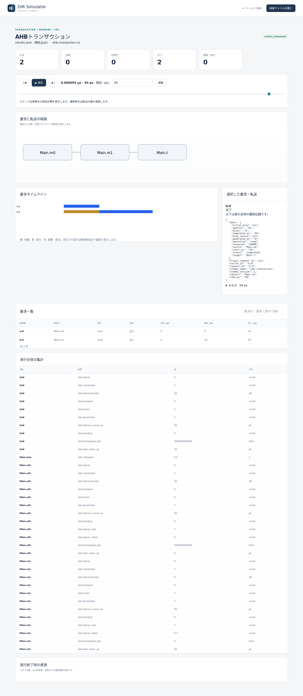
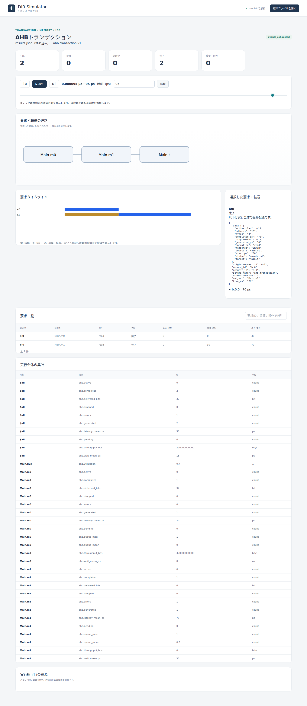
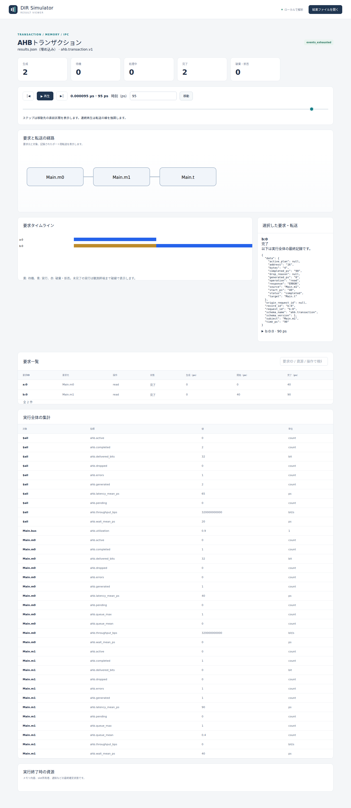

# AHBの応答待ちとERROR完了

文書バージョン：`1.1.1`  
対象GitHubバージョン：`v1.1.4`  
実測ソースcommit：`b45515644dfc65c205216d564d5bf7ef00280622`  
文書ID：`guide-ahb-wait-error`  
文書状態：公開用本文

### 更新履歴

| 文書バージョン | 更新日 | 更新内容 |
| --- | --- | --- |
| `1.1.1` | `2026-10-13` | 第2push。正式v1.1.4の固定checkout・ビルド・PATH手順を追加 |
| `1.1.0` | `2026-10-13` | AHBの応答待ちだけを変える実習・OKAY/ERRORの実CLI・実Viewerを追加 |

## 目的：応答待ちと、バスを使い始めるまでの待ちを区別する

二つの要求元が一つのバスを共有する場面を考えます。m0は正常アドレスを、m1はエラー範囲をreadします。両方を0psに生成し、targetの `wait_cycles` だけを0/1/2へ変えます。応答が遅くなると、今の要求の占有時間だけでなく、後ろの要求が開始するまでの待ちも伸びることを確認します。

確認する要求は、2要求が完了すること、OKAYとERRORを区別すること、応答待ちによる占有・競合待ちの変化を読めることです。ERRORはこのprofileのプロトコル応答です。シミュレータの実行失敗や、要求を受け付けられなかったdropとは別に扱います。

使用する `ahb.transaction.v1` は、単一NONSEQ/SINGLE・32bit full-width相当の要求を扱う抽象モデルです。readでRAMのbyte値を読み返すモデルではありません。複数managerの仲裁と直列化はDIR独自の評価前提であり、AHB-Liteの複数manager構成への適合を示すものではありません。

## 構成と責務：二つのManager・一つのBus・一つのTarget

| 要素 | 責務・固定設定 |
| --- | --- |
| `Main.m0` | 要求元。capacity2。a:0を0psに生成、address0、read4byte |
| `Main.m1` | 要求元。capacity2。b:0を0psに生成、address16、read4byte |
| `Main.bus` | manager path順のround_robinで一件を選び、完了まで占有を保持 |
| `Main.t` | base0、size32。エラー範囲は半開区間[16,20)。wait_cyclesだけ0/1/2へ変更 |
| 実行条件 | clock10ps、終了100ps、集計窓10ps |

capacityは各managerのpending＋activeの上限です。今回は各1要求なので受け付けられます。m0が先に選ばれ、m1はm0の完了後に開始します。active一件を保つため、要求のaddress/data段階は別要求と重なりません。

NEDは4ノードと6本のgate接続です。Managerのrequest→Busの対応suffix→Target、応答はTarget→Bus→対応Managerへ戻ります。NEDが接続、model JSONがclock・対象範囲・応答待ち、workloadが要求、INIが参照先と実行条件を担当します。validateのchannel_count0は独立channelオブジェクト数であり、gate接続がないという意味ではありません。

処理は、0psに生成→manager内で待機→Busを取得→address段階→dataとtargetの応答待ち→OKAYまたはERRORで完了→次のmanager、です。a:0は[0,4)でエラー範囲と交差しません。b:0は[16,20)で、target内にdecodeされたうえでERRORとなります。未decodeのERRORは今回試しません。

## 再現手順：targetのwait_cyclesだけを変える

[AHB実習入力ZIP](downloads/ahb-wait-error-inputs.zip)を展開します。NED1、共通workload1、model3、INI3の8入力です。リポジトリの `examples/guide/ahb-wait-error/` にも同じ入力があります。

正式公開済みの[v1.1.4 Release](https://github.com/hideki-ozu/DIR-Simulator/releases/tag/v1.1.4)のソースからCLIを準備します。以下はGitとrustup/Cargoが導入済みのWSL Ubuntu 24.04 LTS x86_64で確認した手順です。必要なRustは1.85.0で、タグ内のrust-toolchain.tomlが指定します。ビルドの元資料は[正式v1.1.4 READMEのビルド説明](https://github.com/hideki-ozu/DIR-Simulator/blob/v1.1.4/README.md#canサンプルを実行する)です。mainやRelease未公開のタグを、この実習の正式実測版として使いません。

まだ存在しない `DIR-v1.1.4` ディレクトリへ取得し、commitが一致したときだけビルドを進めます。

```bash
git clone --depth 1 --branch v1.1.4 --single-branch https://github.com/hideki-ozu/DIR-Simulator.git DIR-v1.1.4
cd DIR-v1.1.4
test "$(git rev-parse HEAD)" = b45515644dfc65c205216d564d5bf7ef00280622
cargo build --locked --release --target-dir target -p dir-simulator
export PATH="$PWD/target/release:$PATH"
command -v dir-simulator
```

最後に取得先の `target/release/dir-simulator` が表示されることを確認します。PATHの設定はこのシェルの間だけ有効です。同じシェルで次の入力展開先へ移動します。正式タグのソースにはこの新しい8入力実習を同梱していないため、上記のZIPを別途展開してください。

展開先の `examples/guide/ahb-wait-error` で実行します。

```bash
mkdir out
dir-simulator validate --config wait0.ini
dir-simulator run --config wait0.ini --output out/wait0
dir-simulator view --input out/wait0/results.json --output out/wait0-viewer.html
dir-simulator validate --config wait1.ini
dir-simulator run --config wait1.ini --output out/wait1
dir-simulator view --input out/wait1/results.json --output out/wait1-viewer.html
dir-simulator validate --config wait2.ini
dir-simulator run --config wait2.ini --output out/wait2
dir-simulator view --input out/wait2/results.json --output out/wait2-viewer.html
```

既にoutがあれば新しい展開先を使います。JSON差分は `targets[0].wait_cycles` だけ、INI差分はmodelファイル名だけです。要求の時刻・アドレス・4byte、容量、エラー範囲、clock10ps、終了100psは固定します。a:0/b:0はgenerator a/bの0番目の要求です。

## 実測：ERRORも一件の完了として数える

clockをP=10ps、応答待ちをw、開始をgとすると、このprofileのOKAY完了は `g+(2+w)×P` です。addressの1cycleとdataの1cycleにw cycleを足します。decode済みtargetのERRORは同じwaitを適用し、ERROR応答の追加1cycleを含め `g+(3+w)×P` で完了します。

次の値は、正式版CLIを実行して得た記録です。

| wait_cycles | a:0開始→完了（ps） | b:0開始→完了（ps） | b:0の開始待ち（ps） | Bus占有（ps） |
| --- | --- | --- | --- | --- |
| 0 | 0→20、OKAY | 20→50、ERROR | 20 | 50 |
| 1 | 0→30、OKAY | 30→70、ERROR | 30 | 70 |
| 2 | 0→40、OKAY | 40→90、ERROR | 40 | 90 |

waitを1増やすと各要求の占有が10psずつ伸びます。a:0の完了が10ps遅くなるため、b:0の開始も10ps遅くなり、その後の応答待ちも10ps増えてb:0の完了は20psずつ遅くなります。

| wait_cycles | 全体平均の開始待ち（ps） | 全体平均latency（ps） | Bus利用率 | 完了転送量 |
| --- | --- | --- | --- | --- |
| 0 | 10 | 35 | 0.5 | 32bit |
| 1 | 15 | 50 | 0.7 | 32bit |
| 2 | 20 | 65 | 0.9 | 32bit |

`ahb.wait_mean_ps` は `start_ps - generated_ps` の平均です。targetの `wait_cycles` そのものではありません。m0の開始待ちは0、m1は20/30/40psです。latencyは `completed_ps - generated_ps` で、targetの待ちとERROR追加cycleを含みます。利用率の分母は終了100psで、busy50/70/90psを割ります。

全条件でgenerated2・completed2・errors1・dropped0、pending/active0でした。ERRORはcompletedの内数なので、completed2とerrors1を足して3件とは数えません。`ahb.delivered_bits` はOKAY完了だけの4byte×8＝32bitです。ERRORのtransferにもbytes4が記録されますが、成功転送量への加算は0です。$allとmanager別の32/0bitも同じ要求を異なる集計単位で見た値で、重ねて加算しません。

各runはexit_code0、primary_diagnostic=null、partial=false、events_exhausted、終了100ps、残イベント0でした。last_eventは50/70/90psです。ERROR応答を一件処理して正常に実行を終えたことが分かります。

## Viewer：最終記録と選択時刻の表示を区別する

生成HTMLを開き、95psへ移動してb:0を選びます。基本操作は[Viewerで結果を読む](Viewerで結果を読む.md)を参照してください。以下は正式版CLIが生成した実画面です。







95psでは3条件とも生成2・完了2です。選択詳細のb:0は `status=completed`、`response=ERROR`、開始20/30/40、完了50/70/90psです。a:0を選ぶとOKAY、開始0、完了20/30/40psになります。

選択詳細・一覧・実行全体の集計は最終commit記録です。スライダー時刻の観測値として読みません。たとえば5psでは上部counterは待機1・処理中1・完了0ですが、b:0の詳細には最終的なcompletedとERRORが表示されます。これは5psにb:0が既に完了したという意味ではありません。counterとタイムラインの進行を、最終記録の時刻と分けて読みます。

経路図の横並びはNEDの正確な配線図ではありません。m0→m1という直列接続と解釈せず、NEDの接続とtransferのfrom/toを使って、二つのManagerがBusを通じて同じTargetを使う構成を確認します。図の箱で4ノードを数えず、Busの占有はsubjectと `Main.bus` の集計で読みます。

## 制約と仕様への入口

有限2要求、target1個、0ps生成、正常アドレスとdecode済みエラー範囲だけを試しました。容量超過、未decode、target境界またぎ、複数target、clock edge間の生成、途中打切り、連続負荷は未検証です。

データbyte値、RTL、実機性能、pin waveform、address/data pipelineの重なり、burst、SPLIT/RETRY、lockはこのprofileの保証範囲外です。10psは説明用の設定です。SoC調停やNoC配送は別profileとして扱います。

契約は[正式v1.1.4のSoC・AHB・NoC詳細機能仕様（AHB）](https://github.com/hideki-ozu/DIR-Simulator/blob/v1.1.4/docs/specs/models/SoC・AHB・NoC詳細機能仕様書.md#ahb)、DIR-REQ-0190〜0193 / DIR-FUNC-0045に対応します。

[ガイドの入口へ戻る](index.md)
