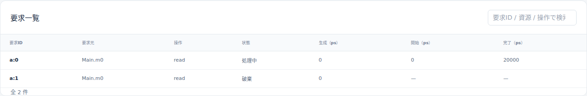
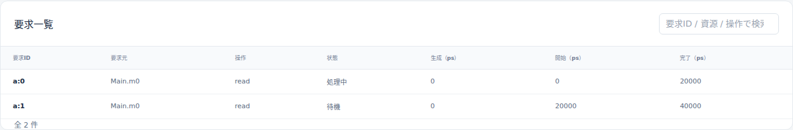
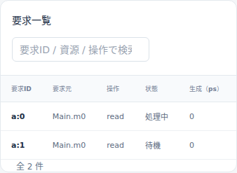

# AXIのoutstanding上限と受理・待機・処理の違い

文書バージョン：`1.2.0`
対象GitHubバージョン：`v1.2.0`
実測ソースcommit：`397900451015c9bca6a33d24feac0a88b9b7b8fe`
文書ID：`guide-axi-outstanding`
文書状態：公開用本文。正式版CLI実測・実Viewer画像付き

本文・画像・実習入力のライセンスは[ガイドのライセンス表示](ガイドのライセンス表示.md)を参照してください。

### 更新履歴

| 文書バージョン | 更新日 | 更新内容 |
| --- | --- | --- |
| `1.2.0` | `2026-10-22` | v1.2.0の対象タグ・文書版を確定。過去の測定基準と公開済み履歴を保持 |
| `1.1.1` | `2026-10-20` | Issue #121：公開済み画像を保持した撮影再検証、単独実習の選択と新規出力先・再試行手順を整合 |
| `1.1.0` | `2026-10-20` | outstanding上限だけを変える2条件の実習、実測・実画面と集計母数を追加 |

## 目的：受け入れられる件数と、同時に処理する件数を分ける

同じ時刻に読み出し要求を2件出したとき、outstanding上限を1から2へ増やすと何が変わるでしょうか。この実習では2件目が「破棄」から「受理して待機」へ変わります。処理は2件同時には進みません。DIRの `axi4.transaction.v1` は、Interconnect全体でactive transactionを一つずつ進める抽象モデルだからです。

CLIと[Viewerの基本操作](Viewerで結果を読む.md)を終えた読者が、生成・受理・待機・処理・完了・破棄を結果から区別することが目的です。書き込みデータやWSTRBの比較は[書き込みストローブと部分更新](AXIの書き込みストローブと部分更新.md)を参照してください。

## 全体構成：誰が要求を作り、枠を使い、処理するか

```text
Generator a → Main.m0 (Manager) → Main.bus (Interconnect) → Main.ram
                                   ↑
                      Main.m1 (要求を生成しないManager)
```

| 部品・入力 | 責務と今回の条件 |
| --- | --- |
| Generator `a` / workload JSON | Main.m0から0psに同じ1beat readを2件生成。IDは `a:0`、`a:1` |
| Main.m0 / model JSON | pendingとactiveを合計したoutstanding枠を管理。上限だけ1→2へ変更 |
| Main.m1 | 構成に残すManager。上限2だが、このworkloadでは要求を生成しない |
| Main.bus | 受理済み要求をgrantし、全Managerを通じて一度に1件を進める |
| Main.ram | base4096（0x1000）、32byte。読み出し先は4096、先頭8byteは0001020304050607、残り00 |
| `models/demo/Main.ned` | 4ノードとgate接続を定義 |
| `capacity.ini` | profile、model/workload参照、50nsの観測上限を指定 |
| `capacity.model.json` | クロック10ns、RAM応答遅延1cycle、全READY=1と容量を指定 |

容量の単位はManagerごとの要求件数です。byte数でも、待機中の件数だけでもありません。生成時に `pending + active` が上限なら、その要求は `dropped / outstanding_full` となります。生成側が空きを待って自動再試行する動作はありません。

受理された要求はpendingへ入り、grantでactiveへ移ります。readではARのアドレスhandshakeを経て、最後のR handshakeでcompletedになり、outstanding枠を解放します。生成、grant、AR、Rは別の出来事です。READYが常に1でも、この入力ではgrant時刻とARの時刻は一致しません。

## 再現手順：max_outstandingだけを1から2へ変える

[実習入力ZIP](downloads/axi-outstanding-inputs.zip)は、条件ごとにINI・model・workload・NEDの4入力、合計8ファイルです。リポジトリの `examples/guide/axi-outstanding/` と同じ内容です。既存の検証fixtureを基礎に作った独立入力で、元fixtureを変更しません。

新しい作業フォルダで[正式v1.1.6](https://github.com/hideki-ozu/DIR-Simulator/releases/tag/v1.1.6)を取得し、固定commitを確認してビルドします。Rust 1.85.0を使います。基本環境は[設定・用語・FAQ](設定・用語・FAQ.md)を参照してください。

```bash
git clone --branch v1.1.6 --depth 1 https://github.com/hideki-ozu/DIR-Simulator.git
cd DIR-Simulator
git rev-parse HEAD
# 397900451015c9bca6a33d24feac0a88b9b7b8fe
cargo build --locked --release -p dir-simulator
```

この新しい記事・実習入力はv1.1.6のソースには含まれません。ダウンロードしたZIPをこのルートへ置き、展開してから実行します。出力先は未使用名にしてください。

```bash
python3 -m zipfile -e axi-outstanding-inputs.zip .
mkdir results-axi-outstanding
for condition in capacity-1 capacity-2; do
  ./target/release/dir-simulator validate \
    --config examples/guide/axi-outstanding/$condition/capacity.ini
  ./target/release/dir-simulator run \
    --config examples/guide/axi-outstanding/$condition/capacity.ini \
    --output results-axi-outstanding/$condition
  ./target/release/dir-simulator view \
    --input results-axi-outstanding/$condition/results.json \
    --output results-axi-outstanding/$condition-viewer.html
done
```

両条件のディレクトリ全体を照合し、意味上の差が `capacity.model.json` の `managers` 配列内、`node=Main.m0` の `max_outstanding` だけであることを検査しました。INI、NED、workload、Main.m1、RAM、READY、終了時刻は同じです。validate/run/viewはすべて終了コード0でした。validateのchannel_count=0は独立したNED channelオブジェクト数であり、gate接続がない意味ではありません。

## 予測と実測：2件目を受理しても、最初の完了を待つ

実行前の予測は「容量1ではa:1が生成時drop、容量2ではa:1が待機し、a:0完了後にgrant」です。以下は今回の正式版CLIで得た新規実測で、予測と一致しました。単位はns（1ns=1000ps）、`—` は実績がないnullです。

| 上限 | 要求ID | 生成 | grant | AR | R・完了 | 最終状態 | 予測との照合 |
| --- | --- | ---: | ---: | ---: | ---: | --- | --- |
| 1 | a:0 | 0 | 0 | 10 | 20 | completed / OKAY | 一致 |
| 1 | a:1 | 0 | — | — | — | dropped / outstanding_full | 一致 |
| 2 | a:0 | 0 | 0 | 10 | 20 | completed / OKAY | 一致 |
| 2 | a:1 | 0 | 20 | 30 | 40 | completed / OKAY | 一致 |

完了したreadはすべて `read_data=["00010203"]` でした。上限2のactive区間はa:0が0〜20ns、a:1が20〜40nsで、重なりません。10nsではa:0がactive、a:1がpendingです。30nsではa:0がcompleted、a:1がactiveです。上限1のa:1は、いずれの時点でもdropのままです。

### 件数と平均は、targetと母数を合わせて読む

次の表は `target=Main.m0`、共通観測区間 `[0, 50000ps]` のsummaryです。Main.busや `$all` の同名指標を足しません。

| Main.m0の指標 | 上限1 | 上限2 |
| --- | ---: | ---: |
| generated | 2 | 2 |
| completed / dropped | 1 / 1 | 2 / 0 |
| 終了時pending / active | 0 / 0 | 0 / 0 |
| outstanding_max / outstanding_mean | 1 / 0.4 | 2 / 1.2 |
| queue_max / queue_mean | 1 / 0 | 2 / 0.4 |
| wait_mean_ps（sample_count） | 0（1） | 10000（2） |
| latency_mean_ps（sample_count） | 20000（1） | 30000（2） |

保存則は上限1が `2=1+1+0+0`、上限2が `2=2+0+0+0`、すなわち `generated=completed+dropped+pending+active` です。waitは生成からgrant、latencyは生成から完了までを測ります。今回、grantと完了の標本はいずれも1件/2件です。dropしたa:1を「待ち時間0」の標本として平均に混ぜません。上限2の平均待ち10ns・平均latency30nsには、失わずに処理した2件目も入っています。

queueはpendingだけです。0psの生成・調停の途中に一時的にpendingが1件/2件となるため、queue_maxには1/2が記録されます。上限1のその滞在時間は0なのでqueue_meanは0です。10nsのViewerで見えるpending0/1と、実行全体のqueue_max1/2は別の値です。outstanding_meanは上限1が `20/50=0.4`、上限2が `(2×20+1×20)/50=1.2` となります。

Main.busの `axi.bus_utilization` は0.4/0.8、`axi.read_bits` は32/64、written_bitsは両条件0です。利用率の分母は同じ50nsです。処理した件数が増えたため占有時間が20nsから40nsへ伸びた結果で、並列度が2になった値ではありません。両条件ともevents_exhausted、pending_events=0、partial=falseでした。

## Viewer：同じ10nsで破棄と待機を見る

各HTMLを開き、「時刻（ps）」を10000へ移します。以下は正式CLIで生成した実Viewerの要求一覧を直接撮影した画像です。同じ条件・時刻についてdesktopと狭幅の表示を載せています。








状態列と上部件数はcursor時点です。開始・完了の時刻列や選択要求の詳細は実行全体の記録を含みます。10nsの画像でa:1の開始20000ps・完了40000psが見えても、その時点で処理済みという意味ではありません。狭幅では表を横スクロールして時刻列を読みます。

続いて30000psへ移し、a:1がactiveになったことを確認します。a:0/a:1の詳細とAR/R記録を上の要求別表へ照合してください。撮影検証では10nsと30nsを往復し、巻戻しても同じ状態へ戻ることを確認しました。

## 証跡と再検証

2026-10-20にWSL2 Ubuntu 24.04.4 LTS x86_64・Rust 1.85.0上で、正式v1.1.6のclean sourceをlocked release buildしました。同一binaryでリポジトリ入力とZIPを別の新規展開先から実行し、論理simulationの一致も確認しました。

[計測・予測照合](https://github.com/hideki-ozu/DIR-Simulator/blob/main/docs/verification/results/axi-outstanding/measurements.json)、[Viewer撮影・巻戻し記録](https://github.com/hideki-ozu/DIR-Simulator/blob/main/docs/verification/results/axi-outstanding/viewer-browser.json)、[成果物SHA-256台帳](https://github.com/hideki-ozu/DIR-Simulator/blob/main/docs/verification/results/axi-outstanding/artifact-ledger.json)にsource/binary/input/results/HTML/画像の来歴を保存しています。同フォルダの `repository/capacity-1/result/`、`repository/capacity-2/result/` に生のresults.json・summary.csv・manifestがあり、`zip/` に独立展開後の結果があります。JSONの `simulation.model_records` 内の `axi.transaction` / `axi.handshake` と、summaryのtarget・sample_count・区間を照合できます。

入力・数値検証の補助スクリプトは本記事と同じ更新版のリポジトリにあります。正式v1.1.6のbinaryを指定し、未使用の証跡出力先で実行します。`--only` でこの実習だけを再検証します。

`/path/to/formal-source` は、ZIPを展開していない別のcleanな正式版checkoutを指定します。

```bash
python3 scripts/build_guide_inputs.py --check
python3 scripts/verify_guide_capacity_comparisons.py \
  --binary /path/to/dir-simulator --source-root /path/to/formal-source \
  --only axi-outstanding --output /path/to/new-evidence
python3 scripts/check_guide_capacity_measurements.py /path/to/new-evidence --only axi-outstanding
NODE_PATH=/path/to/browser-tools/node_modules \
  node scripts/verify_capacity_comparisons_viewer.cjs /path/to/new-evidence \
  --only axi-outstanding --output /path/to/new-captures
```

独立検査は要求別時刻、active区間の非重複、保存則、標本数、CSVとの一致を確認します。実ViewerはChromiumでdesktop1440×1000・狭幅390×844を確認し、外部通信・ページエラーは0でした。

撮影コマンドにはPlaywrightとChromiumが必要です。`/path/to/browser-tools/node_modules` はPlaywrightを導入したnode_modulesへ置き換えます。計測・数値照合・撮影はいずれも `--only axi-outstanding` を指定しており、この実習の証跡だけを読みます。

`/path/to/new-captures` は未使用の撮影出力先です。生成される `capture-summary.json` から `axi-outstanding/viewer-browser.json` を辿れ、実PNGは `axi-outstanding/images/` に保存されます。各reportは自身のdirectoryを基準に、実際に読んだ計測JSON・results.json・manifest・Viewer HTMLと撮影PNGのpath/hash、条件・cursor・viewportを記録します。元の計測成果物と記事収録済みのPNG・台帳は変更しません。

同じ撮影出力先を再指定すると、既存出力を変更せず拒否します。同じ計測証跡をもう一度撮影する場合は、`--output /path/to/new-captures-2` のように別の未使用先を指定します。`--output` を省略した既定値は `/path/to/new-evidence/viewer-captures` です。全4実習を一度に検証する場合は、新しい証跡rootを指定し、上の計測・数値照合・撮影の3コマンドすべてから `--only axi-outstanding` を外します。

公開済みPNGを残した状態での全4実習・AXI単独・Gateway単独の再実行、同じ出力先の拒否、別の出力先での再撮影、元成果物の不変性は[撮影再実行の検証記録](https://github.com/hideki-ozu/DIR-Simulator/blob/main/docs/verification/results/issue-121-capture-workflow/acceptance.json)に保存しています。

## 対象範囲と次に読む資料

単一の生成Manager、同時刻の正常read2件、1beat、固定READYだけの比較です。READY backpressure、error、複数Managerの競合、同時刻の完了と再生成、途中打切り、自動再送は検証していません。AXI規格全体の独立チャネル並列、複数ID、out-of-order、RTL・実機性能・電気特性を保証するものではありません。

outstandingと計測の契約は[SoC・メモリ・IPCリファレンス](reference/SoC・メモリ・IPCの機能・動作仕様.md)と[AXIモデル詳細機能仕様書](https://github.com/hideki-ozu/DIR-Simulator/blob/main/docs/specs/models/AXIモデル詳細機能仕様書.md)を参照してください。[ガイドの入口](index.md)から別の実習へ進めます。
