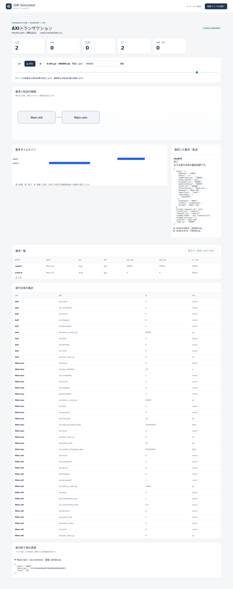

# AXIの書き込みストローブと部分更新

文書バージョン：`1.2.0`
対象GitHubバージョン：`v1.2.0`
実測ソースcommit：`b45515644dfc65c205216d564d5bf7ef00280622`  
文書ID：`guide-axi-strobes`  
文書状態：公開用本文

### 更新履歴

| 文書バージョン | 更新日 | 更新内容 |
| --- | --- | --- |
| `1.2.0` | `2026-10-22` | v1.2.0の対象タグ・文書版を確定。過去の測定基準と公開済み履歴を保持 |
| `1.1.1` | `2026-10-20` | Issue #116〜#119の正式v1.1.6実測記事への相互参照を追加し、既存実習との比較範囲を明示 |
| `1.1.0` | `2026-10-12` | WSTRBだけを変える部分更新の実習・実CLI・実Viewerを追加 |

## 目的：OKAYで完了しても、全バイト更新とは限らない

4バイトの値のうち、一部だけを書き換えたい場面を考えます。AXIの書き込みストローブWSTRBは、書き込みデータのどのバイトを有効にするかを指定します。この実習は同じ `11223344` を同じアドレスへ書き、WSTRBだけを0/5/15へ変えて読み返します。

要求は、指定したバイトだけが更新されること、無効にしたバイトは初期値を保つこと、応答OKAYとRAM内容を別々に確認することです。使用する `axi4.transaction.v1` は32bit・単一クロックの抽象モデルです。数値は仕組みを読むための設定で、実機性能やRTL適合を表しません。

## 構成と責務：Manager・Interconnect・RAM

| 要素 | 責務・固定設定 |
| --- | --- |
| `Main.m0` | Manager。writeと確認用readを発行、最大outstanding2、B/RのREADYは常に1 |
| `Main.bus` | Interconnect。ManagerとRAMの5チャネルを対応付け、全体でactive transaction一件を進める |
| `Main.ram` | base4096（0x1000）、16バイト。先頭8バイト初期値0001020304050607、残りは00 |
| 共通クロック | 10ns周期。RAMのAW/W/AR READYは常に1、read/B応答のlatencyは1cycle |

NEDは3ノードと10本のgate接続を定義します。model JSONが時間・RAM範囲・初期値、workloadが要求、INIがprofileと終了100nsを指定します。NEDのscalar gateは向きとsuffixを揃えて接続します。

| チャネル | 向き・役割 |
| --- | --- |
| AW | Manager→Interconnect→RAM：書き込みアドレス |
| W | 同じ向き：書き込みデータ、WSTRB、最終beatのWLAST |
| B | RAM→Interconnect→Manager：書き込み応答 |
| AR | Manager→Interconnect→RAM：読み出しアドレス |
| R | RAM→Interconnect→Manager：読み出しデータ・応答・RLAST |

このprofileのInterconnectは同じclockの透明なend-to-end経路です。2hopの遅延やhandshakeを二重に加算しません。validateはnode_count3・channel_count0を返しますが、0は独立したNED channelオブジェクトの数です。gate接続がないという意味ではありません。

writeを0ns、readを50nsに発生させます。先行writeのB応答が30nsに終わってから読むため、途中の書き換えとの競合を避け、ストローブの違いに絞れます。

## 再現手順：write_strobesの一つの値だけを変える

[AXI実習入力ZIP](downloads/axi-strobes-inputs.zip)を展開します。NED1、共通model1、workload3、INI3の8入力です。リポジトリでは `examples/guide/axi-strobes/` に同じ入力があります。

公開済み[v1.1.4 Release](https://github.com/hideki-ozu/DIR-Simulator/releases/tag/v1.1.4)のソースでビルドした `dir-simulator` をPATHへ置き、展開先の `examples/guide/axi-strobes` で実行します。基本のビルドは[設定・用語・FAQ](設定・用語・FAQ.md)を参照してください。mainやRelease未公開の別タグを、この実測の正式版として扱いません。

```bash
mkdir out
dir-simulator validate --config strobe0.ini
dir-simulator run --config strobe0.ini --output out/strobe0
dir-simulator view --input out/strobe0/results.json --output out/strobe0-viewer.html
dir-simulator validate --config strobe5.ini
dir-simulator run --config strobe5.ini --output out/strobe5
dir-simulator view --input out/strobe5/results.json --output out/strobe5-viewer.html
dir-simulator validate --config strobe15.ini
dir-simulator run --config strobe15.ini --output out/strobe15
dir-simulator view --input out/strobe15/results.json --output out/strobe15-viewer.html
```

既にoutがあれば新しい展開先を使います。INIの差分はworkloadファイル名だけ、JSONの差分は `generators[0].transaction.write_strobes[0]` だけです。write_dataは全条件 `11223344`、beatsは1、readやRAM設定は同じです。

## 実測：WSTRBのbitとアドレスを対応付ける

この入力の8桁hexは昇順アドレスの4バイトです。`11223344` は0x1000から11・22・33・44を表します。32bit数値としては0x44332211です。WSTRBのbit jがそのj番目バイトを有効にします。

| WSTRB（整数） | bit3..0 | 更新するアドレス | read_data |
| --- | --- | --- | --- |
| 0 | 0000 | なし | 00010203 |
| 5 | 0101 | 0x1000・0x1002 | 11013303 |
| 15 | 1111 | 0x1000〜0x1003 | 11223344 |

5ではbyte0を11、byte2を33に変え、byte1の01とbyte3の03を保持します。0でもW beatを転送し、BでOKAY応答を受けます。RAMが変わらないことと、transactionが進まなかったことを混同しません。

| handshake | 実時刻（ns） | 役割 |
| --- | --- | --- |
| AW | 10 | 書き込みアドレス受理 |
| W | 20 | 1 beatを受理し、有効byteをcommit |
| B | 30 | write:0がOKAYで完了 |
| AR | 60 | 確認用読み出しアドレス受理 |
| R | 70 | read:0がOKAY・RLASTで完了 |

時刻は全条件で同一です。Wの `valid_since_ps=10000`、実handshakeは20000psです。RAMのW受理はAW受理の次edge以後なので、READY設定が常に1でもAWとWを同じedgeで受理しません。待ちが生じてもWSTRBによる時間差ではありません。

Interconnectの `axi.written_bits` は0/16/32、`axi.read_bits` は全条件32です。`axi.bus_utilization=0.5` も共通です。write占有0〜30nsとread占有50〜70nsの合計50nsを、終了100nsで割った値です。全条件でgenerated2・completed2・okay2、dropped/SLVERR/DECERRは0、events_exhausted・partial=false・残イベント0でした。

## Viewer：90nsで読み返した値とRAMを照合する

生成HTMLを開き、時刻欄へ90000ps（90ns）を入力して移動し、`read:0` を選びます。[Viewerで結果を読む](Viewerで結果を読む.md)の基本操作を使います。以下は正式版CLIから生成した実画面です。

経路図はManagerとRAMの端点を表示します。NEDに配置したInterconnectは詳細の `interconnect=Main.bus` と集計のMain.bus行で確認します。図の箱の数だけで構成ノード数を判断しません。




全画面は生成2・完了2です。選択したreadのresponseはOKAY、completed_psは70000、read_dataだけが条件ごとに異なります。「実行終了時の資源」を展開してRAMの先頭4バイトと一致することを確認します。先頭4バイト以外は全条件共通の `04050607` と残り00です。資源欄は保存された終了時状態で、過去時刻のRAM snapshotとしては扱いません。

## 制約と仕様への入口

Manager1個・1 beatの整列INCR・正常アドレス・固定READYだけです。複数Manager、容量超過、READY pattern変更、複数beat、4KiB境界違反、SLVERR/DECERR、途中打切りは試していません。ID=0、global直列という初期profileの範囲で、独立チャネル並列・out-of-order・narrow/unaligned・FIXED/WRAP・RTLや電気的なAXI適合を保証しません。

契約は[正式v1.1.4のAXIモデル詳細機能仕様（RAM・データ・応答）](https://github.com/hideki-ozu/DIR-Simulator/blob/v1.1.4/docs/specs/models/AXIモデル詳細機能仕様書.md#memory)に対応します。構成・五チャネル・byte・応答を合わせ、DIR-REQ-0133〜0144 / DIR-FUNC-0031〜0033の適用範囲を確認します。

[ガイドの入口へ戻る](index.md)

## 関連する実習

[AXIのoutstanding上限と受理・待機・処理の違い](<AXIのoutstanding上限と受理・待機・処理の違い.md>)では、outstanding上限だけを変え、drop・FIFO待機と一要求ずつの処理を区別します
