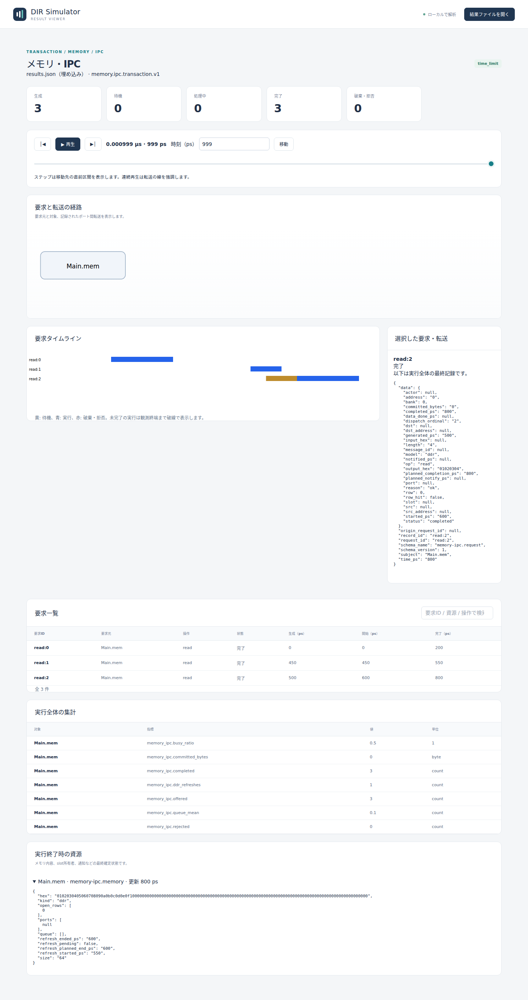
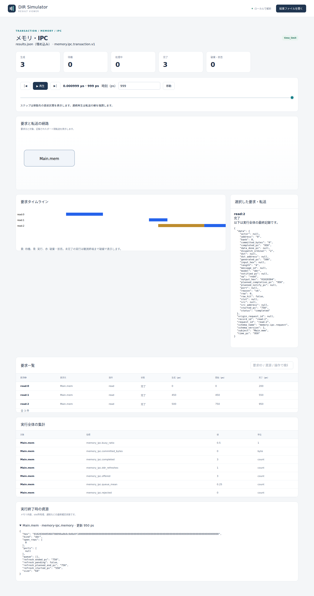

# DDRのリフレッシュと読み出し待ち

文書バージョン：`1.1.1`  
対象GitHubバージョン：`v1.1.4`  
実測ソースcommit：`b45515644dfc65c205216d564d5bf7ef00280622`  
文書ID：`guide-ddr-refresh`  
文書状態：公開用本文

### 更新履歴

| 文書バージョン | 更新日 | 更新内容 |
| --- | --- | --- |
| `1.1.1` | `2026-10-11` | 第2push。対象版を規定のタグ単独行にし、実測ソースcommitを別行へ移して生成一覧との整合を修正 |
| `1.1.0` | `2026-10-11` | DDRのリフレッシュ時間だけを変える実習・実CLI・実Viewerを追加 |

## 目的：同じ読み出しが待つ理由を確かめる

DDRの読み出しでは、要求自体の処理時間に加えて、リフレッシュが終わるまでの待ちが生じます。この実習は同じアドレスから同じ4バイトを3回読み、リフレッシュ時間 `refresh_ps` だけを50/100/200psへ変えます。

確認する要求は、3回とも `01020304` を返すこと、途中の読み出しをリフレッシュが中断しないこと、次の読み出し開始がリフレッシュ終了まで待つことです。全条件を同じ1000psまで実行します。数値は抽象モデルの仕組みを見やすくする設定で、実機DDRの性能値ではありません。

## 構成と責務：一つのDDR、行の状態、待機列

| 要素 | 責務・設定 |
| --- | --- |
| `Main.mem` | 64バイトのDDR。bank1、行16バイト×4行、転送幅4バイト |
| 行の状態 | 最初は閉行。開く時間100ps、閉じる時間100ps。同じ開行の読み出しはopen待ちを省く |
| 読み出しサービス | column50ps＋1 beat50ps。同じ行hitなら100ps、閉行ならopen100psを足して200ps |
| リフレッシュ | 初回予定500ps、実行時間だけ50/100/200ps。開始時に全開行をリセットする |
| 操作待機列 | 容量4、FIFO。DDR全体で同時に処理する通常要求は一つ |

NEDは `dir.memory.DdrV1` の要素一つを配置します。このtransaction profileでは、要求を対象リソースへ届ける調整機構を使うためNEDの配線は不要です。JSONはメモリ形状・初期値・時間定数、INIはprofileと終了時刻、workloadは読み出し要求の発生を担当します。

同じアドレス0・長さ4の要求を0/450/500psに発生させます。要求IDは `read:0`〜`read:2` です。要求は一行の範囲内に収まり、fault範囲はありません。リフレッシュの予定到達時に実行中の要求があれば、その完了を待ち、新しい要求の開始よりリフレッシュを優先します。待機列は保持し、データ自体は変更しません。

## 再現手順：refresh_psだけを変える

[DDR実習入力ZIP](downloads/ddr-refresh-inputs.zip)を展開します。NED1、workload1、INI3、JSON3の8ファイルを含みます。リポジトリでは `examples/guide/ddr-refresh/` に同じ入力があります。

実測の基準は公開済み[v1.1.4 Release](https://github.com/hideki-ozu/DIR-Simulator/releases/tag/v1.1.4)です。そのソースからビルドした `dir-simulator` をPATHへ置き、展開先の `examples/guide/ddr-refresh` で次を実行します。ビルドの基本は[設定・用語・FAQ](設定・用語・FAQ.md)を参照してください。正式タグと、その後のmainを区別します。

```bash
mkdir out
dir-simulator validate --config refresh50.ini
dir-simulator run --config refresh50.ini --output out/refresh50
dir-simulator view --input out/refresh50/results.json --output out/refresh50-viewer.html
dir-simulator validate --config refresh100.ini
dir-simulator run --config refresh100.ini --output out/refresh100
dir-simulator view --input out/refresh100/results.json --output out/refresh100-viewer.html
dir-simulator validate --config refresh200.ini
dir-simulator run --config refresh200.ini --output out/refresh200
dir-simulator view --input out/refresh200/results.json --output out/refresh200-viewer.html
```

既に `out` があれば新しい展開先で試します。INIの差分は対応JSONのファイル名だけ、JSONの差分は `ddr[0].refresh_ps` だけです。初期値・読み出し時刻・行サイズ・処理時間・リフレッシュ間隔500ps・終了時刻は固定します。

## 実測：予定500psでも、開始は550ps

1回目は閉行なので0→200psで完了します。2回目は同じ行hitで450→550psです。予定500psのリフレッシュはこの2回目を中断せず、550psの完了を待って始まります。500psに発生した3回目は待機します。

| refresh_ps | 実refresh開始→終了（ps） | read:2開始→完了（ps） | read:2の待ち（ps） | 読み出し値 |
| --- | --- | --- | --- | --- |
| 50 | 550→600 | 600→800 | 100 | 01020304 |
| 100 | 550→650 | 650→850 | 150 | 01020304 |
| 200 | 550→750 | 750→950 | 250 | 01020304 |

待ち時間は `started_ps - generated_ps` です。3回目では「先行読み出しが終わるまでの50ps」と「リフレッシュ時間」を足した値になります。サービス時間は全条件で200psです。同じ行へのアクセスでも `row_hit=false` なのは、リフレッシュ開始時に開行状態がリセットされ、再びopen100psが必要だからです。

最終的な要求3件はすべて `completed/ok`、拒否0、実行したrefreshは1回で、全読み出し値は同じでした。メモリ内容も初期値のままです。終了は全条件 `time_limit`、`partial=false`、残イベント1です。周期的refreshの次回予定は、仕様の「実開始＋間隔」に従って550＋500＝1050psとなり、今回の終了範囲 `[0,1000)` の外です。残イベント1を、未完了の読み出し1件と解釈しません。

## 指標：busyだけではリフレッシュ待ちが分からない

| refresh_ps | memory_ipc.busy_ratio | memory_ipc.queue_mean |
| --- | --- | --- |
| 50 | 0.5 | 0.1 |
| 100 | 0.5 | 0.15 |
| 200 | 0.5 | 0.25 |

今回のbusy_ratioは通常要求のサービス占有を表し、refresh時間を含みません。サービス合計は200＋100＋200＝500psで固定なので0.5です。リフレッシュ中に要求が開始できないことは、開始時刻・refresh実績・queue_meanと合わせて読みます。busy_ratioが同じでも、読み出し応答は同じではありません。

## Viewer：999psで3回目の要求とrefresh実績を読む

生成したHTMLをブラウザで開き、時刻999psへ移動し、`read:2` を選びます。[Viewerで結果を読む](Viewerで結果を読む.md)の基本操作を使います。以下は正式版CLIから生成した実画面です。






全画面で生成3・完了3です。詳細の `generated_ps=500`、`started_ps`、`completed_ps`、`row_hit=false`、`output_hex=01020304` を照合します。「実行終了時の資源」を展開すると `refresh_started_ps=550` と条件ごとの `refresh_ended_ps` が読めます。この資源欄は保存された終了時の状態です。過去時刻へ戻したときのメモリsnapshotとしては扱いません。

## 制約と仕様への入口

これは1 bankの同じ行を読む正常系だけです。書き込み、行を跨ぐ要求の拒否、別行・別bank、fault、容量超過、DMAとの競合、refresh途中の打切りは試していません。実装の通常サービスは全bank共通の一つの資源で、bank並列実行・JEDEC command/timing網羅・メモリコントローラの実機性能を保証しません。CPU cache/fence・AXI・OSドライバもこの入力にはありません。

実装済みの契約は[正式v1.1.4のメモリ・IPC詳細機能仕様（DDR）](https://github.com/hideki-ozu/DIR-Simulator/blob/v1.1.4/docs/specs/models/メモリ・IPC詳細機能仕様書.md#ddr)の `DIR-REQ-0198`〜`DIR-REQ-0201` / `DIR-FUNC-0047` に対応します。

[ガイドの入口へ戻る](index.md) · [SRAMのポート数と読み出し待ち時間](SRAMのポート数と読み出し待ち時間.md)
