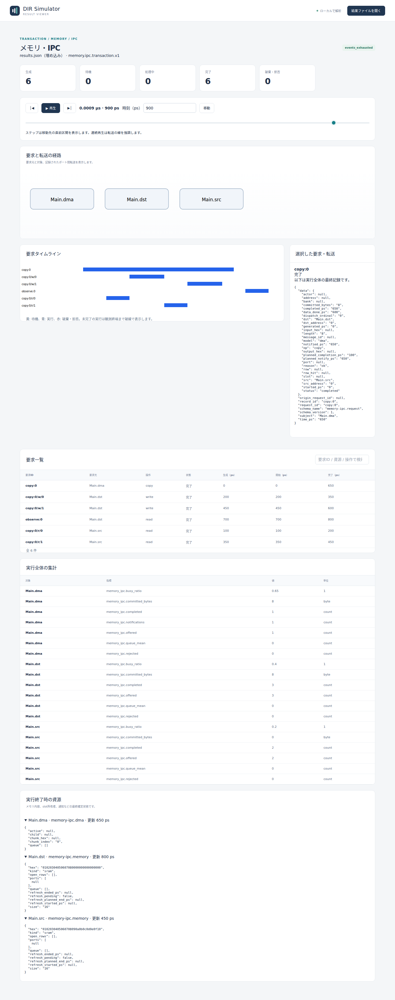
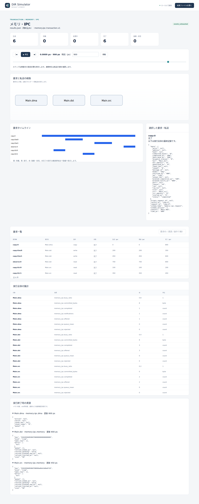
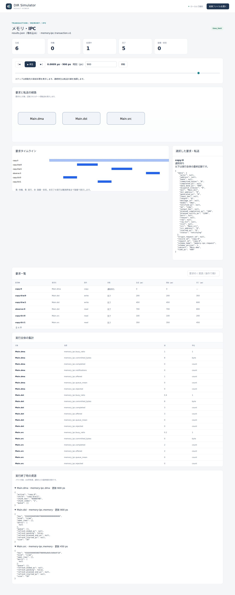

# DMAのコピー完了と通知待ち

文書バージョン：`1.2.0`
対象GitHubバージョン：`v1.2.0`
測定基準：`v1.1.4`（`b45515644dfc65c205216d564d5bf7ef00280622`）
文書ID：`guide-dma-notification`  
公開状態：公開用本文

### 更新履歴

| 文書バージョン | 更新日 | 更新内容 |
| --- | --- | --- |
| `1.2.0` | `2026-10-22` | v1.2.0の対象タグ・文書版を確定。過去の測定基準と公開済み履歴を保持 |
| `1.1.0` | `2026-10-11` | DMAの書き込み完了と通知待ちを1変数・実CLI・実Viewerで比較 |

## 目的：バッファに届いたデータと要求の完了を分ける

DMAは、コピー元からデータを読み、コピー先へ書くエンジンです。この実習では8バイトをコピーし、「データが書かれた時刻」と「DMA要求が通知まで終わった時刻」を区別します。通知時間だけを50/200/600psに変え、同じデータでも要求の終了状態が変わることを確かめます。

要求は、コピー先に `0102030405060708` が届くこと、書き込み完了時刻が変わらないこと、通知待ちを完了と取り違えないことです。モデルは `memory.ipc.transaction.v1`。数値は仕組みを読みやすくする抽象的な設定で、実機の性能値ではありません。

## 構成と責務：コピー元・コピー先・DMA

| 要素 | 役割 | 固定する設定 |
| --- | --- | --- |
| `Main.src` | 初期データを持つSRAM | 16バイト、1ポート、読み100ps、書き150ps |
| `Main.dst` | コピー先のSRAM | 16バイト、初期値ゼロ、同じ処理時間 |
| `Main.dma` | 読み→書きを4バイトずつ順に発行 | setup100ps、chunk4バイト、コピー長8バイト |

NEDは3要素の存在とモデルクラスを定義します。このprofileの操作はtransactionの調整機構が対象リソースへ届けるため、NEDの配線は不要です。JSONがメモリ容量・初期値・処理時間を、INIが実行終了時刻1000psを、workloadがコピー要求と確認用の読み出し要求を指定します。

DMAの子要求はSRAMの通常の読み書きを使います。コピー全体を一度に原子的に書き換えるモデルではありません。今回の4子要求はすべて成功します。最後の書き込みが終わると `data_done_ps` が記録され、その後 `notify_ps` を待って親要求が完了します。通知待ちの間もDMAエンジンは使用中です。

700psにコピー先を8バイト読み出す要求を入れます。これはモデル上のデータを確認する観測用です。実際のCPU・ドライバが通知前にアクセスしてよいという同期規約を表していません。

## 再現手順：通知時間だけを変える

[独立した実習入力ZIP](downloads/dma-notification-inputs.zip)を展開します。ZIPには `examples/guide/dma-notification/` 以下の8ファイルだけが入っています。リポジトリを使う場合も同じ場所に入力があります。

正式版[v1.1.4 Release](https://github.com/hideki-ozu/DIR-Simulator/releases/tag/v1.1.4)のソースでビルドした `dir-simulator` をPATHへ置き、展開先の `examples/guide/dma-notification` で実行してください。ビルドの基本は[設定・用語・FAQ](設定・用語・FAQ.md)から確認できます。

```bash
mkdir out
dir-simulator validate --config notify50.ini
dir-simulator run --config notify50.ini --output out/notify50
dir-simulator view --input out/notify50/results.json --output out/notify50-viewer.html
dir-simulator validate --config notify200.ini
dir-simulator run --config notify200.ini --output out/notify200
dir-simulator view --input out/notify200/results.json --output out/notify200-viewer.html
dir-simulator validate --config notify600.ini
dir-simulator run --config notify600.ini --output out/notify600
dir-simulator view --input out/notify600/results.json --output out/notify600-viewer.html
```

既に `out` がある場合は新しい展開先を使います。各INIは対応するJSONを指定する部分だけが異なり、JSONの差分は `dma[0].notify_ps` だけです。初期データ、要求時刻、SRAM処理時間、終了時刻はすべて共通です。

## 実測：データは600ps、通知は650/800/1200ps

| 要求 | 開始→完了（ps） | 内容 |
| --- | --- | --- |
| `copy:0/r/0` | 100→200 | 元のアドレス0から4バイト読む |
| `copy:0/w/0` | 200→350 | 先のアドレス0に `01020304` を書く |
| `copy:0/r/1` | 350→450 | 元のアドレス4から4バイト読む |
| `copy:0/w/1` | 450→600 | 先のアドレス4に `05060708` を書く |
| `observe:0` | 700→800 | 先のアドレス0から8バイト読む |

全条件の確認用読み出しは `0102030405060708` を返しました。子要求の `origin_request_id` は `copy:0` です。親の `planned_completion_ps=100` はsetupの予定時刻で、コピー全体の完了時刻には使えません。データは `data_done_ps`、通知は `planned_notify_ps` と実績の `notified_ps` を読みます。

| notify_ps | data_done_ps | planned_notify_ps | notified_ps / completed_ps | 終了時の親status | 終了理由 / 残イベント |
| --- | --- | --- | --- | --- | --- |
| 50 | 600 | 650 | 650 / 650 | completed | events_exhausted / 0 |
| 200 | 600 | 800 | 800 / 800 | completed | events_exhausted / 0 |
| 600 | 600 | 1200 | null / null | notifying | time_limit / 1 |

終了時刻は全条件1000psです。600ps条件は通知予定1200psが終了範囲 `[0,1000)` の外にあるため、通知が実行されていません。通常の時間制限終了で、エラー時の部分結果ではありません（`partial=false`）。Viewerで先の予定時刻を表示しても、保存されていない通知実績は増えません。

SRAMの要求列と最終バイト列は全条件で一致します。コピー先の16バイトは `01020304050607080000000000000000` です。DMAの `completed/notifications` は1/1、1/1、0/0、memory_ipc.busy_ratioは0.65、0.8、1.0でした。コピー先のcommitted_bytesとDMAのcommitted_bytesはともに8ですが、同じ転送を各リソースの視点で数えています。足して16バイトのコピーとは解釈しません。

## Viewer：900psで親要求と保存データを照合する

生成したHTMLをブラウザで開き、時刻を900psへ移動し、要求 `copy:0` を選びます。操作の基本は[Viewerで結果を読む](Viewerで結果を読む.md)を参照してください。以下は実際に生成したViewerの画面です。



50ps条件では6要求すべて完了しています。内訳は親1、子4、確認用読み出し1です。



200ps条件も6要求完了ですが、親の通知時刻は800psです。子の書き込み時刻は変わりません。



600ps条件はactive1・completed5です。詳細に `data_done_ps=600`、`committed_bytes=8`、`planned_notify_ps=1200`、`notified_ps=null` が並びます。リソース欄のDMAは親を保持しています。そこに残る最後の子ID `copy:0/w/1` は600psに完了済みで、その子がまだ処理中という意味ではありません。

## 制約と仕様への入口

この実習はSRAM2個とDMA1個の正常コピーだけです。DDRの行境界・refresh、競合する直接アクセス、複数DMA、途中のfaultや満杯、同一メモリの重複範囲は試していません。一般には子要求失敗までに書いたデータが残るため、コピー全体の原子性は保証されません。キャッシュ整合性、CPU・AXI・OS割り込みの配線や実機ドライバの同期も扱いません。

実装済みの境界は[正式v1.1.4のメモリ・IPC詳細機能仕様（DMA）](https://github.com/hideki-ozu/DIR-Simulator/blob/v1.1.4/docs/specs/models/メモリ・IPC詳細機能仕様書.md#dma)の `DIR-REQ-0210`〜`DIR-REQ-0213` / `DIR-FUNC-0050` に対応します。通知はこのtransactionモデルの完了段階です。未採用のViewer新機能は使用していません。

[ガイドの入口へ戻る](index.md) · [SRAMのポート数と読み出し待ち時間](SRAMのポート数と読み出し待ち時間.md)
