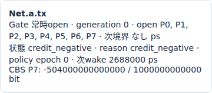
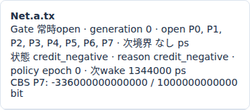
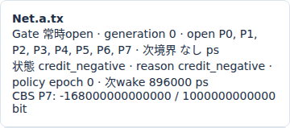

# Ethernet CBSのcredit回復と送信待ち

文書バージョン：`1.2.0`
対象GitHubバージョン：`v1.2.0`
文書ID：`guide-ethernet-cbs-credit`
文書状態：公開用完成稿

### 更新履歴

| 文書バージョン | 更新日 | 更新内容 |
| --- | --- | --- |
| `1.2.0` | `2026-10-22` | v1.2.0の対象タグ・文書版を確定。過去の測定基準と公開済み履歴を保持 |
| `1.1.1` | `2026-10-20` | Issue #116〜#119の正式v1.1.6実測記事への相互参照を追加し、既存実習との比較範囲を明示 |
| `1.1.0` | `2026-10-15` | 初版：idle slopeだけを変える8入力実習、正式版CLI実測・実Viewer、IFG終了からのcredit回復と送信待ちを追加 |

## 目的：空いたLinkで次のフレームが待つ理由を調べる

送信待ちのフレームがあり、Linkも空いている。それでも次の送信が始まらない場合があります。この実習ではCBS（Credit-Based Shaper）のcreditを観察します。creditはクラスごとの送信可否を判断する量です。creditが0以上の先頭だけ送信でき、負なら回復を待ちます。

要求は「物理Linkの送信時間」と「CBSによる追加待ち」を分けて説明できることです。同時刻に同じ2フレームを生成し、creditの回復速度`idle_slope_bps`だけを250/500/750Mbpsに変えます。物理Linkは全条件で1Gbpsのままです。優先順位・VLAN・TASの窓・負荷数は変えません。

profileは`ethernet.tsn.v1`、対象は正式[v1.1.4 Release](https://github.com/hideki-ozu/DIR-Simulator/releases/tag/v1.1.4)です。以下の数値と画像はそのsource commit `b45515644dfc65c205216d564d5bf7ef00280622`の実CLIから取得しています。本profileのcreditはIFG終了まで減算する抽象規則であり、IEEE規格全体の適合を示すものではありません。

## 構成と責務：キュー・送信器・creditを分ける

公開`examples/ethernet/tsn/cbs.ini`の2 Endpoint構成を使います。

```text
workloadの2フレーム → Net.aのclass7 FIFO
                      ↓ creditが0以上か検査
Net.a.tx ── 1Gbps、伝搬0ps ──> Net.b.rx
Net.a.rx <── 逆方向Link ────── Net.b.tx（今回は送信なし）
```

| 構成要素 | 責務・境界・依存する設定 |
| --- | --- |
| NED | a/bと2方向のLinkを接続。物理速度1Gbps、TX/RX処理0ps、伝搬0ps、Endpoint総キュー容量64 |
| INI | network・NED探索先・profile・model-config・workloadを結ぶ。終了120000000ps・集計窓120000000psを全条件で固定 |
| workload | aからbのMACへ時刻0に2個。空payload、tagなし、priority7、flow cbs、deadlineなし。同class FIFOで0番→1番の順 |
| base.config | VLANのPVID10・untagged、全受入、8classと容量、接続済みdynamic Linkを定義。runtime controlは空でLink変更なし |
| CBS | `Net.a.tx`のclass7だけに適用。初期credit0、hi/lo各1000bit、idle slopeだけが比較変数 |
| 方向別送信器 | SOFからIFG終了releaseまで占有。EOFと次の送信可否は別。逆方向は別資源 |
| Endpoint b | 全wire到達後に受信完了。本実習ではRX処理0なのでarrivalとreceivedが同時 |
| Viewer | 保存済み時系列から時刻位置のcredit・待機理由を表示。入力を変更した再実験はCLIで行う |

両outputの`tas`はnullなので全classが常時openです。`streams`と`gcl_updates`は空で、PSFPもbypassです。class7以外には負荷を入れず、優先クラス間競合を実験していません。高priorityであってもCBSのcredit条件は満たす必要があります。

## 入力を用意して正式CLIを準備する

[独立8入力ZIP](downloads/ethernet-cbs-inputs.zip)を展開すると`examples/guide/ethernet-cbs`ができます。このガイドを含むリポジトリcheckoutの同じディレクトリを使う場合も、他の記事の入力は不要です。

| ファイル | 内容 |
| --- | --- |
| `models/ethtsn/Main.ned` | 公開CBSサンプルと同じ接続・型・速度 |
| `workload.json` | 公開`cbs-workload.json`と同じ同時刻2フレーム |
| `slope250.json` / `slope500.json` / `slope750.json` | model-config。250は公開`cbs-model.json`そのもの。残りはidle slopeだけが異なる |
| `slope250.ini` / `slope500.ini` / `slope750.ini` | model-configの名前だけが異なる共通設定 |

比較項目は`tsn.outputs[0].cbs[0].idle_slope_bps`だけです。その行のportが`Net.a.tx`、priorityが7であることも確認します。設定のrateはbit/sの十進文字列です。hi/lo・FIFO容量・物理bitrateを同時に変えないでください。

以下はWSL Ubuntu 24.04 LTS x86_64・Rust1.85.0の手順です。Gitとrustup/Cargoを導入済みのシェルを使います。`dir-v114-cli`は新しい名前にします。タグのSHAを確認し、同じ正式sourceを1ジョブでビルドします。

```bash
git -c core.autocrlf=false clone --depth 1 --branch v1.1.4 --single-branch \
  https://github.com/hideki-ozu/DIR-Simulator.git dir-v114-cli &&
cd dir-v114-cli &&
test "$(git rev-parse HEAD)" = b45515644dfc65c205216d564d5bf7ef00280622 &&
cargo build --locked --release -j 1 --target-dir target -p dir-simulator &&
export PATH="$PWD/target/release:$PATH" &&
command -v dir-simulator
```

次にZIPを展開した場所へ移動します。同じシェルのPATHを維持し、`examples/guide/ethernet-cbs`があることを確認します。出力親を先に作り、各出力には新しい名前を使います。

```bash
mkdir cbs-results
for case in slope250 slope500 slope750; do
  dir-simulator validate --config examples/guide/ethernet-cbs/$case.ini &&
  dir-simulator run --config examples/guide/ethernet-cbs/$case.ini \
    --output cbs-results/$case &&
  dir-simulator view --input cbs-results/$case/results.json \
    --output cbs-results/$case-viewer.html || break
done
```

各runは`manifest.json`・`results.json`・`events.csv`・`summary.csv`・`diagnostics.jsonl`を保存します。validate→run→viewの各終了0とmanifestの`status:complete`・`partial:false`を確認します。Viewer HTMLはブラウザでオフライン表示できます。

## 実測：同じ送信時間と異なるcredit待ち

3条件ともgenerated2・serialized2・received2、dropped/filtered0です。終了は`events_exhausted`、pending0、partial falseです。通信の失敗ではなく、同じ2個が異なる時刻に送信されました。

全条件の1個目はSOF0、EOF576000ps、release672000psです。2個目も時刻0にキューへ入り、1個目の後ろで待ちます。release後にLinkが空いても、creditが負なら直ちには送信しません。

| idle slope Mbps | 最初のreleaseでのcredit bit | release後の回復待ち ps | 2個目SOF ps | 2個目received ps |
| --- | ---: | ---: | ---: | ---: |
| 250 | −504 | 2016000 | 2688000 | 3264000 |
| 500 | −336 | 672000 | 1344000 | 1920000 |
| 750 | −168 | 224000 | 896000 | 1472000 |

1copyは空payload・padding46byteを含むMAC64byteです。preamble/SFD込み直列化は`(64+8)×8×1000 = 576000ps`、IFG込み占有は`(64+20)×8×1000 = 672000ps`です。CBSは**SOFからreleaseまで**、`idle_slope−1000000000` bit/sでcreditを減らします。EOFで減算を止める計算ではありません。

例えば250Mbpsでは`(250000000−1000000000)×672000 / 10^12 = −504bit`です。Link解放後は250Mbpsで回復し、`504×10^12 / 250000000 = 2016000ps`待って0へ戻ります。2個目のSOFは`672000+2016000 = 2688000ps`です。hi/lo1000bitの飽和には達しません。

2個目も同じ時間送信し、releaseは3360000/2016000/1568000psです。最後のcopyを取り出してFIFOが空でも、送信中はreleaseまで減算します。その後の負creditは回復し、0になった5376000/2688000/1792000psで停止します。受信完了後にもcredit回復イベントが残るため、最後のreceivedと最後のイベント時刻は異なります。

| idle slope Mbps | 2標本の平均queue待ち ps | 平均直列化 ps | 平均配送遅延 ps |
| --- | ---: | ---: | ---: |
| 250 | 1344000 | 576000 | 1920000 |
| 500 | 672000 | 576000 | 1248000 |
| 750 | 448000 | 576000 | 1024000 |

平均queue待ちは1個目の0と2個目のSOFを平均した値です。「release後のCBS回復待ち」だけの平均ではありません。伝搬・TX/RX処理は0なので、平均配送遅延は平均queue待ち＋576000psです。この2フレームの短い実験から、長時間の実効throughputや他classへの帯域保証は導けません。

## Viewerでcreditと次wakeを照合する

各Viewerを開き、時刻入力に`672000`を入れて移動します。`Net.a.tx`のTSNカードで、送信窓が常時openでも、待機理由が`credit_negative`であることを確認します。この時点の状態件数はframe2・queue1・送信中0・送信完了1・drop0・受信1です。



250Mbpsの実画面です。creditは`−504000000000000 / 1000000000000 bit`、つまり−504bit、次wakeは2688000psです。回復の傾き250000000bit/sは入力とcredit記録の`slope_bps`で確認します。カードには傾き自体は表示されません。「次wake」は再評価の予定時刻です。コピー行の詳細JSONは最終runの記録なので、この時刻位置でも将来のSOF/EOFが入っています。表の時刻位置の状態と区別してください。





500/750Mbpsでは同じ時刻にcreditが−336/−168bit、次wakeは1344000/896000psです。各条件でその次wakeへ移動すると2個目が送信中になります。1ps前ではまだ待機です。0へ回復した瞬間に次の送信が始まるので、SOF後は再びcreditが減少します。

`results.json`ではcreditを符号と整数numeratorで保存します。例えば250Mbpsのrelease記録は`sign:negative`、`magnitude:504000000000000`、`scale:1000000000000`です。bit値は符号を付けたmagnitude/scaleで、byte数ではありません。配列の並びを時系列と仮定せず、`time_ps`と`effect_seq`を整数でソートして読みます。

```bash
python3 - <<'PY'
import json
from pathlib import Path
for case in ('slope250', 'slope500', 'slope750'):
    sim = json.loads(Path(f'cbs-results/{case}/results.json').read_text())['simulation']
    print(case)
    rows = [r for r in sim['model_records'] if r['schema_name'] == 'ethernet.tsn.credit']
    for r in sorted(rows, key=lambda r: (int(r['time_ps']), int(r['data']['effect_seq']))):
        d = r['data']
        print(r['time_ps'], d['sign'], d['magnitude'], '/', d['scale'], 'slope', d['slope_bps'])
PY
```

## 制約と次に確認すること

本実習は理想共通時計・固定1Gbps・常時open・単一class・同時刻2フレームに限定しています。TAS閉鎖中のcredit凍結、他classとの競合、credit上限/下限の飽和、満杯drop、途中停止を測定していません。hi/loは明示入力で、自動的に適切な値が算出される機能として扱わないでください。

本profileのrelease基準credit規則は再現可能な抽象モデルです。IEEE Qav全状態機械への適合、PTP同期誤差、frame preemptionや実ハードウェアの性能を保証しません。契約は[TSN仕様のCBS規則](https://github.com/hideki-ozu/DIR-Simulator/blob/v1.1.4/docs/specs/models/EthernetTSN詳細機能仕様書.md#scheduling)で確認できます。窓自体による待ちは[TAS送信窓の実習](<Ethernet TASの送信窓とIFG込みの待ち時間.md>)、クラス間の送信順は[優先キューの実習](Ethernetの優先キューと送信順.md)へ進めます。

## 関連する実習

[TASのgate閉鎖とCBS creditの凍結](<TASのgate閉鎖とCBS creditの凍結.md>)では、gate閉鎖だけを変え、負creditの凍結と再開後の回復待ちを比較します
