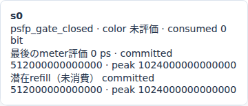
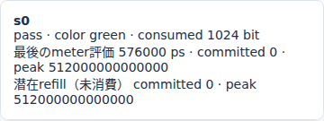

# Ethernet PSFPのstream gateと1ps境界

文書バージョン：`1.2.0`
対象GitHubバージョン：`v1.2.0`
文書ID：`guide-psfp-gate-boundary`
文書状態：公開用完成稿

<a id="guide-psfp-gate-boundary"></a>

### 更新履歴

| 文書バージョン | 更新日 | 更新内容 |
| --- | --- | --- |
| `1.2.0` | `2026-10-22` | v1.2.0の対象タグ・文書版を確定。過去の測定基準と公開済み履歴を保持 |
| `1.1.0` | `2026-10-19` | 初版：stream gateのbase_time_psだけを1ps変える2条件、正式版CLI実測と実Viewerの到着境界を追加 |

## 目的：同じ送信が受信側で通過・拒否に分かれる境界を調べる

PSFP（Per-Stream Filtering and Policing）は、受信した通信をstreamごとの条件で受け入れるか判断する仕組みです。ここではstream gate、つまり「受信を許す時間帯」だけを変えます。同じ1フレームが同じ時刻に届いても、到着時にgateが閉じていれば受信側で拒否されます。

比較する要求は、生成0psの空payload・tagなし・priority7の1フレームです。gateの開始時刻を76000psから76001psへ1psずらし、送信copyが同じままで受信結果だけが変わることを確かめます。色判定の設定を変える[PSFP meterの実習](<Ethernet PSFPの色判定とyellow破棄.md>)とは別の実験です。

profileは`ethernet.tsn.v1`です。以下の数値と画像は正式[v1.1.6 Release](https://github.com/hideki-ozu/DIR-Simulator/releases/tag/v1.1.6)、source `397900451015c9bca6a33d24feac0a88b9b7b8fe`からビルドした同一CLIで取得しました。企画の調査基準main `28ad65c992af80f4f3db681930daa0756546294f`と、実測に使った正式タグのsourceを区別しています。

## 全体の構成・責務・適用範囲

```text
workloadの生成 → Net.aのP7出力FIFO → Net.a.tx
                                     │ 1Gbps・伝搬0ps
                                     ↓
Net.b.rx → VLAN分類 → stream照合 → SDU上限 → stream gate → meter → 受信完了
                                                 │             │
                                                 └── 拒否 ─────┘
```

この実習の流れは、INIでNED・モデル設定・workloadを結び、validateで入力を検証し、runで通信を実行し、viewで保存済み結果を読む、という順序です。Viewerは再シミュレーションをせず、保存された時刻・状態・理由を再生します。

| 構成要素 | 責務と、この実習で固定する条件 |
| --- | --- |
| NED | a/bのEndpointと往復2方向のLinkを接続。1Gbps、伝搬0ps、TX/RX処理0ps、総queue容量64を定義 |
| INI | network、NED探索先、profile、model-config、workloadを接続。終了・集計の終端120000000psを指定 |
| workload | Net.aからNet.bのMACへ1個。生成0ps、空payload、untagged、P7、deadlineなし |
| baseのVLAN・queue設定 | PVID10、default_priority7、VID10のuntagged membership、admit all。8classのstrict priority。Linkはup |
| stream s0 | ingress=`Net.b.rx`、宛先MAC=`02:00:00:00:00:02`、VID10、priority7の完全一致。`flow_id`は照合キーに使わない |
| SDU上限 | `max_sdu_bytes=64`。このprofileではheader・padding・FCSを含むMAC長を比較する。今回の64byteは等号で通過 |
| stream gate | 周期1000000ps、open500000ps・closed500000ps。開始時刻`base_time_ps`だけを76000/76001へ変更 |
| meter | committed 8Mbps/64byte、peak 16Mbps/128byte、初期満杯。yellow_actionはpass。gateを通った場合に評価 |
| Viewer | copyの送信状態、受信状態、policing記録とmeterの保持値を表示。実績と予定値を区別 |

出力TASはnull、CBSは空列、途中のcontrolsとGCL更新も空列です。Switchはありません。逆方向のb.tx→a.rxは接続に残しますが、逆向き負荷は生成しません。理想共通時計`ideal_shared`を使う、この2 Endpoint・単一stream・1フレームだけの比較です。

[TASの実習](<Ethernet TASの送信窓とIFG込みの待ち時間.md>)は、送信を開始する前に出力窓へ収まるかを確認して待たせます。今回のPSFP stream gateは、フレームがbへ実到着した時刻に受理・拒否を判断します。閉じていても、このフレームを受信待ちとして保持して次のopenまで遅延させるわけではありません。

## 到着時刻と半開区間を計算する

空payloadでも、untagged Ethernet MACにはheader14byte、padding46byte、FCS4byteがあり、合計64byteになります。直列化にはpreamble/SFD相当8byteも含めます。SOF=0ps、伝搬・処理0psなので次の計算になります。

```text
直列化 = (64 + 8) × 8 × 10^12 / 10^9 = 576000ps
EOF = arrival = 0 + 576000 = 576000ps
release = EOF + IFG12 × 8 × 10^12 / 10^9 = 672000ps
```

EOFは送信フレームの直列化が終わる時刻、arrivalは相手に到着する時刻です。今回は伝搬0psなので一致します。releaseはIFGも終わって次の送信へ出力資源を渡せる時刻であり、今回の受信gateの判定時刻には使いません。

openの時間帯は、左端を含み右端を含まない半開区間です。到着時の位相は`(arrival - base_time_ps) mod cycle_time_ps`で、今回は500000ps未満ならopenです。

| base_time_ps | 最初のopen区間 | arrivalでの位相 | 576000psの判定 |
| ---: | --- | ---: | --- |
| 76000 | [76000, 576000) | 500000 | 右端に到着するためclosed |
| 76001 | [76001, 576001) | 499999 | 右端の1ps前なのでopen |

この計算を仮説にして、次の正式CLI実測で照合します。開始を1ps後ろへずらすと右端も1ps後ろへ動くため、今回は76001条件のほうが通過します。

## 独立入力ZIPと正式CLIを用意する

[独立7ファイルZIP](downloads/ethernet-psfp-gate-inputs.zip)を展開すると`examples/guide/ethernet-psfp-gate`ができます。このガイドを含むcheckoutの同じフォルダも使えます。正式v1.1.6のsourceを取得しただけでは、この新しい実習フォルダは含まれないため、ZIPも用意してください。

| ファイル | 内容 |
| --- | --- |
| `models/ethtsn/Main.ned` | 正式版の公開PSFP gateサンプルと同じ接続・速度・遅延 |
| `workload.json` | 公開`psfp-gate-workload.json`と同一の1フレーム |
| `gate-76000.json` / `gate-76001.json` | 公開`psfp-gate-model.json`からgate開始時刻を設定。2条件のJSON差分は`tsn.streams[0].gate.base_time_ps`のみ |
| `gate-76000.ini` / `gate-76001.ini` | model-configの参照名だけが異なる共通INI |
| `README.md` | 入力の版・用途・由来 |

以下はGitとrustup/Cargoを準備済みのWSL Ubuntu 24.04 LTS x86_64、Rust1.85.0の手順です。新しいフォルダ名を使い、正式タグのcommitが一致した場合だけbuildへ進めます。

```bash
git -c core.autocrlf=false clone --depth 1 --branch v1.1.6 --single-branch \
  https://github.com/hideki-ozu/DIR-Simulator.git dir-v116-cli &&
cd dir-v116-cli &&
test "$(git rev-parse HEAD)" = 397900451015c9bca6a33d24feac0a88b9b7b8fe &&
cargo build --locked --release -j 1 --target-dir target -p dir-simulator &&
export PATH="$PWD/target/release:$PATH" &&
command -v dir-simulator
```

同じシェルで、ZIPを展開した場所へ移動します。`examples/guide/ethernet-psfp-gate`が見える場所で、新しい出力先を指定してください。

```bash
mkdir psfp-gate-results
for base in 76000 76001; do
  dir-simulator validate \
    --config examples/guide/ethernet-psfp-gate/gate-$base.ini &&
  dir-simulator run \
    --config examples/guide/ethernet-psfp-gate/gate-$base.ini \
    --output psfp-gate-results/gate-$base &&
  dir-simulator view \
    --input psfp-gate-results/gate-$base/results.json \
    --output psfp-gate-results/gate-$base-viewer.html || break
done
```

実測では、リポジトリ内の入力とZIPを新しい場所へ展開した入力について、2条件のvalidate/run/view、計12操作が終了0でした。manifestは`complete`・`partial:false`、diagnosticsは空、結果は`events_exhausted`・pending0です。両経路のsimulationも一致しました。以下はその結果であり、既存のPSFP meter記事の測定値を流用していません。

## 実測：送信copyは一致し、受信判定が変わる

| 記録・時刻 | base76000 | base76001 |
| --- | ---: | ---: |
| generated / source ready / queued / SOF（ps） | 0 / 0 / 0 / 0 | 0 / 0 / 0 / 0 |
| EOF / arrival（ps） | 576000 / 576000 | 576000 / 576000 |
| IFG込みrelease（ps） | 672000 | 672000 |
| copyの最終status / drop_reason | serialized / null | serialized / null |
| reception observed / ready（ps） | 576000 / 576000 | 576000 / 576000 |
| reception status / reason | filtered / psfp_gate_closed | received / null |
| policing verdict / color | psfp_gate_closed / null | pass / green |
| meter committed before → after | null → null | 512000000000000 → 0 |
| meter peak before → after | null → null | 1024000000000000 → 512000000000000 |
| consumed_bits | 0 | 1024 |

2条件のtransferデータはwireを含めて同一です。閉鎖側は、送信元のqueue fullやLinkでのcopy破棄ではありません。bまで到着したcopyに対し、受信側のstream gateが`psfp_gate_closed`を記録し、receptionがfilteredになります。両条件とも出力copyのdroppedは0です。この実験では拒否したframeを自動再送しません。

gateはmeterより前に評価されます。76000側でcolorと4つのtoken欄がnull、`consumed_bits=0`であることは、この到着でmeterを評価・消費していないことを示します。76001側はstream照合とSDU上限64byteの等号を通り、gateもopenなのでmeterへ進みます。

tokenの保存値はbit×10^12の整数です。76001側の評価前はcommitted512bit・peak1024bitで、greenとして両bucketから512bitずつ消費し、評価後は0bit・512bitです。`consumed_bits=1024`は**2つのbucketから引いた合計**です。MAC64byteのcostは512bit、preamble/SFDを含むwire直列化は576bitのままであり、1024bitのフレームを送ったという意味ではありません。

## 実Viewerを同じ576000psで比較する

2つの`gate-*-viewer.html`をブラウザで開き、時刻入力に`576000`を入れて「移動」を押します。まず転送行`psfp_gate:0`を選び、copyのEOF・arrival576000psとdrop_reasonがないことを確認します。「このフレームの受信記録」は76000側でフィルタ拒否、76001側で受信完了になります。詳細の生JSONはrun全体の最終保存記録なので、cursor時点の状態表示と読み分けます。

デスクトップ1440pxで取得した実画面全体は、[76000条件](assets/guide-psfp-gate-76000-576000ps-desktop.png)と[76001条件](assets/guide-psfp-gate-76001-576000ps-desktop.png)で確認できます。同じ576000psに、上部は両方EOF到達1・copy破棄0、受信完了だけが0/1です。画面下の「TSN gate・credit・meter」でstreamカード`s0`を見ます。





上のカードは390pxの実画面から取得しています。**閉鎖側でも、カードのcommitted/peakはnull表示にはなりません。** 正式v1.1.6のViewerは初期満杯の保持値を示し、「最後のmeter評価」は0psのままです。新しいpolicingのnull欄はresults JSONで確認します。画面の「潜在refill（未消費）」も、meterの新しい評価・token消費ではありません。通過側では実際に評価した576000psと消費後の0・512000000000000が表示されます。

同じ欄の`Net.a.tx`・`Net.b.tx`に出る「Gate 常時open」は**出力TAS**の表示です。受信stream gateの通過・拒否は`s0`のverdictと受信記録で読みます。

次に両条件を`575999`psへ戻します。この時点はまだ到着前で、streamカードは「未到着」、上部は送信中1・EOF到達0・受信完了0です。`576000`psへ進むと上記の結果へ切り替わります。検証ではさらに672000psへ進み、575999psへ巻き戻してから576000psへ戻し、件数・カード・選択詳細・転送行が同時刻の状態に一致することも確認しました。gateの未来予定だけで受信を完了済みにしているわけではありません。

## JSONと証跡を照合する

policingには評価時刻、stream_id、reception_id、verdict、color、token、consumed_bitsがあります。receptionには同じcopyに対するobserved/ready、status/reasonがあります。配列の格納順から判定せず、schemaと参照IDで結びます。

```bash
python3 - <<'PY'
import json
from pathlib import Path
for base in (76000, 76001):
    rows = json.loads(Path(f'psfp-gate-results/gate-{base}/results.json').read_text())['simulation']['model_records']
    print(base)
    for schema in ('ethernet.dynamic.transfer', 'ethernet.dynamic.reception', 'ethernet.tsn.policing'):
        for row in rows:
            if row['schema_name'] == schema:
                print(schema, row['record_id'], row['time_ps'], row['data'])
PY
```

[CLI測定証跡](https://github.com/hideki-ozu/DIR-Simulator/blob/main/docs/verification/results/psfp-gate-boundary/measurements.json)には、正式source commit、binaryとbuild sourceのSHA-256、各入力のSHA-256、両条件の実記録、ZIPからの再現結果を保存しています。[Viewer検証証跡](https://github.com/hideki-ozu/DIR-Simulator/blob/main/docs/verification/results/psfp-gate-boundary/viewer-browser.json)には、使用したHTML・結果・画像のSHA-256、ブラウザ版、575999/576000psと巻き戻しの確認を保存しています。元の結果・manifest・Viewer HTMLは変更せず、実際に正式CLIが出力したHTMLを使いました。4つのHTML（2条件×リポジトリ/ZIP）でpage error、console error、request failure、外部通信は0でした。

## 制約と関連する実習

1psはこのモデルの整数時刻で条件を分けるための差です。実機の1ps精度、PTP同期精度、IEEE Qciへの完全適合を検証したものではありません。複数streamや複数hop、gateとmeterの複合負荷、TAS/CBSとの組合せ、時計ずれは今回の測定範囲に含めません。

判断順と設定の契約は正式版の[Ethernet TSN仕様](https://github.com/hideki-ozu/DIR-Simulator/blob/v1.1.6/docs/specs/models/EthernetTSN詳細機能仕様書.md)を参照してください。送信側で待たせる[TAS](<Ethernet TASの送信窓とIFG込みの待ち時間.md>)・[CBS](<Ethernet CBSのcredit回復と送信待ち.md>)、受信meterの[色判定とyellow破棄](<Ethernet PSFPの色判定とyellow破棄.md>)を並べると、どの段階のどの時刻を変えたかを追えます。
