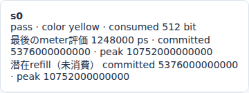
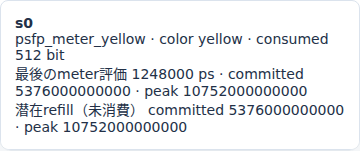
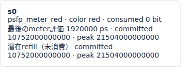

# Ethernet PSFPの色判定とyellow破棄

文書バージョン：`1.2.0`
対象GitHubバージョン：`v1.2.0`
文書ID：`guide-ethernet-psfp-yellow`
文書状態：公開用完成稿

### 更新履歴

| 文書バージョン | 更新日 | 更新内容 |
| --- | --- | --- |
| `1.2.0` | `2026-10-22` | v1.2.0の対象タグ・文書版を確定。過去の測定基準と公開済み履歴を保持 |
| `1.1.0` | `2026-10-15` | 初版：yellow_actionだけを変える6入力実習、正式版CLI実測・実Viewer、色判定と受信拒否・token消費を追加 |

## 目的：送信済みでも受信側で破棄される理由を調べる

送信元がフレームを送り終えても、受信先がすべて受け取るとは限りません。この実習はPSFP（Per-Stream Filtering and Policing）で、受信したstreamの流量を判定する小さな実験です。

**色判定**はbucketに残るtokenからgreen/yellow/redを決める段階、**処置**はその色に対してpass/dropを選ぶ段階です。この二つを分けて読みます。色はこのモデルの観測結果であり、フレーム内のPCPやDEIを書き換えるものではありません。

要求は「同じ5フレームのうち、どれが・いつ・なぜ受信拒否されたかを説明できること」です。`yellow_action`だけをpass/dropへ変えます。rate・burst・宛先・priority・生成時刻は固定し、受信数だけでなくtokenの消費も比較します。送信時刻を遅らせる[CBSの実習](<Ethernet CBSのcredit回復と送信待ち.md>)とは違い、今回のpolicingは受信側で処置します。

profileは`ethernet.tsn.v1`、数値と画像の対象は正式[v1.1.4 Release](https://github.com/hideki-ozu/DIR-Simulator/releases/tag/v1.1.4)のsource `b45515644dfc65c205216d564d5bf7ef00280622`です。掲載時のmain `e6c5e74c3e44db7b1ce3f3d1caf0b1d628dce7ed`には、その後のNEDエディタ・起動診断等の修正もあります。mainの機能すべてを正式v1.1.4の提供内容とは扱いません。本実習のPSFPはv1.1.4に実装済みで、後続のNED修正には依存しません。

## 構成と責務：送信キューと受信meterを分ける

公開`examples/ethernet/tsn/psfp.ini`の2 Endpoint構成を使います。

```text
Net.aの生成器 → class7 FIFO → Net.a.tx
                               │ 1Gbps・伝搬0ps
                               ↓
Net.b.rx → VLAN分類 → stream照合 → SDU上限 → stream gate → meter → 受信完了/拒否
```

逆方向のb.tx→a.rxもNEDに残しますが、今回は逆向き負荷を生成しません。

| 構成要素 | 責務・境界・依存する入力 |
| --- | --- |
| NED | a/bと2方向のLink、1Gbps、TX/RX処理0ps、伝搬0ps、総キュー容量64を定義 |
| INI | network・NED探索先・profile・model-config・workloadを接続。終了/集計窓120000000psを固定 |
| workload | aからbのMACへ5個。最初の3個は生成0ps、残りは32000000/96000000ps。空payload・tagなし・priority7、deadlineなし |
| VLAN分類 | b側の受信PortでPVID10・default_priority7へ分類。admitはallで、membershipも満たす |
| stream s0 | ingress=`Net.b.rx`、宛先MAC、VID10、priority7の完全一致で識別。flow_idは照合キーに使わない |
| SDU上限・gate | 本profileのMAC長上限64byteと常時openのstream gate。今回は前段拒否を起こさない |
| 2 bucket meter | committed 8Mbps/64byte、peak 16Mbps/128byte。初期満杯。到着ごとにtokenを補充して色と消費を決める |
| yellow_action | yellowだけの処置をpass/dropに変更。greenはpass、redはdropで固定 |
| Viewer | 保存済みpolicing・copy・受信記録を再生。meterの最終評価値と潜在refillを区別して表示 |

出力側TASはnull、CBSは空、runtime controlsも空です。出力の待ち時間やgateを変えて受信数を変える実験ではありません。PSFPはsourceの生成時には適用せず、bへの実到着後に適用します。

## 利用フロー：入力から受信理由までつなぐ

INIがNEDの接続・model-configのstream/meter・workloadの5フレームを結びます。CLIのvalidateで参照と型を確かめ、runで生成→FIFO→wire送信→b到着→PSFP→受信状態の順に進みます。viewは保存された結果を単一HTMLにし、再シミュレーションはしません。

比較ではまず送信copyの時刻とwireが同じことを確認し、次にpolicingの色・verdict・token、最後にreceptionのstatus/reasonを照合します。総受信数の差だけから、Linkや出力キューで破棄されたと推測しないでください。

## 手順：6入力を用意して正式CLIを実行する

[独立6入力ZIP](downloads/ethernet-psfp-inputs.zip)を展開すると`examples/guide/ethernet-psfp`ができます。このガイドを含むcheckoutの同じディレクトリでも実行できます。他の記事の入力は不要です。

| ファイル | 内容 |
| --- | --- |
| `models/ethtsn/Main.ned` | 公開PSFPサンプルの型・接続・速度を変更せず使用 |
| `workload.json` | 公開`psfp-workload.json`と同じ5フレーム |
| `pass.json` / `drop.json` | passは公開`psfp-model.json`そのもの。dropは`tsn.streams[0].meter.yellow_action`だけが異なる |
| `pass.ini` / `drop.ini` | model-config名だけが異なる共通設定 |

streamのidが`s0`、ingressが`Net.b.rx`であることも確認します。比較するのは上記の1項目です。rateやburstを同時に変えると、色判定そのものまで変わるので、この実験と切り分けてください。

以下はWSL Ubuntu 24.04 LTS x86_64・Rust1.85.0の手順です。Gitとrustup/Cargoを準備済みのシェルを使い、`dir-v114-cli`は新しい名前にします。正式タグのSHAが一致した場合だけビルドします。1ジョブで同時コンパイルを抑えます。

```bash
git -c core.autocrlf=false clone --depth 1 --branch v1.1.4 --single-branch \
  https://github.com/hideki-ozu/DIR-Simulator.git dir-v114-cli &&
cd dir-v114-cli &&
test "$(git rev-parse HEAD)" = b45515644dfc65c205216d564d5bf7ef00280622 &&
cargo build --locked --release -j 1 --target-dir target -p dir-simulator &&
export PATH="$PWD/target/release:$PATH" &&
command -v dir-simulator
```

次にZIPを展開した場所へ移動し、`examples/guide/ethernet-psfp`を確認します。同じシェルでPATHを維持します。出力親を先に作り、各出力には新しい名前を使います。

```bash
mkdir psfp-results
for case in pass drop; do
  dir-simulator validate --config examples/guide/ethernet-psfp/$case.ini &&
  dir-simulator run --config examples/guide/ethernet-psfp/$case.ini \
    --output psfp-results/$case &&
  dir-simulator view --input psfp-results/$case/results.json \
    --output psfp-results/$case-viewer.html || break
done
```

各runはmanifest・results JSON・events CSV・summary CSV・diagnostics JSONLを保存します。各CLIの終了0とmanifestの`status:complete`・`partial:false`を確認します。`pass-viewer.html`と`drop-viewer.html`はブラウザでオフライン表示できます。

## 実測：色とtokenは同じ、yellowの受信処置だけが変わる

両条件ともgenerated5・serialized5、queued/transmitting/processing0で終了しました。終了は`events_exhausted`、pending0、partial falseです。受信側のPSFP拒否はreceptionのfilteredとして数え、出力copyのdroppedは0です。

| yellow_action | received | filtered | red理由 | yellow理由 | 出力copyのdropped |
| --- | ---: | ---: | ---: | ---: | ---: |
| pass | 4 | 1 | 1 | 0 | 0 |
| drop | 2 | 3 | 1 | 2 | 0 |

色は両条件で同じ順序です。各MAC長は64byteなので、1 bucketの消費costは512bitです。次表のtokenはmeter評価前の補充・cap適用後をbitへ換算した値です。

| frame | b到着 ps | committed / peak bit | 色 | pass条件 | drop条件 |
| --- | ---: | --- | --- | --- | --- |
| psfp:0 | 576000 | 512 / 1024 | green | 受信 | 受信 |
| psfp:1 | 1248000 | 5.376 / 522.752 | yellow | 受信 | psfp_meter_yellow |
| psfp:2 | 1920000 | 10.752 / 21.504 | red | psfp_meter_red | psfp_meter_red |
| psfp:3 | 32576000 | 256 / 512 | yellow | 受信 | psfp_meter_yellow |
| psfp:4 | 96576000 | 512 / 1024 | green | 受信 | 受信 |

最初の3個は生成時刻が0でも同時到着ではありません。MAC64byteのpreamble/SFD込み直列化は576000ps、IFG込み占有は672000psです。SOFは0/672000/1344000ps、b到着は各EOFと同じで576000/1248000/1920000psになります。後の2個は生成時にLinkが空いているため、各生成時刻+576000psで到着します。

meterの処理はこのprofileの2 bucket抽象規則です。peakが512bit未満ならred・消費0、peakは足りるがcommittedが足りなければyellow・peakだけ512bit消費、両方足りればgreen・両方512bitずつ消費します。`consumed_bits`は両bucketから引いた合計なので、greenは1024、yellowは512、redは0です。wire長が2倍になるという意味ではありません。

1個目greenの後はcommitted0・peak512bitです。672000ps後の2個目到着までに、8Mbpsで5.376bit、16Mbpsで10.752bitを補充し、表のyellowになります。yellowをdropにしてもpeak512bitは消費し、返却しません。その後の色・tokenも両条件で一致するため、3個目がgreenに変わることはありません。

## Viewer：到着瞬間の色と受信記録を確認する

両Viewerで時刻入力に`1248000`を入れて移動し、「TSN gate・credit・meter」のstreamカード`s0`を見ます。1ps前の1247999psではまだ最初のgreenの評価記録で、2個目の到着時にyellowへ変わります。





同じyellow・consumed512bitでも、verdictがpassと`psfp_meter_yellow`で異なります。カードのcommitted/peakは消費後のtoken numeratorで、単位はbit×10^12です。表示5376000000000は5.376bit、10752000000000は10.752bitです。「最後のmeter評価」と「潜在refill（未消費）」は区別してください。選択時刻が評価時刻なら一致しますが、後の時刻の潜在refillを新しい評価や消費として数えません。

転送表の`psfp:1`を選ぶと、copyは両条件ともserialized、arrivalは1248000ps、drop_reasonはnullです。その下の「このフレームの受信記録」は、pass条件でbの受信完了、drop条件で`psfp_meter_yellow`の拒否になります。copyと受信記録の責務の違いを確認します。詳細JSONは最終runの記録なので、過去時刻の表の状態とは読み分けてください。



1920000psのredは両条件で拒否・consumed0bitです。32576000psへ進むと次のyellowを確認でき、最後の120000000psではserialized5、received4または2です。受信拒否は待機ではなく、この実習の同じframeが後から自動再送されることはありません。

JSONでもpolicingとreceptionを照合できます。配列順を時系列と仮定せず、整数のtime/effect_seqで並べます。

```bash
python3 - <<'PY'
import json
from pathlib import Path
for case in ('pass', 'drop'):
    sim = json.loads(Path(f'psfp-results/{case}/results.json').read_text())['simulation']
    rows = [r for r in sim['model_records'] if r['schema_name'] == 'ethernet.tsn.policing']
    print(case)
    for r in sorted(rows, key=lambda r: (int(r['time_ps']), int(r['data']['effect_seq']))):
        d = r['data']
        print(r['time_ps'], d['reception_id'], d['color'], d['verdict'], d['consumed_bits'])
PY
```

## 制約と次に確認すること

本実習は固定1Gbps・伝搬/処理0・単一stream・5フレームに限定しています。max_sduの境界、stream gate閉鎖、未一致のbypass、複数hop、後段コピーの満杯、途中停止、TAS/CBSとの合成は測定していません。本profileのmax_sduはheader/tag/padding/FCS込みのMAC byte数であり、payloadだけを数えるSDU定義とは区別します。

この実装は理想共通時計と独立2 bucketの抽象規則です。IEEE Qci全状態機械や実ネットワーク機器の適合・性能を保証しません。契約は[PSFP仕様](https://github.com/hideki-ozu/DIR-Simulator/blob/v1.1.4/docs/specs/models/EthernetTSN詳細機能仕様書.md#policing)、受入条件での拒否は[VLANの実習](EthernetのVLAN受入条件と破棄理由.md)、送信側で待たせる制御は[CBSの実習](<Ethernet CBSのcredit回復と送信待ち.md>)を参照してください。

ガイド内の検索で複合語「色判定」が記事候補を返さない場合は、短い語「判定」「破棄」でも探せます。
