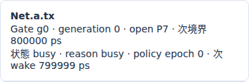
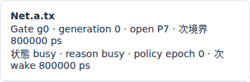
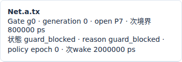

# Ethernet TASの送信窓とIFG込みの待ち時間

文書バージョン：`1.2.0`
対象GitHubバージョン：`v1.2.0`
文書ID：`guide-ethernet-tas-window`
文書状態：公開用完成稿

### 更新履歴

| 文書バージョン | 更新日 | 更新内容 |
| --- | --- | --- |
| `1.2.0` | `2026-10-22` | v1.2.0の対象タグ・文書版を確定。過去の測定基準と公開済み履歴を保持 |
| `1.1.1` | `2026-10-20` | Issue #116〜#119の正式v1.1.6実測記事への相互参照を追加し、既存実習との比較範囲を明示 |
| `1.1.0` | `2026-10-14` | 初版：1フレーム共通条件から生成時刻だけを1psずつ変え、IFG込み送信窓の実測と500000psの実Viewerを掲載 |

## 目的：gateが開いているのになぜ待つのか

Ethernet TASは、priorityごとに送信を許す時間帯を決める制御です。「P7のgateがopenならすぐ送れる」と考えると、窓の終わり近くで結果を読み違えます。DIRのこのprofileは、フレームを送り終える時刻だけでなく、次の送信までの間隔であるIFGを含む解放時刻まで窓へ収まる場合に開始します。

この実習の目的は、生成時刻を1psずらしたときの「即開始」と「次の窓まで待つ」を確認することです。要求は同じ1フレーム、送信速度も窓の設定も固定します。[優先キューの実習](Ethernetの優先キューと送信順.md)は複数要求から次を選ぶ比較ですが、ここでは競合を取り除いて窓末尾の等号だけを調べます。[配送期限の実習](Ethernet配送期限と遅延判定の比較.md)のdeadlineとも別の制約です。

profileは`ethernet.tsn.v1`、実測sourceは正式[v1.1.4 Release](https://github.com/hideki-ozu/DIR-Simulator/releases/tag/v1.1.4)の`b45515644dfc65c205216d564d5bf7ef00280622`です。以下の表と画像はこのCLIで取得しました。

## 構成・責務・境界と利用フロー

```text
workloadの生成 → Net.aのP7出力FIFO → TASの窓と候補の占有時間を照合
                                           │ 入ればSOF、入らなければ待機
Net.a.tx ───────1Gbps／伝搬0ps────────> Net.b.rx
```

| 要素 | 責務・依存する設定 |
| --- | --- |
| NED | a/bのEndpointと往復2方向のLinkを接続。1Gbps、伝搬0ps、TX/RX処理0ps、総queue容量64 |
| INI | network、profile、NED探索先、model-config、workload、終了時刻を結ぶ |
| base設定 | `ethernet.l2.dynamic.v1`のVLAN/出力queue/Link状態を使用。直接接続でSwitchなし。VID10、untagged、Link up、P7固定 |
| TAS設定 | a.txだけにgate g0。base0、周期2000000ps。P7が[0,800000)でopen、[800000,2000000)でclosed。各周期で繰り返す |
| 出力選択 | 同class FIFOとstrict priorityを継承。TASでは候補のIFG込み解放が窓末尾以下かを確認してから取り出す |
| Link | SOFから直列化してEOF、IFG込み時刻に出力資源を解放する。送信中のcopyは中断しない |
| 受信側b | 到着したcopyを受入・宛先判定してreceivedにする。b.txのTASはnullで全priority常時openだが、今回は送信しない |
| Viewer | 保存されたtransfer・gate・decisionを再生し、選択時刻の状態と全実行JSONを表示する |

clockは`ideal_shared`で、全nodeに同じ仮想時刻を使います。CBSのcredit制御は空列、PSFP stream設定とGCL更新も空列です。生成器にP7を指定してもTASを無視して送ることにはなりません。逆に窓が閉じたことだけで待機copyをdropする実験でもありません。

## 窓へ入る条件を計算する

空payloadでもpadding46byteとFCS4byteを含むuntagged MACは64byteです。preamble等8byteを加えた72byte＝576bitを1Gbpsで送るため、直列化は576000ps。IFG12byte相当も含めると84byte＝672bit、占有は672000psです。

```text
EOF     = SOF + 576000ps
release = SOF + 672000ps
開始条件：release <= open窓の末尾
```

最初の窓末尾800000psから占有672000psを引くと128000psです。ここまでは即開始できるという計算になります。等号128000psと、その前後127999/128001psをCLIで確かめます。EOFだけで判断すると128001+576000=704001psは窓内ですが、IFG込み解放800001psが1psはみ出すことを見落とします。

## 共通入力を作り、生成時刻だけを比べる

[独立8入力ZIP](downloads/ethernet-tas-inputs.zip)を展開すると`examples/guide/ethernet-tas`ができます。元の`examples/ethernet/tsn/tas-workload.json`は128000/128001psの**2フレーム**です。今回は先に全条件共通で1フレームへ整理し、その後`generators[0].times_ps[0]`だけを127999/128000/128001へ変えています。元の2フレームの負荷から時刻だけを変えた比較ではありません。

| ファイル | 固定部分・変更部分 |
| --- | --- |
| `models/ethtsn/Main.ned` | 元サンプルと同一byteの接続・速度・伝搬・処理設定 |
| `model.json` | 元tas-model.jsonと同一byte。TAS、8class、VID、動的base、容量を固定 |
| `time127999.json` / `time128000.json` / `time128001.json` | 同じ生成器tas、同じ宛先MAC、空data、tagなし、P7、deadlineなし。1要素の生成時刻だけ異なる |
| `time127999.ini` / `time128000.ini` / `time128001.ini` | workloadの参照ファイル名だけ異なる。終了3000000ps、metrics-window100000psは全条件共通 |

元INIの終了120000000psから、単一フレームの最後の解放までを含む3000000psへ全条件共通で短縮し、観測windowも共通設定しています。実験変数にはしていません。

## 正式CLIを準備して再現する

WSL上のUbuntu 24.04 LTS x86_64、Rust 1.85.0で確認した手順です。Gitとrustup/Cargoを導入済みのシェルを使います。[READMEのビルド説明](https://github.com/hideki-ozu/DIR-Simulator/blob/v1.1.4/README.md#canサンプルを実行する)も参照できます。`dir-v114-cli`は新しいディレクトリ名にしてください。SHAが一致しなければ`&&`によりbuildとPATH追加へ進みません。

```bash
git -c core.autocrlf=false clone --depth 1 --branch v1.1.4 --single-branch \
  https://github.com/hideki-ozu/DIR-Simulator.git dir-v114-cli &&
cd dir-v114-cli &&
test "$(git rev-parse HEAD)" = b45515644dfc65c205216d564d5bf7ef00280622 &&
cargo build --locked --release --target-dir target -p dir-simulator &&
export PATH="$PWD/target/release:$PATH" &&
command -v dir-simulator
```

同じシェルでZIP展開先へ移動し、そこに`examples/guide/ethernet-tas`があることを確認します。出力は新しい名前を使います。

```bash
mkdir tas-results
for case in time127999 time128000 time128001; do
  dir-simulator validate --config "examples/guide/ethernet-tas/$case.ini" &&
  dir-simulator run --config "examples/guide/ethernet-tas/$case.ini" \
    --output "tas-results/$case" &&
  dir-simulator view --input "tas-results/$case/results.json" \
    --output "tas-results/$case-viewer.html" || break
done
```

validateは2ノード・2channelでvalidです。runは3条件とも終了コード0、`partial:false`、`events_exhausted`、pending_events0です。終了時刻3000000psと、最後の実イベント時刻を区別してください。manifestに記録されたデータファイルのhashも確認します。

## 実測：1psのはみ出しで次の窓へ待つ

| 指標（ps） | 127999 | 128000 | 128001 |
| --- | ---: | ---: | ---: |
| 生成・queue投入 | 127999 | 128000 | 128001 |
| SOF | 127999 | 128000 | 2000000 |
| queue待ち | 0 | 0 | 1871999 |
| EOF＝到着＝b受信 | 703999 | 704000 | 2576000 |
| IFG込みrelease・最後のイベント | 799999 | 800000 | 2672000 |
| 生成から受信までの遅延 | 576000 | 576000 | 2447999 |

前2条件は即開始、等号800000psの解放も許されています。直後条件は最初の窓へ入らず、次周期のopen開始2000000psにSOFとなりました。窓末尾は送信開始を判定する制約で、deadlineの超過結果ではありません。

全条件で生成1、直列化copy1、受信1、drop/filtered/未完了0です。直列化576000ps・伝搬0・処理0が固定なので、後者の1871999psのqueue待ちだけが遅延増加を説明します。MAC/wire/occupied量は512/576/672bit、3000000psに対するlink_utilizationは全条件0.224です。同じ利用率でも、生成から受信までの遅延は異なります。

128001条件の保存recordでは、128001psに`guard_blocked`が2件、`next_wake_ps=2000000`と記録されました。`ethernet.tsn.guard_wait=2`は判定記録の件数であり、要求2個や待ち時間2psではありません。前2条件はguard判定記録がなく、このsummary行も出力されません。

```bash
python3 - <<'PY'
import json
from pathlib import Path
for case in ('time127999', 'time128000', 'time128001'):
    sim = json.loads(Path(f'tas-results/{case}/results.json').read_text())['simulation']
    for row in sim['model_records']:
        if row['schema_name'] == 'ethernet.dynamic.transfer':
            d = row['data']
            print(case, d['queued_ps'], d['sof_ps'], d['eof_ps'], d['release_ps'])
PY
```

## Viewerで500000psのgateと待機理由を読む

各`*-viewer.html`を開き、時刻欄へ`500000`を入力して移動します。前2条件は元フレーム1・待機0・送信中1、後者は元フレーム1・待機1・送信中0です。EOF到達・受信はまだ全条件0です。transfer行の「送信中」と「送信待機」、TSN gate・credit・meter欄の`Net.a.tx`を読みます。

以下は同じ500000psの実Viewerから撮影したgateカードです。390px表示で、gate openと状態・次wakeが読み取れる部分を切り出しています。







gateの次境界800000psとdecisionの次wakeは別の項目です。今回の直後条件は次wake2000000psですが、別設定のwakeを同じ値へ決めつけないでください。openは開始の必要条件で、残りの窓幅を満たすかはguardで別に判定します。

transferを選んだJSON詳細は全実行の最終recordです。後者のSOF2000000psやEOF2576000psが表示されても、500000psですでに送信・受信したという意味にはなりません。保存された状態と予定・最終時刻を分けて読みます。

## 制約と次の実験

有限1フレーム、1送信元・1宛先、直接接続、空payload、P7、固定GCL、伝搬・処理0だけを測定しました。複数classの競合、CBS credit、PSFP policing、GCL更新、複数hop、タグ変換、queue満杯、停止途中、連続負荷はこの実習で未検証です。deadlineなしなので期限超過率はnullです。空payloadのpayload throughputも0で、アプリケーションの実効性能を示しません。

DIRのIFG込みguardはこの抽象profileの規則です。IEEE規格全体の適合、PTP同期交換やclock誤差、frame preemption、実機PHY・RTL・実ネットワーク性能の保証はしません。入力・占有時間・状態の正本は[TSN詳細仕様](https://github.com/hideki-ozu/DIR-Simulator/blob/v1.1.4/docs/specs/models/EthernetTSN詳細機能仕様書.md)です。

## 関連する実習

[TASのgate閉鎖とCBS creditの凍結](<TASのgate閉鎖とCBS creditの凍結.md>)では、gate閉鎖だけを変え、負creditの凍結と再開後の回復待ちを比較します
