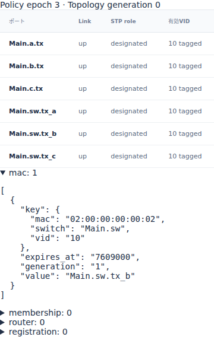
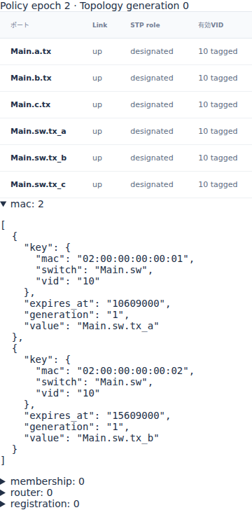

# EthernetのMAC学習とagingによる転送先

文書バージョン：`1.2.0`
対象GitHubバージョン：`v1.2.0`
文書ID：`guide-ethernet-mac-aging`
文書状態：公開用完成稿

### 更新履歴

| 文書バージョン | 更新日 | 更新内容 |
| --- | --- | --- |
| `1.2.0` | `2026-10-22` | v1.2.0の対象タグ・文書版を確定。過去の測定基準と公開済み履歴を保持 |
| `1.1.0` | `2026-10-15` | 初版：mac_age_psだけを変える6入力実習、正式版実測と実Viewer、送信元学習・期限失効と既知転送/floodを追加 |

## 目的：宛先が同じでも転送先が増える理由を調べる

Switchは、到着したフレームの送信元MACから「このMACはどのPortの先にあるか」を学習します。その記録は永久ではなく、agingの期限が来ると消えます。この実習では同じ戻り方向のフレームに対し、学習記録が残ればaだけへ、失効していればaとcへ転送される違いを観察します。

要求は、**学習**した場所と時刻、宛先の**転送**に使った記録、余分なcopyとEndpointでの受信結果を説明できることです。変えるのは`dynamic.mac_age_ps`だけで、配線・負荷・VLAN・処理時間・キューは固定します。静的な出口を比較する[multicastの実習](Ethernetの静的multicastとコピーの配送先.md)とは異なり、今回は送信元の到着履歴で変わる動的unicast表を使います。

profileは`ethernet.l2.dynamic.v1`。数値と画像は正式[v1.1.4 Release](https://github.com/hideki-ozu/DIR-Simulator/releases/tag/v1.1.4)、source `b45515644dfc65c205216d564d5bf7ef00280622`の実CLIで取得しました。掲載時のmain `c67e153cc3bcf1f6ac0303d23023ce8ae4a4f533`には正式版後のNED修正等も含まれます。本実習のMAC学習は正式v1.1.4に実装済みで、その後のNED修正には依存しません。

## 構成と責務：学習する送信元と検索する宛先を分ける

公開Ethernetサンプルの1 Switch・3 Endpoint配線を使います。全6方向のLinkを残し、図は今回主に使う方向です。

```text
Main.a.tx → Main.sw.rx_a    sw.tx_a → a.rx
Main.b.tx → Main.sw.rx_b    sw.tx_b → b.rx
Main.c.tx → Main.sw.rx_c    sw.tx_c → c.rx
```

| 構成要素 | 責務・境界・依存する設定 |
| --- | --- |
| NED | a/b/cとswを接続。全Link1Gbps・伝搬1000ps。Endpoint TX/RX処理0ps、総キュー容量64 |
| INI | network・NED探索先・profile・model-config・workloadを結ぶ。終了/集計窓20000000psを共通化 |
| workload | a→bを0ps、b→aを5000000psに1個ずつ生成。空payload・VID10 tagged・PCP0/DEI0・priority0、deadlineなし |
| Port・出力設定 | 全受入、VID10所属、tagged出力、class FIFO容量64を固定 |
| Switchの学習 | 入場検査を通ったsource MACを、VIDとともにingress側Portへ登録。転送処理完了を待たずarrival時に学習 |
| 宛先検索 | static FDB→有効dynamic FDB→未知宛先のfloodの順。今回はstatic FDBを共通で空にする |
| aging | 最後の受理arrival＋mac_age_psで学習記録を失効。2条件の唯一の変数 |
| Endpoint | 自MAC宛のcopyを受信完了。それ以外のunicastはdestination_mismatchで拒否 |
| Viewer | 保存済みpolicy差分から任意時刻のMAC表を復元。実行中の入力は変更しない |

学習キーは`(switch, VID, source MAC)`です。a→bを受けたSwitchがまず学ぶのはaの所在であり、宛先bの所在ではありません。bは5000000psに自分で送信し、その到着で初めて学習されます。cは送信しないのでcのMAC記録は作りません。

Portの設定はtx完全パスで指定し、対となるrxは接続から決まります。例えばrx_aから到着したaの記録は、戻りの出口`Main.sw.tx_a`を指します。switch間Linkはなく、全Portはup/designated、topology generationは0で固定です。STP切替やlink障害の実験にはしていません。

## 利用フロー：二つの独立した送信から表の変化を追う

INIで入力を接続し、validate→run→viewの順で実行します。a→bの最初の送信でswがaを学習し、未知のbへfloodします。その後agingが進み、b→aの検索時にaの記録が残っているかで出口が変わります。最後にMAC表・copyの親子とreceptionの理由を照合します。

b→aはworkloadで時刻を指定した独立フレームです。bの受信から自動生成される応答やACKではありません。未知unicastのfloodは、同じVIDの適格な出口からingress側を除いて行います。flood先のcへ到達しても、cがアプリケーション受信したことにはなりません。

## 手順：公開入力を揃えてagingだけを変える

[独立6入力ZIP](downloads/ethernet-learning-inputs.zip)を展開すると`examples/guide/ethernet-learning`ができます。このガイドを含むcheckoutの同じディレクトリも使えます。

| ファイル | 内容 |
| --- | --- |
| `models/ethdemo/Main.ned` | 公開`examples/ethernet/models/ethdemo/Main.ned`を変更せず使用 |
| `workload.json` | 公開dynamic unicastを基礎に、名前をMainへ揃え、b→aの固定送信を追加。両条件で同一 |
| `short.json` / `long.json` | 公開VLAN実習のall.jsonをschema4へ揃え、static FDBを空にし、1 bridge/3 linksのdynamic設定を共通追加 |
| `short.ini` / `long.ini` | model-config名だけが異なる共通INI |

共通化後のmodel-configで`dynamic.mac_age_ps`だけをshort=`2000000`ps（2µs）、long=`10000000`ps（10µs）へ変えます。bridge IDはsw=1、convergence0、controls空です。静的FDBを片方だけ残したり、負荷時刻やVLANを一緒に変えたりしません。静的FDBが同じkeyを持つと静的な経路が優先され、この比較にならないためです。

以下はWSL Ubuntu24.04 LTS x86_64・Rust1.85.0の手順です。Gitとrustup/Cargoを導入したシェルで、新しい`dir-v114-cli`へ正式タグを取得します。SHA一致時だけビルドし、同時コンパイルを1ジョブに抑えます。

```bash
git -c core.autocrlf=false clone --depth 1 --branch v1.1.4 --single-branch \
  https://github.com/hideki-ozu/DIR-Simulator.git dir-v114-cli &&
cd dir-v114-cli &&
test "$(git rev-parse HEAD)" = b45515644dfc65c205216d564d5bf7ef00280622 &&
cargo build --locked --release -j 1 --target-dir target -p dir-simulator &&
export PATH="$PWD/target/release:$PATH" &&
command -v dir-simulator
```

次にZIPを展開した場所へ移動し、同じシェルのPATHを維持します。出力親を先に作り、各出力は新しい名前にします。

```bash
mkdir learning-results
for case in short long; do
  dir-simulator validate --config examples/guide/ethernet-learning/$case.ini &&
  dir-simulator run --config examples/guide/ethernet-learning/$case.ini \
    --output learning-results/$case &&
  dir-simulator view --input learning-results/$case/results.json \
    --output learning-results/$case-viewer.html || break
done
```

各runはmanifest、results JSON、events CSV、summary CSV、diagnostics JSONLを保存します。各CLIの終了0、manifestの`status:complete`・`partial:false`を確認し、Viewer HTMLをブラウザで開きます。サーバー不要で表示できます。

## 実測：学習の期限は生成時刻ではなくarrivalから数える

両条件でaのsourceがswへ到着するのは609000psです。MAC68byteの直列化608000ps＋伝搬1000psから求まります。aの学習はその時刻で、転送処理完了611000psやbの受信完了1220000psを待ちません。

| 観測 | short | long |
| --- | ---: | ---: |
| aをsw.tx_aへ学習 ps | 609000 | 609000 |
| aのexpiry ps | 2609000 | 10609000 |
| bをsw.tx_bへ学習 ps | 5609000 | 5609000 |
| 戻り方向の出口決定 ps | 5611000 | 5611000 |
| 戻り方向のsw出口 | tx_a / tx_c | tx_a |
| aで戻りframe受信 ps | 6220000 | 6220000 |
| bのexpiry ps | 7609000 | 15609000 |

記録の有効期間は`[learn, expire)`です。shortのaは2608999psに残り、2609000psでは消えます。longでは10608999psに残り、10609000psに消えます。b→aがswへ到着し、2000ps処理後に宛先を検索する5611000psには、shortは未知宛先、longは既知宛先になります。

| 最終件数 | short | long |
| --- | ---: | ---: |
| 元frame generated | 2 | 2 |
| hop copy serialized | 6 | 5 |
| Switch reception forwarded | 2 | 2 |
| Endpoint reception received | 2 | 2 |
| destination_mismatch filtered | 2 | 1 |
| 出力copy dropped | 0 | 0 |

最初のa→bは両条件でsource1＋sw→b/cの2コピーです。戻り方向はshortがsource1＋sw→a/cの2コピー、longがsource1＋sw→aの1コピーです。cへの余分な転送を減らしても、本構成ではaの受信時刻は同じです。出口は独立した送信器で、競合する追加負荷を入れていないためです。floodを減らせば必ず遅延が改善する、とはこの実測から言えません。

各hopはtag付きMAC68byte、wire608bit、IFG込み704bitです。sw→a/cのSOF5611000ps、EOF6219000ps、arrival6220000ps、release6315000psです。IFGをarrivalへ加算しないでください。両runはevents_exhausted・pending0・partial falseで終了し、最後のイベントはbのexpiryです。終了20000000psには両方の動的MAC表が空になります。

## Viewer：同じ時刻のMAC表とcopyを照合する

各Viewerの時刻入力へ`5611000`を入れて移動します。「動的制御と転送ポリシー」で`mac`を開きます。shortにはbだけ、longにはa/bの2件が残ります。表のkeyのVID/MAC、valueの出口、expires_atの期限を確認します。





Policy epochは実効変更の回数に応じてshort3・long2ですが、topology generationは両方0です。MAC失効によるepoch更新を配線変更や追加frameと混同しないでください。期限の1ps前・期限・1ps前へ戻す順でも、同じ表が復元されます。

`7000000`psへ移動し、転送表の`return:0`を見ます。shortにはsw.tx_c→c.rx、longにはそのcopyがありません。両方のsw.tx_a→a.rxを選ぶと、親copyはb→swのincoming copy、arrivalは6220000psです。「このフレームの受信記録」にはaの受信完了、shortだけcのdestination_mismatchがあります。詳細JSONは最終runの記録なので、過去時刻の状態表と読み分けます。

結果JSONでも学習と失効を確認できます。配列順を時系列と仮定せず、整数のtime/effect_seqで並べます。

```bash
python3 - <<'PY'
import json
from pathlib import Path
for case in ('short', 'long'):
    sim = json.loads(Path(f'learning-results/{case}/results.json').read_text())['simulation']
    rows = [r for r in sim['model_records'] if r['schema_name'] == 'ethernet.dynamic.control']
    print(case)
    for r in sorted(rows, key=lambda r: (int(r['time_ps']), int(r['data']['effect_seq']))):
        d = r['data']
        print(r['time_ps'], d['kind'], d['key'], d['before'], d['after'])
PY
```

## 制約と次に確認すること

固定Link・単一Switch・VID10・2 frame・競合なしの実習です。同じsourceのrefresh、MAC move、static shadow、表上限、link/STP変更によるflush、学習期限とlookupが完全同時の境界、途中停止は測定していません。実装の契約は[動的制御仕様](https://github.com/hideki-ozu/DIR-Simulator/blob/v1.1.4/docs/specs/models/Ethernet動的制御詳細機能仕様書.md#membership)にあります。

本profileは理想時計と抽象制御の評価モデルで、実機の学習方式・全IEEE状態機械の適合や分散protocolの収束時間を保証しません。静的な宛先指定との違いは[VLANの実習](EthernetのVLAN受入条件と破棄理由.md)、コピーと受信の母数は[multicastの実習](Ethernetの静的multicastとコピーの配送先.md)も参照できます。
