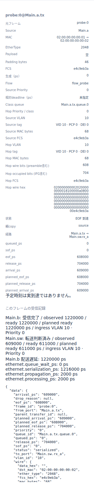
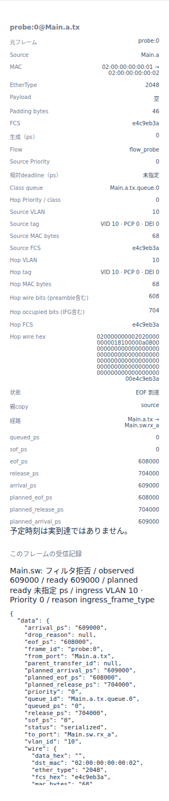

# EthernetのVLAN受入条件と破棄理由

文書バージョン：`1.1.0`
対象GitHubバージョン：`v1.1.4`
文書ID：`guide-ethernet-vlan-admission`
文書状態：公開用完成稿

### 更新履歴

| 文書バージョン | 更新日 | 更新内容 |
| --- | --- | --- |
| `1.1.0` | `2026-10-14` | 初版：受信admitだけを変える8入力実習、正式版CLI実測と実Viewer、filteredとdropの境界を追加 |

## 目的：送信できても届かない理由を調べる

送信元がフレームを送り終えたのに、宛先には届かない。そんなときは、送信待ちだけでなく受信側の受入条件を確認します。この実習ではVLAN 10のタグ付きフレームを1個だけ送り、Switchの受入条件だけを変えます。タグを持つかどうかを判定する`admit`と、VIDが所属VLANに含まれるかを判定するmembershipは別の条件です。

目的は「拒否した場所・時刻・理由を確認できること」です。受入条件が合わない`filtered`と、出力キューの容量不足によるコピーの`dropped`を区別します。優先順位を変える[送信順の実習](Ethernetの優先キューと送信順.md)や[配送期限の実習](Ethernet配送期限と遅延判定の比較.md)とは独立した比較です。

使用profileは`ethernet.l2.vlan.v1`です。実測source commitは`b45515644dfc65c205216d564d5bf7ef00280622`。以下の数字と画像は正式[v1.1.4 Release](https://github.com/hideki-ozu/DIR-Simulator/releases/tag/v1.1.4)のCLIで取得しています。

## 構成と責務：入口判定を転送から分ける

```text
Main.a.tx ──1Gbps／伝搬1000ps──> Main.sw.rx_a
                                    │ 受入判定 → 処理2000ps → VLAN別FDB
Main.b.rx <──1Gbps／伝搬1000ps── Main.sw.tx_b
```

| 構成要素 | 責務・依存する設定 |
| --- | --- |
| NED | Endpoint a/b/c、Switch sw、6方向のLinkを接続。cと逆方向は残すが、この負荷では送信しない |
| INI | network、profile、NED探索先、model-config、workload、終了時刻を結ぶ |
| workload | aからbのMACへ時刻0に1フレーム。VID 10、PCP 0、DEI 0、空payload、priority 0、deadlineなし |
| Port policy | `port`は接続済みtxの完全パス。対のrxは解決した接続から決まる。pvid、admit、default_priority、所属VIDとegressのtag形式を定義 |
| Switch | 受信wireからVID・priorityを分類し、admit、membershipの順に検査。通過後だけ処理遅延と(VID,宛先MAC)のFDB検索へ進む |
| Output queue・Link | コピーの容量判定と直列化。受入拒否されたフレームにはSwitchの次のコピーを作らない |
| Endpoint b | 受入判定と宛先MAC一致を確認し、RX処理後にreceivedにする。今回はRX処理時間0 |
| Viewer | 保存済み結果の時刻・コピー・受信記録を表示。シミュレーションを再実行しない |

今回変えるPortは`Main.sw.tx_a`です。この行は対になる`Main.sw.rx_a`の受信policyも設定します。**送信元aのpolicyは変更しません。** 全PortのPVIDは10、所属はVID 10だけ、egressは`tagged:true`です。FDBはVID 10のb宛を`Main.sw.tx_b`へ固定するため、学習やfloodで経路が変わる実験ではありません。

タグ付き受信ではVIDはtag.vid、priorityはPCPです。タグなし受信では受信PortのPVIDとdefault_priorityを使います。今回はタグ付き1個だけなので、タグなしの再分類を測定したことにはなりません。

## 入力を用意して正式CLIを準備する

[独立入力ZIP](downloads/ethernet-vlan-inputs.zip)を展開すると`examples/guide/ethernet-vlan`に次の8ファイルがあります。既存サンプルの`Main.ned`をそのまま使用し、QoS設定を基礎に静的VLANのschema3、全Port policy、VID付きFDBを共通条件として設定しています。

| ファイル | 内容 |
| --- | --- |
| `models/ethdemo/Main.ned` | 接続・1Gbps・伝搬1000ps・TX/RX処理0・全Port総容量64 |
| `workload.json` | 共通のタグ付きフレーム1個 |
| `all.json` / `tagged.json` / `untagged.json` | `ports[3].admit`だけがall / tagged_only / untagged_only |
| `all.ini` / `tagged.ini` / `untagged.ini` | model-configのファイル名だけが異なる。同じ終了2000000ps、metrics-window 100000ps |

model-configのその他全fieldと共通workload・NEDは固定です。`ports[3].port`は`Main.sw.tx_a`であることも検証します。受入条件とmembership、タグ、FDBを同時に変える比較にはしていません。

以下はWSL上のUbuntu 24.04 LTS x86_64、Rust 1.85.0での手順です。Gitとrustup/Cargoを導入済みのシェルを使います。一般的なビルド方法は[README](https://github.com/hideki-ozu/DIR-Simulator/blob/v1.1.4/README.md#canサンプルを実行する)にもあります。`dir-v114-cli`は新しいディレクトリ名にしてください。SHAが一致しない場合、`&&`によりビルドとPATH追加へ進みません。

```bash
git -c core.autocrlf=false clone --depth 1 --branch v1.1.4 --single-branch \
  https://github.com/hideki-ozu/DIR-Simulator.git dir-v114-cli &&
cd dir-v114-cli &&
test "$(git rev-parse HEAD)" = b45515644dfc65c205216d564d5bf7ef00280622 &&
cargo build --locked --release --target-dir target -p dir-simulator &&
export PATH="$PWD/target/release:$PATH" &&
command -v dir-simulator
```

次にZIPを展開したディレクトリへ移動します。そこに`examples/guide/ethernet-vlan`があることを確認します。CLIのPATHは同じシェルで維持します。`vlan-results`と各出力は新しい名前を使ってください。

```bash
mkdir vlan-results
for case in all tagged untagged; do
  dir-simulator validate --config "examples/guide/ethernet-vlan/$case.ini" &&
  dir-simulator run --config "examples/guide/ethernet-vlan/$case.ini" \
    --output "vlan-results/$case" &&
  dir-simulator view --input "vlan-results/$case/results.json" \
    --output "vlan-results/$case-viewer.html" || break
done
```

validateは4ノード・6channelのvalidを返します。runの正常終了は受信成功と同義ではありません。受入拒否も正常なモデル結果として終了コード0になります。`manifest.json`と`results.json`で`partial:false`、`events_exhausted`、pending_events 0を確認します。3条件とも終了時刻は2000000psです。

## 実測：入口拒否は転送コピーのdropではない

| 指標 | all | tagged_only | untagged_only |
| --- | ---: | ---: | ---: |
| 生成元フレーム数 | 1 | 1 | 1 |
| source SOF / EOF / 解放（ps） | 0 / 608000 / 704000 | 同左 | 同左 |
| Switch観測時刻（ps） | 609000 | 609000 | 609000 |
| Switch受信結果 | forwarded | forwarded | filtered |
| Switch ready（ps） | 611000 | 611000 | 609000 |
| Switch理由 | null | null | ingress_frame_type |
| 直列化コピー数 | 2 | 2 | 1 |
| received / filtered / dropped | 1 / 0 / 0 | 1 / 0 / 0 | 0 / 1 / 0 |
| b受信時刻・配送遅延（ps） | 1220000 | 1220000 | 受信なし・平均null |
| 最後のイベント（ps） | 1315000 | 1315000 | 704000 |

空payloadでもzero padding 46byteとタグ4byteを含むMACは68byteです。preamble等8byteを加えた608bitを1Gbpsで送るので608000ps、IFG 96bitを含む占有は704000psです。この68byteはDIRの生成・padding方針による値です。

通過条件の経路はsource SOF 0→EOF 608000→Switch到達609000→処理完了・次SOF 611000→次EOF 1219000→b受信1220000psです。2回の直列化1216000ps＋伝搬2000ps＋Switch処理2000ps＋待機0psが配送遅延に一致します。最後の1315000psはSwitch出力のIFG込み解放で、bの受信時刻とは別です。source PortのMAC/wire/occupiedは544/608/704bit、2000000psに対するlink_utilizationは0.352です。

`untagged_only`はタグ付きwireを拒否します。membershipやFDBを見る前に即filteredとなり、ready=observed、planned_ready=nullです。b側のreceptionやSwitch出力のtransferを合成しません。sourceのコピーはすでに送信されており、解放704000psまで残ります。filtered理由別件数の和はfiltered総数に一致します。容量不足は今回0件です。

`results.json`を読む最小例です。整数時刻は精度保持の十進文字列なので、計算するときは整数へ変換します。

```bash
python3 - <<'PY'
import json
from pathlib import Path
for case in ('all', 'tagged', 'untagged'):
    sim = json.loads(Path(f'vlan-results/{case}/results.json').read_text())['simulation']
    print(case)
    for row in sim['model_records']:
        if row['schema_name'] == 'ethernet.reception':
            d = row['data']
            print(row['subject'], d['observed_ps'], d['status'], d['reason'])
PY
```

## Viewerで同じ終了時刻を比較する

生成した各`*-viewer.html`をブラウザで開き、時刻欄へ`2000000`を入力して移動します。sourceの`probe:0@Main.a.tx`行を選ぶと、コピーの詳細と到達先Switchの受信記録が表示されます。JSON詳細は全実行結果であり、任意の途中時刻へ移動したときに未来の記録をその時点の観測と読み替えないでください。

以下は正式CLIが生成したHTMLをChromiumで開いた実画面の詳細パネルです。同じ2000000ps・同じsourceコピーを選び、到達先のstatusとreasonを比べています。






## 制約と次に調べる範囲

1送信元・1宛先・静的FDB・有限1フレーム・空payload・VID 10のタグ付きwireだけを測定しています。タグなし受信、VID不一致、egressのタグ付け外し、multicast、flood、複数Switch、queue_full、PCP競合、停止途中はこの比較の検証範囲に含めません。deadlineなしなので、受信なしをdeadline超過率へ変換しません。送信成功数やコピー数をそのまま元フレームの損失率へ置き換えないでください。

本profileは静的VLANと全二重L2の抽象モデルです。VID 0、二重タグ、動的MAC学習、STP、実機PHY、規格全体適合や実ネットワークの性能保証は扱いません。具体的な入力・分類・拒否順序の正本は[詳細仕様](https://github.com/hideki-ozu/DIR-Simulator/blob/v1.1.4/docs/specs/models/EthernetVLAN・マルチキャスト詳細機能仕様書.md)です。
