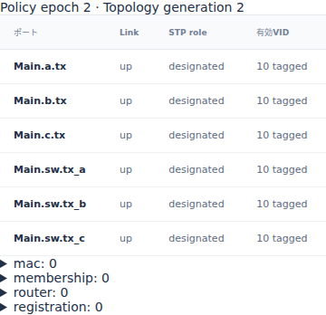
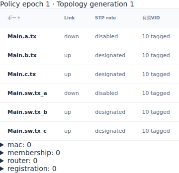

# Ethernetのlink復旧時刻と受信判定

文書バージョン：`1.2.0`
対象GitHubバージョン：`v1.2.0`
文書ID：`guide-ethernet-link-control`
文書状態：公開用完成稿

### 更新履歴

| 文書バージョン | 更新日 | 更新内容 |
| --- | --- | --- |
| `1.2.0` | `2026-10-22` | v1.2.0の対象タグ・文書版を確定。過去の測定基準と公開済み履歴を保持 |
| `1.1.0` | `2026-10-16` | 初版：link復旧の1ps比較、送信済みcopyの継続と到着時の受信判定、公開6入力・正式版実測・実Viewerを追加 |

## 目的：送信できたフレームが届かない理由を調べる

送信中にlinkをdownにしたとき、「送信が途中で消える」のか、「送信は終わるが受信で拒否される」のかを分けて調べます。この実習で使う動的Ethernetモデルは、SOF（送信開始）済みのcopyを中断せず、到着時のlink状態で受け入れを判定します。

要求は、送信開始・終了と受信判定を別々に読み、障害中のフレームと復旧後の次のフレームを区別できることです。変えるのは復旧controlの `at_ps` 一つだけ。到着ちょうどに復旧する `on-time` と、1ps遅い `late` を比較します。転送先は静的FDBで固定します。[MAC学習の実習](EthernetのMAC学習とagingによる転送先.md)と違い、学習表の期限を比較する実習ではありません。

profileは `ethernet.l2.dynamic.v1`。測定と画面は正式[v1.1.4 Release](https://github.com/hideki-ozu/DIR-Simulator/releases/tag/v1.1.4)、source `b45515644dfc65c205216d564d5bf7ef00280622` から取得しました。掲載時のmain `c67e153cc3bcf1f6ac0303d23023ce8ae4a4f533` の後続NED修正は、正式版での測定へ含めていません。

## 構成と責務：配線、制御、受信を分ける

公開Ethernetの1 Switch・3 Endpoint配線をそのまま使います。6本の有向Linkがあり、動的設定では往復を一つの物理linkとして扱います。今回通る接続は次の2段です。

```text
Main.a.tx → Main.sw.rx_a    Main.sw.tx_b → Main.b.rx
```

| 構成 | 責務・境界 | この実習で固定する依存 |
| --- | --- | --- |
| Endpoint a | 時刻0と2000000psに独立した2フレームを生成する | 宛先MACはb、VID10、PCP0、payload空、TX処理0ps |
| Link | 1Gbpsの直列化と1000psの伝搬を表す | SOF後はdownになってもEOF・arrivalまで進む |
| 動的control | `a-sw` のup/downを双方向一体で変更する | downは500000ps。upだけ609000/609001psにする |
| Switch sw | arrival時に入口link/VID/STPを確認し、受理時だけ転送する | 静的FDBでb宛をtx_bへ。転送処理2000ps |
| Endpoint b | 自分宛の正常フレームを受信完了として数える | RX処理0ps。自動応答や再送は生成しない |
| Endpoint c | 公開配線の第3Endpointとして残す | 今回の静的unicast経路ではcopyを受けない |

`a-sw` はNEDのチャンネル名ではなく、modelの `dynamic.links` で `Main.a.tx` と `Main.sw.tx_a` を対応付けたIDです。制御はそのIDを参照します。別の `b-sw` は変更しません。linkが復旧しても、既に受信拒否したcopyを後から再送する機能はありません。

静的FDBにはa/b/cの宛先が設定されています。送信元aも静的に登録済みなので、受理時の `static_shadowed` は動的学習を抑制した監査記録です。これをフレームの受信失敗と数えないでください。今回は `convergence_ps=0`、Switch間linkなしです。抽象STPの冗長経路切替や収束待ちを測る構成ではありません。

## 利用フロー：同じcopyの送信と到着を追う

1. INIからNED・model・workloadを読み、接続とprofileを `validate` します。
2. aが最初のframe `unicast:0` を生成し、0psにSOFします。
3. 500000psに `a-sw` がdownになります。送信済みcopyは継続します。
4. EOFは608000ps、swへのarrivalは609000psです。そのarrivalで復旧済みかを調べます。
5. 受理された場合だけ611000psにswからbへ新しいcopyがSOFし、1220000psにbへ到着します。
6. aは2000000psに次のframe `unicast:1` を独立して生成します。両条件とも復旧済みなのでbへ届きます。

同時刻ではphase0のcontrolを先に適用し、その後phase1のarrivalを判定します。そのため609000psちょうどのupは間に合います。609001psのupは、609000psで終わった受信判定を取り消しません。

## 手順：公開入力を揃え、復旧時刻だけ変える

[6入力ZIP](downloads/ethernet-link-control-inputs.zip)を展開するか、リポジトリの `examples/guide/ethernet-link-control` を使います。ZIPはリポジトリ相対のディレクトリ構成を持ち、他の記事のファイルを必要としません。

| ファイル | 内容 |
| --- | --- |
| `models/ethdemo/Main.ned` | 公開Ethernet配線を変更せず同梱 |
| `model.json` | 公開VLAN全受入設定へ、1 bridge/3 linksの動的設定を共通追加 |
| `on-time.json` / `late.json` | 公開dynamic topology負荷の接続名・down/up時刻を共通整理。2条件の差はup時刻1psだけ |
| `on-time.ini` / `late.ini` | 対応workloadを選ぶ。model・時刻上限・profileは共通 |

両workloadでdownは共通です。

```json
{"id":"down","at_ps":"500000","kind":"link_set","link":"a-sw","up":false}
```

upは `on-time.json` で次の値です。`late.json` では `at_ps` だけを `"609001"` にします。psは10進文字列で記載します。

```json
{"id":"up","at_ps":"609000","kind":"link_set","link":"a-sw","up":true}
```

正式v1.1.4から用意した `dir-simulator` をPATHへ置き、リポジトリのルート、又はZIPを展開したルートで実行します。

```bash
mkdir -p link-results
for case in on-time late; do
  dir-simulator validate --config examples/guide/ethernet-link-control/$case.ini &&
  dir-simulator run --config examples/guide/ethernet-link-control/$case.ini \
    --output link-results/$case &&
  dir-simulator view --input link-results/$case/results.json \
    --output link-results/$case-viewer.html
done
```

これはBash用の例です。PowerShellでは `$case` の2値を順に各コマンドへ代入して実行できます。`link-results` の親ディレクトリを先に用意し、各runの出力先は未使用のものを指定してください。各コマンドの終了0、manifestの `status: complete` と `partial: false` を確認します。runはJSON・CSV・診断・manifestを出力し、viewは同じrunのresults.jsonからHTMLを作ります。HTMLをブラウザーで開けばサーバーなしで確認できます。

## 実測：送信copyの完了と受信完了は別の数

payload空でも、VIDタグ付きMACは68byteです。preamble/SFD込みのwireは `8×(68+8)=608 bit` なので1Gbpsで608000ps、伝搬1000psを足してarrivalは609000psです。IFG込み占有は704000psですが、受信判定が704000psまで待つわけではありません。

| 観測 | on-time | late |
| --- | --- | --- |
| up適用 ps | 609000 | 609001 |
| 最初のa→sw SOF / EOF / arrival ps | 0 / 608000 / 609000 | 0 / 608000 / 609000 |
| 最初のsw受信判定 | forwarded、入口epoch2 | filtered、`link_down`、入口epoch1 |
| 最初のsw→b copy | SOF611000、arrival1220000ps | 生成なし |
| 次のa→sw arrival ps | 2609000 | 2609000 |
| 次のb受信完了 ps | 3220000 | 3220000 |
| generated / serialized | 2 / 4 | 2 / 3 |
| forwarded / received | 2 / 2 | 1 / 1 |
| reception filtered / copy dropped | 0 / 0 | 1 / 0 |

`serialized` はhopごとのcopy数です。aが生成したframe数ではありません。lateでも最初のa→swはserializedになり、その到着に対応するreceptionがfilteredです。copyのqueue dropと受信側filterを混同しないよう、results.jsonのtransferとreceptionを `transfer_id` で対応付けます。

両runとも上限10000000psまでの結果がcompleteで、`events_exhausted`・pending0です。最後のイベントは3315000psの送信資源解放でした。復旧後の次のframeは自動再送ではなく、workloadに最初から指定した別frameです。

## Viewer：同じ609000psで状態と受信を照合する

1. `on-time-viewer.html` を開き、時刻欄へ `609000` を入力してJumpします。Policyのa側linkはupで、topology generationは2です。
2. `late-viewer.html` で同じ時刻へJumpします。a側linkはdown、generationは1です。送信を始めたepoch0と、現在のpolicyを区別できます。
3. lateだけ `609001` へ進めるとupになります。`609000` へ戻すとdownへ戻ることも確認します。
4. `1300000` へ進めて `unicast:0` のa→sw行を選択します。lateの詳細には `link_down` があり、on-timeにはbの受信完了があります。forwardedは2000psの処理後に確定するため、609000psで転送完了件数まで増えたとは読まないでください。
5. `4000000` では `unicast:1` のb受信完了を両条件で確認します。

次は実際のv1.1.4 Viewerの609000psを、390px表示で取得したPolicy画面です。





## 制約と仕様への入口

この実習は一つのEndpoint linkの制御と、SOF済みcopyの到着時判定だけを比較します。電気的な断線で途中のbitが壊れる現象、FCSの自動破損、PHY再同期・自動ネゴシエーション、TCP再送や実機の復旧時間予測は扱いません。down中の新規生成・queue滞留中のdrop、複数Switchの冗長経路、非ゼロ収束時間、停止境界との全組合せも今回の測定対象外です。

制御は明示した事実を時刻どおり適用する抽象モデルです。BPDU等を交換する分散STPの実装や、IEEE全体適合の証明として使わないでください。測定には正式版sourceのclean dev buildを使っており、最適化ビルドの実時間性能比較ではありません。

詳しい境界は[動的Ethernet仕様の抽象tree・切替・観測](https://github.com/hideki-ozu/DIR-Simulator/blob/v1.1.4/docs/specs/models/Ethernet動的制御詳細機能仕様書.md#topology)、既存検証の範囲は[動的Ethernet検証仕様](https://github.com/hideki-ozu/DIR-Simulator/blob/v1.1.4/docs/verification/cases/Ethernet動的制御検証仕様書.md)を参照してください。日本語検索では「復旧」「受信」でこの記事を探せます。
