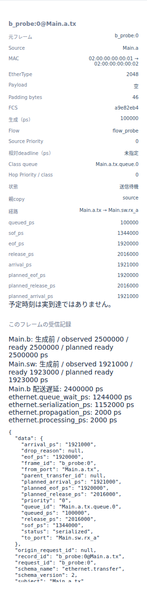

# Ethernetの優先キューと送信順

文書バージョン：`1.2.0`
対象GitHubバージョン：`v1.2.0`
実測ソースcommit：`b45515644dfc65c205216d564d5bf7ef00280622`  
文書ID：`guide-ethernet-priority`  
文書状態：公開用本文

### 更新履歴

| 文書バージョン | 更新日 | 更新内容 |
| --- | --- | --- |
| `1.2.0` | `2026-10-22` | v1.2.0の対象タグ・文書版を確定。過去の測定基準と公開済み履歴を保持 |
| `1.1.0` | `2026-10-13` | Ethernet論理priorityだけを変える実習・FIFOと非プリエンプト・実CLIとViewerを追加 |

## 目的：優先度が効くのは、次を選ぶとき

一つのEndpointからSwitchを通して受信先へ送る場面を考えます。busyを先に送信し、その途中でprobeとfixedを同時に発生させます。probeのpriorityだけを0/3/7へ変え、次の送信順、同じclassのFIFO、送信中フレームを中断しない境界を確認します。

確認する要求は、3元フレームが受信されること、待機中のpriorityで次が決まること、先に送信を開始したbusyは全条件で同じ区間を占有することです。使用する `ethernet.l2.qos.v1` はpriority0〜7の論理キューを扱い、大きい値を優先します。このprofileのpriorityはVLAN PCPのwire符号化ではありません。

## 構成と責務：Endpoint・出力キュー・Link・Switch

| 要素 | 責務と固定条件 |
| --- | --- |
| `Main.a` | 3元フレームを生成。busyは0ps、probe/fixedは100000ps |
| `Main.a.tx` | 0〜7の独立class、strict_priority、class内FIFO。NEDのport全体上限64件と各class64件、byte上限なし |
| Link | 1Gbps、伝搬1000ps。全二重の方向別資源。送信とIFGを終えて次を選ぶ |
| `Main.sw` | 静的FDBで宛先MACをtx_bへ転送。forward_delay2000ps |
| `Main.b` | 宛先。受信処理遅延0ps |
| `Main.c` | 既存サンプルの構成要素として残す。今回の送受信には使わない |

NEDは4ノードと6本の方向別Linkです。使う経路は a.tx → sw.rx_a → sw.tx_b → b.rx です。逆方向やc向けの接続も存在します。modelのoutputsは接続済みの6出力を列挙し、それぞれに8classを設定します。port全体の64件上限も併用するため、64×8件を同時に待機できるという意味ではありません。送信中copyは待機容量から除外します。

NEDが接続とLink時間、model JSONがMAC・FDB・Switch遅延と出力キュー、workloadが生成・flow・priority、INIが参照先と観測終了を担当します。Endpointがoffer→空き出力がclassを選択→Link送信・伝搬→Switch処理・次copy作成→次Link→Endpoint受信、という流れです。

strict_priorityは非空classの最大priorityを選び、class内ではoffer成功順FIFOです。非プリエンプトなので、待機中に高priorityが来ても送信中のcopyを止めません。新しい元フレームと、各出力を通るcopyと、受信判断は別の単位です。

## 再現手順：probeのpriorityだけを変える

[Ethernet優先キュー実習ZIP](downloads/ethernet-priority-inputs.zip)を展開します。NED1、共通model1、workload3、INI3の8入力です。リポジトリでは `examples/guide/ethernet-priority/` に同じ入力があります。

既存qos-priorityサンプルの接続とmodelを使い、生成時刻・ID・flow・busy/fixedのpriorityを共通の実験条件へ整理しています。その共通条件から比較する変数は `generators[1].priority` だけです。元サンプルからpriorityだけを変えた実験とは扱いません。

正式[v1.1.4 Release](https://github.com/hideki-ozu/DIR-Simulator/releases/tag/v1.1.4)のCLIを準備します。Gitとrustup/Cargo導入済みのWSL Ubuntu 24.04 LTS x86_64で、Rust1.85.0を使います。[正式READMEのビルド説明](https://github.com/hideki-ozu/DIR-Simulator/blob/v1.1.4/README.md#canサンプルを実行する)が元資料です。まだ存在しない取得先で実行します。

```bash
git clone --depth 1 --branch v1.1.4 --single-branch https://github.com/hideki-ozu/DIR-Simulator.git DIR-v1.1.4 &&
cd DIR-v1.1.4 &&
test "$(git rev-parse HEAD)" = b45515644dfc65c205216d564d5bf7ef00280622 &&
cargo build --locked --release --target-dir target -p dir-simulator &&
export PATH="$PWD/target/release:$PATH" &&
command -v dir-simulator
```

`&&`によりSHA不一致等では後続を実行しません。最後に取得先のtarget/release/dir-simulatorが表示されることを確認します。PATHはこのシェルの間だけ有効です。正式タグには新しい実習は同梱していないためZIPを別途展開し、同じシェルで展開先 `examples/guide/ethernet-priority` へ移動します。mainやRelease未公開タグを正式実測版として扱いません。

```bash
mkdir out
dir-simulator validate --config priority0.ini
dir-simulator run --config priority0.ini --output out/priority0
dir-simulator view --input out/priority0/results.json --output out/priority0-viewer.html
dir-simulator validate --config priority3.ini
dir-simulator run --config priority3.ini --output out/priority3
dir-simulator view --input out/priority3/results.json --output out/priority3-viewer.html
dir-simulator validate --config priority7.ini
dir-simulator run --config priority7.ini --output out/priority7
dir-simulator view --input out/priority7/results.json --output out/priority7-viewer.html
```

outが既にある場合は新しい展開先を使います。workload差分はprobeのpriorityだけ、INI差分はworkload参照名だけです。宛先MACは02:00:00:00:00:02、EtherType2048、dataは空、deadlineはnull。busyのpriority0、fixedのpriority3、Link・処理時間、終了3000000ps、集計窓100000psは固定です。request IDはa_busy:0 / b_probe:0 / c_fixed:0です。

## 実測：送信中は保持し、待機copyの順を変える

空のdataもEthernetフレームとして送信します。実測でpadding46byte、MAC64byte（FCSを含む）、preambleを加えたwire576bitでした。1GbpsなのでSOF→EOFは576000ps、IFG96bitを加えたSOF→解放は672000psです。busyは0→576000psに送信し、672000psに出力を解放しました。probe/fixedは100000psに生成・offerされるので、どちらもbusy送信中に待機します。

| probe priority | a.txの送信順 | probe SOF（ps） | fixed SOF（ps） | probeのb受信完了（ps） |
| --- | --- | --- | --- | --- |
| 0 | busy → fixed → probe | 1344000 | 672000 | 2500000 |
| 3 | busy → probe → fixed | 672000 | 1344000 | 1828000 |
| 7 | busy → probe → fixed | 672000 | 1344000 | 1828000 |

priority0ではfixedの3が先です。priority3ではprobeとfixedが同じclassに入り、同時生成がgenerator ID順でofferされるためb_probeがc_fixedより先になります。priority7でもprobeはbusyを中断せず、解放後に先に選ばれます。EOF576000psの直後ではなく、IFGを含む解放672000psまで待つことも確認します。

busyは全条件でbへ1156000psに到着しました。各copyのSOF・EOF・解放・伝搬到着、Switchのoffer、受信処理完了を照合しています。Switchは受信EOF＋伝搬1000ps＋処理2000ps後に次copyをofferし、この条件ではSwitch側のqueue待ちは0でした。

| probe priority | probeのqueue待ち合計（ps） | 2Linkの送信合計（ps） | 伝搬合計（ps） | 処理合計（ps） | probe受信遅延（ps） |
| --- | --- | --- | --- | --- | --- |
| 0 | 1244000 | 1152000 | 2000 | 2000 | 2400000 |
| 3 / 7 | 572000 | 1152000 | 2000 | 2000 | 1728000 |

受信遅延は生成100000psから受信完了までです。4成分の和が一致します。ここで変わるのはqueue待ちで、Link速度やframe長ではありません。fixedの遅延は逆に1728000→2400000psとなります。全体平均だけを見ると同じ値になるため、flow別に比較します。

全条件で元frame3、Switch転送3、Endpoint受信3、serialized copy6、破棄/未完了0でした。各元frameが2Linkを通るためcopy6を元frame6件とは数えません。a.txとsw.tx_bの各出力でMAC1536bit、wire1728bit、IFG込み占有2016bit、利用率0.672（分母3000000ps）です。payloadは空なのでpayload_bits0です。二つの方向別資源のbitを足してアプリケーションの配送量とは解釈しません。

終了3000000ps、last_event2595000ps、events_exhausted、partial=false、残イベント0、CLI exit_code0・診断nullでした。

## Viewer：500000psで待機classを読む

生成HTMLを開き、500000psへ移動します。busyのsource copyは送信中、probe/fixedは送信待機です。上部は元frame3、待機copy2、送信中copy1、EOF到達0、受信完了0。class別表示ではpriority0/7条件は二つのclassに各1件、priority3条件はclass3に2件（MAC128byte）です。

source側のb_probe:0（Main.a.tx → Main.sw.rx_a）を選びます。以下はその実Viewer詳細パネルです。基本操作は[Viewerで結果を読む](Viewerで結果を読む.md)を参照してください。




画面の「送信待機」は選択時刻の状態です。一方、詳細JSONや受信時刻・遅延内訳は実行全体の最終記録です。500000psにSOF672000/1344000や受信完了が観測済みという意味ではありません。planned時刻も実到達と区別します。Switch側copyの行はこの時刻では生成前です。

## 制約と仕様への入口

有限3frame、単一送信元、静的FDB、一宛先、空payloadだけを試しました。容量満杯/byte超過、複数送信元、flood・multicast、VLAN、周期/バースト、RX処理競合、途中停止、連続負荷は未検証です。高priorityの連続到着下で低priorityが必ず進む保証は示しません。

PCPのwire符号化、TSN shaping、frame preemption、PAUSE、MAC学習、実機規格適合・実機性能はこの実習の対象外です。期限判定は行わずdeadline=nullなので、期限標本数0・比率nullです。

契約は[正式v1.1.4のEthernet負荷・QoS仕様](https://github.com/hideki-ozu/DIR-Simulator/blob/v1.1.4/docs/specs/models/Ethernet負荷・QoS詳細機能仕様書.md#queues)のDIR-REQ-0219/0220（キューと選択）、[flow計測](https://github.com/hideki-ozu/DIR-Simulator/blob/v1.1.4/docs/specs/models/Ethernet負荷・QoS詳細機能仕様書.md#observations)のDIR-REQ-0221〜0223に対応します。使用した明示生成は[workload契約](https://github.com/hideki-ozu/DIR-Simulator/blob/v1.1.4/docs/specs/models/Ethernet負荷・QoS詳細機能仕様書.md#workload)を参照してください。

[ガイドの入口へ戻る](index.md)
