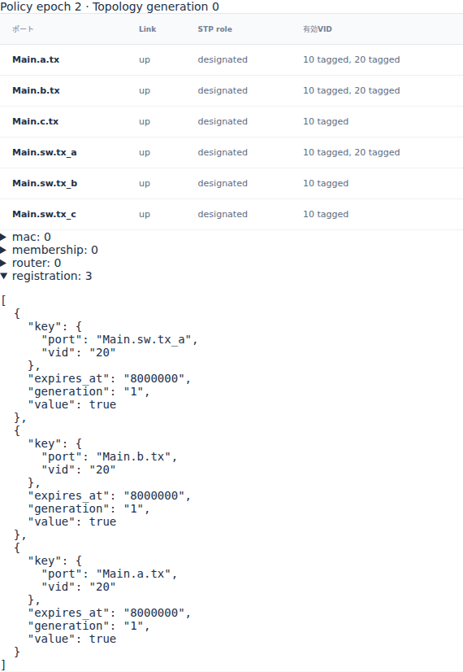
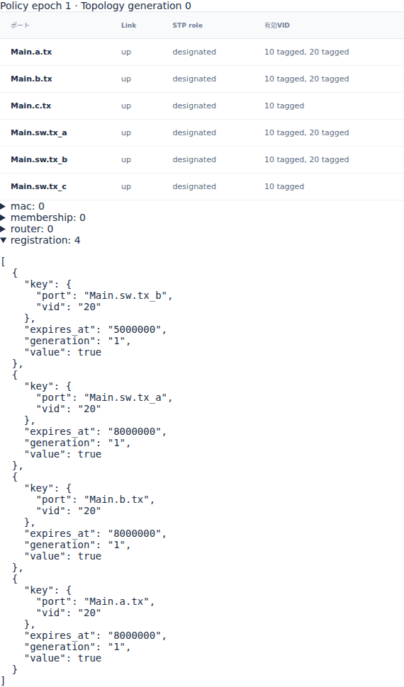

# Ethernetの動的VID登録と有効期限

文書バージョン：`1.1.0`
対象GitHubバージョン：`v1.1.4`
文書ID：`guide-ethernet-vid-registration`
文書状態：公開用完成稿

### 更新履歴

| 文書バージョン | 更新日 | 更新内容 |
| --- | --- | --- |
| `1.1.0` | `2026-10-16` | 初版：出口portの登録寿命だけを変える6入力実習、正式版実測、実Viewerとportごとの期限を追加 |

## 目的：経路が同じでもVIDの有効期限で配送が変わる

[VLAN受入条件の実習](EthernetのVLAN受入条件と破棄理由.md)では静的な受入条件を比較しました。今回は動的Ethernetの `vlan_register` を使い、portへ一時的にVID20を追加します。配線と宛先経路を変えず、Switchの出口portの登録寿命だけを2000000/5000000psにして、同じ2フレームが届くかを調べます。

要求は、「登録可能」と「現在有効」を分け、送信元・Switch入口・出口・受信側それぞれのVID条件を追えることです。出口に宛先の静的FDBがあっても、そのportでVIDが無効なら配送できません。また、一つのportの登録は対向portへ自動伝播しません。

profileは `ethernet.l2.dynamic.v1`。測定と画面は正式[v1.1.4 Release](https://github.com/hideki-ozu/DIR-Simulator/releases/tag/v1.1.4)、source `b45515644dfc65c205216d564d5bf7ef00280622` から取得しました。掲載時のmain `594458ee50aed5c14d4c84d5b68422e26d41d358` に含まれる後続NED修正は、正式版の実測に含めていません。

## 構成と責務：登録許可、有効状態、転送先を分ける

公開Ethernetの1 Switch・3 Endpoint配線をそのまま使います。aからbへの経路は次の2段です。cとの往復配線も残しますが、今回の宛先経路には使いません。

```text
Main.a.tx → Main.sw.rx_a    Main.sw.tx_b → Main.b.rx
```

| 構成・入力 | 責務と境界 | 固定する依存 |
| --- | --- | --- |
| NED | Endpoint・Switch・Linkの配線と媒体時間 | 6方向Link、1Gbps、伝搬1000ps |
| Port.vlans | 常時使える静的VID | すべてVID10 tagged、PVID10 |
| dynamic.registrable | 追加を許可するPort/VID/tag形式 | 6 portでVID20 taggedを許可。許可だけでは有効にならない |
| workload controls | 時刻付きのVID登録と期限 | 4 portを時刻0に登録。出口以外の寿命は8000000ps |
| Switch FDB | 宛先MACとVIDに対する出口を指定 | VID20のb宛はMain.sw.tx_b、処理2000ps |
| a / b | 指定時刻の生成と、自分宛の受信完了 | aは0/3000000psに生成、TX/RX処理0ps |

Port設定の `Main.sw.tx_a` は、対応する入口 `Main.sw.rx_a` のVID判定にも使われます。同様にbの受信側は `Main.b.tx` のPort設定で表します。入力のport名はNEDの対になる入出力を表すための正規名です。

有効VIDは静的 `Port.vlans` と現在の動的registrationの和集合です。今回はVID10を残し、VID20だけを期限付きで追加します。PVIDやuntaggedの分類は変更しません。静的FDBにVID20行を置いてもVID membershipを追加する効果はありません。

登録が必要なのは `Main.a.tx`、`Main.sw.tx_a`、`Main.sw.tx_b`、`Main.b.tx` の4か所です。aだけ登録してもsw入口は有効にならず、sw出口だけ登録してもbの受信条件は有効になりません。今回は対向側も明示的に登録してから、出口の寿命一つだけを比較します。

## 利用フロー：最初の配送と期限後の次の配送を追う

1. INIでNED・model・workloadを選び、validateします。
2. 時刻0のphase0で4つのVID20登録を適用し、その後aが最初のframe `unicast:0` を生成します。
3. a→sw到着609000ps、sw処理完了611000psで、静的FDBのb向け出口が現在VID20を使えるかを調べます。最初は両条件とも有効です。
4. shortでは2000000psに出口のVID20だけが失効します。対向のbは8000000psまでVID20を保持します。
5. aが3000000psに別frame `unicast:1` を生成します。swの入口は両条件とも有効ですが、shortの出口は無効です。known宛先の不適格として候補0になり、floodへ切り替えません。
6. longでは5000000psまで出口が有効なので、次のframeもbへ届きます。8000000psには共通の残り3登録も失効し、静的VID10だけが残ります。

短い登録は `[0,2000000)`、長い登録は `[0,5000000)` psで有効です。期限はframeの生成・到着時刻からではなくregister時刻から数えます。今回はrefresh/unregisterを使いません。

## 手順：公開入力で出口のlifetimeだけを変える

[独立6入力ZIP](downloads/ethernet-vid-registration-inputs.zip)を展開するか、`examples/guide/ethernet-vid-registration` を使います。ZIPはリポジトリ相対の構成で、他の記事のファイルを必要としません。

| ファイル | 内容 |
| --- | --- |
| `models/ethdemo/Main.ned` | 公開Ethernetの配線を変更せず同梱 |
| `model.json` | 公開VLAN設定由来の動的modelへVID20の静的FDB行とregistrableを共通追加 |
| `short.json` / `long.json` | 公開registration負荷をMain名・VID20・2回生成・4 port登録へ共通整理 |
| `short.ini` / `long.ini` | 対応workloadを選ぶ。model・profile・上限時刻は共通 |

比較するcontrolは次の1行です。`long.json` では `lifetime_ps` だけを `"5000000"` にします。残り3 portの `"8000000"` は変えません。

```json
{"id":"egress","at_ps":"0","kind":"vlan_register",
 "port":"Main.sw.tx_b","vid":20,"lifetime_ps":"2000000"}
```

正式v1.1.4の `dir-simulator` をPATHへ置き、リポジトリ又はZIP展開先ルートで実行します。次はBash用です。

```bash
mkdir -p registration-results
for case in short long; do
  dir-simulator validate --config examples/guide/ethernet-vid-registration/$case.ini &&
  dir-simulator run --config examples/guide/ethernet-vid-registration/$case.ini \
    --output registration-results/$case &&
  dir-simulator view --input registration-results/$case/results.json \
    --output registration-results/$case-viewer.html
done
```

PowerShellでは `$case` の2値を各コマンドへ順に代入できます。親ディレクトリを先に作り、各runの出力先は未使用のものにします。validate/run/viewの各終了0、manifestの `status: complete` と `partial: false` を確認してください。runのJSON・CSV・診断・manifestを保存し、そのresults.jsonから作ったViewer HTMLを開きます。ブラウザーでの確認にサーバーは不要です。

## 実測：登録が切れても対向portは残る

tag付きMAC68byteとpreamble/SFDの8byteでwireは608bit、1Gbpsなら608000psです。伝搬1000psを足して最初のsw到着609000ps、処理2000ps後の転送SOF611000ps、b到着1220000psになります。次のframeは各時刻に3000000psを加えます。

| 観測 | short | long |
| --- | --- | --- |
| sw.tx_bのVID20期限 ps | 2000000 | 5000000 |
| b.txのVID20期限 ps | 8000000 | 8000000 |
| 最初のb受信完了 ps | 1220000 | 1220000 |
| 次のsw到着 / 処理完了 ps | 3609000 / 3611000 | 3609000 / 3611000 |
| 次のsw reception | filtered | forwarded |
| 次のsw→b SOF / b受信 ps | 生成なし | 3611000 / 4220000 |
| generated / serialized | 2 / 3 | 2 / 4 |
| forwarded / received | 1 / 1 | 2 / 2 |
| reception filtered / copy dropped | 1 / 0 | 0 / 0 |

shortでもa→swは送信完了しています。入口は有効で処理まで進み、静的FDBが指す出口の不適格で候補0になったため `known_egress_ineligible` です。出口queueへ入れたcopyをdropした結果ではありません。`serialized` はframe数ではなくhopごとのcopy数です。

両runは上限10000000psまでのcomplete結果、`events_exhausted`・pending0です。最後のイベントは8000000psの共通登録失効でした。静的FDBにある送信元aの `static_shadowed` 記録は動的MAC学習の抑制を示し、受信失敗の件数ではありません。

## Viewer：有効VIDとregistrationを照合する

1. 各Viewerで時刻 `4000000` へJumpします。shortではsw.tx_bの有効VIDは10だけ、longでは10と20です。対向のb.txは両条件で10と20です。
2. Policyの `registration` を展開します。shortは3件、longは4件です。port/vidとexpires_atを照合してください。
3. shortでは `1999999` で出口登録あり、`2000000` でなしになります。前の時刻へ戻すと同じ表が復元されます。longの境界は4999999/5000000psです。
4. `5000000` で `unicast:1` のa→sw行を選びます。shortは `known_egress_ineligible`、longはbの受信完了です。
5. `8000000` でregistrationは空になります。各portの静的VID10は残ります。

次は正式v1.1.4の実Viewerを4000000ps・600px表示で取得した画面です。入口や対向を含め、同じVIDの有効期間がportごとに異なることを確認できます。Viewerの有効VID表は390px幅では右端が切れるため、表全体を見る場合はウィンドウを広げてください。





## 制約と仕様への入口

単一Switch・VID20・2 frame・競合なしで登録寿命を比較した実習です。refresh/unregister、登録上限、期限とlookupの同時刻全境界、待機中copyのdrop、link/STP切替や複数Switch構成は測定していません。registrableは静的VIDと重複できず、動的VIDはtagged形式だけです。静的VID10の解除を試す入力にはなっていません。

登録は設定した事実を時刻どおり適用する抽象controlです。実MVRP packetの交換・分散登録protocolやIEEE全体適合を示すものではありません。正式sourceのclean dev buildを使い、最適化ビルドの性能比較はしていません。

詳しい契約は[正式版の動的Ethernet仕様](https://github.com/hideki-ozu/DIR-Simulator/blob/v1.1.4/docs/specs/models/Ethernet動的制御詳細機能仕様書.md#membership)、実施範囲は[動的Ethernet検証仕様](https://github.com/hideki-ozu/DIR-Simulator/blob/v1.1.4/docs/verification/cases/Ethernet動的制御検証仕様書.md)を参照してください。日本語検索では「登録」「期限」でこの記事を探せます。
