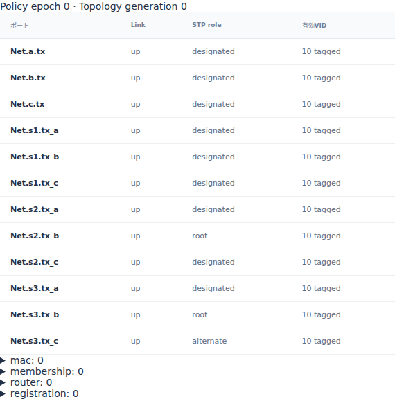

# Ethernetの抽象STPとリンクcostによる配送経路

文書バージョン：`1.2.0`
対象GitHubバージョン：`v1.2.0`
文書ID：`guide-ethernet-stp-cost`
文書状態：公開用完成稿

### 更新履歴

| 文書バージョン | 更新日 | 更新内容 |
| --- | --- | --- |
| `1.2.0` | `2026-10-22` | v1.2.0の対象タグ・文書版を確定。過去の測定基準と公開済み履歴を保持 |
| `1.1.0` | `2026-10-17` | 初版：三角網のL12 costだけを変える6入力実習、初期role・copy経路・正式版実測と実Viewerを追加 |

## 目的：costを通信速度と分けて経路を読む

Switchを三角形につなぐと、同じframeが循環しないように転送経路を制限する必要があります。動的Ethernetの抽象STPは、bridge IDとlinkのcostから共通treeとportのroleを計算します。今回の要求は、costを一つ変えたとき、どの入口が受理され、bまで何段を通るかを説明できることです。

比較するのはlink `L12` の `cost` だけで、10と30にします。bitrate、伝搬遅延、Switch処理時間は固定です。costはtreeを選ぶ重みであり、bitの送信時間へ直接加算するps値ではありません。[link復旧の実習](Ethernetのlink復旧時刻と受信判定.md)のような時刻付きdown/upは行わず、初期状態の経路を比較します。

profileは `ethernet.l2.dynamic.v1`。数値と画面は正式[v1.1.4 Release](https://github.com/hideki-ozu/DIR-Simulator/releases/tag/v1.1.4)、source `b45515644dfc65c205216d564d5bf7ef00280622` から取得しました。掲載時のmain `60e238e04c1a7fd1bd714d02e928f51f4683de88` の後続NED修正は、この正式版の実測へ含めていません。

## 構成と責務：配線、tree、宛先を分ける

公開dynamicサンプルの3 Switch・3 Endpoint配線をそのまま使います。各接続は往復で、NEDには12方向Linkがあります。

```text
a ― s1 ―L12― s2 ― b
    │        │
   L13      L23
    │        │
    └── s3 ──┘
         │
         c
```

| 構成 | 責務・境界 | 固定する依存 |
| --- | --- | --- |
| NED | 物理配線とLink時間を定める | 全Link 1Gbps・伝搬1000ps、全up |
| bridge設定 | 共通treeのrootを選ぶ | s1/s2/s3のIDは1/2/3。最小のs1がroot |
| dynamic.links | up graphと経路costを定める | L13/L23は10、L12だけ10/30 |
| Switch | 入口STP判定、送信元学習、出口候補選択 | 処理2000ps、全port VID10 tagged |
| a / b / c | aが時刻0にb宛の1 frameを生成する | 宛先はbのMAC、payload空。cには宛先不一致で受信filter |

宛先bへの静的FDBは、両条件で共通に空へ整理しました。元サンプルの固定出口を残すと、その出口を追う実験になってしまうためです。bは送信しないので、そのMACもまだ学習されていません。この最初のunknown unicastをfloodし、treeの入口/出口適格性で広がりを制限します。送信元aのMAC学習は起きますが、宛先bを学習したことにはなりません。

root portはrootへ向かう入口、designated portはそのlinkでの転送担当、alternateはdiscardingになる代替portです。root又はdesignatedはforwardingで、alternateの入口では受信を拒否します。送信側がdesignatedでも、対向側がalternateならそのcopyは対向で拒否されます。物理linkのdownとは別です。

## 利用フロー：roleから受理経路へつなぐ

1. INIでNED・model・workloadを読み、validateします。時刻0の初期treeは準備済みで、収束待ちを追加しません。
2. a→s1へframeが届き、s1はL12/L13へcopyを送ります。s1はrootなので、両方の出口がdesignatedです。
3. lowではs2のrootまでのcostは直接10、s3経由は20なのでL12側がroot portです。bへはa→s1→s2→bで届きます。
4. highでは直接30、s3経由20なのでs2のroot portはL23側です。L12側へ届いた早いcopyはs2で拒否され、a→s1→s3→s2→bの後続copyが受理されます。
5. cにも枝のcopyが届きますが宛先はbなので、cでは `destination_mismatch` です。tree選択とEndpointの宛先判定を分けて読みます。

lowでL23のdesignated側がs2なのは、s2/s3のrootまでのcostがともに10で、bridge ID2が3より小さいためです。highではs3まで10、s2まで20なのでs3側がdesignatedになります。

## 手順：公開入力でL12のcostだけを変える

[独立6入力ZIP](downloads/ethernet-stp-cost-inputs.zip)を展開するか、`examples/guide/ethernet-stp-cost` を使います。ZIPはリポジトリ相対の構成で、他の記事の入力は不要です。

| ファイル | 内容 |
| --- | --- |
| `models/ethdynamic/Main.ned` | 公開dynamic配線とbyte同一 |
| `workload.json` | 公開dynamic unicast負荷とbyte同一。時刻0の1 frame、controls空 |
| `low.json` / `high.json` | 公開dynamic modelの静的FDBを共通に空へ整理し、L12 costだけを比較 |
| `low.ini` / `high.ini` | 対応modelを選ぶ。profile・負荷・上限時刻は共通 |

`low.json` の比較対象は次のlinkです。`high.json` では `cost` だけを `"30"` にします。速度やNEDのdelayは変更しません。

```json
{"id":"L12","ports":["Net.s1.tx_b","Net.s2.tx_b"],
 "up":true,"cost":"10"}
```

正式v1.1.4の `dir-simulator` をPATHへ置き、リポジトリ又はZIP展開先ルートで実行します。次はBash用です。

```bash
mkdir -p stp-results
for case in low high; do
  dir-simulator validate --config examples/guide/ethernet-stp-cost/$case.ini &&
  dir-simulator run --config examples/guide/ethernet-stp-cost/$case.ini \
    --output stp-results/$case &&
  dir-simulator view --input stp-results/$case/results.json \
    --output stp-results/$case-viewer.html
done
```

PowerShellでは `$case` の2値を順に各コマンドへ代入できます。親ディレクトリを先に作り、runは未使用の出力先を指定します。各終了0、manifestの `status: complete` と `partial: false` を確認してください。JSON・CSV・診断・manifestを保存し、同じresults.jsonから作ったViewer HTMLをブラウザーで開きます。サーバーは不要です。

## 実測：経路は1段増えるがcopy総数は同じ

| 観測 | low | high |
| --- | --- | --- |
| L12 cost | 10 | 30 |
| s2のroot port | tx_b（L12） | tx_c（L23） |
| alternate port | s3.tx_c | s2.tx_b |
| b受信完了 ps | 1831000 | 2442000 |
| generated / serialized | 1 / 6 | 1 / 6 |
| forwarded / received | 3 / 1 | 3 / 1 |
| reception filtered / copy dropped | 2 / 0 | 2 / 0 |

tag付きMACは68byte、preamble/SFD込みwireは608bitなので、1Gbpsで608000ps、伝搬込みarrivalはSOFから609000ps後です。各Switchはさらに2000psを処理に使います。lowのb向け最後のSOFは1222000ps、highでは1833000psです。b到着の差611000psは1段分の `609000+2000` で、costの差20psを加算した結果ではありません。IFG込み占有704000psも、到着時刻と区別します。

両条件でcopyは6件ですが、通る枝と入口判定が異なります。lowではL23をs2→s3に進んだcopyが1831000psに `stp_discarding`、highではL12をs1→s2に進んだcopyが1220000psに同じ理由でfilterされます。もう1件はcで1831000psの `destination_mismatch` です。SOF済みcopyの送信完了と、その後のreception filterは別の記録です。

highの同じframeはs2に2回到達します。早いL12側の拒否と、後のL23側の受理を、異なるvisit/transfer IDとparentで対応付けます。拒否されたcopyを再送したのではなく、s1から分かれた別の枝です。

両runは上限10000000psまでのcomplete結果、`events_exhausted`・pending0です。最後のイベントはMAC学習の失効でlow6220000ps/high6831000psでした。これをbへの配送時刻やSTP収束時間と読み替えないでください。今回はtopology generationはずっと0で、時刻付きlink変更はありません。

## Viewer：初期roleとcopyの親子を確認する

1. 各Viewerで時刻 `0` へJumpし、PolicyのSTP roleを見ます。lowのs2.tx_bはroot、s3.tx_cはalternate。highはs2.tx_bがalternate、s2.tx_cがrootです。
2. 時刻 `3000000` でb向けの行を選び、到着1831000/2442000psとb受信完了を照合します。
3. `stp_discarding` になった枝の行を選び、拒否した入口がlowのs3.rx_c/highのs2.rx_bであることを確認します。
4. `0` へ戻すと同じ初期roleが復元されます。rootというroleはSwitch全体のroot選出とは別で、s1の各portがrootと表示されるわけではありません。

次は正式版の実Viewerの時刻0を600pxで取得したPolicy画面です。390pxで表が枠より広い場合は、表内を横スクロールして右端の有効VIDまで確認できます。




## 制約と仕様への入口

これは中央計算の単一共通treeで、実BPDUの送受信や分散STP protocol、IEEE全体適合の証明ではありません。costは入力modelの初期値で比較し、run中のcost変更機能を使った実験ではありません。convergence_psは共通設定に残っていますが、初期treeを待つ遅延ではなく、今回その収束性能を測定していません。

三角網・VID10・1 frameだけの範囲です。link down/up、非ゼロ収束中の切替、parallel link、非連結、VLAN分断、表容量、複数frameの競合は今回未測定です。unknown unicastのfloodを観察する共通条件であり、任意の静的FDBを自動で迂回経路へ書き換える機能は主張しません。正式sourceのclean dev buildを使い、最適化ビルドの実時間性能は比較していません。

詳しいtreeと入口判定は[正式版の動的Ethernet仕様](https://github.com/hideki-ozu/DIR-Simulator/blob/v1.1.4/docs/specs/models/Ethernet動的制御詳細機能仕様書.md#topology)、検証済み範囲は[動的Ethernet検証仕様](https://github.com/hideki-ozu/DIR-Simulator/blob/v1.1.4/docs/verification/cases/Ethernet動的制御検証仕様書.md)を参照してください。日本語検索では「経路」「三角」でこの記事を探せます。
