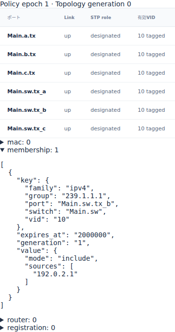
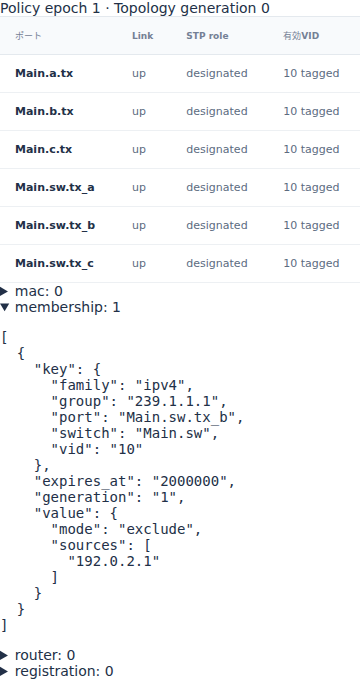

# Ethernetの源別multicastとINCLUDE・EXCLUDE

文書バージョン：`1.1.0`
対象GitHubバージョン：`v1.1.4`
文書ID：`guide-ethernet-source-filter`
文書状態：公開用完成稿

### 更新履歴

| 文書バージョン | 更新日 | 更新内容 |
| --- | --- | --- |
| `1.1.0` | `2026-10-16` | 初版：源別membershipのmodeだけを変える6入力実習、正式版実測、期限後のfloodと実Viewerを追加 |

## 目的：同じgroupでも送信元によって配送を選ぶ

multicastは複数の受信先へ送る仕組みです。[静的multicastの実習](Ethernetの静的multicastとコピーの配送先.md)ではgroupに対する出口を固定しました。今回は動的Ethernetの源別membershipを使い、「このgroupのうち、どのIP送信元をこのportへ配送するか」を調べます。

要求は、送信元集合の意味と、配送先が0になる場合、登録期限が切れた場合を説明できることです。集合を `192.0.2.1` の一つに固定し、modeだけを変えます。`include` は集合にある送信元を受理し、`exclude` は集合にない送信元を受理します。送るframeのIP送信元も `192.0.2.1` なので、同じ集合でも最初の配送先が変わります。

profileは `ethernet.l2.dynamic.v1`。数値と画面は正式[v1.1.4 Release](https://github.com/hideki-ozu/DIR-Simulator/releases/tag/v1.1.4)、source `b45515644dfc65c205216d564d5bf7ef00280622` から取得しました。掲載時のmain `c67e153cc3bcf1f6ac0303d23023ce8ae4a4f533` に含まれる後続NED修正は、この正式版の測定へ含めていません。

## 構成と責務：Switchの登録とEndpointの購読を分ける

公開Ethernetの1 Switch・3 Endpoint配線を変更せず使います。物理配線は次の往復3組です。矢印は今回主に使う方向です。

```text
Main.a.tx → Main.sw.rx_a    Main.sw.tx_a → Main.a.rx
Main.b.tx → Main.sw.rx_b    Main.sw.tx_b → Main.b.rx
Main.c.tx → Main.sw.rx_c    Main.sw.tx_c → Main.c.rx
```

| 構成 | 責務・境界 | 固定する依存 |
| --- | --- | --- |
| Endpoint a | 時刻100/3000000psに別々のframeを生成する | VID10、PCP0、payload空、IP送信元192.0.2.1・group239.1.1.1 |
| Link | wire直列化と伝搬を表す | 1Gbps・伝搬1000ps、全link up |
| Switch sw | IPのfamily/group/sourceに対する登録を検索し、候補portを選ぶ | tx_bに一つのmembership、静的L2 multicast集合は空、router登録なし |
| 動的control | membershipを時刻0に設定し、2000000psに失効させる | mode以外のkey・sources・lifetimeは同一 |
| Endpoint b/c | 届いたL2 multicastを静的購読条件で受け付ける | 両者ともVID10・MAC01:00:5e:01:01:01を購読、RX処理0ps |

Switchの登録は `(switch, VID, family, group, port)` がkeyです。今回は `Main.sw / 10 / ipv4 / 239.1.1.1 / Main.sw.tx_b`。この登録からEndpointの購読設定を自動生成することはありません。cはL2 groupを購読していても、最初のSwitch配送候補には登録されていません。

IPv4 group `239.1.1.1` は宛先MAC `01:00:5e:01:01:01` に対応します。frameの `ip_multicast` は明示metadataで、payloadから実IP headerを解析する機能ではありません。`family/source/group` の入力整合を検査しますが、ここではdataを空にしています。

## 利用フロー：登録中と期限後の二つの送信を追う

1. INIでNED・model・workloadを接続し、CLIでvalidateします。
2. 時刻0にmembershipを設定します。登録の有効区間は `[0, 2000000)` psです。
3. aが100psに `ipv4:0` を生成し、609100psにswへ到着します。swは2000psの処理後、送信元集合とmodeで候補を選びます。
4. includeならb向けのcopyを一つ作ります。excludeならこの送信元は不一致で候補0です。groupのmembershipが存在するためknownとして扱い、unknown floodへ変更しません。
5. 2000000psにmembershipが削除されます。これはsourcesを空に変更した状態とは異なります。
6. aが3000000psに別frame `ipv4:1` を生成します。到着時にはgroupの登録も静的候補もrouter登録もないのでunknownとなり、共通設定 `unknown_multicast=flood` に従ってb/cへ配送されます。

候補選択の後もingress除外・link/VID/STPの適格性検査があります。今回はすべて固定してmodeの影響だけを比較します。静的L2候補やrouter登録を追加するとそれらとの和集合になるため、excludeだけで全配送を禁止できるとは限りません。

## 手順：公開入力でmodeだけを変える

[独立6入力ZIP](downloads/ethernet-source-filter-inputs.zip)を展開するか、リポジトリの `examples/guide/ethernet-source-filter` を使います。ZIPにはリポジトリ相対のディレクトリ構成があり、他の記事の入力は不要です。

| 入力 | 内容 |
| --- | --- |
| `models/ethdemo/Main.ned` | 公開Ethernet配線を変更せず同梱 |
| `model.json` | 公開VLAN設定を動的profileへ共通整理。Endpoint購読は公開dynamic modelから使用 |
| `include.json` / `exclude.json` | 公開membership負荷からIPv4送信とjoin4を取り出し、Mainの接続名へ対応付ける |
| `include.ini` / `exclude.ini` | 共通model・profile・上限時刻で、対応workloadを選ぶ |

membershipの共通部分は次のとおりです。`exclude.json` では `mode` だけを `"exclude"` にします。sources、group、port、lifetimeは変えません。

```json
{
  "id":"join4", "at_ps":"0", "kind":"membership_set",
  "switch":"Main.sw", "port":"Main.sw.tx_b", "vid":10,
  "family":"ipv4", "group":"239.1.1.1", "mode":"include",
  "sources":["192.0.2.1"], "lifetime_ps":"2000000"
}
```

正式v1.1.4の `dir-simulator` をPATHに置き、リポジトリ又はZIP展開先のルートから実行します。これはBash用です。

```bash
mkdir -p source-results
for case in include exclude; do
  dir-simulator validate --config examples/guide/ethernet-source-filter/$case.ini &&
  dir-simulator run --config examples/guide/ethernet-source-filter/$case.ini \
    --output source-results/$case &&
  dir-simulator view --input source-results/$case/results.json \
    --output source-results/$case-viewer.html
done
```

PowerShellでは `$case` の2値を各コマンドへ順に代入して実行できます。出力親ディレクトリを先に作り、各runは未使用の出力先を指定してください。validate/run/viewの各終了0、manifestの `status: complete`・`partial: false` を確認します。runのresults.jsonとCSV・診断・manifestを保存し、そのresults.jsonから作ったViewer HTMLをブラウザーで開きます。サーバーは不要です。

## 実測：候補0とunknown floodを区別する

tag付きMACは68byte、preamble/SFD込みwireは `8×(68+8)=608 bit`。1Gbpsで608000ps、伝搬1000psなので、最初のa→sw arrivalは `100+609000=609100` psです。sw処理2000ps後に転送するとSOF611100ps、b到着1220100psになります。IFG込み占有704000psは到着時刻と別です。

| 観測 | include | exclude |
| --- | --- | --- |
| 送信元集合 | {192.0.2.1} | {192.0.2.1} |
| 最初のsw処理完了 ps | 611100 | 611100 |
| 最初の転送先 | bのみ | 0、`multicast_filtered` |
| 最初のb受信完了 ps | 1220100 | なし |
| membership失効 ps | 2000000 | 2000000 |
| 次のsw処理完了 ps | 3611000 | 3611000 |
| 次の転送先・受信完了 ps | b/c、両方4220000 | b/c、両方4220000 |
| generated / serialized | 2 / 5 | 2 / 4 |
| forwarded / received | 2 / 3 | 1 / 2 |
| reception filtered / copy dropped | 0 / 0 | 1 / 0 |

frame数は両方2ですが、`serialized` はhopごとのcopy数です。excludeでもa→sw copyは送信完了し、sw receptionが `multicast_filtered` になります。存在しない出口copyをqueue dropとして数えません。次のframeは最初からworkloadに指定した独立した送信で、自動再送ではありません。

両runとも上限10000000psまでのcomplete結果で、`events_exhausted`・pending0です。最後のイベントは4315000psの資源解放でした。membershipの期限は生成時刻やarrivalからではなく、今回のset時刻0から2000000psです。

## Viewer：登録集合、受信理由、期限を同じrunで見る

1. `include-viewer.html` を開き、時刻欄に `611100` と入力してJumpします。Policyの `membership` を展開し、tx_b・group・mode・sources・expires_atを見ます。
2. `exclude-viewer.html` でも同じ時刻を見ます。keyとsourcesは同じでmodeだけが違います。
3. `1300000` へ進めて `ipv4:0` のa→sw行を選ぶと、includeはb受信完了、excludeは `multicast_filtered` でb/c受信なしと確認できます。
4. `1999999` で登録あり、`2000000` で登録なしになります。前の時刻へ戻すと同じ表が復元されます。
5. `5000000` で `ipv4:1` を調べ、両条件でb/cの受信完了を確認します。

次の2枚は正式v1.1.4の実Viewerで611100psのmembershipを展開し、390px表示で取得しました。





## 制約と次に確認すること

今回の測定は単一Switch・VID10・IPv4 group一つ・送信元一つ・2 frameだけです。IPv6、複数sources、INCLUDE空/EXCLUDE空、router portとの合成、refresh/leave、表容量、STP/link変更、期限とlookupの同時刻境界の全組合せは検証していません。空INCLUDEは明示受理0、空EXCLUDEは全source受理という仕様ですが、登録自体が消える期限切れとは区別してください。

membership_setはportを代表する集約状態を明示設定する抽象controlです。実IGMP/MLDのquery/report packetを生成・解析する機能、実IP packetのchecksumやheader処理、規格全体適合の証明ではありません。測定には正式sourceのclean dev buildを使い、最適化ビルドの性能比較はしていません。

詳しい候補集合と期限は[正式版の動的Ethernet仕様](https://github.com/hideki-ozu/DIR-Simulator/blob/v1.1.4/docs/specs/models/Ethernet動的制御詳細機能仕様書.md#membership)、検証済み範囲は[動的Ethernet検証仕様](https://github.com/hideki-ozu/DIR-Simulator/blob/v1.1.4/docs/verification/cases/Ethernet動的制御検証仕様書.md)を参照してください。日本語検索では「集合」「配送」でこの記事を探せます。
