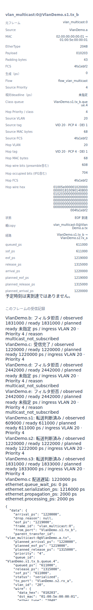
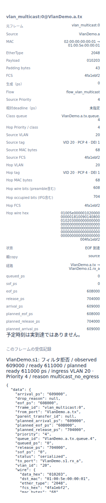

# Ethernetの静的multicastとコピーの配送先

文書バージョン：`1.2.0`
対象GitHubバージョン：`v1.2.0`
文書ID：`guide-ethernet-static-multicast`
文書状態：公開用完成稿

### 更新履歴

| 文書バージョン | 更新日 | 更新内容 |
| --- | --- | --- |
| `1.2.0` | `2026-10-22` | v1.2.0の対象タグ・文書版を確定。過去の測定基準と公開済み履歴を保持 |
| `1.1.0` | `2026-10-14` | 初版：静的groupの出口リストだけを変える9入力実習、正式版CLI実測と実Viewer、転送コピーとEndpoint購読の境界を追加 |

## 目的：一つのフレームがどこへ複製されるか調べる

同じデータを複数の宛先へ配るとき、「Switchが転送した数」と「Endpointが受信した数」は一致するとは限りません。この実習ではmulticast（グループ宛の配送）のフレームを1個だけ生成し、最初のSwitchの出口リストだけを変えます。出口なし・近くのcだけ・下流にも複製する、の3条件を比べます。

要求は、元フレーム・各hopの転送コピー・受信記録を区別し、届かなかった場所と理由を説明できることです。Switchの静的group表は配送経路を決め、Endpointの購読は届いたgroupを受け取るか決めます。購読設定だけでSwitchの経路が自動的に作られるモデルではありません。

使用profileは`ethernet.l2.vlan.v1`です。数字と画像は正式[v1.1.4 Release](https://github.com/hideki-ozu/DIR-Simulator/releases/tag/v1.1.4)のCLIで取得しました。実測source commitは`b45515644dfc65c205216d564d5bf7ef00280622`です。VLAN受入・priority・TASを変える既存実習とは異なり、本実習は静的multicastの経路を比較します。

## 構成と責務：経路の指定と受信の購読を分ける

公開サンプル`examples/ethernet/vlan-multicast.ini`のconnected treeを使います。図は今回の送信方向です。NEDには逆方向のLinkもあり、全14方向をそのまま残します。

```text
a.tx → s1.rx_a
       s1.tx_c → c.rx（group購読あり）
       s1.tx_b → s2.rx_a
                 s2.tx_c → b.rx（未購読）
                 s2.tx_b → s3.rx_a
                           s3.tx_b → d.rx（未購読）
                           s3.tx_c → e.rx（未購読）
```

名前の完全パスは`VlanDemo.a`、`VlanDemo.s1`等です。全Linkは1Gbps・伝搬1000ps、Switchの処理は2000ps、EndpointのTX/RX処理は0psです。接続はNEDで決まり、JSONの出口名で新しいLinkを追加することはできません。

| 構成要素 | 責務・境界・依存する入力 |
| --- | --- |
| NED | Endpoint 5個・Switch 3個とLinkを接続。出力txの完全パスはmodel-configの参照先になる |
| INI | network、NED探索先、profile、model-config、workload、終了時刻を結ぶ |
| workload | aが時刻0に1個生成。宛先`01:00:5e:00:00:01`、payload `010203`、VID20・PCP4・DEI1、priority4、deadlineなし |
| Port policy | 受入は全て`all`、VID20は全Portでtagged。今回は受入条件やtagを変えない |
| Switchのgroup表 | `(VID, group MAC)`に一致する静的出口を選び、ingressと同じPortを除く。s1の出口リストだけが比較変数 |
| 出力キュー・Link | 候補ごとに別のコピーを作り、容量を判定して送信。全Portの総容量64・各class容量64を固定する |
| Endpointの購読 | cだけがVID20のこのgroupを購読。b/d/eへのwire到達は購読を意味しない |
| Viewer | 保存済み結果を表示し、frame→transfer→reception→子transferを追う。表示時にシミュレーションを再実行しない |

s2は同groupを`tx_b`（s3へ）と`tx_c`（bへ）に、s3は`tx_b`（dへ）と`tx_c`（eへ）に転送する設定です。この2表とEndpoint購読を固定します。`unknown_multicast`も全Switchで`flood`のままですが、今回の宛先は登録済みです。**登録の出口リストが空でも「未登録」には戻らず、floodしません。**

## 入力を用意して正式CLIを準備する

[独立入力ZIP](downloads/ethernet-multicast-inputs.zip)を展開すると`examples/guide/ethernet-multicast`に9ファイルがあります。ZIP単独で再現でき、既存の記事のZIPは不要です。mainをcloneした場合は同じ入力が同梱されています。

| ファイル | 内容 |
| --- | --- |
| `models/ethdemo/Main.ned` / `VlanDemo.ned` | 公開Ethernetサンプルの型と接続を変更せず使用 |
| `workload.json` | 公開`vlan-multicast.json`と同じ1フレーム |
| `none.json` / `local.json` / `branch.json` | s1の`multicast[0].egresses`だけが異なる。branchは公開`model-vlan.json`そのもの |
| `none.ini` / `local.ini` / `branch.ini` | model-config名だけが異なる。終了4000000ps、集計窓4000000psは共通 |

比較するJSON項目は`switches[0].multicast[0].egresses`です。`switches[0].instance`が`VlanDemo.s1`、groupがVID20・`01:00:5e:00:00:01`であることを確認します。

| 条件 | 出口リスト |
| --- | --- |
| none | `[]` |
| local | `["VlanDemo.s1.tx_c"]` |
| branch | `["VlanDemo.s1.tx_b", "VlanDemo.s1.tx_c"]` |

以下はWSL上のUbuntu 24.04 LTS x86_64、Rust 1.85.0の手順です。Gitとrustup/Cargoを準備済みのシェルを使います。`dir-v114-cli`は新しい名前にしてください。SHAが一致した場合だけビルドします。`-j 1`は同時コンパイルを1個に制限します。

```bash
git -c core.autocrlf=false clone --depth 1 --branch v1.1.4 --single-branch \
  https://github.com/hideki-ozu/DIR-Simulator.git dir-v114-cli &&
cd dir-v114-cli &&
test "$(git rev-parse HEAD)" = b45515644dfc65c205216d564d5bf7ef00280622 &&
cargo build --locked --release -j 1 --target-dir target -p dir-simulator &&
export PATH="$PWD/target/release:$PATH" &&
command -v dir-simulator
```

次にZIPを展開したディレクトリへ移動し、`examples/guide/ethernet-multicast`があることを確認します。同じシェルでPATHを維持します。出力には新しい名前を使ってください。

```bash
mkdir multicast-results
for case in none local branch; do
  dir-simulator validate --config examples/guide/ethernet-multicast/$case.ini &&
  dir-simulator run --config examples/guide/ethernet-multicast/$case.ini \
    --output multicast-results/$case &&
  dir-simulator view --input multicast-results/$case/results.json \
    --output multicast-results/$case-viewer.html || break
done
```

各runは`manifest.json`、`results.json`、`events.csv`、`summary.csv`、`diagnostics.jsonl`を保存します。validate→run→viewの順で失敗を確認します。CLIの終了0とmanifestの`status:complete`・`partial:false`を確認し、生成した`*-viewer.html`をブラウザで開きます。Viewerはサーバー不要でオフライン表示できます。

## 実測：転送が増えても受信Endpointは増えない

3条件とも元frameは1個で、全copyは送信完了しています。終了は`events_exhausted`、未処理イベント0、途中結果ではありません。`received`はEndpointの受信記録、`filtered`はSwitchまたはEndpointの受信拒否記録、`serialized`はhopごとの送信完了コピーです。

| 条件 | generated | serialized | forwarded | received | filtered | dropped |
| --- | ---: | ---: | ---: | ---: | ---: | ---: |
| none | 1 | 1 | 0 | 0 | 1 | 0 |
| local | 1 | 2 | 1 | 1 | 0 | 0 |
| branch | 1 | 7 | 3 | 1 | 3 | 0 |

noneではa→s1の1コピーだけです。s1が609000psで観測し、処理後611000psに`multicast_no_egress`でfilteredになります。空の登録を削除して未登録groupのfloodに変える比較ではありません。

localではs1→cを1個追加し、cは1220000psでreceivedになります。branchではs1→s2、s2→s3/b、s3→d/eも追加しますが、cの受信時刻は同じ1220000psです。bは1831000ps、d/eは2442000psに到達した時点で`multicast_not_subscribed`になります。Switchの転送先指定とEndpointの購読が別であるためです。

filteredは出力キュー満杯による`dropped:queue_full`とは別です。本実習ではdroppedが全条件0であり、容量不足を測定したことにはなりません。生成1個から7コピーを作ったからといって、7個のアプリケーション受信を数えることもできません。

時間の確認には1copyのMAC長68byteを使います。payload3byteとpadding43byteにtagged header/FCSを加えた長さです。1Gbpsでpreamble/SFD込みの直列化は`(68+8)×8×1000 = 608000ps`、IFG込み占有は`(68+20)×8×1000 = 704000ps`です。arrivalはEOF+1000ps、Switchの次のSOFはarrival+2000psです。

| hop（branch） | SOF ps | EOF ps | arrival ps | release ps |
| --- | ---: | ---: | ---: | ---: |
| a→s1 | 0 | 608000 | 609000 | 704000 |
| s1→s2 / s1→c | 611000 | 1219000 | 1220000 | 1315000 |
| s2→s3 / s2→b | 1222000 | 1830000 | 1831000 | 1926000 |
| s3→d / s3→e | 1833000 | 2441000 | 2442000 | 2537000 |

異なるLinkは別資源なので、上流のIFGが終わる前に下流の送信が始まることがあります。s1→s2とs1→cも別出力で同時に進みます。sourceのframeを増やす処理ではなく、同じframeを参照するtransferが増えます。

## Viewerでコピーの親子関係を追う

生成したViewerで時刻入力に`4000000`を入れ、移動ボタンを押します。全条件の最終状態を見てから、転送表の`VlanDemo.a.tx`行をクリックします。詳細の元frame、転送copyと受信記録を照合します。



branchの`VlanDemo.s1.tx_b`行（s1→s2）を選んだ実画面です。詳細JSONの`parent_transfer_id`は`vlan_multicast:0@VlanDemo.a.tx`で、a→s1のincoming copyを指します。a.tx行を選ぶと`parent_transfer_id:null`、画面の「親copy」はsourceになります。元frameのIDは全copyで共通です。受信欄は選んだcopyだけでなく、この元フレームの受信記録を一覧表示します。詳細JSONは最終runの記録なので、過去時刻に移動した場合も実績と予定fieldを読み分けます。

次に`VlanDemo.s2.tx_c`の行を選び、経路がb.rxであることと、受信欄のb側の`multicast_not_subscribed`を照合します。`VlanDemo.s1.tx_c`の行ではc.rxへの経路とc側の「受信完了」（JSONのreceived）を確認できます。Switchの「転送判断済み」はJSONのforwardedです。同じMACへの複製でも受信結果が違うことを、表示線だけでなく受信欄のdevice名と理由で読んでください。s1の子copyリスト`egress_transfer_ids`は次の結果JSON抽出で確認します。



noneの同じa.tx行の実画面です。s1は`multicast_no_egress`、子copyは空です。cは購読済みでも、cへ到達したcopyもreceptionもありません。「未購読だから届かない」と「経路がないから到達しない」を区別できます。Viewerの全run集計と時刻位置の状態表示は母数が異なる場合があるため、今回は4000000psに揃えています。

結果JSONを手元でも確認できます。次はコピーの親と受信状態だけを取り出す例です。

```bash
python3 - <<'PY'
import json
from pathlib import Path
for case in ('none', 'local', 'branch'):
    sim = json.loads(Path(f'multicast-results/{case}/results.json').read_text())['simulation']
    print(case)
    for row in sim['model_records']:
        d = row['data']
        if row['schema_name'] == 'ethernet.transfer':
            print('copy', d['from_port'], d['to_port'], d['parent_transfer_id'])
        elif row['schema_name'] == 'ethernet.reception':
            print('rx', row['subject'], d['status'], d['reason'], d['egress_transfer_ids'])
PY
```

## 制約と次に確認すること

この実習は静的表・単一C-tag・非巡回tree・競合なしの1フレームに限定しています。VID20、全Portの受入・tagged設定、priority4、購読、終了時刻は固定です。未登録group、部分queue満杯、途中停止、動的membership変更は測定していません。IGMP/MLD snoopingやSTPによる自動経路構築、上位IP protocolの処理やEthernet規格全体への適合を示すものでもありません。

設定の契約は[VLAN・multicast仕様](https://github.com/hideki-ozu/DIR-Simulator/blob/v1.1.4/docs/specs/models/EthernetVLAN・マルチキャスト詳細機能仕様書.md#forwarding)を参照してください。受入で拒否される場合は[VLAN受入条件の実習](EthernetのVLAN受入条件と破棄理由.md)、送信待ちを調べる場合は[優先キューの実習](Ethernetの優先キューと送信順.md)へ進めます。
