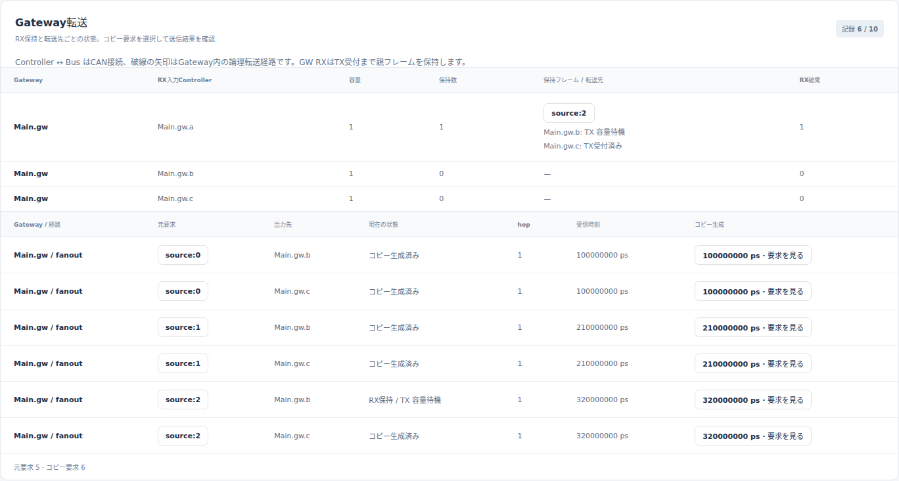
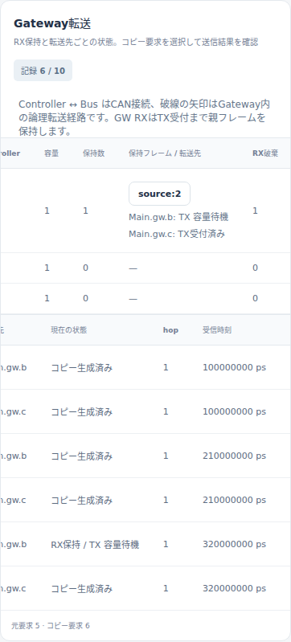
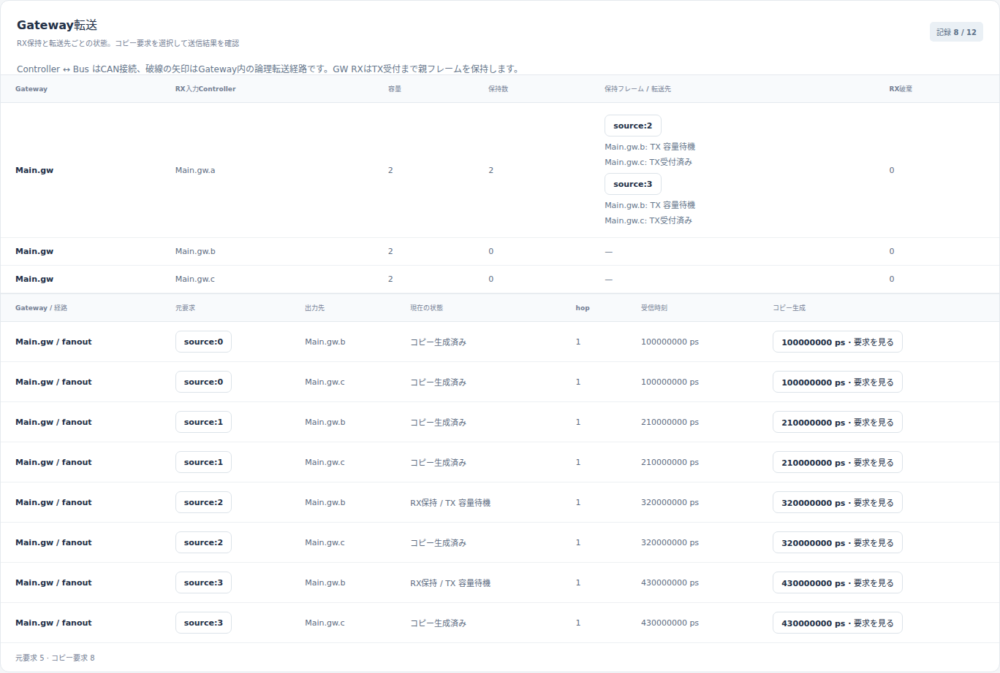
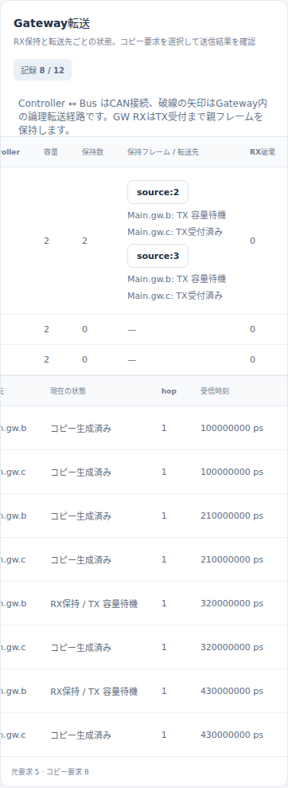

# GatewayのRX容量と遅い分岐による後続配信の損失

文書バージョン：`1.2.0`
対象GitHubバージョン：`v1.2.0`
実測ソースcommit：`397900451015c9bca6a33d24feac0a88b9b7b8fe`
文書ID：`guide-gateway-rx-capacity`
文書状態：公開用本文。正式版CLI実測・実Viewer画像付き

本文・画像・実習入力のライセンスは[ガイドのライセンス表示](ガイドのライセンス表示.md)を参照してください。

### 更新履歴

| 文書バージョン | 更新日 | 更新内容 |
| --- | --- | --- |
| `1.2.0` | `2026-10-22` | v1.2.0の対象タグ・文書版を確定。過去の測定基準と公開済み履歴を保持 |
| `1.1.1` | `2026-10-20` | Issue #121：公開済み画像を保持した撮影再検証、単独実習の選択と新規出力先・再試行手順を整合 |
| `1.1.0` | `2026-10-20` | RX容量だけを変える2条件の実習、親・両枝・保存則と実画面を追加 |

## 目的：速い出力が空いていても、次の親を受け取れない理由を読む

Gatewayが一つのCANフレームを速度の違う2本のバスへ配る場面を考えます。速い枝への送信が済んでも、遅い枝がTXへ受理されるまでは親フレームがRX枠を使い続けます。その間に次の親が来てRX満杯で落ちると、空いている速い枝へのコピーも作られません。

この実習は、RX容量だけを1から2へ変え、この依存を確認します。[Gateway処理遅延の実習](Gateway処理遅延と複数CANバスの中継.md)の次に、元送信成功、Gateway受信、コピー生成、TX受理、末端受信を別々に読むための内容です。

## 全体構成：入口の親保持と、出口ごとのTX待機

```text
Main.src → busA (500kbps) → gw.a: 親フレームをRX保持
                                    ↓ Main.gw: 静的fanout
                           gw.b → busB (125kbps) → sinkB
                           gw.c → busC (1Mbps)   → sinkC
```

| 部品・入力 | 責務と今回の条件 |
| --- | --- |
| `models/gateway/Main.ned`、`Types.ned` | Controller、Bus、Wireの構成と接続 |
| `buffered-fanout.ini` | `can.cc.multibus.v1`、バス速度、出口TX待機容量各1、終了2msと参照先 |
| `buffered-workload.json` | Main.srcから0〜990µs、110µs周期で10件。standard ID0、data空 |
| `buffered-routing.json` | gw.aからgw.b/cへの静的経路、RX容量、処理遅延0、hop上限16 |
| Main.gw.a | 元バスで受信完了した親をRX枠へ受理。ここだけが実験の受信入口 |
| Main.gw.b / Main.gw.c | 枝ごとのコピーを、それぞれのTX待機キューへ受理 |
| Main.sinkB / Main.sinkC | 各コピーのEOF後に末端受信を記録 |

Controller処理遅延・Wire伝搬遅延は0、受信filterは `*`、他の送信者はいません。routingの `gateways[0].rx_queue_capacity` は各ingressへ個別に適用される値です。受信していないgw.b/cのRX保持数をgw.aへ合算しません。

RXは**親1件で1枠**を使い、分岐先の両方がTXへ受理されるまで保持します。コピー2件だからRX2枠ではありません。出口TX容量1は待機中の要求を数え、送信中の1件は含みません。そのため、あるコピーがSOFへ進むと、その出口のTX待機枠に空きができます。

RX解放は両枝のEOFや末端受信を待ちません。一方、コピー生成済みの `gw.forward / submitted` は末端への配達成功を表しません。受理できない枝は `waiting_tx` で待ち、受理済みの速い枝は独立して送れます。RX満杯では新しい親を `rx_queue_full` として拒否し、その親の両コピーを作りません。元バスの送信successとgw.aの受信通知は保持されます。

## 再現手順：rx_queue_capacityだけを1から2へ変える

[実習入力ZIP](downloads/gateway-rx-capacity-inputs.zip)には条件ごとにINI・routing・workload・NED2の5入力、合計10ファイルがあります。リポジトリの `examples/guide/gateway-rx-capacity/` と同じ入力です。公開buffered-fanoutサンプルを基礎に別フォルダへ用意し、元サンプルは変更しません。

新しい作業フォルダで[正式v1.1.6](https://github.com/hideki-ozu/DIR-Simulator/releases/tag/v1.1.6)のソースを取得し、固定commitを確認します。Rust 1.85.0を使います。環境の準備は[設定・用語・FAQ](設定・用語・FAQ.md)も参照してください。

```bash
git clone --branch v1.1.6 --depth 1 https://github.com/hideki-ozu/DIR-Simulator.git
cd DIR-Simulator
git rev-parse HEAD
# 397900451015c9bca6a33d24feac0a88b9b7b8fe
cargo build --locked --release -p dir-simulator
```

新しい記事・実習入力はv1.1.6のソースには含まれません。ZIPをこのルートへ置いて展開し、未使用名の出力先で実行します。

```bash
python3 -m zipfile -e gateway-rx-capacity-inputs.zip .
mkdir results-gateway-rx-capacity
for condition in rx-1 rx-2; do
  ./target/release/dir-simulator validate \
    --config examples/guide/gateway-rx-capacity/$condition/buffered-fanout.ini
  ./target/release/dir-simulator run \
    --config examples/guide/gateway-rx-capacity/$condition/buffered-fanout.ini \
    --output results-gateway-rx-capacity/$condition
  ./target/release/dir-simulator view \
    --input results-gateway-rx-capacity/$condition/results.json \
    --output results-gateway-rx-capacity/$condition-viewer.html
done
```

条件ディレクトリ全体を比較し、意味上の差が `buffered-routing.json` の `gateways[0].rx_queue_capacity` 1→2だけであることを検査しました。INI、NED、生成周期、速度、TX容量、処理遅延、経路、終了時刻は同じです。validate/run/viewは両条件とも終了コード0でした。TX容量0は別の破棄契約なので、この比較へ混ぜません。

## 予測と実測：source:2が保持される間にsource:3が来る

実行前には、source:2が320µsに到着して遅いB枝のTX空きを待ち、親RXを524µsまで保持すると予測しました。次のsource:3は430µsに到着するため、RX=1なら拒否、RX=2なら受理され、C枝へ先に届く予測です。今回の新規実測は以下のとおり一致しました。時刻の単位はµs（1µs=1000000ps）です。

| 対象 | 仕様からの予測 | RX=1の実測 | RX=2の実測 |
| --- | --- | --- | --- |
| source:2 元送信EOF / gw.a受信 | 320 / 320 | 320 / 320 | 320 / 320 |
| source:2 親RX解放 | 524 | 524 | 524 |
| source:2 C枝SOF / EOF・sinkC受信 | 320 / 370 | 320 / 370 | 320 / 370 |
| source:2 B枝TX受理 / SOF / EOF・sinkB受信 | 524 / 948 / 1348 | 524 / 948 / 1348 | 524 / 948 / 1348 |
| source:3 元送信EOF / gw.a受信 | 430 / 430 | 430 / 430 | 430 / 430 |
| source:3 親RX | 1では拒否、2では保持して解放 | dropped、reason=rx_queue_full | 430に受理、948に解放 |
| source:3 C枝SOF / EOF・sinkC受信 | 1では生成なし、2では430 / 480 | コピーなし | 430 / 480 |
| source:3 B枝TX受理 / SOF / EOF・sinkB受信 | 1では生成なし、2では遅れて送信 | コピーなし | 948 / 1372 / 1772 |

コピーIDは例えば `gw:source:2/Main.gw/fanout/Main.gw.b`、C枝は末尾が `.c` です。`origin_request_id` と `parent_request_id` はどちらも `source:2`、hopは1です。source:3も同じ形式で追います。RX=1のsource:3には対応する `gw.forward` と子 `can.request` がありません。元要求successは、分岐先への配達を保証しません。

source:2のB枝はready=320、TX受理=524、SOF=948µsです。`gw_tx_buffer_wait_ps=524−320=204µs` はTX容量の空き待ちです。その後の `SOF−tx_enqueued=948−524=424µs` はCAN送信開始までの待ちで、別の区間です。他の送信者がいなくても、先行コピーの送信とintermissionを待ちます。二つを一つの「Gateway処理遅延」に置き換えません。

最初の元フレームはSOF0、EOF100、バス解放106µsでした。frame_bits=50、busA=500kbpsの100µsにintermission3bitの6µsが加わります。元生成周期110µsなので、今回の損失は元送信のTX満杯とは切り分けられます。

### 500µsの現在状態を読む

| 条件・親 | RXの状態 | B枝 | C枝 |
| --- | --- | --- | --- |
| 両条件 source:2 | holding | コピー生成済み・waiting_tx | 370µsに配達済み |
| RX=1 source:3 | dropped（430µs） | コピーなし | コピーなし |
| RX=2 source:3 | holding | コピー生成済み・waiting_tx | 480µsに配達済み |

この時刻でRX=1は保持1/容量1・RX破棄1、RX=2は保持2/容量2・RX破棄0です。524µsになるとsource:2 B枝がTXへ受理され、親RXが解放されます。しかしB枝のSOFは948µs、EOFは1348µsで、まだ配達完了ではありません。RX解放とEOFを別々に確認するのが要点です。

## Viewer：同じ500µsで親保持と二つの枝を比較する

生成HTMLを開き、「時刻（ps）」を500000000へ移します。Gateway転送欄で、保持フレームのsource:2/source:3と、各枝の「TX容量待機」「TX受付済み」を読みます。以下は同じcursorの実Viewer欄を直接撮影した画像です。









「コピー生成済み」「TX受付済み」だけでは末端受信を判断できません。C枝のコピー要求を選択し、EOFとsinkCのreceivedを表へ照合します。状態と保持数はcursor時点ですが、要求詳細や時刻列は実行全体の記録を含みます。未来のTX受理・EOFが詳細に見えても、500µsで実行済みという意味ではありません。

撮影検証では430µs直前/直後、524µs直前/直後、終了2msと、500µsへ戻す巻戻しも確認しました。狭幅では横に長い表を横スクロールできます。画像は保持数・枝の状態を見せる位置で撮影し、画面外の値は上のJSON実測表で補っています。

## 終了2ms：破棄と未完了を別の母数で数える

| 母数・最終状態 | RX=1 | RX=2 |
| --- | ---: | ---: |
| 元要求generated / success / dropped | 10 / 10 / 0 | 10 / 10 / 0 |
| gw.aの受信通知 | 10 | 10 |
| 親RX released / holding / dropped | 5 / 0 / 5 | 6 / 0 / 4 |
| Main.gw.a.rxQueueのgw_rx_queue_max | 1 | 2 |
| 生成された枝コピー総数 | 10 | 12 |
| B枝generated / success / dropped / in_flight / pending | 5 / 4 / 0 / 1 / 0 | 6 / 4 / 0 / 1 / 1 |
| C枝generated / success / dropped / 未完了 | 5 / 5 / 0 / 0 | 6 / 6 / 0 / 0 |
| sinkB / sinkCの実受信 | 4 / 5 | 4 / 6 |

親RXでは `10=5+0+5` / `10=6+0+4`、すなわち `受信通知=released+holding+dropped` が成立します。コピーについても `generated=success+dropped+processing+waiting_tx+pending+in_flight` が成立し、総数はRX=1で `10=9+0+0+0+0+1`、RX=2で `12=10+0+0+0+1+1` です。RX拒否はコピーの通常CAN droppedへ二重計上しません。

元10件を各末端へ届ける観点では、sinkBは両条件とも4/10件受信です。残りはRX=1でRX拒否5件・未完了1件、RX=2でRX拒否4件・未完了2件です。sinkCは5/10→6/10件へ増え、残り5→4件はRX拒否でした。生成済みコピーだけを母数にすると、B枝成功は4/5→4/6、C枝成功は5/5→6/6です。コピーを作れなかった損失が隠れるため、どちらの母数か明記します。

両条件とも終了理由time_limit、pending_events=2、partial=falseです。partial=falseでも、時間上限で未完了は残ります。未完了のplanned_eofから受信を補完せず、終了後の自動queue排出も行いません。RX=2で追加受理したsource:3が先にB枝へ入るため、source:8のB枝は終了時pendingになりました。容量増加を「全要求が必ず早まる」「全10件の配達を保証する」とは読みません。

## 証跡と再検証

2026-10-20、WSL2 Ubuntu 24.04.4 LTS x86_64・Rust 1.85.0上で、正式v1.1.6のclean sourceをlocked release buildした同一binaryを使用しました。今回の新規実測であり、Issueの予測や既存試験の期待値を実測として転記していません。

[計測・予測照合](https://github.com/hideki-ozu/DIR-Simulator/blob/main/docs/verification/results/gateway-rx-capacity/measurements.json)、[Viewer撮影・巻戻し記録](https://github.com/hideki-ozu/DIR-Simulator/blob/main/docs/verification/results/gateway-rx-capacity/viewer-browser.json)、[成果物SHA-256台帳](https://github.com/hideki-ozu/DIR-Simulator/blob/main/docs/verification/results/gateway-rx-capacity/artifact-ledger.json)に出自を保存しています。同フォルダの `repository/rx-1/result/`、`repository/rx-2/result/` に生のresults.json・summary.csv・manifestがあり、`zip/` に新規展開後の結果があります。schema2の `simulation.model_records` 内で、元 `can.request` → `can.receiver` → `gw.rx_buffer` → `gw.forward` → 子 `can.request` → 末端 `can.receiver` の順に親子IDを追えます。

manifest、空diagnostics、JSON/CSVの値・target・区間・標本数、全ZIP member一致と展開後の論理simulation一致を検証しました。本記事と同じ更新版のリポジトリで、次の補助手順を使えます。正式版binary・正式版のソースルートと未使用の証跡出力先を指定し、`--only` でこの実習を選びます。

`/path/to/formal-source` は、ZIPを展開していない別のcleanな正式版checkoutを指定します。

```bash
python3 scripts/build_guide_inputs.py --check
python3 scripts/verify_guide_capacity_comparisons.py \
  --binary /path/to/dir-simulator --source-root /path/to/formal-source \
  --only gateway-rx-capacity --output /path/to/new-evidence
python3 scripts/check_guide_capacity_measurements.py /path/to/new-evidence --only gateway-rx-capacity
NODE_PATH=/path/to/browser-tools/node_modules \
  node scripts/verify_capacity_comparisons_viewer.cjs /path/to/new-evidence \
  --only gateway-rx-capacity --output /path/to/new-captures
```

独立検査はsource:2/source:3、親RX・子コピーの保存則、時刻とCSVを照合します。Chromiumでdesktop1440×1000・狭幅390×844を操作し、外部通信・ページエラーは0でした。

撮影コマンドにはPlaywrightとChromiumが必要です。`/path/to/browser-tools/node_modules` はPlaywrightを導入したnode_modulesへ置き換えます。計測・数値照合・撮影はいずれも `--only gateway-rx-capacity` を指定しており、この実習の証跡だけを読みます。

`/path/to/new-captures` は未使用の撮影出力先です。生成される `capture-summary.json` から `gateway-rx-capacity/viewer-browser.json` を辿れ、実PNGは `gateway-rx-capacity/images/` に保存されます。各reportは自身のdirectoryを基準に、実際に読んだ計測JSON・results.json・manifest・Viewer HTMLと撮影PNGのpath/hash、条件・cursor・viewportを記録します。元の計測成果物と記事収録済みのPNG・台帳は変更しません。

同じ撮影出力先を再指定すると、既存出力を変更せず拒否します。同じ計測証跡をもう一度撮影する場合は、`--output /path/to/new-captures-2` のように別の未使用先を指定します。`--output` を省略した既定値は `/path/to/new-evidence/viewer-captures` です。全4実習を一度に検証する場合は、新しい証跡rootを指定し、上の計測・数値照合・撮影の3コマンドすべてから `--only gateway-rx-capacity` を外します。

公開済みPNGを残した状態での全4実習・AXI単独・Gateway単独の再実行、同じ出力先の拒否、別の出力先での再撮影、元成果物の不変性は[撮影再実行の検証記録](https://github.com/hideki-ozu/DIR-Simulator/blob/main/docs/verification/results/issue-121-capture-workflow/acceptance.json)に保存しています。

## 対象範囲と次に読む資料

理想Classical CAN、静的CAN→CAN fanout、共通clockの抽象モデルです。通常ControllerのアプリケーションRX、CPU逐次処理、通信エラー、物理層、CAN↔Ethernet変換、動的経路、規格適合や実機性能は対象外です。すべてのGatewayが同じRX保持方式を使うという主張ではありません。

[CAN・Gatewayリファレンス](reference/CAN・Gatewayの機能・動作仕様.md)と[GWモデル詳細機能仕様書](https://github.com/hideki-ozu/DIR-Simulator/blob/main/docs/specs/models/GWモデル詳細機能仕様書.md)で容量と終了契約を確認できます。処理時間だけを比較する場合は[Gateway処理遅延と複数CANバスの中継](Gateway処理遅延と複数CANバスの中継.md)、別の実習は[ガイドの入口](index.md)へ進んでください。
