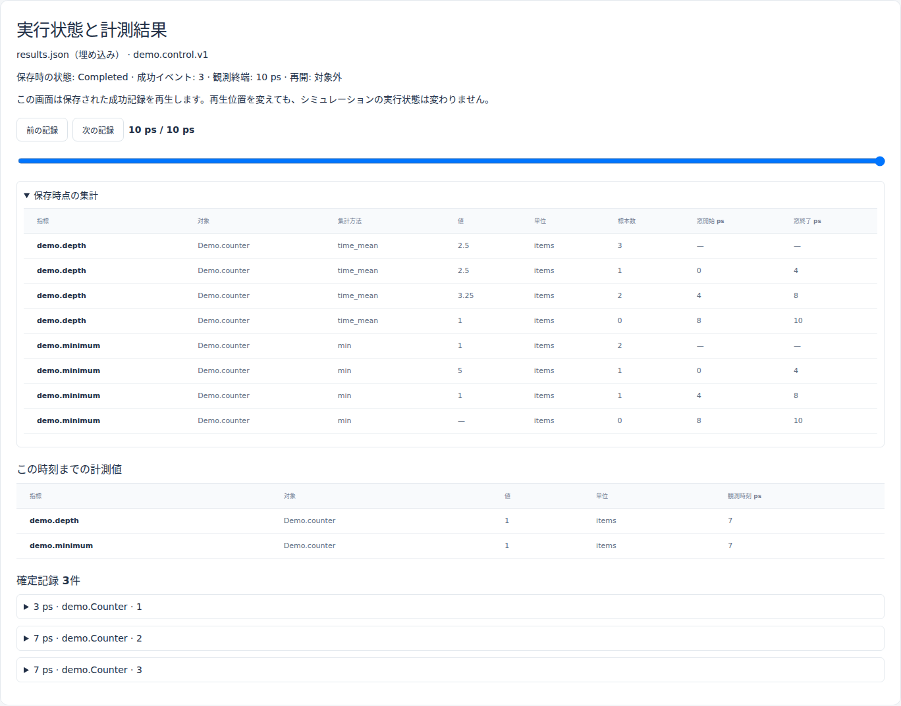
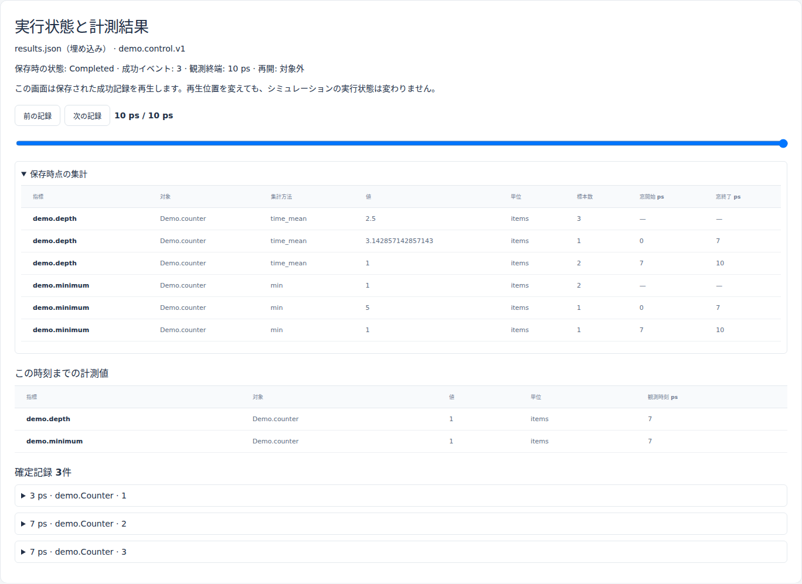
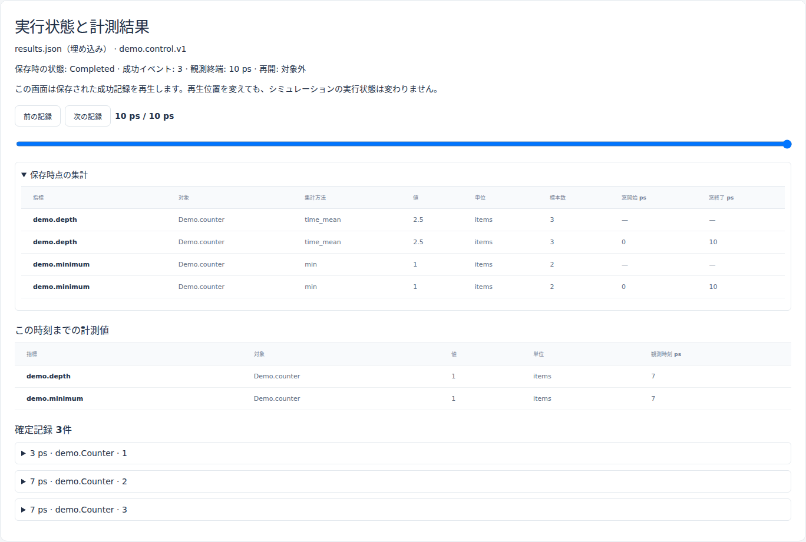
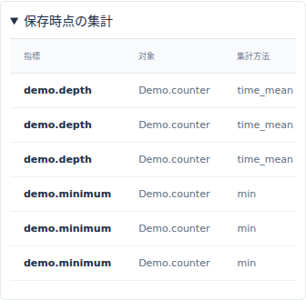

# Metric V2の集計窓幅と時間平均

文書バージョン：`1.2.0`
対象GitHubバージョン：`v1.2.0`
文書ID：`guide-metric-windows`
文書状態：公開用完成稿

<a id="guide-metric-windows"></a>

### 更新履歴

| 文書バージョン | 更新日 | 更新内容 |
| --- | --- | --- |
| `1.2.0` | `2026-10-22` | v1.2.0の対象タグ・文書版を確定。過去の測定基準と公開済み履歴を保持 |
| `1.1.0` | `2026-10-19` | 初版：4/7/10ps窓の正式版実測・整数面積照合・実Viewer・独立入力ZIPを追加 |

## 目的：窓を細かくすると、何が変わるか

`metrics-window`は計測値を集計する区切りです。窓を短くしても、シミュレーションのイベント発生時刻や、整数psの実行分解能が細かくなるわけではありません。

同じCounterを10psだけ動かし、窓幅だけを4ps／7ps／10psに変えます。生のイベント列と全体平均が同じでも、窓の境界・平均・標本数が変わることを、自分のJSON/CSVとViewerで確認します。

使用するのは正式[v1.1.6](https://github.com/hideki-ozu/DIR-Simulator/releases/tag/v1.1.6)、commit `397900451015c9bca6a33d24feac0a88b9b7b8fe`です。WSL上のUbuntu・Rust1.85.0で新しくビルドして実測しました。この記事で扱う`demo.control.v1`は同梱exampleが登録する独自profileです。通常CLIに組み込まれたnetwork profileの計測全体へ、この実習のMetric V2の振る舞いを一般化しません。

## 全体像と、各ファイルの責務

入力INI/NED → exampleが登録したCounter → 成功イベントの計測更新 → Metric V2の窓積分 → schema3結果 → 読み取り専用Viewer、という流れです。

| 構成要素 | 今回の責務と依存関係 |
| --- | --- |
| NED | `Demo.counter`を1個配置。窓幅によって構成は変わらない |
| INI | 観測終端10psと`metrics-window`を指定。3条件で変更するのは窓幅だけ |
| Rust example | `demo.control.v1`と計測descriptor、初期値、固定イベント列を登録。別のworkload JSONは使わない |
| Runtime | 整数psで同じイベントを実行し、gaugeの値×継続時間を整数で積分する |
| export | 生の計測record、model record、全体集計と窓集計をJSON/CSVへ保存する |
| Viewer | 保存済み結果を読む。再生位置を変えても保存時点の窓集計を再計算しない |

example名にはcheckpointが含まれますが、本編で使うモードは`run`だけです。結果JSONやViewer HTMLから実行を再開する実習ではありません。

## 固定するイベントと、二種類の計測

元の[同梱example](https://github.com/hideki-ozu/DIR-Simulator/blob/v1.1.6/crates/dir-simulator/examples/control_checkpoint.rs)を変更せず使います。8psに予約されたイベントは取消され、成功したmodel recordは3ps・7ps・7psの3件です。

| 時刻 | `demo.depth`（gauge） | `demo.minimum`（point） |
| --- | --- | --- |
| 初期状態 | 2 | 標本なし |
| 3ps | 4へ更新 | 5を記録 |
| 7ps | 同時刻に9へ更新し、その後1へ更新 | 1を記録 |

gaugeは次の更新まで値が続きます。したがって区間は`[0,3)`で2、`[3,7)`で4、`[7,10)`で1です。同じ7psの9→1には正の継続時間がなく、9を1ps続いた値として積分しません。一方、gaugeの更新標本数には9と1の両方が入ります。標本数と継続時間は別の情報です。

pointは、その時刻の標本を窓へ割り当てます。窓は半開区間なので、7psの標本は`[0,7)`ではなく`[7,10)`に入ります。

## 手順：正式版と独立入力を用意する

[入力ZIP](downloads/metric-windows-inputs.zip)には3条件のINI、共通NED、同梱exampleの照合用Rustソースと説明を含めています。Rustライブラリ全体は含まないため、ZIPだけではexampleをビルドできません。

まず正式ソースを新しいディレクトリへ取得します。Git/rustupを導入したWSL Ubuntuのシェルで、タグのcommitが一致した場合だけビルドします。

```bash
git -c core.autocrlf=false clone --depth 1 --branch v1.1.6 --single-branch \
  https://github.com/hideki-ozu/DIR-Simulator.git dir-metric-v116 &&
cd dir-metric-v116 &&
test "$(git rev-parse HEAD)" = 397900451015c9bca6a33d24feac0a88b9b7b8fe &&
cargo build --locked -p dir-simulator --bin dir-simulator --example control_checkpoint
```

ZIPを別の場所へ展開し、その絶対パスを`METRIC_INPUT`へ指定します。`METRIC_OUTPUT`は既存の結果と重ならない新しい名前を使います。INIと`ned/`の相対配置を保ってください。

```bash
METRIC_INPUT=/absolute/path/to/unpacked/examples/guide/metric-windows
METRIC_OUTPUT=/absolute/path/to/new-metric-results
mkdir "$METRIC_OUTPUT"
for width in 4 7 10; do
  target/debug/examples/control_checkpoint run \
    "$METRIC_INPUT/window-$width.ini" "$METRIC_OUTPUT/window-$width" &&
  target/debug/dir-simulator view \
    --input "$METRIC_OUTPUT/window-$width/completed/results.json" \
    --output "$METRIC_OUTPUT/window-$width-viewer.html" || break
done
```

通常CLIの`run --config`を代わりに使うと、独自profileが登録されず、この実習を実行できません。exampleの`run CONFIG OUTPUT_ROOT`を使います。各結果は`completed/`以下に保存されます。終了値0、manifestの`complete`・`partial:false`、controlの`Completed`、pending0を確認します。

## 実測：同じ生記録、異なる窓集計

3条件とも成功イベント3件、model record3件、生の計測record5件で、時刻・順序・値が一致しました。観測終端は10ps、最後の成功イベントは7ps、未処理イベントは0件です。INI snapshotのhashやsession/run IDの違いを、実行イベントの違いと混同しないでください。

全体ではgauge時間平均が **2.5 items**、更新標本数3、point最小値が **1 item**、標本数2で一致しました。

| 窓幅 | 実際の窓 `[開始,終了)` ps | gauge面積 item·ps | 時間平均 items | gauge更新数 | point最小値／標本数 |
| --- | --- | ---: | ---: | ---: | --- |
| 4ps | `[0,4)` | 10 | 2.5 | 1 | 5／1 |
| 4ps | `[4,8)` | 13 | 3.25 | 2 | 1／1 |
| 4ps | `[8,10)` | 2 | 1 | 0 | null／0 |
| 7ps | `[0,7)` | 22 | 22/7 ≈ 3.142857 | 1 | 5／1 |
| 7ps | `[7,10)` | 3 | 1 | 2 | 1／1 |
| 10ps | `[0,10)` | 25 | 2.5 | 3 | 1／2 |

面積は独立に`2×3 + 4×4 + 1×3 = 25 item·ps`と計算できます。全体平均は`25/10 = 2.5`です。4ps設定の末尾は2psの短い窓なので、平均の分母は設定値4ではなく実長2です。

4ps窓の平均を単純に平均すると`(2.5+3.25+1)/3 = 2.25`となり、全体平均と一致しません。各窓の実長で重み付けすると`(2.5×4+3.25×4+1×2)/10 = 2.5`になります。

`[8,10)`にはpoint標本がなく、minはnullです。0に置き換えると観測していない最小値を作ってしまいます。一方、gaugeは更新がなくても1の状態が続くため、更新標本数0でも時間平均は1です。

## 実Viewerで保存集計と現在値を分ける

生成したHTMLを開き、「保存時点の集計」を展開します。以下は新しく生成した正式版のViewerを実ブラウザで撮影したものです。







再生位置を2ps→3ps→7ps→2psへ動かすと、「この時刻までの計測値」のgaugeは2→4→1→2へ変わります。「保存時点の集計」は元のrun全体の集計なので変わりません。巻戻しで実行をやり直しているわけではありません。



JSONのnullは画面で`—`と表示されます。狭い画面では表全体を縮小せず、表の中を横スクロールして窓列を確認します。画面で読めない桁は`results.json`や`summary.csv`へ戻ってください。

## 再現確認と利用境界

[検証スクリプト](https://github.com/hideki-ozu/DIR-Simulator/blob/main/scripts/verify_guide_metric_windows.py)は、入力の1変数差分、整数面積と半開区間の独立計算、全体・生記録の不変、JSON/CSV一致、manifest/hash、独立ZIP再実行を検証します。新規実測はexample実行とViewer生成を合わせて12操作（元入力6・ZIP6）です。[実測JSON](https://github.com/hideki-ozu/DIR-Simulator/blob/main/docs/verification/results/metric-windows/measurements.json)と[実画面検証](https://github.com/hideki-ozu/DIR-Simulator/blob/main/docs/verification/results/metric-windows/viewer-browser.json)に出典を保存しています。

保存時集計と再生時現在値の確認は、この独自generic profileのMetric V2に対するものです。Metric V1や、V2 descriptorを登録していないnetwork builtinへの一般化、実機の1ps精度、checkpointからの再開は本実習の対象外です。

[共通基盤の機能・動作仕様](reference/共通基盤の機能・動作仕様.md)から、計測descriptorと実行分解能の説明へ進めます。

Copyright (c) 2026 DIR Simulator contributors. Licensed under MIT OR Apache-2.0. [LICENSE](https://github.com/hideki-ozu/DIR-Simulator/blob/v1.1.6/LICENSE)・[MIT](https://github.com/hideki-ozu/DIR-Simulator/blob/v1.1.6/LICENSE-MIT)・[Apache-2.0](https://github.com/hideki-ozu/DIR-Simulator/blob/v1.1.6/LICENSE-APACHE)。
