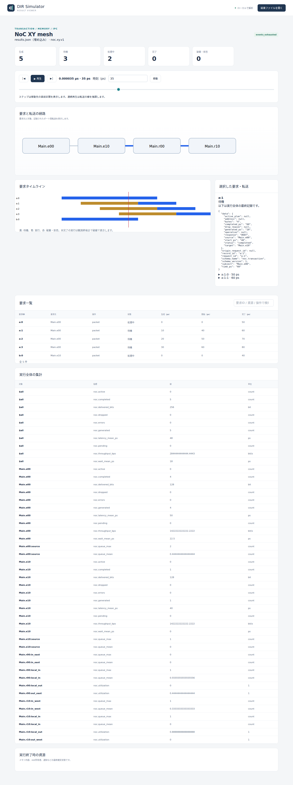
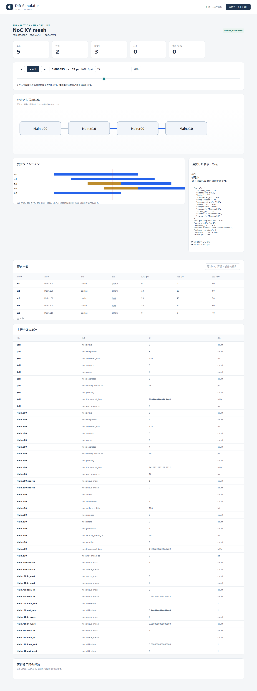

# NoCの入力FIFO容量と待ち時間

文書バージョン：`1.2.0`
対象GitHubバージョン：`v1.2.0`
実測ソースcommit：`b45515644dfc65c205216d564d5bf7ef00280622`  
文書ID：`guide-noc-input-fifo`  
文書状態：公開用本文

### 更新履歴

| 文書バージョン | 更新日 | 更新内容 |
| --- | --- | --- |
| `1.2.0` | `2026-10-22` | v1.2.0の対象タグ・文書版を確定。過去の測定基準と公開済み履歴を保持 |
| `1.1.0` | `2026-10-13` | NoC入力FIFO容量だけを比較する実習・実測・35psの実Viewerを追加 |

## 目的：容量を増やすと、どこで待つかを確かめる

二つのRouterを横につないだNoCを考えます。一方から短いpacketを4件送り、配送先のRouterでは長いpacketが先にlocal出力を使います。入力FIFO容量を1/2/3slotへ変え、最初の転送を始めるまでの待ちと、hopを進んだ後の待ちを区別します。

確認する要求は、5packetがすべて配送されること、FIFOを追い越さないこと、容量による開始待ちと最終配送時刻の関係を読めることです。今回使う `noc.xy.v1` は、有限slotとstore-and-forwardの抽象評価モデルです。容量を増やす効果を、この一つの負荷条件で実測します。

## 構成と責務：Endpoint・入力FIFO・出力資源

| 要素 | 責務・固定設定 |
| --- | --- |
| `Main.e00` | packetの生成元。a:0〜a:3を0/10/20/30psに生成。各4byte、宛先e10 |
| `Main.e10` | 配送先でもある生成元。b:0を0psに生成。16byte、宛先もe10 |
| `Main.r00` | 座標(0,0)。e00をlocal接続し、east出力でr10へ転送 |
| `Main.r10` | 座標(1,0)。west入力FIFOで受け、local_outでe10へ配送 |
| 共通条件 | 2列1行、clock10ps、bytes_per_cycle4、link_cycles0、source_capacity4、終了90ps、集計窓10ps |

NEDは4ノードと6本のgate接続です。aの経路は e00.packet → r00.local_in → r00.out_east → r10.in_west → r10.local_out → e10.delivery です。bは e10.packet → r10.local_in → r10.local_out → e10.delivery と、自分のEndpointへlocal配送します。逆方向のgate接続もありますが今回のpacketは使いません。validateのchannel_count0は独立channelオブジェクトの数で、gate接続がないという意味ではありません。

NEDが接続、model JSONが座標・容量・転送時間、workloadが生成時刻・宛先・byte数、INIが参照先と終了時刻を担当します。XY経路は先にx、次にyを進み、最後にlocal配送します。今回aはeast＋localの2hop、bはlocalの1hopです。

`input_capacity` は各Routerのlocal_inと各方向入力の**独立FIFOごとのslot数**です。全Routerで共有する一つの容量ではありません。packetはbyte数によらず1slotを占めます。Endpointの生成順FIFO容量は別設定のsource_capacity4です。

出力を取得すると下流slotを予約し、全packetの到着後に予約を解除して入力FIFOへ追加します。空きは容量からqueue件数と予約slot数を引いた数です。満杯なら現在のFIFOに保持して待つbackpressureとなります。出力は独立に調停され、Router全体を一件に制限するモデルではありません。

## 再現手順：共通条件を作り、input_capacityだけを比較する

[NoC実習入力ZIP](downloads/noc-input-fifo-inputs.zip)を展開します。NED1、共通workload1、model3、INI3の8入力で、リポジトリの `examples/guide/noc-input-fifo/` にも同じ入力があります。

この実習は既存のnoc-backpressure fixtureの接続を使い、source_capacityを1→4、aの最後の生成を20→30ps、終了を65→90psへ共通変更しています。**その共通条件から3条件で変えるのがinput_capacityだけ**です。元fixtureから容量だけを変えた比較ではありません。

正式[v1.1.4 Release](https://github.com/hideki-ozu/DIR-Simulator/releases/tag/v1.1.4)のCLIを準備します。Gitとrustup/Cargoが導入済みのWSL Ubuntu 24.04 LTS x86_64を使います。Rust1.85.0はタグ内のrust-toolchain.tomlが指定し、ビルド元資料は[正式版README](https://github.com/hideki-ozu/DIR-Simulator/blob/v1.1.4/README.md#canサンプルを実行する)です。まだ存在しない取得先で実行します。

```bash
git clone --depth 1 --branch v1.1.4 --single-branch https://github.com/hideki-ozu/DIR-Simulator.git DIR-v1.1.4 &&
cd DIR-v1.1.4 &&
test "$(git rev-parse HEAD)" = b45515644dfc65c205216d564d5bf7ef00280622 &&
cargo build --locked --release --target-dir target -p dir-simulator &&
export PATH="$PWD/target/release:$PATH" &&
command -v dir-simulator
```

`&&`で連結した準備は失敗時に後続を実行しません。SHA不一致ならビルドへ進まず原因を確認します。最後に取得先のtarget/release/dir-simulatorが表示されることを確認します。PATHはこのシェルだけ有効です。正式タグには新しい8入力実習は同梱していないため、ZIPを別途展開し、同じシェルで展開先の `examples/guide/noc-input-fifo` へ移動します。mainやRelease未公開のタグは正式実測版として扱いません。

```bash
mkdir out
dir-simulator validate --config capacity1.ini
dir-simulator run --config capacity1.ini --output out/capacity1
dir-simulator view --input out/capacity1/results.json --output out/capacity1-viewer.html
dir-simulator validate --config capacity2.ini
dir-simulator run --config capacity2.ini --output out/capacity2
dir-simulator view --input out/capacity2/results.json --output out/capacity2-viewer.html
dir-simulator validate --config capacity3.ini
dir-simulator run --config capacity3.ini --output out/capacity3
dir-simulator view --input out/capacity3/results.json --output out/capacity3-viewer.html
```

outが既にある場合は新しい展開先を使います。JSONの差分はinput_capacity、INIの差分はmodel参照名だけです。request IDはgenerator名と0始まりのordinalを合わせたa:0等です。

## 実測：開始が早くなっても、今回は配送時刻が同じ

出力の占有時間は `(ceil(bytes/4)+0)×10ps` です。aの各hopは10ps、bのlocal配送は40psです。実測ではb:0がr10.local_outを0〜40psに占有しました。

| input_capacity | a:0/a:1/a:2/a:3の最初のgrant（ps） | aの最終配送（ps） | a平均の開始待ち（ps） | a平均latency（ps） |
| --- | --- | --- | --- | --- |
| 1 | 0 / 40 / 50 / 60 | 50 / 60 / 70 / 80 | 22.5 | 50 |
| 2 | 0 / 10 / 40 / 50 | 50 / 60 / 70 / 80 | 10 | 50 |
| 3 | 0 / 10 / 20 / 40 | 50 / 60 / 70 / 80 | 2.5 | 50 |

容量1では最初のaがr10.in_westでbの完了を待ち、次のaは下流に空きがなく最初のhopを開始できません。容量を増やすと、より多くのaが早くeast転送を始め、r10の入力FIFOへ先に到着してlocal出力を待ちます。

a:1だけを取り出すと、待つ場所が見えます。

| 容量 | 生成→最初のgrant（ps） | east到着→local開始（ps） | 最終配送（ps） |
| --- | --- | --- | --- |
| 1 | 10→40（開始待ち30） | 50→50（hop間待ち0） | 60 |
| 2 | 10→10（開始待ち0） | 20→50（hop間待ち30） | 60 |
| 3 | 10→10（開始待ち0） | 20→50（hop間待ち30） | 60 |

`noc.wait_mean_ps` は最初のgrant−生成の平均です。source FIFOとlocal_inでの開始前待ちを含み、開始後のhop間FIFO待ちは含みません。`noc.latency_mean_ps` は最終配送−生成なので両方を含みます。容量を増やして開始待ちが減っても、この条件ではbが同じlocal出力を占有するため最終配送が早まりません。別の経路・負荷で容量増加が無効だという一般的な結論にはしません。

全体平均の開始待ちは18/8/2ps、latencyは48psでした。a4件とb1件の5packet平均であり、Endpoint別平均二つの単純平均ではありません。全条件で生成5・完了5・error0・drop0、pending/active0、最終配送256bitです。aは4×4byte、bは16byteなので合計32byte×8です。途中hopの4byteを配送量へ重ねて加算しません。transferはaの2hop×4件＋bの1hop＝9記録です。

r00.out_eastは40ps、r10.local_outは80ps占有しました。利用率の分母は終了90psです。これらは独立資源なので合算して一つのバス利用率にしません。last_event80ps、終了90ps、events_exhausted、partial=false、残イベント0で、CLIはexit_code0・診断nullでした。

## Viewer：35psの待機と処理中を読む

生成HTMLで35psへ移動し、a:1を選びます。基本操作は[Viewerで結果を読む](Viewerで結果を読む.md)を参照してください。以下は正式版CLIの実画面です。






全条件で生成5・完了0、待機は3/2/1、処理中は2/3/4です。NoCでは最初の出力grant後をactiveとして、hop間のFIFO待ちでも処理中を保ちます。処理中4件は、4件が同時にリンク上を転送しているという意味ではありません。最初のgrant前の待ちはpendingなので、上部待機counterも全FIFOにあるpacket数の合計ではありません。

選択詳細JSON・時刻列・実行全体の集計は最終記録です。35ps時点に観測済みの値として読みません。容量1のa:1詳細にstart40・completed60・OKAYがあっても、35psではまだ待機です。容量2/3はstart10で処理中ですが、次hopの50→60psは未来の最終transfer記録です。counter・一覧の状態と、最終記録の時刻を分けて読みます。

経路図の横並びはNED配線の正確なトポロジではありません。EndpointとRouterの箱の順を配線と解釈せず、NEDの接続とhop別transferのfrom/to・subjectでeast転送とlocal配送を確認します。

## 制約と仕様への入口

2列1行、有限5packet、常時受理する配送先、一つの競合出力だけを試しました。source満杯drop、別topology・複数競合・連続負荷、非edge生成、途中打切り、deadlock診断、native・実機は未検証です。今回全件配送されたことは、すべての構成や負荷の性能受入を示しません。

wormhole/flit、VC、adaptive routing、torus、故障経路、RTL・波形・実機規格適合・実機性能は対象外です。10psは説明用設定で、メモリbyte値やsnapshotもこのNoC実習では扱いません。

契約は[正式v1.1.4のSoC・AHB・NoC詳細機能仕様（NoC）](https://github.com/hideki-ozu/DIR-Simulator/blob/v1.1.4/docs/specs/models/SoC・AHB・NoC詳細機能仕様書.md#noc)、DIR-REQ-0194〜0197 / DIR-FUNC-0046に対応します。

[ガイドの入口へ戻る](index.md)
