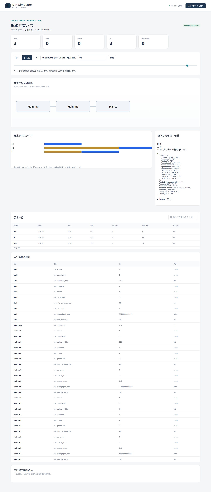
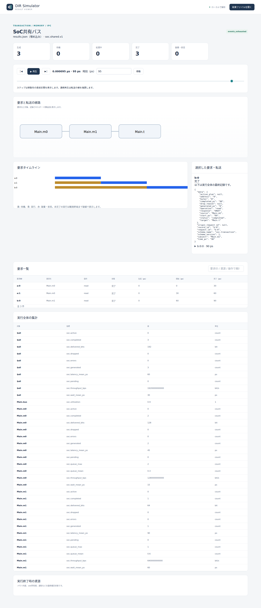

# SoC共有バスの調停と要求の待ち時間

文書バージョン：`1.1.0`  
対象GitHubバージョン：`v1.1.4`  
実測ソースcommit：`b45515644dfc65c205216d564d5bf7ef00280622`  
文書ID：`guide-soc-arbitration`  
文書状態：公開用本文

### 更新履歴

| 文書バージョン | 更新日 | 更新内容 |
| --- | --- | --- |
| `1.1.0` | `2026-10-13` | SoC共有バスの調停だけを変える実習・実CLI・実Viewerを追加 |

## 目的：転送量が同じでも、誰が待つかは変わる

二つの送信元が一つのバスを使う場面を考えます。m0から2要求、m1から1要求を同じ0psに発生させ、交互に選ぶround_robinと、優先度を使うfixed_priorityを比較します。変えるのは `arbitration` だけです。

確認する要求は、3要求がすべて完了すること、同じ送信元のFIFO順を保つこと、調停によってm0/m1の待ち時間が変わることです。使用する `soc.shared.v1` は転送量と応答・占有時間の抽象モデルです。read要求でもRAMのbyte値を読み返す機能ではありません。10ps等の設定は仕組みを読みやすくするためで、実機性能ではありません。

## 構成と責務：二つのSource・一つのBus・一つのTarget

| 要素 | 責務・固定設定 |
| --- | --- |
| `Main.m0` | 要求元。capacity2、priority0。a:0とa:1を生成 |
| `Main.m1` | 要求元。capacity2、priority1。b:0を生成 |
| `Main.bus` | sourceごとのFIFO先頭から一つを選び、完了まで所有者を保持 |
| `Main.t` | address0〜31の対象。service_cycles1 |
| 転送設定 | clock10ps、bytes_per_cycle4、各要求8byte、終了100ps |

capacityは各sourceのpending＋active上限です。今回m0は2要求、m1は1要求なので全件を受け付けられます。優先度の数値は固定し、fixed_priorityでは小さい値のm0が優先です。round_robinではsource path順でcursorが進み、m0の次にm1を選びます。

NEDは4ノードと6本のgate接続を定義します。各sourceのrequestはBusの対応suffixへ入り、Busからtargetへ進みます。responseはTarget→Bus→該当Sourceへ戻ります。model JSONは構成・時間・調停、workloadは要求、INIは実行条件を担当します。validateのchannel_count0は独立channelオブジェクトの数で、gate接続がないという意味ではありません。

利用フローは、0psに3要求を生成→source内でFIFO待機→Busが一要求を選出→転送とtarget service→完了後に次要求を選出、です。activeを途中で別sourceが追い越すことはありません。このprofileでは応答を完了通知へ抽象化し、逆向きresponse用の独立した帯域を計算しません。

## 再現手順：arbitrationだけを変える

[SoC調停実習入力ZIP](downloads/soc-arbitration-inputs.zip)を展開します。NED1、共通workload1、model2、INI2の6入力です。リポジトリでは `examples/guide/soc-arbitration/` に同じものがあります。

公開済み[v1.1.4 Release](https://github.com/hideki-ozu/DIR-Simulator/releases/tag/v1.1.4)のソースでビルドした `dir-simulator` をPATHへ置き、展開先の `examples/guide/soc-arbitration` で実行します。基本のビルドは[設定・用語・FAQ](設定・用語・FAQ.md)を参照してください。mainやRelease未公開のタグを、この実習の正式版とは扱いません。

```bash
mkdir out
dir-simulator validate --config round_robin.ini
dir-simulator run --config round_robin.ini --output out/round_robin
dir-simulator view --input out/round_robin/results.json --output out/round_robin-viewer.html
dir-simulator validate --config fixed_priority.ini
dir-simulator run --config fixed_priority.ini --output out/fixed_priority
dir-simulator view --input out/fixed_priority/results.json --output out/fixed_priority-viewer.html
```

既にoutがあれば新しい展開先を使います。INIの差分はmodelファイル名だけ、JSONの差分は `arbitration` の値だけです。priority0/1、容量、生成時刻、8byte、4byte/cycle、service_cycles1、clock10ps、終了100psは固定です。

要求IDはgenerator aの0/1番目がa:0/a:1、generator bの0番目がb:0です。operationはread、address0、bytes8です。入力にはエラー範囲16〜20もありますが、今回の要求範囲0〜8とは交差せず、正常系だけを比較します。

## 実測：3要求の順序と個別の待ち時間

一要求の占有時間は、転送 `ceil(8/4)=2cycle` とtarget service1cycleを合わせ、`(2+1)×10=30ps` です。実測でも全要求が30psずつ占有しました。

| 調停 | 要求 | 開始→完了（ps） | 待ち（ps） |
| --- | --- | --- | --- |
| round_robin | a:0 | 0→30 | 0 |
| round_robin | b:0 | 30→60 | 30 |
| round_robin | a:1 | 60→90 | 60 |
| fixed_priority | a:0 | 0→30 | 0 |
| fixed_priority | a:1 | 30→60 | 30 |
| fixed_priority | b:0 | 60→90 | 60 |

待ちは `start_ps - generated_ps` です。RRはm0→m1→m0の順になり、固定優先度はm0の二つを先に選びます。どちらでもsource m0内のa:0→a:1というFIFO順は同じです。結果JSONやViewerの一覧行の並びだけで調停順を判断せず、開始時刻で並べ直して確認します。

| 調停 | m0平均待ち（ps） | m1平均待ち（ps） | 全体平均待ち（ps） | 完了転送量 |
| --- | --- | --- | --- | --- |
| round_robin | 30 | 30 | 30 | 192bit |
| fixed_priority | 15 | 60 | 30 | 192bit |

全体の `soc.wait_mean_ps=30` だけを見ると違いを見落とします。固定優先度ではm0が短く待ち、m1が長く待つため、source別の値と個別要求を合わせます。全体は3要求の平均であり、source別平均二つを単純に平均する値ではありません。

全条件でgenerated3・completed3・errors0・dropped0、すべてOKAY、pending/active0です。8byte×3×8＝192bitで、Busの占有は0〜90ps、`soc.utilization=0.9`です。集計の$allとsource別128/64bitは同じ転送を異なる単位で見たもので、足して384bitとは解釈しません。終了100ps、last_event90ps、events_exhausted、partial=false、残イベント0でした。

## Viewer：95psでb:0の待ちを比較する

生成HTMLを開き、時刻95psへ移動して `b:0` を選びます。基本操作は[Viewerで結果を読む](Viewerで結果を読む.md)を参照してください。以下は正式版CLIの実画面です。





全画面は生成3・完了3です。選択要求のgenerated_ps0、start_ps30/60、completed_ps60/90、response OKAYと、タイムラインの待機/実行の帯を照合します。経路図はsourceとtargetの端点を表示し、共有Busはtransfer記録のsubjectや集計のMain.busで確認します。図の箱だけでNEDの4ノード構成を数えません。

横並びの図はNED配線の正確なトポロジを描いたものではありません。二つのSourceが直列接続されていると解釈せず、NEDのrequest/response接続とtransferのfrom/toで、各Sourceが共有Busを通じて同じTargetを使う構成を確認します。

## 制約と仕様への入口

有限の3要求、target1個、正常アドレスだけです。連続負荷、容量超過、複数target、ERROR、生成がclock edgeの間にある場合、途中打切りは試していません。今回全件完了したことは、固定優先度で低優先度sourceの飢餓を避けられる保証ではありません。その保証はこのprofileの範囲外です。

データbyte値・CPU cache・実機のSoC interconnect・RTL/電気的適合・実機性能も扱いません。AHBやNoCは別profileで、この実習には含めません。

契約は[正式v1.1.4のSoC・AHB・NoC詳細機能仕様（SoC）](https://github.com/hideki-ozu/DIR-Simulator/blob/v1.1.4/docs/specs/models/SoC・AHB・NoC詳細機能仕様書.md#soc)のDIR-REQ-0186〜0189 / DIR-FUNC-0044に対応します。

[ガイドの入口へ戻る](index.md)
