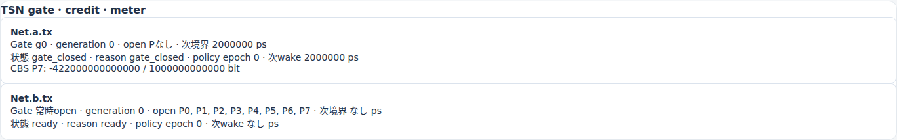
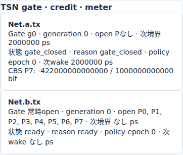
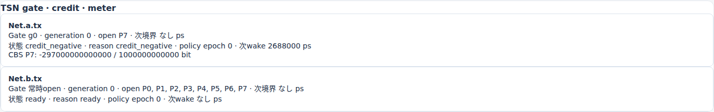
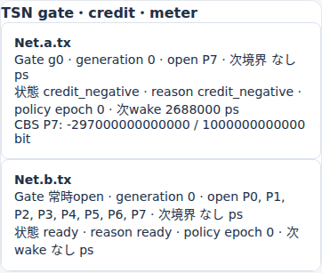
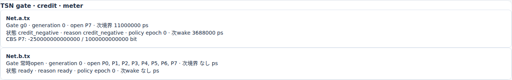
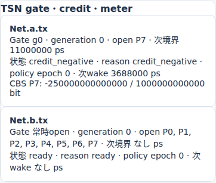
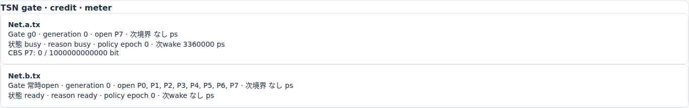
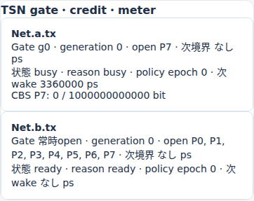

# TASのgate閉鎖とCBS creditの凍結

文書バージョン：`1.1.0`
対象GitHubバージョン：`v1.1.6`
実測ソースcommit：`397900451015c9bca6a33d24feac0a88b9b7b8fe`
文書ID：`guide-ethernet-cbs-gate`
文書状態：公開用本文

### 更新履歴

| 文書バージョン | 更新日 | 更新内容 |
| --- | --- | --- |
| `1.1.0` | `2026-10-20` | 正式v1.1.6で1変数比較を新規実測し、独立入力・実Viewer・巻戻し検証を追加 |

## 目的：gateが開いても、creditが負なら送れない

TASは送信を許す時間帯、CBSはcreditによる送信条件を決めます。両方を使うと「gateが開いたから即送信」「gate閉鎖中もcreditが回復し続ける」という読み方はできません。この実習は同じ2frameについて、GCLの一つの区間のopen_prioritiesだけを変え、負creditの凍結と再開後の待ち時間を確認します。

TAS単独の開閉時刻、CBS単独の傾きの説明はそれぞれ[Ethernet TASの送信窓とIFG込みの待ち時間](Ethernet TASの送信窓とIFG込みの待ち時間.md)、[Ethernet CBSのcredit回復と送信待ち](Ethernet CBSのcredit回復と送信待ち.md)を参照してください。ここでは二つの条件を同時に満たす必要がある点に絞ります。

## 構成と責務：静的GCLとclass7の2frame

`Net.a.tx → Net.b.rx` の1Gbpsリンクを使い、Net.aが0psに空payloadの2frameを生成します。priority7、VLAN10、伝搬・TX/RX処理0、終了120000000psです。ideal_shared clockで、PSFP・動的controls・gcl_updatesは使いません。

| 部品・ファイル | 責務 |
| --- | --- |
| `models/ethtsn/Main.ned` | 2 Endpointと対向接続、1Gbps |
| `cbs-gated.ini` | ethernet.tsn.v1、入力参照と観測期間 |
| `cbs-gated-model.json` | VLAN・queue・TAS GCL・CBS credit契約 |
| `cbs-gated-workload.json` | 同時刻0、priority7の2frame |
| TAS | base0、周期10000000psのopen条件 |
| CBS | idle slope250Mbps、hi/lo各1000bit、負creditで待機 |
| Viewer | 記録済みgate/credit/decisionとcopy状態を再演 |

closed条件のGCLは最初の1000000psがP7 open、次の1000000psがclosed、残り8000000psがopenです。open条件は中央区間もP7 openです。TASをnullにする比較ではなく、全区間の長さ・base・周期を保った1 field比較です。

creditはbit単位で、保存値はsign × magnitude / scaleです。整数のmagnitudeだけをbit数と読まず、scale=1000000000000で割ります。送信中はIFG終了までsend slopeで減算し、非送信でgate closedの間は凍結します。閉鎖が送信中frameを途中で切るモデルではありません。

## 再現手順：GCL中央区間のopen_prioritiesだけを変える

[独立実習入力ZIP](downloads/ethernet-cbs-gate-inputs.zip)を新しいフォルダへ展開します。リポジトリの `examples/guide/ethernet-cbs-gate/` と同じ入力です。各条件にINI・model JSON・workload JSON・NED依存を含め、相対参照で完結します。元の公開サンプルや検証fixtureは変更しません。

[正式v1.1.6 Release](https://github.com/hideki-ozu/DIR-Simulator/releases/tag/v1.1.6)のsource commit `397900451015c9bca6a33d24feac0a88b9b7b8fe` を取得し、指定Rust 1.85.0で `cargo build --locked --release -p dir-simulator` を実行します。生成した `dir-simulator` をPATHへ置き、展開先の `examples/guide/ethernet-cbs-gate` で実行します。ビルド環境の準備は[設定・用語・FAQ](設定・用語・FAQ.md)を参照してください。

```bash
mkdir out
dir-simulator validate --config closed/cbs-gated.ini
dir-simulator run --config closed/cbs-gated.ini --output out/closed
dir-simulator view --input out/closed/results.json --output out/closed-viewer.html
dir-simulator validate --config open/cbs-gated.ini
dir-simulator run --config open/cbs-gated.ini --output out/open
dir-simulator view --input out/open/results.json --output out/open-viewer.html
```

既にoutがあれば別の新しい展開先を使います。既存の結果を上書きすると、入力と画面の対応を確かめにくくなります。

唯一の意味差分は `tsn.outputs[0].tas.entries[1].open_priorities` の `[]` / `[7]` です。portがNet.a.txであることも検査します。全NED・INI・workloadはbyte一致で、CBS slopeやqueue容量を変えません。

## 予測：整数creditから2個目のSOFを求める

1Gbpsの最小frameはpreamble込み576000ps、IFG込みreleaseは672000psです。send slopeは250Mbps−1Gbps=−750Mbpsなので、release時creditは `−750000000 × 672000 / 10^12 = −504 bit` です。EOF576000psだけで減算を止めません。

release672000psからgate境界1000000psまで328000ps回復し、`250000000 × 328000 / 10^12 = 82 bit` を加えます。1000000psのcreditは−422bitです。

closed条件では1000000〜2000000psを凍結するため、再開時も−422bitです。回復には `422 × 10^12 / 250000000 = 1688000ps` 必要なので、2個目SOFを3688000psと予測します。open条件は閉鎖がなく、1000000psから回復を続けて2688000psに送れる予測です。

## 新規実測：凍結中も、再開直後も送信待機

以下は今回のresults.jsonの確定記録と、その記録からcursor時刻へ再演した値です。予測は前節の独立した有理数計算で、過去fixtureの実行値を今回の測定値として使っていません。時間はpsです。

| 観測項目 | closed予測 | closed実測 | open予測 | open実測 |
| --- | ---: | ---: | ---: | ---: |
| 最初のSOF / EOF / release | 0 / 576000 / 672000 | 0 / 576000 / 672000 | 0 / 576000 / 672000 | 0 / 576000 / 672000 |
| release時credit（bit） | −504 | −504 | −504 | −504 |
| 1000000psのcredit（bit） | −422 | −422 | −422 | −422 |
| 1500000psのcredit（再演、bit） | −422 | −422 | −297 | −297 |
| 2000000psのcredit（bit） | −422 | −422 | −172 | −172 |
| 2個目SOF | 3688000 | 3688000 | 2688000 | 2688000 |
| 2個目EOF=受信時刻 | 4264000 | 4264000 | 3264000 | 3264000 |
| 2個目release | 4360000 | 4360000 | 3360000 | 3360000 |

credit行のないcursorは、直前の確定credit・slope・gate状態から再演します。例えばopenの1500000psの−297bitは、672000psの−504bitから回復した値で、このcursorに新しいcreditイベントが記録された意味ではありません。新規実測列にはこの再演値も含め、ブラウザの実表示と照合しました。

差は1000000psで、この固定入力では閉鎖区間長と一致しました。他class競合や更新GCLのある負荷でも同じ差になるという一般則ではありません。2個目のqueue待ち=SOF−queuedは3688000 / 2688000psです。

`ethernet.tsn.gate` のopen状態と `ethernet.tsn.credit` の整数記録を、time_ps/effect_seq順で照合しました。closed条件の1000000psはdecision=gate_closed、next_wake=2000000psです。2000000psにgateが開くとdecision=credit_negative、next_wake=3688000psへ変わります。予定wakeは送信の実績ではなく、`ethernet.dynamic.transfer` の実SOFでも確認します。

両条件ともgenerated2、serialized2、received2、drop/filtered0です。events_exhausted、pending_events0、partial=falseでした。成功件数は同じでも2個目の配送時刻が違います。

## Viewer：同じcursorでcreditとcopyの状態を比較する

各HTMLの「時刻（ps）」で1500000を指定します。closedのNet.a.txはgate_closed・−422bit、openはcredit_negative・−297bitです。画像のfraction表示はscaleを割って読んでください。









次に2688000psへ移動します。openはcredit0で2個目が送信中、closedは−250bit・credit_negativeで送信待機です。









2000000psでもclosedのcreditが−422bitのままであることを確認しました。各条件のSOF−1psとSOFでも待機→送信中を検査しました。1500000→672000→1500000psと巻戻して同じ状態へ戻ることも確認しています。

TSNカードと状態列はcursor時点、copyの時刻列・選択詳細・フロー別指標は実行全体の記録を含みます。例えば1500000psに最終SOF3688000psが表示されても、既に送信した意味ではありません。画像は実画面のTSNパネルを直接撮影したもので、計算図をUIとして合成していません。

## 証跡と再検証

2026-10-20に正式v1.1.6のclean sourceからlocked release buildした同一binaryで、両条件のvalidate/run/viewを新規実行しました。実行環境はWSL2 Ubuntu 24.04.4 LTS x86_64、Rust 1.85.0です。以下は今回の実測であり、Issueの解析予測や過去fixtureの出力を転記した値ではありません。

[計測・予測照合](https://github.com/hideki-ozu/DIR-Simulator/blob/main/docs/verification/results/ethernet-cbs-gate/measurements.json)、[実Viewer撮影・巻戻しの記録](https://github.com/hideki-ozu/DIR-Simulator/blob/main/docs/verification/results/ethernet-cbs-gate/viewer-browser.json)、[成果物SHA-256台帳](https://github.com/hideki-ozu/DIR-Simulator/blob/main/docs/verification/results/ethernet-cbs-gate/artifact-ledger.json)にsource commit、binary、入力、results.json、HTML、PNG、ブラウザ版、viewport、cursorを保存しています。`https://github.com/hideki-ozu/DIR-Simulator/blob/main/docs/verification/results/ethernet-cbs-gate/repository/` に元JSON・CSV・manifest・CLIログ・生成HTMLがあり、`zip/` は別の新規展開先から再実行した結果です。

manifestの全成果物hashと空diagnostics、JSON/summary.csvの値・target・標本数・観測区間を照合し、ZIPの全member一致と展開後の論理simulation一致を検証しました。run IDや入力の絶対path等のmetadataは論理結果と分けています。実画面は各results.jsonから正式CLIで生成した自己完結HTMLをChromiumで開いて直接撮影し、desktop1440×1000・狭幅390×844で状態を確認しました。外部通信・ページエラーは0です。mobileで横に長い表は横スクロールできます。撮影時の横位置も記録しています。

新しいcheckoutで再検証する場合、リポジトリrootで以下を実行します。`/path/to/dir-simulator` を上記の正式binaryへ置き換え、`/path/to/new-evidence` は未使用pathを指定してください。

```bash
python3 scripts/build_guide_inputs.py --check
python3 scripts/verify_guide_capacity_comparisons.py \
  --binary /path/to/dir-simulator --source-root /path/to/formal-source \
  --output /path/to/new-evidence
python3 scripts/check_guide_capacity_measurements.py /path/to/new-evidence
```

最後の検査は出力の独立期待値・保存則・CSVを照合します。撮影の再実行は `scripts/verify_capacity_comparisons_viewer.cjs` に同じ証跡rootを渡します。既存の撮影PNG・レポートがあると停止するため、保存済み証跡を残した別checkoutを使います。ブラウザ実行にはPlaywrightとChromiumが必要です。

## 対象範囲

単一class、2frame、静的GCL、理想共有clock、固定Linkの抽象モデルです。IEEE規格全体の適合、PTP誤差、実機性能、preemption、別class競合、GCL更新、PSFP、長時間throughputは未検証です。詳細契約は[EthernetTSN詳細機能仕様書](https://github.com/hideki-ozu/DIR-Simulator/blob/main/docs/specs/models/EthernetTSN詳細機能仕様書.md)、機能全体の入口は[Ethernetリファレンス](reference/Ethernetの機能・動作仕様.md)を参照してください。
