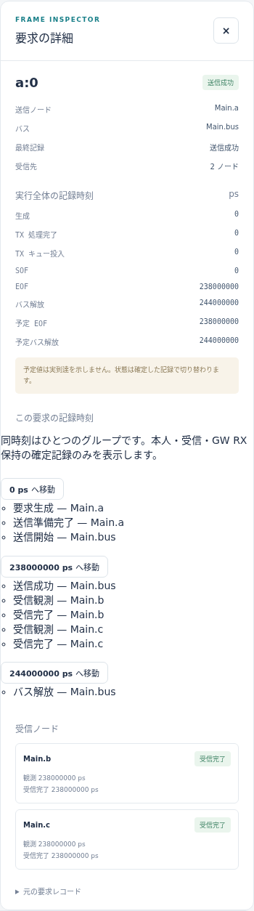
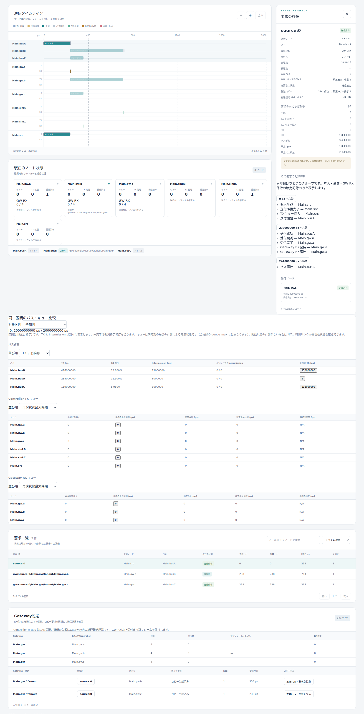

# CAN・Gatewayの機能・動作仕様

文書バージョン：`1.1.1`
対象GitHubバージョン：`main @ c67e153cc3bcf1f6ac0303d23023ce8ae4a4f533`
収録リリース：`v1.1.6`（本文・画像の調査基準は上記commitを維持）

### 更新履歴

| 文書バージョン | 更新日 | 更新内容 |
| --- | --- | --- |
| `1.1.1` | `2026-10-20` | Issue #116〜#119の正式v1.1.6実測記事への相互参照を追加し、既存実習との比較範囲を明示 |
| `1.1.0` | `2026-10-17` | CAN・複数バスGateway・CAN FD・CAN↔Ethernetの機能と動作を採否判断用に整理。v1.1.6へ収録し、本文・画像の調査基準を維持 |

文書ID：`guide-reference-can-gateway`
文書状態：レビュー用参考資料。現行仕様・実装を読み解くための初版草案であり、新しい規範要件を追加しない。正本と差が見つかった場合は、以下の参照先と対象commitのソースを確認して修正する。

本書でいう「変更できる」は、入力が受理される設定変更を指す。「固定」は、このprofileでは設定項目がなく、変更に仕様・コード・検証の更新を要することを指す。全章の時刻は整数ps、実行範囲は `[0,T)`。`u32max=4294967295`、`u64max=18446744073709551615`。各表の既定値は参照仕様・配布入力の定義を示す。NEDのdefaultやINI overrideを変更した場合の実効値は実行metadataで確認する。必須JSON項目にサンプル値があっても、省略時の既定値が存在するとは限らない。

| 判断したいこと | 主な参照箇所 |
| --- | --- |
| バス速度、負荷、ID、待ち行列容量を変える | 1・2・3節 |
| アプリ受信の遅延・フィルタを変える | 4節 |
| 複数CAN間の経路・保持容量・処理時間を変える | 5節 |
| FDのデータ速度を比較する | 6節。位相bit数は外部入力 |
| CANとEthernetを接続する | 7節と[Ethernet編](Ethernetの機能・動作仕様.md) |

## 第1節 Classical CANの選択・構成・負荷生成

### 概要

**機能仕様**：`can.cc.ideal.v1`は、1個の共有Busと2個以上のControllerでClassical CANのDATAフレームを評価する既定profile。標準11bit・拡張29bit、決定的な明示／周期負荷、仲裁、内容依存のCRC・stuffing、有限TXキューを提供する。

**動作仕様**：INI/NED/負荷を準備検証し、時刻がT未満のgenerator発火を要求へ変える。要求はTX処理→キュー入場→仲裁→SOF→EOF→解放へ進む。Busごとに同じ(format,ID)の送信Controllerを一つに限定し、発火時刻が違っても別送信者の同じkeyは準備拒否する。

### 詳細

**機能仕様**：構成の入口と入力範囲は次のとおり。相対ファイルパスの基準はINIの親ディレクトリ。

| 設定場所・キー | 値・既定・単位 | 設定／固定と制約 |
| --- | --- | --- |
| INI `[General] model-profile` | `can.cc.ideal.v1`、省略時も同値 | 設定可。他profileへの変更時は型・schemaも合わせる |
| INI `network` / `ned-path` | 実行network名／NED探索先 | 実構成を指定。Controllerのtx→Bus入力、Bus出力→同Controllerのrxを対にする |
| Bus `bitrate` | 必須、整数換算1..1000000 bps | NED又はINIで設定。非整数bps・0・上限超過拒否 |
| Controller `queueCapacity` | 既定64、0..u32max frame | 待機要求だけを数える。3節参照 |
| Controller `txProcessingDelay` / `rxProcessingDelay` | 各既定0ps、0..u64max ps | 非負の時間値。単一CPUのサービス能力ではなく要求ごとの固定遅延 |
| Controller `rxFilter` | 既定`"*"` | 4節の文字列構文 |
| `dir.link.FixedDelay`の`delay` | 既定0ps、0..u64max ps | 観測通知の遅延。仲裁・ACKの物理伝搬を表さない |
| INI `workload` | UTF-8 JSON、省略時generatorなし | idealはschema_version=1。`model-config`の追加は拒否 |
| 負荷root | `{schema_version:1,generators:[]}` | 必須キー。未知・重複キー拒否 |
| generator共通 | `id,kind,node,frame`必須 | idは一意な`[A-Za-z_][A-Za-z0-9_]*`、nodeはController完全パス |
| `frame.format` / `frame.id` | standard:0..2047、extended:0..536870911 | JSON整数ID。formatは必須。両formatは別key |
| `frame.data` | 必須、0..8 byteの偶数桁hex、空文字可 | `0x`・空白・奇数桁拒否。DLCは長さから導出 |
| kind=`can.explicit.v1` | 必須`times`=時間文字列配列 | 非減少、同時刻重複・空列可 |
| kind=`can.periodic.v1` | 必須`start,period`、任意`phase,end,count` | phase既定0、period>0、0≤phase<period、end≥start、countは0..u64max整数 |

**動作仕様**：周期時刻は `start+phase+k*period`。指定されたcountとendの双方を満たす候補だけを使い、endとTは未満で判定する。同時刻生成はgenerator ID辞書順、同一generatorではordinal順。`request_id=id:ordinal`は繰返しの各送信を識別し、CAN IDとは区別する。負荷は遅延展開し、長期間の全要求を初めに配列化しない。

正常例は[同梱最小INI](https://github.com/hideki-ozu/DIR-Simulator/blob/c67e153cc3bcf1f6ac0303d23023ce8ae4a4f533/examples/guide/can/minimal.ini)とそのworkloadを一緒に使う。count=0・空timesは正常な0件負荷であり、入力検証は省略しない。T以降しか発火しないgeneratorも、不正frameや所有者競合は準備失敗となる。RTR・独立DLC・任意ACK・確率負荷の追加キーは受理範囲外。

下位実装は[NED・profile解決](https://github.com/hideki-ozu/DIR-Simulator/blob/c67e153cc3bcf1f6ac0303d23023ce8ae4a4f533/crates/dir-simulator/src/input/can.rs)と[CAN runtime](https://github.com/hideki-ozu/DIR-Simulator/blob/c67e153cc3bcf1f6ac0303d23023ce8ae4a4f533/crates/dir-simulator/src/runtime/can.rs)。Rustの`serde_json`等の入力基盤と共通schedulerを利用するが、外部CANシミュレータを呼び出す構成ではない。仕様・設計・検証の入口は[CAN仕様](https://github.com/hideki-ozu/DIR-Simulator/blob/c67e153cc3bcf1f6ac0303d23023ce8ae4a4f533/docs/specs/models/CANモデル詳細機能仕様書.md#workload)、[CAN設計](https://github.com/hideki-ozu/DIR-Simulator/blob/c67e153cc3bcf1f6ac0303d23023ce8ae4a4f533/docs/design/CANモデル詳細設計書.md)、[製品試験](https://github.com/hideki-ozu/DIR-Simulator/blob/c67e153cc3bcf1f6ac0303d23023ce8ae4a4f533/crates/dir-simulator/tests/can_scenarios.rs)。

**変更判断**：決定的負荷の再現だけで足りるか、確率生成が必要か。周期キーの追加・所有者制限の緩和は入力だけで済まず、同時刻順序、衝突表現、要求ID、旧schema1との互換試験に影響する。

## 第2節 ローカル候補とバス仲裁

### 概要

**機能仕様**：同じBusを共有する複数Controllerのready要求から、CAN仲裁列に従って次の1件を選ぶ。Controller内もID優先であり、単純FIFOではない。

**動作仕様**：各Controllerが待機中の最優先1件を提出し、Busが全候補を比較する。敗者は保持し、次回は新着を含め再選択する。SOF後の高優先要求は進行中フレームを中断しない。

### 詳細

**機能仕様**：比較方式・非プリエンプト・敗者保持は固定。利用者が変えられるのはframeのformat/ID、生成時刻、TX処理遅延、バス速度など。独立の「優先度」設定はない。

| 比較対象 | 固定規則 |
| --- | --- |
| standard仲裁列 | ID11bit、RTR=0、IDE=0 |
| extended仲裁列 | ID上位11bit、SRR=1、IDE=1、ID下位18bit、RTR=0 |
| bit比較 | MSBから最初に違うbitで0が1に勝つ。stuff bitは優先度keyに入れない |
| Controller内の同じ仲裁列 | generated時刻、generator ID辞書順、ordinalの生成順 |
| Busの別Controllerで同じkey | 準備時に所有者一意を検査し拒否。正常時に同値勝者を作らない |

**動作仕様**：共通phase0の完了・解放、phase1の生成／ready処理の後、phase2で候補を集める。仲裁の論理選択に追加の時間は加えず、仲裁フィールドは勝者フレーム長に一回含める。仲裁敗者も勝者の受信対象になる。

standard `0x123` とextended `0x048C0000`は先頭11bitが同じためstandardが先行する。extended `0x00000123`は先頭11bitが0なのでstandard `0x123`より先行する。29bitの数値と11bitの数値をそのまま比較すると誤る。SOF直前のreadyは参加でき、SOF後のreadyは次のreleaseを待つ。後着高優先要求が先の低優先要求を繰返し追い越すことはあり、最大待ち時間保証を自動付与しない。

結果では`sof_ps`と`ready_ps`、仲裁待ちを照合する。multibusではTX受理待ちが追加されるため、`tx_enqueued_ps`以後の仲裁待ちと区別する。[仕様](https://github.com/hideki-ozu/DIR-Simulator/blob/c67e153cc3bcf1f6ac0303d23023ce8ae4a4f533/docs/specs/models/CANモデル詳細機能仕様書.md#arbitration) → [設計](https://github.com/hideki-ozu/DIR-Simulator/blob/c67e153cc3bcf1f6ac0303d23023ce8ae4a4f533/docs/design/CANモデル詳細設計書.md) → [選択実装](https://github.com/hideki-ozu/DIR-Simulator/blob/c67e153cc3bcf1f6ac0303d23023ce8ae4a4f533/crates/dir-simulator/src/runtime/can.rs)・[内部試験](https://github.com/hideki-ozu/DIR-Simulator/blob/c67e153cc3bcf1f6ac0303d23023ce8ae4a4f533/crates/dir-simulator/src/runtime/can/tests.rs)。操作例は[CANの調停](../CANの調停.md)。

**変更判断**：Controller内FIFOが必要か、現在のID優先が必要か。仲裁方式の変更は送信順だけでなく、キュー滞留、drop、受信順、Gateway下流の負荷へ波及する。

## 第3節 CRC・stuffing・TX容量・媒体占有

### 概要

**機能仕様**：payloadの内容を含むClassical CAN bit列からCRC-15とstuff bit数を算出し、SOF→EOFと次送信が可能になるreleaseを分ける。有限TXキューが過負荷時の新着破棄を表す。

**動作仕様**：生成要求はTX処理完了時に待機容量を検査する。通常Controllerの満杯は新着をqueue_fullで破棄する。送信開始でキューから外し、EOFで送信成功、3bit intermissionを終えたreleaseでBusを再利用する。

### 詳細

**機能仕様**：CRC・stuff規則・intermission=3bitは固定。`queueCapacity`と`bitrate`は1節の範囲で設定できる。CRCやstuff数を入力で上書きするキーはない。

| 項目 | 固定計算／容量契約 |
| --- | --- |
| CRC入力 | 非stuffのSOFからDATA末尾。standardは19+8D bit、extendedは39+8D bit |
| CRC-15 | 多項式下位係数0x4599、初期0、最終XORなし。算出値を15bitとして付加 |
| stuff | SOFからCRC最終bitまで連続5個の同bit後に反対bitを挿入。field境界でも連続数を保持 |
| frame_bits | standard=44+8D+S、extended=64+8D+S。Dはbyte、Sはstuff数 |
| EOF / release | `SOF+ceil(frame_bits*10^12/R)` / `SOF+ceil((frame_bits+3)*10^12/R)` |
| 待機容量 | ready待機件数。TX処理中と送信中を除外。容量0は全新着をdrop |
| 満杯の規則 | 同時刻phase1はphase2の取出しを先取りしない。通常Controllerはdrop-newest |

**動作仕様**：standard ID0/data空はframe_bits=50、500kbpsでEOF=SOF+100us、release=SOF+106us。これは全0byteフレーム共通の長さではなく、ID・dataが変わるとCRCとstuff数も変わる。payload byte数だけから固定frame長を推定しない。

容量0で一件生成した場合、TX処理後にdropped、SOFなし、attempt_count=0。Busが空いていても容量検査を飛ばして直送しない。容量1で同時刻に二件readyなら、最初の入場後は満杯のため次の要求をdropし、その後phase2が1件を取り出す。Gateway由来コピーの正容量満杯だけは5節のwaiting_txへ進む。

EOF=Tならイベントは未実行でin_flight、成功0。EOF<Tかつrelease≥Tなら送信成功だがBusはintermission中。Receiver到着はさらに後となり得る。結果の`frame_bits,stuff_bits,crc15,serialized_bits`と予定／実績EOFを照合する。busy比率にはintermissionを含む観測区間の占有時間を用いる。

[規格の参照範囲](https://www.iso.org/standard/86384.html)はISO 11898-1:2024のデータリンク／物理符号化副層の書誌確認。本profileのCRC・仲裁・理想ACKの採用範囲は[CAN仕様](https://github.com/hideki-ozu/DIR-Simulator/blob/c67e153cc3bcf1f6ac0303d23023ce8ae4a4f533/docs/specs/models/CANモデル詳細機能仕様書.md#wire-time)を正本とし、通信エラー、再送、error-passive、bus-off、物理波形までの適合を主張しない。[設計](https://github.com/hideki-ozu/DIR-Simulator/blob/c67e153cc3bcf1f6ac0303d23023ce8ae4a4f533/docs/design/CANモデル詳細設計書.md)・[bit列実装](https://github.com/hideki-ozu/DIR-Simulator/blob/c67e153cc3bcf1f6ac0303d23023ce8ae4a4f533/crates/dir-simulator/src/runtime/can/protocol.rs)・[資源仕様](https://github.com/hideki-ozu/DIR-Simulator/blob/c67e153cc3bcf1f6ac0303d23023ce8ae4a4f533/docs/specs/資源詳細機能仕様書.md#queue)・[試験](https://github.com/hideki-ozu/DIR-Simulator/blob/c67e153cc3bcf1f6ac0303d23023ce8ae4a4f533/crates/dir-simulator/tests/can_scenarios.rs)。

**変更判断**：容量の評価単位はframe件数でよいか。占有をEOFまでに変えると次SOFと利用率が同時に変わる。CRC/stuffingを簡略化すると、同payload長でも異なる送信時間を比較する用途を失う。

## 第4節 受信フィルタ・処理遅延・成功と期限の読み方

### 概要

**機能仕様**：送信元以外の全Controllerへ完了フレームを通知し、受信者別のfilterとRX固定遅延を適用する。送信成功とアプリ受信を別に観測する。

**動作仕様**：EOF成功後、経路遅延を加えたobservedでfilterを判定する。拒否はfiltered、適合はrxProcessingDelay後にreceived。全受信者が拒否しても理想ACKは成立し、送信成功を取り消さない。

### 詳細

**機能仕様**：`rxFilter`は`*`、`none`、又はcomma区切りの`std:0xHEX`／`ext:0xHEX`集合。HEXは1..8桁かつformatのID範囲内。空白・重複・空項目は拒否する。マスク・範囲式・実行中の動的filter変更はない。通常Controllerに有限アプリRXキューはなく、`rxProcessingDelay`は独立固定遅延でありCPU競合を表さない。

| 観測項目 | 意味・境界 |
| --- | --- |
| observed | `EOF+source側tx channel.delay+receiver側rx channel.delay`。各成分一回 |
| received | filter適合時だけ`observed+rxProcessingDelay` |
| TX状態 | processing→pending→in_flight→success。容量拒否はdropped |
| Receiver状態 | EOFで行を作成、観測前pending、filter不適合filtered、適合して処理完了received |
| 未完了 | T以上の観測・受信完了は実行せず予定だけ保持。成功要求にも未完了Receiverがあり得る |
| deadlineの設定 | ideal/multibusのCAN generatorには`deadline_ps`等の期限キーなし。未知キーとして拒否 |

**動作仕様**：A送信、B=`rxFilter="none"`ではA.success=1、B.filtered=1、B.received=0。BのRX遅延だけを900usへ変えてもAのEOF、Bus release、次SOFは変わらず、Bの受信完了だけ後へ移る。遅延がTを跨げばBは未完了となる。

CANの期限評価は、現在のCAN入力に内蔵期限を追加したことにせず、`received_ps−generated_ps`又はoriginから末端までの遅延を外部の設計期限と比較する。遅延標本に未完了受信を補完しない。Ethernetの`deadline_ps`の自動集計は[Ethernet編の期限](Ethernetの機能・動作仕様.md#第5節-周期バースト負荷と配送期限)に限定する。

図は対象commitのCAN実行を読むためのViewer例。撮影入力・実行条件・表示時刻は[図版の証跡](設定・固定値・規格・変更検討.md)を参照する。要求一覧と受信行を合わせ、successを全受信完了と読み替えない。

詳細図ではEOFが238000000ps、Main.bとMain.cの受信完了も238000000psである。バス解放244000000psはintermission後の別の時刻である。「実行全体の記録時刻」には選択時刻238000000psより後の確定記録も載るため、その欄を選択時刻時点の完了判定と混同しない。

[仕様](https://github.com/hideki-ozu/DIR-Simulator/blob/c67e153cc3bcf1f6ac0303d23023ce8ae4a4f533/docs/specs/models/CANモデル詳細機能仕様書.md#controller)・[設計](https://github.com/hideki-ozu/DIR-Simulator/blob/c67e153cc3bcf1f6ac0303d23023ce8ae4a4f533/docs/design/CANモデル詳細設計書.md)・[filter parser](https://github.com/hideki-ozu/DIR-Simulator/blob/c67e153cc3bcf1f6ac0303d23023ce8ae4a4f533/crates/dir-simulator/src/input/can.rs)・[受信runtime](https://github.com/hideki-ozu/DIR-Simulator/blob/c67e153cc3bcf1f6ac0303d23023ce8ae4a4f533/crates/dir-simulator/src/runtime/can.rs)・[試験](https://github.com/hideki-ozu/DIR-Simulator/blob/c67e153cc3bcf1f6ac0303d23023ce8ae4a4f533/crates/dir-simulator/tests/can_scenarios.rs)。操作例は[受信フィルタ](../CANの受信フィルタ.md)と[RX遅延比較](../CAN受信処理遅延の比較.md)。

**変更判断**：アプリが遅いほど次の受信も遅れる単一serverが必要か、要求ごと独立でよいか。前者への変更はrxProcessingDelayの値変更では表現できず、RX資源・queue・drop・計測の新しい契約が必要になる。

## 第5節 独立CANバスとCAN→CAN Gateway

### 概要

**機能仕様**：`can.cc.multibus.v1`は、独立仲裁する複数Busと静的Gateway経路を扱う。format/ID/dataを保ったstore-and-forwardとfanout、ingress別の有限RX保持、egress TX満杯待ちを提供する。

**動作仕様**：Gateway portの受信処理完了でRX枠を確保し、経路照合→Gateway処理→コピー生成→egress TX処理→TX受理→CAN仲裁を進める。全枝のTX受理又は終端破棄で親のRX枠を解放し、下流の送信成功を待たない。

### 詳細

**機能仕様**：INIの`model-profile="can.cc.multibus.v1"`と`model-config="routing.json"`を明示する。workloadはschema2、互換schema1も受理。登録型は`dir.can.MultibusController`と`dir.can.MultibusBus`。Busは1個以上、各BusのControllerは2個以上。Gateway portsはcompound配下の異なるBus上のControllerを2個以上指定する。

| routing.jsonの場所 | 入力値・既定 | 範囲・変更効果 |
| --- | --- | --- |
| root | 必須`schema_version:1,gateways:[]` | 空配列はGWなしの独立Bus |
| `gateways[].node,ports,routes` | 必須module名、Controller配列、経路配列 | Controllerの複数GW所有・GW portからのnative generatorを拒否 |
| `processing_delay` | 任意時間文字列、既定0ps | 0..u64max ps、RX保持中の独立固定処理 |
| `rx_queue_capacity` | 任意JSON整数、既定64 | 0..u32max。**ingressごと**に同容量を適用、親受信frame単位 |
| `hop_limit` | 任意JSON整数、既定16 | 1..65535。新hopsが上限を超えるとコピー生成前破棄 |
| route `id,ingress,egress,format,id_min,id_max` | 全項目必須 | idはGW内一意、egress空不可・別Bus。範囲はstandard0..2047、extended0..536870911 |
| egress ControllerのTX設定 | 通常CANと同じ | queueCapacityの正容量満杯はwaiting_tx、0は終端queue_full |

**動作仕様**：同ingress・formatのID区間重複は端点一致も拒否する。各ID区間についてBus有向経路の閉路を準備拒否し、native送信と経路egressのID所有予約も検証する。未発火・到達不能の経路も検査対象。ID書換え、実行中の経路変更、経路順による先勝ちはない。

受信filter拒否ではGW転送行を作らない。RX容量0／満杯なら`gw.rx_buffer`に`rx_queue_full`、元CAN要求のsuccessとReceiver.receivedは保持する。経路なしは`gw.forward`がfiltered/no_routeとなりRXを即解放。経路一致なら各枝をパス順に作り、`forward_due=received+processing_delay`。hop適合時にchild要求を生成し`gw.forward=submitted`となる。submittedはコピー生成済みを意味し、送信成功ではない。

正容量TXが満杯ならchildはwaiting_txでRX枠を保持する。SOFでTX待機枠が空くと次deltaで再試行し、GW/TX遅延は加え直さない。空いている枝は先に進めるが、最後の待ち枝がRXを占有し続けるため後続親がrx_queue_fullになり得る。容量0はqueue_fullで終端し、全枝終端後にRXを返す。処理期限=Tならforward行はprocessing、child要求はまだ存在しない。

結果の`can.request`、`can.receiver`、`gw.forward`、`gw.rx_buffer`はschema2の`simulation.model_records`内にある。旧schema1の`simulation.requests`をそのまま検索しない。originは元要求、parentは直前要求、childは分岐コピーを表す。`gw_tx_buffer_wait_ps=tx_enqueued_ps−ready_ps`と`arbitration_wait_ps=SOF−tx_enqueued_ps`を分ける。元送信一件が複数コピーへ分かれるため、成功件数の単純合算を元要求の配達率にしない。

図はGatewayの物理Bus接続と内部中継の読み方の例。入力と撮影条件は[図版の証跡](設定・固定値・規格・変更検討.md)。RX保持とTX待機を別に見る。

400us時点の詳細図。右上で元要求`source:0`は送信成功、転送コピー2件は成功1・未完了1と読める。下段のGateway転送表にはMain.gw.bとMain.gw.cへの枝が別々に並ぶ。元要求が成功していても、遅い枝は送信中である。[原寸画像](../assets/reference/gateway-detail.png)で右側の詳細と最下段の枝を確認できる。

[GW仕様](https://github.com/hideki-ozu/DIR-Simulator/blob/c67e153cc3bcf1f6ac0303d23023ce8ae4a4f533/docs/specs/models/GWモデル詳細機能仕様書.md)・[GW設計](https://github.com/hideki-ozu/DIR-Simulator/blob/c67e153cc3bcf1f6ac0303d23023ce8ae4a4f533/docs/design/GWモデル詳細設計書.md)・[入力検証](https://github.com/hideki-ozu/DIR-Simulator/blob/c67e153cc3bcf1f6ac0303d23023ce8ae4a4f533/crates/dir-simulator/src/input/gateway.rs)・[転送実装](https://github.com/hideki-ozu/DIR-Simulator/blob/c67e153cc3bcf1f6ac0303d23023ce8ae4a4f533/crates/dir-simulator/src/runtime/gateway.rs)・[製品試験](https://github.com/hideki-ozu/DIR-Simulator/blob/c67e153cc3bcf1f6ac0303d23023ce8ae4a4f533/crates/dir-simulator/tests/gateway.rs)・[fanout入力](https://github.com/hideki-ozu/DIR-Simulator/blob/c67e153cc3bcf1f6ac0303d23023ce8ae4a4f533/examples/gateway/fanout.ini)。操作例は[処理遅延と複数CAN中継](../Gateway処理遅延と複数CANバスの中継.md)。

**変更判断**：RX容量はingress別でよいか、GW全体共有が必要か。TX満杯時に保持するか即dropするか。これらは処理遅延値の変更と違い、上流損失と下流待ちの関係、RX解放、保存則、Viewer表示まで変更する。

## 第6節 CAN FDの外部位相長モデル

### 概要

**機能仕様**：`can.fd.precomputed.v1`はFD専用バスの二速度・BRS・0..64byteの許可DLC長を扱う。内容依存のFD CRC/stuffingを内部生成せず、外部計算／測定で得た位相bit数を入力する。

**動作仕様**：frame・速度・位相bit数の結合hashと構造を準備検証し、nominal/dataの合計時間を算出する。候補・仲裁・filter・有限TXはCC規則を再利用する。FD波形の正しさはhash一致だけでは証明されない。

### 詳細

**機能仕様**：INIで専用profileとmodel-configを選ぶ。`model-config`は全キー必須の`{schema_version:1,profile:"can.fd.precomputed.v1"}`。NED登録型`dir.canfd.ControllerV1/BusV1`と`dir.link.FixedDelay`、Bus一個・Controller二個以上を使う。

| 設定位置・キー | 値・範囲・単位 | 省略／固定 |
| --- | --- | --- |
| Bus `nominalBitrate` | 必須1..1000000整数bps | defaultなし |
| Bus `dataBitrate` | 必須nominalBitrate..8000000整数bps | defaultなし。本profileの範囲であり実機速度保証ではない |
| workload | schema2、kind=`can.fd.explicit.v1`、`times_ps` | 非負u64の正規十進文字列配列、非減少。周期は事前展開 |
| frame | 必須`format,id,data,brs,wire` | format/IDはCCと同じ。brsはbool |
| dataの許可byte長 | 0..8、12、16、20、24、32、48、64 | 自動paddingなし、DLC導出 |
| wire | 必須`nominal_bits,data_bits,evidence,binding_sha256` | bit数はJSON整数0..1000000、nominal≥1 |
| BRS=true | data_bits≥max(1,8*payload bytes) | 位相配分は外部計算 |
| BRS=false | data_bits=0、nominal_bits≥8*payload bytes | データ速度区間なし |
| evidence / hash | 1..512文字の非空証跡名／小文字hex64桁 | hashの入力順は正本仕様参照。frame・速度・bit数と結合 |

**動作仕様**：N/Dを公称／データ位相bits、Rn/Rdを速度として、EOF差分は `ceil(10^12*(N*Rd+D*Rn)/(Rn*Rd))`。releaseはNをN+3に置き換え、和全体で一回切上げる。外部位相長にはSOFからEOF、CRC・stuff・ACKを含め、intermission3公称bitを含めない。速度変更時は外部条件とhashを更新し、古いhashを使い回さない。

正常時はEOFで`canfd.serialized`、受信処理完了で`canfd.received`を計上する。BRS=falseなのにdata_bits>0、10byteなど許可表外payload、hash不一致は準備拒否。EOF=Tは未実行、実績EOFはnullで予定だけを持つ。CCとFDの同一バス混在、RTR、ESI変化、エラー注入は対象外。

結果は`dir.canfd.frame/request/reception`のmodel_records。`fidelity=externally-precomputed-phase-bits`、`wire_validation=structural-only`を保持する。evidence文字列は計算器の版・設定等を識別するためのもので、合法波形の認定ではない。同梱synthetic fixtureも実機golden vectorとは区別する。

[FD仕様](https://github.com/hideki-ozu/DIR-Simulator/blob/c67e153cc3bcf1f6ac0303d23023ce8ae4a4f533/docs/specs/models/CANFD・100BASE-T1詳細機能仕様書.md#canfd)・[設計](https://github.com/hideki-ozu/DIR-Simulator/blob/c67e153cc3bcf1f6ac0303d23023ce8ae4a4f533/docs/design/CANFD・100BASE-T1詳細設計書.md)・[入力](https://github.com/hideki-ozu/DIR-Simulator/blob/c67e153cc3bcf1f6ac0303d23023ce8ae4a4f533/crates/dir-simulator/src/input/canfd.rs)・[runtime](https://github.com/hideki-ozu/DIR-Simulator/blob/c67e153cc3bcf1f6ac0303d23023ce8ae4a4f533/crates/dir-simulator/src/runtime/canfd.rs)・[試験](https://github.com/hideki-ozu/DIR-Simulator/blob/c67e153cc3bcf1f6ac0303d23023ce8ae4a4f533/crates/dir-simulator/tests/canfd.rs)・[実行INI](https://github.com/hideki-ozu/DIR-Simulator/blob/c67e153cc3bcf1f6ac0303d23023ce8ae4a4f533/examples/canfd/precomputed.ini)。操作例は[データ速度比較](../CANFDのデータ速度比較.md)。

**変更判断**：外部位相長で相対比較できれば足りるか、payloadからFD bitstreamを自動算定する必要があるか。後者はCC CRCの流用では実現できず、FD専用codecと独立波形検証を追加する設計変更になる。

## 第7節 CAN↔Ethernet変換

### 概要

**機能仕様**：`can.ethernet.gateway.v1`はClassical CANと全二重Ethernetの静的VLAN/QoSを一つの実行に置き、明示した双方向変換規則で接続する。DIR独自の実験codec、有限共通RX保持、分岐、lineageによるループ停止を提供する。

**動作仕様**：通常の媒体受信条件を通過した後、codec→lineage→rule→RX容量を判定する。受理した変換を処理後に反対媒体へofferし、全枝の受理／終端破棄でRXを解放する。CAN→CANのmultibus Gatewayとは入力と容量の適用単位が異なる。

### 詳細

**機能仕様**：INIのprofile・model-config・workloadをすべて専用形式へ合わせる。NEDの登録キーは`dir.bridge.CanController/CanBus/EthEndpoint/EthLink`（Switchは`dir.ethernet.Switch`）。CAN Bus既定500kbps、Controller queue既定64、TX/RX遅延既定0ps、EthLink既定1Gbps/0ps。

| model-config / workloadの場所 | 必須値・範囲 | 動かせる内容 |
| --- | --- | --- |
| config root | `{schema_version:1,can:{},ethernet:VLAN_CONFIG,gateways:[]}` | canは空object固定、ethernetはschema3の完全構成 |
| `gateways[].instance,can_ports,ethernet_endpoint` | compound、CAN Controller1個以上、Ethernet Endpoint1個 | 重複所有拒否 |
| `rx_capacity` | 必須JSON整数0..u32max | GW全体の共通RX slot数。multibusのingress別容量と異なる |
| `conversion_delay_ps` | 必須u64正規十進文字列ps | observedからの固定変換遅延 |
| `max_hops` | 必須JSON整数1..255 | 訪問済GW・hop超過を抑止 |
| rule | 必須`id,direction,ingress,match,egresses` | 方向は`can_to_ethernet`又は`ethernet_to_can`、完全一致のみ |
| CAN→Eth match / egress | `format,can_id` / `port,dst_mac,vid,pcp` | 出力VID1..4094、PCP0..7を固定写像 |
| Eth→CAN match / egress | `vid,pcp,format,can_id` / `port,format,can_id` | 復号元IDで照合、出力IDへ明示書換え。複数CAN出力可 |
| workload root | `{schema_version:1,can:CAN_WORKLOAD,ethernet:VLAN_WORKLOAD}` | 内部CAN schema2、Eth schema3。GW所有送信元はnative指定不可 |

**動作仕様**：Ethernetの受信はFCS→admit→VID membership→MAC宛先、CANはrxFilterを先に通す。自身以外のindividual MAC宛てをGWが無差別変換しない。DIR codecはEtherType 0x88B5、magic DIRC、version、format flag、big-endian ID、DLC、0..8byte dataの11..19byte。0x88B5はlocal experimental用途であり、AVTP・SOME/IP・IEEE1722の実装を意味しない。通常Ethernet paddingとCAN CRC/stuffは変換先で扱う。lineageは内部状態でありwire payloadへ埋め込まない。

受理時刻observedで共通RXを予約し、`ready=observed+ingress RX処理+conversion_delay`。egress TX処理を一回加えてofferする。通常の正容量満杯はwaiting、容量0又はMAC長がbyte上限を超えて永久入場不能なら`tx_unadmittable`で終端。別枝の成功を戻したり再送したりしない。

拒否理由は`invalid_codec/no_rule/loop_prevented/hop_limit/rx_full`を通常受信拒否と分ける。同GW・方向・ingressの重複ruleは先勝ちにせず準備拒否。Gateway間の論理循環はlineageで停止する一方、Ethernet物理成分はtreeが必要。CAN FD・RTR・半二重・媒体固有PHY・動的制御・TSNとの組合せは現在のprofileで準備拒否する。

結果の`dir.can_ethernet.conversion/branch/segment`とnative CAN/Ethernet記録をorigin/parent/childで追う。conversion acceptedはprocessing+waiting_tx+released、branchはwaiting+admitted+dropped。end-to-end分母は各**実SOF**時に固定した通常terminalの機会数で、未来の変換先を補わない。未完了terminalは分子へ入れず、分母0の率はnull。異種媒体のsuccess件数を単純に足した率にはしない。

[変換仕様](https://github.com/hideki-ozu/DIR-Simulator/blob/c67e153cc3bcf1f6ac0303d23023ce8ae4a4f533/docs/specs/models/CAN・Ethernet変換詳細機能仕様書.md)・[設計](https://github.com/hideki-ozu/DIR-Simulator/blob/c67e153cc3bcf1f6ac0303d23023ce8ae4a4f533/docs/design/CAN・Ethernet変換詳細設計書.md)・[入力](https://github.com/hideki-ozu/DIR-Simulator/blob/c67e153cc3bcf1f6ac0303d23023ce8ae4a4f533/crates/dir-simulator/src/input/can_ethernet.rs)・[runtime](https://github.com/hideki-ozu/DIR-Simulator/blob/c67e153cc3bcf1f6ac0303d23023ce8ae4a4f533/crates/dir-simulator/src/runtime/can_ethernet.rs)・[受入試験](https://github.com/hideki-ozu/DIR-Simulator/blob/c67e153cc3bcf1f6ac0303d23023ce8ae4a4f533/crates/dir-simulator/tests/acceptance_bridge.rs)・[双方向例](https://github.com/hideki-ozu/DIR-Simulator/blob/c67e153cc3bcf1f6ac0303d23023ce8ae4a4f533/examples/can-ethernet/bidirectional.ini)。Ethernet側のVLANと8classは[Ethernet編](Ethernetの機能・動作仕様.md)を参照する。

**変更判断**：現在の実験codecと固定ID↔PCP写像でよいか、外部protocol互換が必要か。Gateway+TSN、FRER、preemptionは現行profileの有効設定ではなく提案・後続設計の範囲。採用するなら複合入力、同時刻順序、RX保持、lineage、受信母数、Viewerを合わせて改訂する。

## 第8節 実装の依存関係と採否レビュー

### 概要

**機能仕様**：各profileは入力検証、共通時刻・イベント実行、媒体runtime、結果schema、Viewerを組み合わせる。下位機構を共有していても、profile間の機能を任意に混ぜられるわけではない。

**動作仕様**：準備失敗は実行を開始せず、実行時の算術・内部不整合は未commit callbackを破棄し、確定済prefixだけを結果へ残す。通常のfilter・queue_full・待機は実行失敗とは分ける。

### 詳細

**機能仕様**：判断に必要な下位実装と利用ライブラリを示す。[Cargo依存](https://github.com/hideki-ozu/DIR-Simulator/blob/c67e153cc3bcf1f6ac0303d23023ce8ae4a4f533/crates/dir-simulator/Cargo.toml)ではserde/serde_jsonが型・JSON、sha2がhash、tiny_httpがHTTPツール、rustix/signal-hookがOS・停止等の基盤を担う。CANのCRC・stuffing・仲裁は本リポジトリのRust実装。利用ライブラリの存在は外部規格codecへの適合を保証しない。

**動作仕様**：profile選択は[入力入口](https://github.com/hideki-ozu/DIR-Simulator/blob/c67e153cc3bcf1f6ac0303d23023ce8ae4a4f533/crates/dir-simulator/src/input.rs)、時刻順序は[scheduler](https://github.com/hideki-ozu/DIR-Simulator/blob/c67e153cc3bcf1f6ac0303d23023ce8ae4a4f533/crates/dir-simulator/src/runtime/scheduler.rs)・[engine](https://github.com/hideki-ozu/DIR-Simulator/blob/c67e153cc3bcf1f6ac0303d23023ce8ae4a4f533/crates/dir-simulator/src/runtime/engine.rs)、観測は[結果仕様](https://github.com/hideki-ozu/DIR-Simulator/blob/c67e153cc3bcf1f6ac0303d23023ce8ae4a4f533/docs/specs/結果詳細機能仕様書.md)へ依存する。CANだけを残す判断でも、共通schema・保存・診断・Viewerから参照されるprofile名と登録型を確認する。詳細な製品試験範囲は[CAN検証](https://github.com/hideki-ozu/DIR-Simulator/blob/c67e153cc3bcf1f6ac0303d23023ce8ae4a4f533/docs/verification/cases/CANモデル検証仕様書.md)、[GW検証](https://github.com/hideki-ozu/DIR-Simulator/blob/c67e153cc3bcf1f6ac0303d23023ce8ae4a4f533/docs/verification/cases/GWモデル検証仕様書.md)、[FD検証](https://github.com/hideki-ozu/DIR-Simulator/blob/c67e153cc3bcf1f6ac0303d23023ce8ae4a4f533/docs/verification/cases/CANFD・100BASE-T1検証仕様書.md)、[変換検証](https://github.com/hideki-ozu/DIR-Simulator/blob/c67e153cc3bcf1f6ac0303d23023ce8ae4a4f533/docs/verification/cases/CAN・Ethernet変換検証仕様書.md)を正本とし、本書の説明を今回全組合せ実行済みという意味で使わない。

| 判断 | 先に確かめる事項 | 変更に含める成果物 |
| --- | --- | --- |
| 機能を残す | どの測定判断に使うか、抽象化が用途に足りるか | 代表入力、受入条件、既知制限 |
| 設定を変える | 範囲内か、単位・既定・適用対象は正しいか | NED/INI/JSON、metadata、比較結果 |
| 動作仕様を変える | 容量境界、同時刻、停止境界、正常dropの意味 | 正本仕様、設計、実装、独立期待値、Viewer |
| 機能を外す | 旧入力・結果を読む必要があるか、他profileの再利用点か | 登録・診断、sample、schema reader、移行説明、回帰試験 |

2026-10-17現行実装追補：承認済み後続10分野の[API・設定・scope・出力・Viewer境界](後続10分野の現行実装と利用境界.md)を追加した。固定commitに基づく既存画像・実測は取得時の証跡として保持する。新機能はv1.1.6に収録する。製品受入最終判定は同追補の製品検証記録へ分離する。文書版・履歴は本pushの改訂として確定した。

## 関連する実習

[GatewayのRX容量と遅い分岐による後続配信の損失](<../GatewayのRX容量と遅い分岐による後続配信の損失.md>)では、RX容量だけを変え、親保持・枝別TX受理と後続親の拒否を区別します
