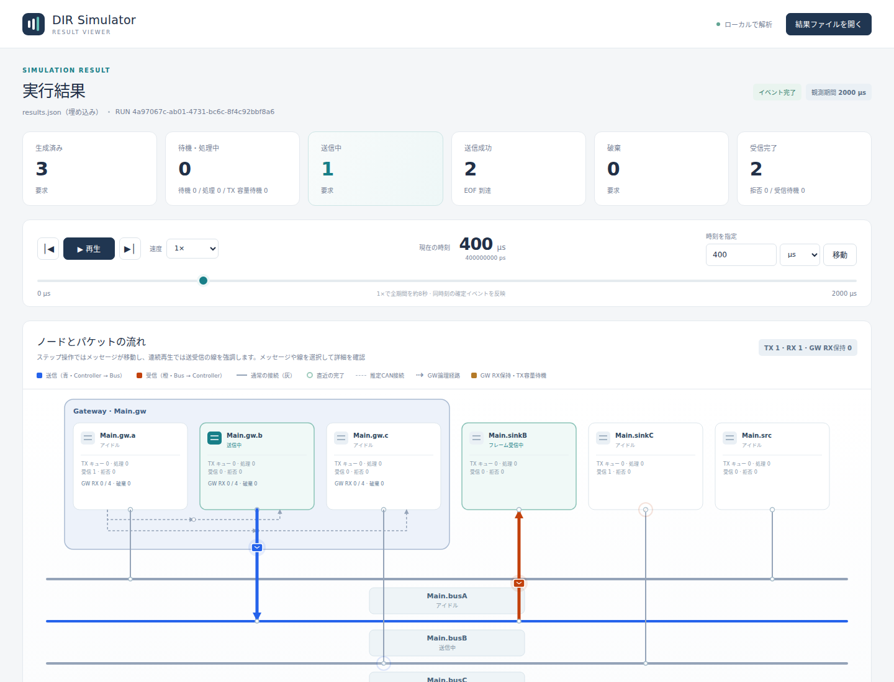

# DIR機能・動作仕様ガイド

文書バージョン：`1.1.0`
対象GitHubバージョン：`main @ c67e153cc3bcf1f6ac0303d23023ce8ae4a4f533`
収録リリース：`v1.1.6`（本文・画像の調査基準は上記commitを維持）
<br>
追補：`2026-10-17` Timer通知APIの修正差分（v1.1.6収録の追補）。基準版・画像の取得条件は維持。
<br>
調査日：`2026-10-16`（日本時間）
<br>
文書ID：`guide-function-behavior-reference`
<br>
文書状態：機能の採否・追加設定・仕様修正を検討するための調査資料。

### 更新履歴

| 文書バージョン | 更新日 | 更新内容 |
| --- | --- | --- |
| `1.1.0` | `2026-10-17` | 初版。基準commit c67e153の16 profileと共通基盤・画面操作を、概要／詳細それぞれの機能仕様・動作仕様、実画面、設定・固定値・規格・変更判断で整理。v1.1.6へ収録し、本文・画像の調査基準を維持 |

## この文書で判断できること

DIRは、通信や共有資源について、**どの要求が、どの条件で待ち、いつ完了し、何が失われるか**を離散イベントで調べるシミュレータである。本書は「その機能を残すか」「どの条件を利用者設定にしたいか」「モデルの前提をどう直したいか」を判断するための読み解き資料である。

各機能は、先に**概要の機能仕様＋動作仕様**、次に**詳細の機能仕様＋動作仕様**を記す。詳細には設定キー・保存場所・単位・既定値・固定条件・正常／境界／異常時・結果の読み方・変更の影響を含める。「機能仕様」はできることと条件、「動作仕様」は入力・操作後に処理される順序と結果を意味する。

既存の詳細仕様・設計・実装・試験へのリンクを各節に付けた。正本の仕様を新たに置き換える文書ではなく、基準ソースを読み解いた資料である。規格の名前が付いたモデルでも、規格の全機能や実機の電気波形を再現するわけではない。採用する抽象化を各章で説明する。

## 読む順序

| 章 | 主に分かること | 仕様変更を考えるときの入口 |
| --- | --- | --- |
| [共通基盤の機能・動作仕様](共通基盤の機能・動作仕様.md) | 入力、型・接続、設定優先、時刻、終了、資源、計測、保存、診断、Rust API | 入力形式や実行・結果の共通ルールを変える |
| [画面操作の機能・動作仕様](画面操作の機能・動作仕様.md) | NED作成、原文と図、設定、保存復旧、型独立化、リネーム、実行、Viewer | 編集手順、保存の制約、実行上限、表示・比較を変える |
| [CAN・Gatewayの機能・動作仕様](CAN・Gatewayの機能・動作仕様.md) | Classical CAN、仲裁、TX/RX、FD、複数バス、相互変換 | 調停、キュー、遅延、経路、エラーやFD忠実度を検討する |
| [Ethernetの機能・動作仕様](Ethernetの機能・動作仕様.md) | L2、媒体、負荷、QoS、VLAN、multicast、動的制御、TAS/CBS/PSFP | 利用するprofile、待ち・破棄・制御の意味を選ぶ |
| [SoC・メモリ・IPCの機能・動作仕様](SoC・メモリ・IPCの機能・動作仕様.md) | AXI、共有バス、AHB、NoC、SRAM、DDR、共有IPC、mailbox、DMA | 並列性、応答、容量、可視化、通知の前提を変える |
| [後続10分野の現行実装と利用境界](後続10分野の現行実装と利用境界.md) | Gateway＋TSN、冗長、分割送信、wire protocol、制御・計測・保存の現行限定実装 | 新しい設定・API・実行例・検証結果を確認する |
| [設定・固定値・規格・変更検討](設定・固定値・規格・変更検討.md) | 変更場所の逆引き、依存、規格、残件、実画面の証拠、検討記入表 | 採否と変更要求を具体化する |

最初は各章の「概要」だけを読んで必要な機能を選び、必要な節の「詳細」で入力と結果の条件を確認する。最後に変更検討表へ判断を記入すると、仕様・実装・検証の修正範囲を絞りやすい。

## 理解に必要な前提知識

| 用語 | 本書での意味 | 間違えやすい点 |
| --- | --- | --- |
| 離散イベント | 生成・受付・送信開始・完了等の変化の時点へ進む計算方式 | 1psごとに全ノードを動かす計算ではない |
| 仮想時刻／実時間 | モデルの中の時刻／計算に要した時計の時間 | INIの1msとエディタ実行上限600秒は別 |
| profile | 入力・処理・結果の約束を版付きの名前で選ぶ単位 | 機能を個別にON/OFFする任意組合せスイッチではない |
| 型／実体 | NEDの部品定義／配置された個々の部品 | 同じ型の編集は複数実体へ影響する |
| schema | JSONやrecordの項目・型・版の約束 | profile名とschema番号は別。数字だけで互換性を判断しない |
| workload | 何を、いつ、どの送信元から発生させるか | キュー容量やネットワーク構造とは別入力 |
| FIFO | 先に受け付けたものから処理する列 | CANのID仲裁や複数class間の優先順位とは別 |
| backpressure | 次段に空きがないため上流を待たせる動作 | 新着破棄やfull応答とは異なる |
| abstract／抽象 | 評価目的に必要な状態・時間へ簡略化したモデル | 同名の標準プロトコル全体との適合を意味しない |
| 固定値／既定値 | 設定口がない値／省略時に採用する値 | 配布サンプルの値は、必須JSON項目の既定値とは限らない |
| snapshot | ある時点で固定した入力または結果の状態 | 実行を途中から再開できるcheckpointと同義ではない |
| `partial`／`unfinished` | 異常等による部分結果／終了時点の未完了要求 | 正常な時間打切りでもunfinishedは残り得る |
| ns／ps、bit／byte | 1ns=1000ps、1byte=8bit | `bps`はbit/s、容量の単位はモデルごとに異なる |

### 入力から結果までのつながり

```text
NED: 部品型・階層・gate・結線・default
  ＋ INI: network/profile・実行条件・実体ごとの上書き・JSON参照
  ＋ model-config JSON: 経路・port・資源・制御表
  ＋ workload JSON: 要求・発生時刻・内容
     ↓ prepare / validate（構文、値、参照、モデル固有条件）
     ↓ run（同じ入力snapshotから仮想イベントを実行）
     ↓ results / CSV / diagnostics → 最後にmanifestを公開
     ↓ Viewer（確定済み結果を再生・比較）
```

NEDエディタは上段の入力を編集し、必要に応じて未保存snapshotをrunへ渡す。Viewer上で時刻を動かしても入力条件やシミュレーション結果は変化しない。

## 現行の組込みprofileと利用目的

基準ソースの[Registry登録一覧](https://github.com/hideki-ozu/DIR-Simulator/blob/c67e153cc3bcf1f6ac0303d23023ce8ae4a4f533/crates/dir-simulator/src/registry/mod.rs#L1071)を確認した。基準の16個に、2026-10-17の現行作業ツリーで4 profileを追加して20個となる。選択肢数は試験合格件数ではない。追加分はv1.1.6に収録する。[現行利用境界](後続10分野の現行実装と利用境界.md)を参照する。

| profile（INI `model-profile`） | 対象・用途 | 主な前提／読む章 |
| --- | --- | --- |
| `can.cc.ideal.v1` | 単一Classical CAN | 既定。理想ACK・エラーなし。CAN章 |
| `can.cc.multibus.v1` | 複数CANとCAN間Gateway | バスごと独立、RX保持とTX容量待ち。CAN章 |
| `can.fd.precomputed.v1` | CAN FDの速度・時間 | 位相bit数を外部指定。CAN章 |
| `can.ethernet.gateway.v1` | CAN↔Ethernet変換 | 独自codecと静的VLANの合成。CAN章 |
| `ethernet.l2.store-forward.v1` | 全二重L2蓄積交換 | 受信してから次hopへ送信。Ethernet章 |
| `ethernet.l2.qos.v1` | 負荷・優先queue・byte容量 | 非プリエンプト。Ethernet章 |
| `ethernet.l2.vlan.v1` | 単一タグ・静的multicast | VIDと出口別処理。Ethernet章 |
| `ethernet.l2.store-forward.v2` | 半二重・媒体別PHY条件 | CSMA/CDと固定PHY遅延等。Ethernet章 |
| `ethernet.l2.100base-t1.v1` | 専用100BASE-T1 | 100Mbps全二重抽象媒体。Ethernet章 |
| `ethernet.l2.dynamic.v1` | 学習・membership・VID登録・抽象tree | 標準制御packetのwire再現ではない。Ethernet章 |
| `ethernet.tsn.v1` | TAS/CBS/PSFP | 理想同期clock。Ethernet章 |
| `can.ethernet.tsn.v1` | CAN・変換・TSNの明示合成 | 一FES、PSFP一回。現行利用境界 |
| `ethernet.redundancy.abstract.v1` | 有限履歴の抽象冗長配送 | 静的2〜16経路、IEEE FRERは対象外。現行利用境界 |
| `ethernet.preemption.abstract.v1` | fragment境界のexpress割込み | 全二重、MAC Mergeは対象外。現行利用境界 |
| `ethernet.control.wire.experimental.v1` | 受動IGMP/MLD・限定RSTP/MVRP | union、revision・領域配置制約。現行利用境界 |
| `axi4.transaction.v1` | AXI4要求・RAM | 五チャネル、ID0、限定burst。SoC章 |
| `soc.shared.v1` | 共有バス・target競合 | トランザクション単位。SoC章 |
| `ahb.transaction.v1` | AHB相当の待ち・応答 | 抽象address/data処理。SoC章 |
| `noc.xy.v1` | NoC経路・有限FIFO | XY経路、packet単位。SoC章 |
| `memory.ipc.transaction.v1` | SRAM/DDR/共有IPC/mailbox/DMA | メモリ・所有権・通知の抽象モデル。SoC章 |

## 実画面から読む例



公開入力`examples/guide/gateway-delay/delay0.ini`を基準ソースで実行し、400us、`source:0`を選択した画面。図の位置は表示上の配置で、距離を測って伝搬時間を設定するものではない。Gatewayで生まれたcopyは別要求として追い、元要求の成功と各出口での成功を分ける。

本資料の実画面10枚は基準ソースから新たに取得した。4モデルの`validate/run/view`と、エディタ読み込み・設定画面の描画を確認している。全体画面に加え、要求・受信・分岐・最終資源の詳細を載せた。これらの画面は全仕様条件・全profileの合格証明ではない。入力、時刻、選択要求、hash、撮影条件は[画像証跡](../assets/reference/screenshot-evidence.json)と[付録](設定・固定値・規格・変更検討.md)へ記載した。

## この調査の限界と読む際の優先順位

対象は上記コミットの製品コード・仕様・設計・既存試験と、今回の実画面用実行である。公開タグ`v1.1.5`そのものと、後続修正を含むmainを同一視しない。Cargoの`--version`は`0.1.0`なので、コードの特定にはcommitも使う。

**2026-10-17追補：** 調査基準c67e153で見つかったTimer発火token通知と公開APIの不一致は、本作業の差分で`Context::current_timer_token()`を追加して修正した。基準コミット・既存タグ・撮影済み画像は修正前を示し、修正APIの動作は公開APIの統合試験で確認している。[共通基盤のTimer通知](共通基盤の機能・動作仕様.md#rust登録apiによるモデル拡張)に利用方法を記す。

2026-10-17追補では、Gateway＋TSN、抽象冗長配送/preemption、受動IGMP/MLD、協調run制御、Metric V2、process越しcheckpoint、能動RSTP/MVRPの全10分野を限定scopeで実装設計まで具体化した。IEEE規範本文の取得阻害も解消し、RSTP/MVRPの機械・codec・統合設計をレビューした。その後、承認済みの限定scopeを現行ソースへ実装してv1.1.6へ収録する。[現行API・設定・利用例](後続10分野の現行実装と利用境界.md)と[実装状態・残件](設定・固定値・規格・変更検討.md)に分けて記載する。撮影済み画像と旧固定commitは当該実装の証拠へ転用しない。

変更時には「この資料の説明」→「リンク先の詳細仕様と設計」→「固定commitの実装と検証条件」を確認し、正本へ修正を反映する。規格全文の適合、全入力規模の性能、他OS・全ブラウザ、実機との誤差は、この調査だけでは確定しない。
