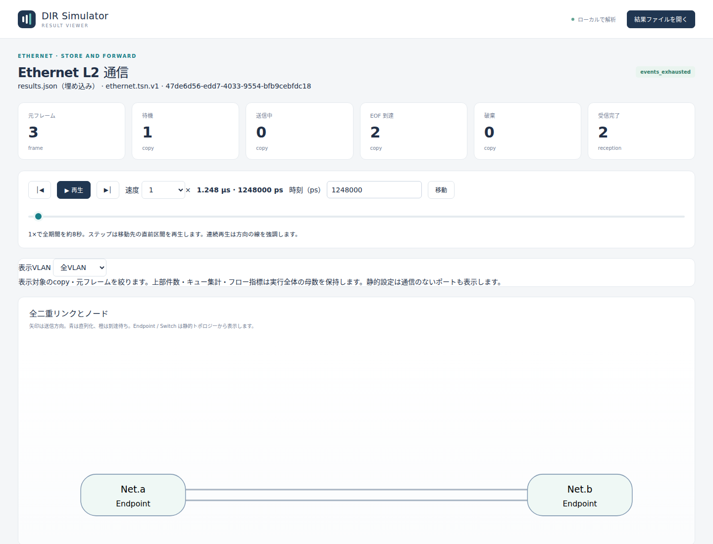
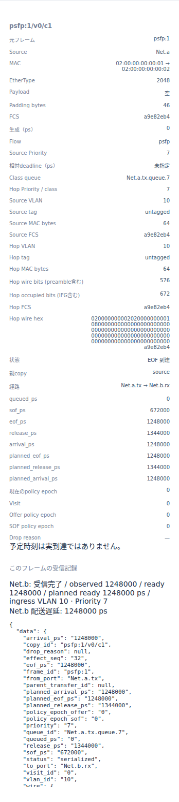

# Ethernetの機能・動作仕様

文書バージョン：`1.1.0`
対象GitHubバージョン：`main @ c67e153cc3bcf1f6ac0303d23023ce8ae4a4f533`
収録リリース：`v1.1.6`（本文・画像の調査基準は上記commitを維持）

### 更新履歴

| 文書バージョン | 更新日 | 更新内容 |
| --- | --- | --- |
| `1.1.0` | `2026-10-17` | Ethernetの媒体・交換・負荷・QoS・VLAN・動的制御・TSNを採否判断用に整理。v1.1.6へ収録し、本文・画像の調査基準を維持 |

文書ID：`guide-reference-ethernet`
文書状態：レビュー用参考資料。既存の正本仕様と対象commitを読み解くための初版草案であり、新規の規範要件を追加しない。

「設定」は受理範囲内の入力変更、「固定」は変更に仕様・コード・検証の改訂を要する規則を表す。`D`は0..u64maxの先頭0なし非負十進**文字列**（0は`"0"`）。`J`はboolを除くJSON整数。時刻はps、実行対象は半開区間`[0,T)`。容量のframe数とMAC byte数、元frame・hop copy・受信判定の件数を分けて読む。

| 選択する`model-profile` | model-config / workload schema | 主な能力・組合せ境界 |
| --- | --- | --- |
| `ethernet.l2.store-forward.v1` | 1 / 2 | 全二重、静的unicast FDB、broadcast、方向別FIFO、tree |
| `ethernet.l2.store-forward.v2` | 2 / 2 | 10/100のfull/half、1000BASE-T1、媒体試行。VLAN/QoS追加版とは別系列 |
| `ethernet.l2.100base-t1.v1` | 媒体用2 / 2 | 100BASE-T1専用full、明示PHY遅延 |
| `ethernet.l2.qos.v1` | QoS用2 / 2 | 8class、FIFO/strict priority、byte容量、周期／burst、期限 |
| `ethernet.l2.vlan.v1` | 3 / 3 | 単一C-tag、Port policy、VLAN別FDB、静的multicast／購読 |
| `ethernet.l2.dynamic.v1` | 4 / 4 | MAC学習、期限付きmembership・VID、抽象STP/link制御、一般グラフ |
| `ethernet.tsn.v1` | TSN wrapper1 / dynamic用4 | dynamicをbaseにTAS・CBS・PSFP。理想共通時計 |

schema番号が同じでもprofileごとにrootが異なる。媒体v2 configをQoS configとして渡すことはできない。CAN↔Ethernetの静的VLAN/QoS複合profileは[CAN・Gateway編](CAN・Gatewayの機能・動作仕様.md#第7節-canethernet変換)を参照する。

## 第1節 全二重L2・フレーム・方向別送信

### 概要

**機能仕様**：基本L2はEthernet IIの0..1500byte payloadをフレーム化し、全二重linkを方向ごとに送信する。逆方向の送信と受信処理を並行させられる。

**動作仕様**：負荷生成→Endpoint TX固定遅延→output FIFO→SOF→EOF→arrival→受信処理を進める。EOFは直列化完了、releaseはIFG終了、arrivalは相手への全フレーム到達であり、三つを同じ完了時刻として扱わない。

### 詳細

**機能仕様**：基本構成はEndpoint2個以上、Switch0個以上、無向の方向対グラフがconnected tree。各Endpointはtx/rx一対、Switchはsuffixの一致するtx/rx対を2組以上持つ。両方向Linkのbitrateとdelayは一致が必要。平行接続・自己接続・閉路は基本profileで拒否する。

| 設定場所・キー | 既定／受理範囲・単位 | 設定／固定 |
| --- | --- | --- |
| INI `[General] model-profile` | 基本は`ethernet.l2.store-forward.v1`を明示 | 省略時CANになるため明示が必要 |
| INI `model-config,workload` | INI親基準のUTF-8 JSON | profileに合ったschemaを指定 |
| NED登録 | `dir.ethernet.Endpoint/Switch/Link` | Endpoint/Switchが送信器とFIFOを所有 |
| Endpoint/Switch `queueCapacity` | 既定64、0..4294967295 frame | 各outputの全待機数。送信中除外 |
| Endpoint `txProcessingDelay,rxProcessingDelay` | 各既定0ps、0..u64max ps | 要求ごとの独立固定遅延 |
| Link `bitrate` | 必須10/100/1000/10000Mbps | 受理値は10000000/100000000/1000000000/10000000000整数bps |
| Link `delay` | 既定0ps、0..u64max ps | EOF→arrivalの伝搬 |
| config root | 必須`schema_version:1,endpoints:[],switches:[]` | 全対象instanceを過不足なく列挙 |
| endpoint行 | 必須`instance,mac` | MACは一意・非zero individual、colon区切り6byte |
| switch行 | 必須`instance,forward_delay_ps,fdb` | forward delayはD ps、FDBは2節 |
| workload frame | 必須`dst_mac,ether_type,data` | EtherType1536..65535、0x8100/0x88a8除外。dataは0..1500byte偶数hex |
| explicit generator | `id,node,kind:"ethernet.explicit.v1",times_ps,frame` | schema2。times_psはDの非減少配列、空・重複可 |

**動作仕様**：source MACはEndpoint設定から取り、payloadが46byte未満ならzero padding、FCSを付加する。MAC長Mにはheader/padding/FCSを含め、untaggedは64..1518byte。wire bit数は`8*(M+8)`、IFG込み占有は`8*(M+20)`。固定8byte preamble/SFDと12byte IFGを採用する。

`EOF=SOF+ceil(8*(M+8)*10^12/R)`、`release=SOF+ceil(8*(M+20)*10^12/R)`、`arrival=EOF+delay`。1Gbps・空dataではM64、EOF差576000ps、release差672000ps。delay1000psならarrivalはSOF+577000ps。PHY symbol rateやFEC量でこのMAC時間を再計算しない。

実行開始前にframeを検証・cacheし、生成時刻g<Tでだけ元frameを記録する。T以後の負荷も不正入力を先に拒否。未知／欠落／重複キー、boolによる整数代用、未解決port、非対応group宛先は準備失敗。基本profileはbroadcastとindividualを扱い、通常multicastは7節のVLAN profileが必要。

根拠は[IEEE 802.3-2022](https://standards.ieee.org/ieee/802.3/10422/)の規格識別と、本プロジェクトが採用した[基本L2仕様](https://github.com/hideki-ozu/DIR-Simulator/blob/c67e153cc3bcf1f6ac0303d23023ce8ae4a4f533/docs/specs/models/Ethernetモデル詳細機能仕様書.md#wire)。規格全PHY・例外・エラー適合の認定ではない。[設計](https://github.com/hideki-ozu/DIR-Simulator/blob/c67e153cc3bcf1f6ac0303d23023ce8ae4a4f533/docs/design/Ethernetモデル詳細設計書.md)・[入力](https://github.com/hideki-ozu/DIR-Simulator/blob/c67e153cc3bcf1f6ac0303d23023ce8ae4a4f533/crates/dir-simulator/src/input/ethernet.rs)・[L2実装](https://github.com/hideki-ozu/DIR-Simulator/blob/c67e153cc3bcf1f6ac0303d23023ce8ae4a4f533/crates/dir-simulator/src/runtime/ethernet/l2.rs)・[製品試験](https://github.com/hideki-ozu/DIR-Simulator/blob/c67e153cc3bcf1f6ac0303d23023ce8ae4a4f533/crates/dir-simulator/tests/ethernet.rs)・[双方向例](https://github.com/hideki-ozu/DIR-Simulator/blob/c67e153cc3bcf1f6ac0303d23023ce8ae4a4f533/examples/ethernet/duplex.ini)。

**変更判断**：固定処理遅延で用途を表せるか、CPU/RXの有限サービス資源が必要か。Link速度やdelayの値変更と、cut-through・PHY符号化・可変処理の導入は別の変更になる。

## 第2節 unicast・broadcast・store-and-forward・copy単位の損失

### 概要

**機能仕様**：Switchは静的FDBに従って既知unicastを一portへ送り、未知unicastとbroadcastをingress以外へ複製する。outputごとの有限FIFOで競合と満杯dropを観測する。

**動作仕様**：全frame到着後にforward_delayを待ち、宛先lookupとfanoutを実行する。各枝の容量判定を同じbatchで確定し、一枝が満杯でも他枝は進める。受信先EndpointはMAC適合後にRX固定遅延を経てreceivedとなる。

### 詳細

**機能仕様**：basic FDB行は`{dst_mac,egress}`で、dst_macはindividualのみ、egressは所有Switchの接続済output完全パス。同key重複を拒否する。MAC学習はbasicに含めない。`forward_delay_ps`はDで必須、0も可。容量とdrop-newest、非プリエンプト、frameごとの独立処理は固定。

| 境界・正常条件 | 動作と結果 |
| --- | --- |
| 既知unicast | FDBの一egressへcopy。ingressの対outputと同じならsame_ingress filter |
| 未知unicast / broadcast | ingress以外へ完全パス順にflood。Endpointでは自MAC又はbroadcastだけ受理 |
| Endpoint宛先不一致 | arrivalでdestination_mismatch filter、アプリ受信処理なし |
| queue満杯 / 容量0 | 新着copyだけqueue_full drop。idle直送で容量検査を迂回しない |
| 同時刻offerとdequeue | phase1 offerはphase2取出しを先取りできない |
| Switch遅延0 | arrival後の交換。FCS到着前に開始するcut-throughにはならない |
| 不変条件／予約失敗 | fanout callback全体を未commitとして停止。正常queue_fullとは区別 |

**動作仕様**：元frameに対してsource transferを作り、Switch receptionから子transferを作る。basic treeではtransfer IDは`frame_id@output`、receptionはincoming transfer ID+`@rx`。dynamicでは再訪があり得るため別ID方式を使う。基本時のqueueはoffer順FIFO、送信中copyは容量から除外する。

結果の`ethernet.frame/transfer/reception`を関連IDで追う。`generated`は元frame数、`transfer_offered`は全hop copy数、`received`は受信判断数。broadcast一件のreceivedが複数でも矛盾ではない。`offered=queued+transmitting+serialized+dropped`を照合し、serializedを受信完了としない。EOF<Tでもarrival≥Tならreceptionはまだない。予定arrivalから受信者を合成しない。

図は元frame・方向別転送・受信を区別して読むための例。入力・表示時刻・撮影条件は[図版の証跡](設定・固定値・規格・変更検討.md)。

詳細図はTSN実習入力の`psfp:1/v0/c1`を1248000psで選択したもの。元frameは`psfp:1`、経路はNet.a.tx→Net.b.rxである。MAC 64byteに対し、preamble込み576bit、IFG込み672bitを別々に表示する。実EOF・arrivalは1248000ps、releaseは1344000psであり、Net.bの受信完了を別行で確認できる。これは転送詳細の図であり、PSFPの色判定そのものを表示したカードではない。

[交換仕様](https://github.com/hideki-ozu/DIR-Simulator/blob/c67e153cc3bcf1f6ac0303d23023ce8ae4a4f533/docs/specs/models/Ethernetモデル詳細機能仕様書.md#switch)・[設計](https://github.com/hideki-ozu/DIR-Simulator/blob/c67e153cc3bcf1f6ac0303d23023ce8ae4a4f533/docs/design/Ethernetモデル詳細設計書.md)・[L2実装](https://github.com/hideki-ozu/DIR-Simulator/blob/c67e153cc3bcf1f6ac0303d23023ce8ae4a4f533/crates/dir-simulator/src/runtime/ethernet/l2.rs)・[試験](https://github.com/hideki-ozu/DIR-Simulator/blob/c67e153cc3bcf1f6ac0303d23023ce8ae4a4f533/crates/dir-simulator/tests/ethernet.rs)・[unicast入力](https://github.com/hideki-ozu/DIR-Simulator/blob/c67e153cc3bcf1f6ac0303d23023ce8ae4a4f533/examples/ethernet/unicast.ini)。

**変更判断**：未知宛先floodが必要か。静的FDBだけで十分か。copy drop数を元frame損失率と呼ぶ仕様変更は避け、まず必要な終端到達の母数を決める。学習を追加する場合は8節の専用profileを選ぶ。

## 第3節 半二重・carrier・衝突・再送

### 概要

**機能仕様**：`ethernet.l2.store-forward.v2`は10BASE-T／100BASE-TXの二つのMACからなる物理対でhalfを扱い、carrier、衝突、jam、決定的BEB再送を評価する。Switch経由で複数の独立物理対をtree接続できる。

**動作仕様**：carrierが消えて連続IFGを満たし、backoff期限も過ぎれば送信する。同じsnapshotから両端の許可を決め、相手信号が届く前の同時／後着SOFを許す。衝突試行は正常EOFを無効化し、jam後に再試行する。

### 詳細

**機能仕様**：登録型を`dir.ethernet.EndpointV2/SwitchV2/LinkV2`へ変更する。config rootは全キー必須の`{schema_version:2,endpoints:[],switches:[],seed:D,physical_links:[]}`。Endpoint/FDBはbasic形式を継承する。

| 設定・定数 | 値・単位 | 変更可否 |
| --- | --- | --- |
| physical link行 | `id,a,b,phy_mode,duplex,a_phy,b_phy`全必須 | a/bは対向output、辞書順a<b、全outputを一度だけ覆う |
| `phy_mode / duplex` | `10base-t`=10Mbps又は`100base-tx`=100Mbps、half/full | 速度と組合せを検証 |
| `a_phy,b_phy` | `role:"none",tx_latency_ps:"0",rx_latency_ps:"0"` | 10/100 modeでは固定。任意PHY遅延は拒否 |
| half伝搬P | 10MbpsでP<24000000ps、100MbpsでP<2400000ps | Link.delay。0可、等号拒否 |
| `seed` | D、0..u64max、必須 | 同じseedとtransfer IDと試行番号で再送slotを決定 |
| slot / jam / IFG | 512 / 32 / 96 bit時間 | 固定。preamble/SFD64bit、試行最大16、指数最大10 |
| deference policy | `continuous-idle-96.v1` | 固定。二段階IFGの全挙動は表さない |
| backoff policy | `sha256-beb.v1` | 固定。busy中にも期限は進む |

**動作仕様**：bit時間B=10^12/R、half制約は`2P+32B<512B`。送信信号の区間をPだけずらしてpeer carrierとし、局所送信と相手carrierが重なると衝突する。検出時刻cでは`jam_start=max(c,SOF+64B)`、`jam_end=jam_start+32B`。preamble内の衝突も64bitを完了してからjamを送る。

衝突n回目でn<16ならk=min(n,10)、rを0..2^k−1から決め、`backoff_until=jam_end+r*512B`。SHA-256の入力はseed、transfer ID、nと固定domain文字列。イベント列挙順に依存するPRNGではない。n=16のjam終了でattempt_limit drop、17回目は開始しない。carrierが途切れても連続idle96Bを再計測し、backoff終了とIFGを二重加算しない。

current copyは最初のSOFで待機queueを離れ、jam/backoff/deferred中もcurrentに保持する。後続は追越さず、currentはqueueCapacityに含めない。衝突試行から正常reception・payload量を生成しない。衝突=Tなら未検出、jam_end=Tならjammingのまま。0伝搬の同時開始も両方SOF後、次deltaで衝突を確定する。

結果はv2のattempt／phy記録と媒体指標から、成功copy、失敗fragment、carrier時間を分ける。PHY pairごとに衝突領域を閉じ、hub・repeater・共有同軸の多MAC衝突領域は対象外。IEEE 802.3全Clause 4適合を意味せず、固定deferenceとの差を[媒体仕様](https://github.com/hideki-ozu/DIR-Simulator/blob/c67e153cc3bcf1f6ac0303d23023ce8ae4a4f533/docs/specs/models/Ethernet媒体拡張詳細機能仕様書.md#csma)に記録する。[設計](https://github.com/hideki-ozu/DIR-Simulator/blob/c67e153cc3bcf1f6ac0303d23023ce8ae4a4f533/docs/design/Ethernet媒体拡張詳細設計書.md)・[媒体実装](https://github.com/hideki-ozu/DIR-Simulator/blob/c67e153cc3bcf1f6ac0303d23023ce8ae4a4f533/crates/dir-simulator/src/runtime/ethernet/media.rs)・[試験](https://github.com/hideki-ozu/DIR-Simulator/blob/c67e153cc3bcf1f6ac0303d23023ce8ae4a4f533/crates/dir-simulator/tests/ethernet_media.rs)・[衝突例](https://github.com/hideki-ozu/DIR-Simulator/blob/c67e153cc3bcf1f6ac0303d23023ce8ae4a4f533/examples/ethernet/media/collision.ini)。

**変更判断**：二端点の衝突と決定的再送で目的を満たすか。共有hub、異なるIFG方式、エラー注入を求めるなら、seedやdelayの変更ではなく別媒体契約・試験が必要になる。

## 第4節 1000BASE-T1・100BASE-T1の固定PHY pipeline

### 概要

**機能仕様**：1000BASE-T1は媒体v2、100BASE-T1は専用`ethernet.l2.100base-t1.v1`で扱う。master/slave属性と端点ごとの固定TX/RX PHY遅延を記録する全二重モデル。

**動作仕様**：MACのSOF/EOF/releaseは基本L2と同じ計算を使い、PHY TX→伝搬→PHY RXのpipelineで到着をずらす。masterは送信優先権ではなく固定clock属性である。

### 詳細

**機能仕様**：どちらもEndpointV2/SwitchV2/LinkV2、媒体用schema2 config、schema2 explicit workloadを使う。physical_links各行の全fieldを指定し、PHY遅延の実測既定値は設けない。

| 条件・キー | 1000BASE-T1 | 100BASE-T1 |
| --- | --- | --- |
| profile | `ethernet.l2.store-forward.v2` | `ethernet.l2.100base-t1.v1` |
| `phy_mode` | `1000base-t1` | 全physical linkで`100base-t1` |
| `duplex` / bitrate | full / 1000000000bpsだけ | full / 100000000bpsだけ |
| `a_phy.role,b_phy.role` | master/slave一つずつ必須 | 同じ |
| `tx_latency_ps,rx_latency_ps` | 全端でDを明示、0も可 | 同じ |
| link状態 | t=0でup、固定 | 同じ。trainingやauto negotiationなし |

**動作仕様**：i→jの到着は`EOF+TX_i+P+RX_j`。mdi_sof/eofはMAC時刻+TX_i、peer_mdiはさらにPを加算する。受信側のRX処理／forward_delayはarrival後に一回だけ加える。PHY遅延をMAC busyやreleaseへ足して次SOFを遅らせない。

1Gbps・空dataでSOF0、EOF576000、release672000ps。P1000、A TX100000/RX400000、B TX300000/RX200000psならA→B arrival877000、B→A arrival1277000ps。両方向同時SOFが可能。両master、両slave、half、速度不一致、暗黙の1000→100速度置換は準備拒否する。0 PHY遅延は理想値であり特定製品の実測値ではない。

符号化波形、EMC、FEC、link training、障害後復帰を評価する能力はない。[1000BASE-T1仕様](https://github.com/hideki-ozu/DIR-Simulator/blob/c67e153cc3bcf1f6ac0303d23023ce8ae4a4f533/docs/specs/models/Ethernet媒体拡張詳細機能仕様書.md#t1)・[100BASE-T1仕様](https://github.com/hideki-ozu/DIR-Simulator/blob/c67e153cc3bcf1f6ac0303d23023ce8ae4a4f533/docs/specs/models/CANFD・100BASE-T1詳細機能仕様書.md#t1)・[媒体設計](https://github.com/hideki-ozu/DIR-Simulator/blob/c67e153cc3bcf1f6ac0303d23023ce8ae4a4f533/docs/design/Ethernet媒体拡張詳細設計書.md)・[専用profile設計](https://github.com/hideki-ozu/DIR-Simulator/blob/c67e153cc3bcf1f6ac0303d23023ce8ae4a4f533/docs/design/CANFD・100BASE-T1詳細設計書.md)・[入力](https://github.com/hideki-ozu/DIR-Simulator/blob/c67e153cc3bcf1f6ac0303d23023ce8ae4a4f533/crates/dir-simulator/src/input/ethernet.rs)・[runtime](https://github.com/hideki-ozu/DIR-Simulator/blob/c67e153cc3bcf1f6ac0303d23023ce8ae4a4f533/crates/dir-simulator/src/runtime/ethernet/media.rs)・[製品試験](https://github.com/hideki-ozu/DIR-Simulator/blob/c67e153cc3bcf1f6ac0303d23023ce8ae4a4f533/crates/dir-simulator/tests/ethernet_media.rs)・[100BASE-T1例](https://github.com/hideki-ozu/DIR-Simulator/blob/c67e153cc3bcf1f6ac0303d23023ce8ae4a4f533/examples/ethernet/media/100base-t1.ini)。

**変更判断**：実機pipeline値を校正すれば足りるか、起動時間や時計誤差も必要か。固定role・固定upの変更は現行PHY遅延入力の範囲を超える。

## 第5節 周期・バースト負荷と配送期限

### 概要

**機能仕様**：QoS以降のL2 profileはexplicit／periodic／burst負荷、flow分類、生成からアプリ受信完了までの相対期限を扱う。フローは計測の分類であり、帯域予約や接続を生成しない。

**動作仕様**：次候補を遅延展開してT未満を生成し、受信完了標本の遅延が期限を**超えた**ときだけmissとする。等号は達成、未完了・期限nullはdeadline標本に含めない。

### 詳細

**機能仕様**：`ethernet.l2.qos.v1`ではworkload root schema2。generator共通必須は`id,node,kind,frame,flow_id,priority,deadline_ps`。priorityはJの0..7、deadlineはD ps又はnullで、欠落とnullを同じ扱いにしない。VLAN以降はschema3/4のframe差分を合わせる。

| kind・追加field（すべて必須） | 時刻・範囲・境界 |
| --- | --- |
| `ethernet.explicit.v1`: `times_ps` | D配列、非減少、空と重複可 |
| `ethernet.periodic.v1`: `start_ps,phase_ps,period_ps,end_ps,count` | 発火=start+phase+k*period。period>0、phase<period。end/countはnullable、count0可 |
| `ethernet.burst.v1`: `start_ps,period_ps,burst_count,frames_per_burst,spacing_ps,end_ps` | 発火=start+floor(k/n)*period+(k%n)*spacing。n>0、period>0、(n−1)*spacing<period。burst_count/endはnullable |
| `flow_id` | ASCII識別子。同flowのpriority/deadline/dst_macを一致。VLAN/tag/IP属性も後続schemaの制約に従う |

**動作仕様**：endは個々の候補の時刻<endで判定し、T以後は実行しない。spacing=0なら同時刻にordinal順で発火する。count/burst_count=0は正常な生成0件。同時刻の複数generatorはID辞書順、同generatorはordinal順。空負荷や将来負荷もframeと全fieldを準備検証する。数値は文字列の辞書順で時刻比較しない。

期限Dは`received_ps−generated_ps`に対する相対値であり、絶対時刻・EOF・Link完了の期限ではない。`deadline_sample_count`は期限非nullの完了受信、`deadline_missed`はその遅延>D、比率はmiss/sample。未完了はdeadline miss0を保証する対象でもなく、別のunfinished件数で確認する。1frameが複数Endpointに完了すれば各受信が標本になる。

遅延平均、max、nearest rankのp50/p95/p99、jitter=max−minを出す。0標本はnull、1標本のjitterは0。queue待ち+serialization+propagation+processingの4成分を親copy列から再構成し、総配送遅延と照合する。partial実行では未到達時刻を埋めない。null期限・0期限・標本なしを区別する。

[負荷・期限仕様](https://github.com/hideki-ozu/DIR-Simulator/blob/c67e153cc3bcf1f6ac0303d23023ce8ae4a4f533/docs/specs/models/Ethernet負荷・QoS詳細機能仕様書.md#workload)・[設計](https://github.com/hideki-ozu/DIR-Simulator/blob/c67e153cc3bcf1f6ac0303d23023ce8ae4a4f533/docs/design/Ethernet負荷・QoS詳細設計書.md)・[入力](https://github.com/hideki-ozu/DIR-Simulator/blob/c67e153cc3bcf1f6ac0303d23023ce8ae4a4f533/crates/dir-simulator/src/input/ethernet.rs)・[計測実装](https://github.com/hideki-ozu/DIR-Simulator/blob/c67e153cc3bcf1f6ac0303d23023ce8ae4a4f533/crates/dir-simulator/src/output/ethernet/flow.rs)・[試験](https://github.com/hideki-ozu/DIR-Simulator/blob/c67e153cc3bcf1f6ac0303d23023ce8ae4a4f533/crates/dir-simulator/tests/ethernet_qos.rs)・[periodic/burst例](https://github.com/hideki-ozu/DIR-Simulator/blob/c67e153cc3bcf1f6ac0303d23023ce8ae4a4f533/examples/ethernet/qos-periodic-burst.ini)。操作例は[配送期限比較](../Ethernet配送期限と遅延判定の比較.md)。

**変更判断**：完了受信に対する期限達成率か、未完了を含む配送保証を評価したいか。後者は母数と打切り時の扱いを別途決める必要がある。deadlineの値変更だけで母数は変えられない。

## 第6節 8class優先キュー・frame/byte容量

### 概要

**機能仕様**：QoS以降は各outputにpriority0..7の8キューを持ち、FIFO又はstrict priorityで非プリエンプト送信する。port合計frame容量とclassのframe/byte容量を同時に制約できる。

**動作仕様**：egressで使うMAC bytesを確定してから全容量を検査し、一つでも超えればそのcopyだけqueue_fullとする。送信器が空くとclass先頭を比較し、一件を取り出す。送信済みclassの残りと別classの待機を保持する。

### 詳細

**機能仕様**：QoS config rootは`{schema_version:2,endpoints:[],switches:[],outputs:[]}`。各output行は`{port,scheduler,queues}`全必須、全接続outputを一度ずつ指定する。

| 設定キー | 値・既定の扱い | 適用単位 |
| --- | --- | --- |
| `outputs[].scheduler` | `fifo`又は`strict_priority`を明示 | output単位。TSNではstrict_priority必須 |
| `queues[].priority` | J=0..7、全8classを重複なく必須 | class識別子 |
| `capacity_frames` | D=0..4294967295、明示必須 | classの待機件数 |
| `capacity_bytes` | D又はnull、明示必須 | classの待機MAC bytes。nullはbyte上限なし |
| NED `queueCapacity` | 既定64、0..4294967295 | output全class合計の待機件数 |

**動作仕様**：入場にはport frame上限・class frame上限・class MAC byte上限の三つを満たす。送信中を各容量から除外する。byte算入はheader/tag/padding/FCS込み、preambleとIFGなし。タグの増減で同payloadでも入場可否が変わる。空dataのuntagged M64をclass byte上限63へ入れるとdrop、64なら一件まで入る。

class内はoffer成功順FIFO。fifoは各class先頭のうち最も古いofferを選び、strict_priorityは非空の最大数値priorityを選ぶ。進行中frameを高priorityで割り込ませない。高priorityが連続する負荷では低priority待ちの長期化を許し、自動fairnessを付けない。

phase0 release→phase1 offer→phase2 selectionのため、同時刻に空きそうなqueueでもphase1時点で満杯ならdropとなる。queue_idは`output.queue.priority`、合計は`output.queue`。queue_length/bytes、最大値、観測期間の時間平均を記録する。満杯offerで長さが変化しなくても判定点を保存する。

[キュー仕様](https://github.com/hideki-ozu/DIR-Simulator/blob/c67e153cc3bcf1f6ac0303d23023ce8ae4a4f533/docs/specs/models/Ethernet負荷・QoS詳細機能仕様書.md#queues)・[設計](https://github.com/hideki-ozu/DIR-Simulator/blob/c67e153cc3bcf1f6ac0303d23023ce8ae4a4f533/docs/design/Ethernet負荷・QoS詳細設計書.md)・[input](https://github.com/hideki-ozu/DIR-Simulator/blob/c67e153cc3bcf1f6ac0303d23023ce8ae4a4f533/crates/dir-simulator/src/input/ethernet.rs)・[runtime](https://github.com/hideki-ozu/DIR-Simulator/blob/c67e153cc3bcf1f6ac0303d23023ce8ae4a4f533/crates/dir-simulator/src/runtime/ethernet.rs)・[試験](https://github.com/hideki-ozu/DIR-Simulator/blob/c67e153cc3bcf1f6ac0303d23023ce8ae4a4f533/crates/dir-simulator/tests/ethernet_qos.rs)。操作例は[優先キューと送信順](../Ethernetの優先キューと送信順.md)。

**変更判断**：frame件数とbyte容量の両方が必要か、strict priorityの低class滞留が許容できるか。Weighted方式やpreemptionはschedulerの値を追加するだけでなく、選択・占有・計測・Viewerを改訂する。

## 第7節 VLAN分類・タグ変換・静的multicast

### 概要

**機能仕様**：`ethernet.l2.vlan.v1`は単一C-tag、Portごとの入場／membership、VLAN別unicast FDB、静的multicast経路、Endpoint購読を提供する。

**動作仕様**：実到達wireのtag又は受信port PVIDからVLANとpriorityを分類し、admit→membership→宛先条件を適用する。Switchは候補egressごとにtagを付け外ししてFCSを再計算し、copyごとの長さ・容量・時間を使う。

### 詳細

**機能仕様**：config root schema3の必須配列は`endpoints,switches,ports,outputs`、workload root schema3。全port/outputの明示列挙が必要。QoSの8class設定を継承する。

| 配置・必須キー | 範囲・省略／固定の扱い |
| --- | --- |
| endpoint `instance,mac,multicast` | multicastは`{vid,dst_mac}`集合。空可。VID1..4094、通常group MACのみ |
| switch `instance,forward_delay_ps,fdb,multicast,unknown_multicast` | fdbは`{vid,dst_mac,egress}`、multicastは`{vid,dst_mac,egresses}`、unknownはflood/drop |
| port `port,pvid,admit,default_priority,vlans` | portはtx完全パス、PVID1..4094、priority0..7 |
| `admit` | all / tagged_only / untagged_onlyを明示 |
| `vlans[]` | `{vid:J,tagged:bool}`、重複VID不可。PVIDを含む。untaggedは最大一つでPVIDだけ |
| frame `tag` | 必須nullable。非nullは`{vid:J,pcp:J,dei:J}`、VID1..4094、PCP0..7、DEI0/1 |
| generator `priority` | source tagがあればPCPと一致を要求 |
| EtherType / payload | inner EtherType1536..65535、0x8100/0x88a8拒否、0..1500byte |

**動作仕様**：sourceはtag.vid又は自身Port.PVIDを使い、memberとtagged設定の一致を準備検証する。tagged ingressはVID/PCP/DEI、untagged ingressは**受信port**のPVID/default_priority/DEI0で分類する。untagged化した後に元frameのPCPを参照して優先度を引き継がない。egress classは現在priorityを使い、次hopはwireから再分類する。

PCP→classは恒等対応、DEI依存dropなし、VID0 priority-tag・QinQなし。tagged copyはSA後に0x8100/TCIを挿入し、paddingはdataを46byteまで埋めたまま保持する。その結果この生成方針のMAC長はuntagged64..1518、tagged68..1522byte。tagged最小68byteを規格一般の全tagged最小長だとは言わない。

| 宛先とtable状態 | 候補egressと拒否境界 |
| --- | --- |
| 既知individual | (VID,MAC)の一port。same_ingressならfilter、floodに戻さない |
| 未知individual / broadcast | ingress以外のVID memberへflood。空ならno_vlan_egress |
| 登録group | 静的egressesとeligible集合の積集合。明示空登録も有効、空ならmulticast_no_egress |
| 未登録group | unknown_multicast=flood/drop。dropならunknown_multicast |
| Endpoint group到着 | Port入場後、(VID,group MAC)の購読が必要。Switchの表から購読を自動生成しない |

FCS不正、admit不一致、VID非member、宛先不適合はreceivedに進まない。予約済制御MAC範囲01:80:c2:00:00:00..0fは本profileの負荷・購読・tableで準備拒否。peerのPort policy一致は強制しないため、片側untagged／他側tagged_onlyの不整合は実到着でfilteredとして観測できる。

[仕様](https://github.com/hideki-ozu/DIR-Simulator/blob/c67e153cc3bcf1f6ac0303d23023ce8ae4a4f533/docs/specs/models/EthernetVLAN・マルチキャスト詳細機能仕様書.md)・[設計](https://github.com/hideki-ozu/DIR-Simulator/blob/c67e153cc3bcf1f6ac0303d23023ce8ae4a4f533/docs/design/EthernetVLAN・マルチキャスト詳細設計書.md)・[入力](https://github.com/hideki-ozu/DIR-Simulator/blob/c67e153cc3bcf1f6ac0303d23023ce8ae4a4f533/crates/dir-simulator/src/input/ethernet.rs)・[交換実装](https://github.com/hideki-ozu/DIR-Simulator/blob/c67e153cc3bcf1f6ac0303d23023ce8ae4a4f533/crates/dir-simulator/src/runtime/ethernet/l2.rs)・[試験](https://github.com/hideki-ozu/DIR-Simulator/blob/c67e153cc3bcf1f6ac0303d23023ce8ae4a4f533/crates/dir-simulator/tests/ethernet_vlan.rs)。操作例は[VLAN拒否理由](../EthernetのVLAN受入条件と破棄理由.md)と[静的multicast](../Ethernetの静的multicastとコピーの配送先.md)。[IEEE 802.1Q-2022](https://standards.ieee.org/ieee/802.1Q/10323/)はbridge/VLANの位置付けの参照先で、全protocol適合の証拠ではない。

**変更判断**：静的multicast表とEndpoint購読を別設定する必要があるか、untagged hopでpriorityが受信側既定へ変わる仕様が用途に合うか。自動経路生成やpriority再写像は現在の設定機能とは分けて設計する。

## 第8節 MAC学習・aging・source membership・VID有効期間

### 概要

**機能仕様**：`ethernet.l2.dynamic.v1`は到着に基づくMAC学習、期限付き源別multicast membership・router port・VID登録を扱う。上位protocol packetを解析せず、明示controlで状態を変える抽象モデル。

**動作仕様**：受信入場時にsource MACを学習し、lookupはstatic→有効dynamic→unknownと進む。controlは予定時刻に適用し、有効期限で状態を失効させる。失効済み世代のtimerは更新後の状態を消さない。

### 詳細

**機能仕様**：config root schema4はVLANの4配列+`dynamic`、workload schema4は`generators,controls`を必須指定。generator.frameへ`ip_multicast:null|{family,source,group}`を追加する。

| 設定位置・キー | 範囲・単位・既定の扱い | 追加条件 |
| --- | --- | --- |
| `dynamic.mac_age_ps` | 必須D>0 ps、最終受理arrivalからのaging期間 | |
| `dynamic.convergence_ps` | 必須D≥0 ps。9節のtree切替待ち | |
| `dynamic.bridges[]` | `{instance,bridge_id:D}`、全Switch、ID一意（コードは0も受理） | |
| `dynamic.links[]` | `{id,ports:[a,b],up:bool,cost:D}`、cost>0、全物理対を一度ずつ | |
| `dynamic.registrable[]` | `{port,vid,tagged:true}`、VID1..4094。静的VIDとの重複不可 | |
| `dynamic.limits` | `mac_entries,membership_entries,sources_per_entry,registrations,control_events,pending_timers,visits_per_frame`全必須 | |
| limitsの値 | 正のJSON整数、ホストのaddressable range以下。既定なし。visitsはさらにu64化検査。例の1024等を既定としない | |
| control共通 | `id,at_ps,kind`全必須 | id非空一意、atはD。kind別キーを厳密検査 |
| membership_set | `switch,port,vid,family,group,mode,sources,lifetime_ps` | mode include/exclude、sourceは同family一意unicast、lifetime>0 D |
| membership_leave | setのkeyのみ | mode/sources/lifetimeを置かない |
| router_set / router_leave | switch,port,vid,family（setだけlifetime） | 同VID/familyの全IP multicast用 |
| vlan_register / vlan_unregister | port,vid（registerだけlifetime） | registrableに明記した動的VIDだけ |

**動作仕様**：MAC keyは(switch,VID,MAC)。同port学習はrefresh、別portはmove、static FDBで同keyがあればstatic_shadowed。新keyが表容量を超えても学習を抑えるだけでframe転送は続く。同key更新は可能。期限は`[learn,learn+mac_age)`、topology変更ではdynamic FDBを全flushする。known egressが不適格でもunknown floodへ戻さない。

源別keyは(switch,VID,family,group,port)。INCLUDE(S)はsource∈S、EXCLUDE(S)はsource∉S、INCLUDE空は受理0、EXCLUDE空は全source受理。候補は一致する静的L2 group表∪源適合membership∪router ports、その後eligibilityを適用する。known groupでsourceが不一致なら候補0のまま、unknown floodに切り替えない。Endpointの静的購読も別途必要。

IPv4 group metadataは224.0.0.0/4、IPv6はff00::/8、MAC写像とEtherTypeの一致を検証する。payloadはopaqueのままでIP header/checksumを検証しない。metadata=nullでは静的L2 lookupだけ。登録VIDは静的membership∪有効registrationで評価し、peerへ自動伝播しない。静的PVIDは動的登録不可、動的追加VIDはtagged:true固定なので失効でuntagged分類を変えない。

set/leaveと期限が同時なら先に明示controlを適用し、新世代を旧timerで消さない。同種controlはid辞書順の後の操作が最終状態。lifetime0、無許可登録、IP/family不正、将来controlの不正も準備拒否。実行中の表上限違反はcallbackを未commitにして診断停止する。

[IGMPv3 RFC 9776](https://www.rfc-editor.org/info/rfc9776/)・[MLDv2 RFC 9777](https://www.rfc-editor.org/info/rfc9777/)はINCLUDE/EXCLUDE用語の参照先。本機能はquery/report交換やhost集約を自動実行せず、IGMP/MLD/MVRP実装への全適合を主張しない。[仕様](https://github.com/hideki-ozu/DIR-Simulator/blob/c67e153cc3bcf1f6ac0303d23023ce8ae4a4f533/docs/specs/models/Ethernet動的制御詳細機能仕様書.md#membership)・[設計](https://github.com/hideki-ozu/DIR-Simulator/blob/c67e153cc3bcf1f6ac0303d23023ce8ae4a4f533/docs/design/Ethernet動的制御詳細設計書.md)・[parser](https://github.com/hideki-ozu/DIR-Simulator/blob/c67e153cc3bcf1f6ac0303d23023ce8ae4a4f533/crates/dir-simulator/src/input/ethernet/dynamic.rs)・[runtime](https://github.com/hideki-ozu/DIR-Simulator/blob/c67e153cc3bcf1f6ac0303d23023ce8ae4a4f533/crates/dir-simulator/src/runtime/ethernet/dynamic.rs)・[試験](https://github.com/hideki-ozu/DIR-Simulator/blob/c67e153cc3bcf1f6ac0303d23023ce8ae4a4f533/crates/dir-simulator/tests/acceptance_dynamic_tsn.rs)・[membership例](https://github.com/hideki-ozu/DIR-Simulator/blob/c67e153cc3bcf1f6ac0303d23023ce8ae4a4f533/examples/ethernet/dynamic/membership.ini)。

**変更判断**：結果としてのmembershipの時間変化が欲しいか、packet交換から生じる収束過程が欲しいか。後者はcontrol時刻の設定では表現できず、protocol、timer、上限、wire入力の拡張が必要になる。

## 第9節 抽象STP・link変更・切替時のcopy寿命

### 概要

**機能仕様**：dynamic/TSN profileは固定配線の一般グラフ・閉路・非連結構造を受理し、中央計算の単一共通treeで転送を制限する。linkのup/downを時刻付きcontrolで変えられる。

**動作仕様**：初期treeはt=0から有効。実際のlink状態変更でdynamic FDBをflushし、Switch間portを一旦閉じ、convergence_ps後に最新treeをまとめて公開する。SOF済みcopyは中断せず、queueと到着はその時点のpolicyで再検査する。

### 詳細

**機能仕様**：controlは`{id,at_ps,kind:"link_set",link,up}`。配線追加削除・速度変更はない。bridge_id・cost・convergenceは8節の必須config。Endpoint portはupならforwarding、downならdisabled。全VID共通treeでありVLANごとの最適treeを計算しない。

**動作仕様**：各Switch連結成分の最小bridge_idがroot。rootまでの最小累積costでroot portを選び、同costなら(隣接bridge_id,隣接port,自port)順。linkのdesignated側は(rootまでのcost,bridge_id,port)順で決め、root/designatedはforwarding、他はalternate/discarding。

実効link変更でtopology世代を進め、`t+convergence_ps`の最新graphを予約する。収束中に別変更があれば旧予約を無効化し、新しい期限から待つ。convergence0なら同じphase0で公開。単一中央計算のbreak-before-makeであり、BPDU分散交換・実機STP/RSTP収束時間を再現しない。

| copyの位置 | policy変更時の扱い |
| --- | --- |
| SOF済み | downでもEOF/arrivalまで非中断、開始epochを保持 |
| 到着時 | 現在のingress link→STP→VIDの順で検査、不適格ならfiltered |
| queue待機 | 次phase2で最新egress link/STP/VIDを再検査し不適格copyをdrop |
| 決定済egress集合 | 後のFDB/membership変更で追加・取消・別portへ再routingしない |
| frame再訪 | 独立visit/copy IDとparentを付与。visits_per_frame超過でvisit_limit filter |

同時刻はwire完了→link/STP→registration/membership→aging→（TSNでは）GCL更新、次にarrival/offer、最後に送信選択。eligibility理由はlink_down→stp_discarding→vlan_unregisteredの優先順。policy_epochとtopology/timer generationを別に保持する。no-op controlは監査行があるがepochを変えない。T丁度のcontrolは未適用。

結果は`ethernet.dynamic.frame/transfer/reception/control/policy`。transferのstart epoch、到着epoch、control予定／実績を区別し、Viewerはcommit差分から任意時刻のMAC・VID・link/STP状態を復元する。[仕様](https://github.com/hideki-ozu/DIR-Simulator/blob/c67e153cc3bcf1f6ac0303d23023ce8ae4a4f533/docs/specs/models/Ethernet動的制御詳細機能仕様書.md#topology)・[設計](https://github.com/hideki-ozu/DIR-Simulator/blob/c67e153cc3bcf1f6ac0303d23023ce8ae4a4f533/docs/design/Ethernet動的制御詳細設計書.md)・[tree/runtime](https://github.com/hideki-ozu/DIR-Simulator/blob/c67e153cc3bcf1f6ac0303d23023ce8ae4a4f533/crates/dir-simulator/src/runtime/ethernet/dynamic.rs)・[受入試験](https://github.com/hideki-ozu/DIR-Simulator/blob/c67e153cc3bcf1f6ac0303d23023ce8ae4a4f533/crates/dir-simulator/tests/acceptance_dynamic_tsn.rs)・[切替入力](https://github.com/hideki-ozu/DIR-Simulator/blob/c67e153cc3bcf1f6ac0303d23023ce8ae4a4f533/examples/ethernet/dynamic/topology.ini)。

**変更判断**：中央計算treeの停止区間で用途を評価できるか、VLAN別treeや分散収束が必要か。途中downでSOF済みframeも破壊する仕様へ変える場合、copy cancel、EOF、受信、busy時間、partial保存をまとめて変更する。

## 第10節 TSN TAS・GCL・IFG込みguard

### 概要

**機能仕様**：`ethernet.tsn.v1`はdynamicをbaseに、output/classごとの時刻窓とGCLの予定更新を提供する。共通の理想時計を使い、同期誤差は0固定。

**動作仕様**：送信選択時にgate開放とcopy占有が窓内に収まることを確認する。EOFだけでなくIFG終了releaseまで収まる候補だけSOFを許し、GCL更新時刻を跨ぐ開始も抑える。

### 詳細

**機能仕様**：configは全field必須の`{schema_version:1,base:{profile:"ethernet.l2.dynamic.v1",config:DYNAMIC_CONFIG},tsn:{clock:"ideal_shared",outputs:[],streams:[],gcl_updates:[]}}`。workloadはdynamic用schema4。baseの全output schedulerはstrict_priority必須。半二重・PAUSEとの組合せは準備拒否。

| 設定位置・キー | 受理範囲・単位・無効化方法 |
| --- | --- |
| `tsn.outputs[]` | 全output一度ずつ、必須`port,tas,cbs` |
| `tas` | nullで常時open。非nullは`id,base_time_ps,cycle_time_ps,entries` |
| `base_time_ps` | D ps、初期は0又は未来。base前は全closed |
| `cycle_time_ps` | D>0 ps |
| `entries[]` | 1件以上、`duration_ps:D>0,open_priorities:J[]`。duration合計=cycle |
| `open_priorities` | 0..7一意集合、空は全closed |
| `gcl_updates[]` | `id,submitted_at_ps,effective_at_ps,port,schedule`全必須 |
| updateの条件 | submitted≤effective、schedule.base=effective、同port/effective重複拒否。空配列で更新なし |

**動作仕様**：base後は`(t-base)%cycle`を半開entry区間へ対応させる。同classが隣接entry・周期境界を跨いでopenなら連続窓として扱い、全周期openなら終端なし。VLAN変換後MAC長Mから1節と同じEOFとreleaseを算定し、`release<=open_window_end`で開始を許す。等号は通る。

1Gbps・空untagged frameは占有672000ps。窓幅672000psで先頭から開始でき、671999psではEOFが収まってもguard_blockedとなる。高class先頭がfitしなければ低classのeligible先頭を試せるが、同class内の後続は追越せない。現在GCLの最大連続open幅が先頭占有未満ならnever_eligibleとして保持し、dropもrun失敗もしない。後のGCL更新で再評価する。

既知の次effective時刻で旧窓を打ち切り、effective phase0でGCLを一括交換する。同時刻phase2は新scheduleを使う。旧gate/credit wakeは世代で無効化する。実行中APIで後から更新を投入する機能はなく、静的入力へ予定操作を列挙する。

結果の`ethernet.tsn.gate/decision`にschedule世代、open class、次境界・wake、ready/busy/gate_closed/guard_blocked/credit_negative/no_active_schedule/never_eligibleを記録する。guard_blocked指標はarbitration時の判定回数であり閉鎖時間割合ではない。[IEEE Qbvの位置付け](https://www.ieee802.org/1/pages/802.1bv.html)を参照し、IFG込みguardは本profileの明示抽象規則と区別する。[TSN仕様](https://github.com/hideki-ozu/DIR-Simulator/blob/c67e153cc3bcf1f6ac0303d23023ce8ae4a4f533/docs/specs/models/EthernetTSN詳細機能仕様書.md#scheduling)・[設計](https://github.com/hideki-ozu/DIR-Simulator/blob/c67e153cc3bcf1f6ac0303d23023ce8ae4a4f533/docs/design/EthernetTSN詳細設計書.md)・[入力](https://github.com/hideki-ozu/DIR-Simulator/blob/c67e153cc3bcf1f6ac0303d23023ce8ae4a4f533/crates/dir-simulator/src/input/ethernet/tsn.rs)・[runtime](https://github.com/hideki-ozu/DIR-Simulator/blob/c67e153cc3bcf1f6ac0303d23023ce8ae4a4f533/crates/dir-simulator/src/runtime/ethernet/tsn.rs)・[試験](https://github.com/hideki-ozu/DIR-Simulator/blob/c67e153cc3bcf1f6ac0303d23023ce8ae4a4f533/crates/dir-simulator/tests/acceptance_dynamic_tsn.rs)。操作例は[TAS送信窓](../Ethernet%20TASの送信窓とIFG込みの待ち時間.md)。

**変更判断**：releaseまで収めるguardでよいか。時計誤差0を許容できるか。preemptionや非理想同期を加える場合は、窓長だけでなく占有・credit・fragment・再生規則を改訂する。

## 第11節 TSN CBS credit・回復・gateとの合成

### 概要

**機能仕様**：TASと併用できるclassごとの抽象CBSを提供する。送信中の減算とopen時の回復を整数算術で評価し、credit非負の先頭だけ送信できる。

**動作仕様**：旧状態を現在時刻まで積分してから状態を変える。自class送信中はIFG終了まで減算し、非送信中にgateが閉じていれば凍結する。送信開始にはcredit、TAS guard、dynamic eligibilityをすべて満たす必要がある。

### 詳細

**機能仕様**：`tsn.outputs[].cbs`は空配列で無効。各行は`{priority,idle_slope_bps,hi_credit_bits,lo_credit_bits}`全必須。priorityはJ0..7かつ一意、他はD。`0<idle_slope_bps<R`、hi/loは0可、loは**負下限の絶対値**として入力する。link速度Rは実行中固定、上下限の自動推定なし。

**動作仕様**：Q=10^12、credit(bit)=符号付きnumerator C/Q、初期C=0、範囲[-lo*Q,hi*Q]。rate(bit/s)*dt(ps)をchecked整数で加算し、浮動小数の累積誤差を入れない。

| 状態 | Cの変化 |
| --- | --- |
| 自class SOF→release | slope=idle_slope−Rで減算、loで飽和。送信中にgateが閉じても継続 |
| 非送信、gate open、backlogあり | idle_slopeで増加、hiで飽和 |
| 非送信、gate open、queue空、C<0 | idle_slopeで0まで回復 |
| 非送信、gate closed/base前 | 凍結。ただしqueue空で非負creditは0へreset |
| 非送信、queue空、C≥0 | 即0にreset |

最後の待機copyをSOFで取り出しても自class送信中が優先され、releaseまで減算する。他class送信中もopen/backlogのCBS classは回復する。負creditの0到達wakeは`ceil(abs(C)/idle_slope)`ps。T丁度wakeは未実行で、未到達credit回復を完了扱いにしない。

1Gbps、idle_slope250Mbps、hi/lo1000bit、672000ps占有なら送信中に504bit減少する。gate openで250Mbps回復なら0到達まで2016000ps。closed区間があればその間の非送信回復は進まない。これは本profileのrelease基準・freeze規則を使った計算例であり、実機CBS全modeの一般式として使わない。

`ethernet.tsn.credit`に符号、u128 magnitude、scale=10^12、slope、causeを記録し、decisionからcredit_negative待ちを読める。[IEEE Qavの位置付け](https://www.ieee802.org/1/pages/802.1av.html)と、採用抽象規則`release-based-credit`を区別する。[仕様](https://github.com/hideki-ozu/DIR-Simulator/blob/c67e153cc3bcf1f6ac0303d23023ce8ae4a4f533/docs/specs/models/EthernetTSN詳細機能仕様書.md#scheduling)・[設計](https://github.com/hideki-ozu/DIR-Simulator/blob/c67e153cc3bcf1f6ac0303d23023ce8ae4a4f533/docs/design/EthernetTSN詳細設計書.md)・[算術実装](https://github.com/hideki-ozu/DIR-Simulator/blob/c67e153cc3bcf1f6ac0303d23023ce8ae4a4f533/crates/dir-simulator/src/runtime/ethernet/tsn.rs)・[試験](https://github.com/hideki-ozu/DIR-Simulator/blob/c67e153cc3bcf1f6ac0303d23023ce8ae4a4f533/crates/dir-simulator/tests/acceptance_dynamic_tsn.rs)。操作例は[CBS credit回復](../Ethernet%20CBSのcredit回復と送信待ち.md)。

**変更判断**：IFG込み減算とgate closedでのfreezeは目的に合うか。IEEE全状態機械又は特定NICとの一致が必要なら、現在のhi/lo値調整だけでは同一化できない部分を列挙して別契約にする。

## 第12節 TSN PSFP・stream gate・二bucket meter

### 概要

**機能仕様**：ingressの宛先MAC/VLAN/priority完全一致でstreamを識別し、MAC長上限、時刻gate、独立二bucket meterでfilter/policingする。EndpointとSwitchの到着へ適用できる。

**動作仕様**：VLAN入場分類後、固定処理遅延前にSDU上限→stream gate→meterの順で一回評価する。未一致はbypass、gate closedは待たずdrop。egress複製ごとにtokenを再消費しない。

### 詳細

**機能仕様**：`tsn.streams=[]`で無効化。stream行は`id,ingress,dst_mac,vid,priority,max_sdu_bytes,gate,meter`全必須、ingressはrx完全パス、VIDはJ1..4094、priorityはJ0..7。同じ識別tupleの重複を拒否し、wildcard・先勝ち・flow_idによる識別はない。

| キー | 型・範囲・意味 |
| --- | --- |
| `max_sdu_bytes` | D。**header/tag/padding/FCS込みMAC byte**上限。0も受理し通常frameを拒否 |
| `gate` | null常時open、又は`base_time_ps,cycle_time_ps,entries`。entryはduration_ps>0とopen:bool |
| gate時刻 | D、cycle>0、正duration合計=cycle、base前closed、半開区間 |
| `meter` | nullならmeterなし、又は以下全キー必須 |
| `committed_rate_bps,peak_rate_bps` | D、0<committed≤peak |
| `committed_burst_bytes,peak_burst_bytes` | D、0<committed≤peak |
| `yellow_action` | pass又はdropを明示 |

**動作仕様**：max判定はM>maxでpsfp_max_sdu、等号は受理。本profileのfield名SDUはMAC bytesを数える抽象契約で、規格の全SDU定義と同一とは主張しない。到着瞬間closedならpsfp_gate_closed。前段dropではmeterを評価・消費しない。

meterはcolor-blind独立二bucket、初期満杯。token numeratorはbit*10^12、cap=burst_bytes*8*10^12、cost=M*8*10^12。最後のmeter評価からrate*dtを各bucketへ独立refillしてcapへclampする。

| refill後のtoken | 色・消費 | 判定 |
| --- | --- | --- |
| peak<cost | red、消費0 | psfp_meter_red drop |
| peak≥cost、committed<cost | yellow、peakだけ消費 | yellow_action=dropならpsfp_meter_yellow、passなら通過 |
| 両方≥cost | green、両方消費 | pass |

同じ受信から3egressへ複製しても評価は一回。後段FDB・VID・queue drop、停止でもtokenを返さない。別hopの実到着は別filter評価。色によってPCP/DEIを書き換えない。consumed_bitsは実際に全bucketから減らした合計で、green=2*M*8、yellow=M*8、red/前段drop/bypass=0。これは元frameのwire bit量ではない。

`ethernet.tsn.policing`からstream、reception、verdict、color、token前後、消費を読める。`ethernet.tsn.psfp_pass/drop`を前段drop・色と合わせて解釈する。[IEEE Qciの位置付け](https://grouper.ieee.org/groups/802/1/pages/802.1ci.html)と抽象規則`independent-two-bucket`を区別し、規格準拠meterの全modeとはしない。[仕様](https://github.com/hideki-ozu/DIR-Simulator/blob/c67e153cc3bcf1f6ac0303d23023ce8ae4a4f533/docs/specs/models/EthernetTSN詳細機能仕様書.md#policing)・[設計](https://github.com/hideki-ozu/DIR-Simulator/blob/c67e153cc3bcf1f6ac0303d23023ce8ae4a4f533/docs/design/EthernetTSN詳細設計書.md)・[実装](https://github.com/hideki-ozu/DIR-Simulator/blob/c67e153cc3bcf1f6ac0303d23023ce8ae4a4f533/crates/dir-simulator/src/runtime/ethernet/tsn.rs)・[受入試験](https://github.com/hideki-ozu/DIR-Simulator/blob/c67e153cc3bcf1f6ac0303d23023ce8ae4a4f533/crates/dir-simulator/tests/acceptance_dynamic_tsn.rs)・[PSFP入力](https://github.com/hideki-ozu/DIR-Simulator/blob/c67e153cc3bcf1f6ac0303d23023ce8ae4a4f533/examples/ethernet/tsn/psfp.ini)。操作例は[色判定とyellow破棄](../Ethernet%20PSFPの色判定とyellow破棄.md)。

**変更判断**：未一致bypassが用途に合うか。MAC byteを上限・消費に使う設計でよいか。flow_id識別、規格meter別mode、refund、色再markを採用するなら入力と監査記録の意味まで更新する。

## 第13節 下位依存・出力・変更範囲の決め方

### 概要

**機能仕様**：各profileは共通イベント基盤と版付き結果を利用する。VLAN→dynamic→TSNは能力を継承する一方、媒体v2やCAN↔Ethernetとの任意組合せを保証しない。

**動作仕様**：各callbackの効果を原子的にcommitし、未完了や失敗時は確定prefixから出力する。Viewerは実績recordを再生し、予定から受信やtreeを合成しない。

### 詳細

**機能仕様**：入力は[ethernet.rs](https://github.com/hideki-ozu/DIR-Simulator/blob/c67e153cc3bcf1f6ac0303d23023ce8ae4a4f533/crates/dir-simulator/src/input/ethernet.rs)、動的入力とTSN入力はそのサブmodule、時間・占有は[runtime/ethernet](https://github.com/hideki-ozu/DIR-Simulator/blob/c67e153cc3bcf1f6ac0303d23023ce8ae4a4f533/crates/dir-simulator/src/runtime/ethernet.rs)の下でl2/media/dynamic/tsnへ分担する。結果生成は[output/ethernet.rs](https://github.com/hideki-ozu/DIR-Simulator/blob/c67e153cc3bcf1f6ac0303d23023ce8ae4a4f533/crates/dir-simulator/src/output/ethernet.rs)、Viewerは[ethernet-model.js](https://github.com/hideki-ozu/DIR-Simulator/blob/c67e153cc3bcf1f6ac0303d23023ce8ae4a4f533/crates/dir-simulator/src/tool/viewer/assets/ethernet-model.js)等へ依存する。serde/serde_jsonは型とJSON、sha2はBEB等のhashに使う[依存ライブラリ](https://github.com/hideki-ozu/DIR-Simulator/blob/c67e153cc3bcf1f6ac0303d23023ce8ae4a4f533/crates/dir-simulator/Cargo.toml)。外部IEEE simulatorへ転送して動作を保証する方式ではない。

**動作仕様**：TSNの同時刻合成はwire release→link/STP→registration/membership→aging→GCL、続いてphase1入力、phase2選択。gate開放はlink down/STP discard/VID失効を覆さない。copyの目的port集合、wire、parent/visit、epoch、credit、meterの消費を同じ時点の結果として解釈する。T丁度のgate/arrival/EOF/wakeは未実行。zero負荷・空表・never_eligibleはそれだけで失敗ではない。

規格名は機能の由来を示す。IEEE 802.3、IEEE 802.1Q、Qbv/Qav/Qciの全文全条件を照合したという意味ではなく、MAC時間、全二重、単一C-tag、明示control、IFG guard、credit、meterなど採用範囲を各正本仕様で定義する。802.1AS/PTP packet交換、時計offset/drift、FRER、frame preemption/Qbu、Qcc中央設定protocol、Gateway+TSNは現在の有効設定ではない。提案文書の存在を実装済みの根拠にしない。

| 判断 | 確認する入出力・他機能への影響 |
| --- | --- |
| profileを残す／外す | そのprofileだけのschema・登録型・sample・保存済結果のreader、後続profileの再利用点 |
| 既定・容量・速度を変える | NEDとINIの解決値、frame/byte単位、metadata、queue/drop・期限の変化 |
| 正常／境界規則を変える | phase順、T丁度、等号、fanout atomicity、epoch、planned/actual、Viewer seek |
| 規格忠実度を上げる | 採用対象と未実装状態機械、独立golden vector、実機校正、旧入力の互換方針 |

検証の正本は[基本L2](https://github.com/hideki-ozu/DIR-Simulator/blob/c67e153cc3bcf1f6ac0303d23023ce8ae4a4f533/docs/verification/cases/Ethernetモデル検証仕様書.md)、[媒体](https://github.com/hideki-ozu/DIR-Simulator/blob/c67e153cc3bcf1f6ac0303d23023ce8ae4a4f533/docs/verification/cases/Ethernet媒体拡張検証仕様書.md)、[負荷・QoS](https://github.com/hideki-ozu/DIR-Simulator/blob/c67e153cc3bcf1f6ac0303d23023ce8ae4a4f533/docs/verification/cases/Ethernet負荷・QoS検証仕様書.md)、[VLAN](https://github.com/hideki-ozu/DIR-Simulator/blob/c67e153cc3bcf1f6ac0303d23023ce8ae4a4f533/docs/verification/cases/EthernetVLAN・マルチキャスト検証仕様書.md)、[dynamic](https://github.com/hideki-ozu/DIR-Simulator/blob/c67e153cc3bcf1f6ac0303d23023ce8ae4a4f533/docs/verification/cases/Ethernet動的制御検証仕様書.md)、[TSN](https://github.com/hideki-ozu/DIR-Simulator/blob/c67e153cc3bcf1f6ac0303d23023ce8ae4a4f533/docs/verification/cases/EthernetTSN検証仕様書.md)。本書の記載範囲と今回実行した確認範囲は別に管理する。既存試験のリンクだけで、現行commitの全入力・全組合せ・全規格への適合を認定しない。

2026-10-17現行実装追補：承認済み後続10分野の[API・設定・scope・出力・Viewer境界](後続10分野の現行実装と利用境界.md)を追加した。固定commitに基づく既存画像・実測は取得時の証跡として保持する。新機能はv1.1.6に収録する。製品受入最終判定は同追補の製品検証記録へ分離する。文書版・履歴は本pushの改訂として確定した。
