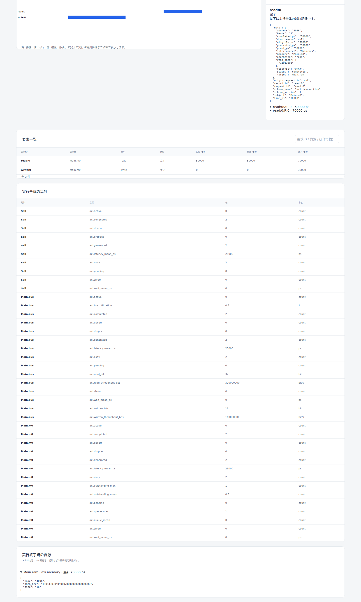

# SoC・メモリ・IPCの機能・動作仕様

文書バージョン：`1.1.1`
対象GitHubバージョン：`main @ c67e153cc3bcf1f6ac0303d23023ce8ae4a4f533`
収録リリース：`v1.1.6`（本文・画像の調査基準は上記commitを維持）

### 更新履歴

| 文書バージョン | 更新日 | 更新内容 |
| --- | --- | --- |
| `1.1.1` | `2026-10-20` | Issue #116〜#119の正式v1.1.6実測記事への相互参照を追加し、既存実習との比較範囲を明示 |
| `1.1.0` | `2026-10-17` | 初版。AXI、共有SoC、AHB相当、NoC、DDR/SRAM、共有メモリ、メールボックス、DMAの入力・動作・結果と変更判断を整理。v1.1.6へ収録し、本文・画像の調査基準を維持 |

文書ID：`guide-reference-soc-memory-ipc`

文書状態：草案。対象コミットの実装を読むためのリファレンスであり、新しい要件・profile・規格適合宣言を追加しない。数値例は明記した構成での解析例と、既存fixtureの内容を区別する。

解析例は、明記した条件以外に、正しい配置・十分な待機容量・他の競合要求なしを前提とする。例示値は製品の省略時既定値ではない。

## 第1節 評価対象と設定の入口

### 概要

**機能仕様。** この章は、チップ内の要求競合・転送待ち・データ公開を、五つのprofileから選んで評価する機能を扱う。同じINIに全種類を並べる機能ではない。特にAXIのRamと`memory.ipc.transaction.v1`のDDR/SRAMは別のモデルであり、現在は相互接続しない。

**動作仕様。** NEDで資源を配置し、INIでprofileとJSONファイルを指定する。準備に成功した入力だけを決定的に実行し、要求・転送・byte内容・途中状態をschema 2の結果へ保存する。通常のモデル応答エラーとシミュレータ自体の失敗は区別する。

| 選ぶprofile | 主に判断できること | 保存するデータ内容 |
| --- | --- | --- |
| `axi4.transaction.v1` | 五チャネルのREADY待ち、Manager間競合、WSTRB、RAM読書き | RAM全byte、read結果、handshake |
| `soc.shared.v1` | 共有バス帯域、優先度、source容量、target service時間 | 転送量・応答。read/writeのbyte値は保持しない |
| `ahb.transaction.v1` | 4byte単発要求のaddress/data/wait/ERROR時間 | 転送量・応答。byte値は保持しない |
| `noc.xy.v1` | 矩形meshのXY配送、出力競合、入力FIFO、下流backpressure | packet量・hop・配送。payload byte値は保持しない |
| `memory.ipc.transaction.v1` | DDR/SRAM内容、IPC所有権、mailbox、DMA競合と通知 | byte列・slot・message・DMA部分進捗 |

### 詳細

**機能仕様。** 変更箇所は三つに分かれる。NEDは配置・ゲート・接続、INIは実行対象と時間、model-config/workload JSONは資源値と負荷である。この章の全model-config欄は必須で、キー省略による既定値はない。空配列が許される項目もキー自体は必要になる。

```ini
[General]
network = memoryipc.Main
ned-path = "models"
model-profile = "memory.ipc.transaction.v1"
model-config = "ddr-row-refresh.model.json"
workload = "ddr-row-refresh.workload.json"
sim-time-limit = 33ps
```

これは[DDR fixtureのINI][ddr-ini]の設定例である。INI相対参照から解決されるJSONを編集する。NEDの資源パラメータ集合は空で、たとえば`ports`や`queue_capacity`をNEDパラメータとして加える方法は使わない。model-configの`node`は配置後の正規module pathと一致させる。memory/IPC資源はゲートを持たず、DMAの`src`/`dst`によってDDR/SRAMを参照する。他四profileはprofile固有ゲートの接続整合性を検査し、直接接続または遅延0のFixedDelayを受け付ける。

| 入力規則 | AXI・SoC・AHB・NoC | memory/IPC |
| --- | --- | --- |
| model-configの版 | `schema_version: 1`、選んだ`profile`と一致 | 同左。rootには`ddr,sram,shared,dma,mailboxes`の全配列が必要。各配列は空可、合計一資源以上 |
| workload root | `schema_version: 2, generators: [...]` | 同左 |
| generator | `id,kind,node,times,transaction` | `id,kind,node,times,request` |
| `kind` | `axi.explicit.v1` / `soc.explicit.v1` / `ahb.explicit.v1` / `noc.explicit.v1` | `memory-ipc.explicit.v1` |
| 時間の指定 | `clock_period`は正整数psへ換算できる時間文字列。`times`は単位付き非負時間文字列 | `times`は同左。`read_ps`などの`*_ps`は単位を付けない正のcanonical十進**文字列**、例`"4"`。上限はu64 |
| 整数・hex | JSON整数は小数・指数・booleanを許さない。AXIデータは4byteに対応する8桁hex | JSON整数は同様。`hex`は非空・偶数桁・小文字hex。`"00"`が1byte |
| 不正入力 | 未知・重複・欠落キー、型・配置・範囲違反を準備エラーにする | 同左。実行時の範囲・権限拒否との区別は各節参照 |

**動作仕様。** `request_id`は`generator ID:timesの0始まりindex`。timesは非減少で同時刻重複可、空配列可。終了時刻をTとすると生成・実行は`[0,T)`で、ちょうどTの生成・完了・通知は実行しない。一方、T以後を含む入力全体は準備時に検査する。正常終了の観測端はH=T、失敗時は確定済み効果のprefixが結果になる。

AXI/SoC/AHB/NoCはclock edgeで進め、生成時刻tを`ceil(t/P)*P`へ切り上げたedge以後に選出する。基本順序はphase 0の完了・解放、phase 1の生成、phase 2の調停である。memory/IPCはps単位の指定時間で予約し、phase 1で要求を集め、phase 2で**同じ時刻・deltaの全要求をadmissionしてから**dispatchする。deltaは同一物理時刻内の追加処理順で、phase 2からphase 1へ戻る予約だけ次deltaになる。

| 容量の意味 | 満杯での振る舞い | 設計を変える際の注意 |
| --- | --- | --- |
| AXI `max_outstanding`、SoC/AHB `capacity` | pending+activeが上限なら新規生成を`dropped`にする | 応答完了で解放。同時刻phase 0完了後の生成は空きを使える |
| NoC `source_capacity` | source FIFOだけの上限。満杯生成は`dropped/source_full` | Router入力へ注入するとsourceの空きが増える。packet総数上限と同義ではない |
| memory/IPC `queue_capacity` | activeを除く待機FIFO。admission時に満杯なら`rejected/queue_full` | 0はidle/空portでも全要求拒否。同時刻の先頭要求を直ちにdispatchして後続へ空きを回す実装ではない |

memory/IPCの同時admissionは`(root generator ID, ordinal, 外部0/child1, chunk index, read0/write1)`順。通常の範囲・権限拒否を容量検査より先に決める。よって入力順の見た目だけで結果を推定せず、IDと資源FIFOを確認する。[memory/IPC仕様][mem-spec]、[入力実装][mem-input]、[admission実装][mem-runtime]が根拠となる。

実行時の`address_error,queue_full,access_denied,empty,full,memory_fault`やAXIの`SLVERR/DECERR`、AHBの`ERROR`は通常応答として実行を継続する。準備失敗は`E-0001`、不正eventや内部状態不整合は`E-0002`、時刻・連番等の上限は`E-0004`。失敗callbackの未確定効果を成功したbyte更新に混ぜない。

## 第2節 AXIの五チャネルとRAM読書き

### 概要

**機能仕様。** `axi4.transaction.v1`は、複数Manager・一Interconnect・一Ramを使う32bit memory-mapped AXI4 transactionモデルである。AW（write address）、W（write data）、B（write response）、AR（read address）、R（read data）のhandshake、READY pattern、byteごとのwrite strobe、応答・RAM内容を確認できる。

**動作仕様。** 各Managerのread/write共通FIFOからround-robinで一要求を選び、応答完了までInterconnect全体をその要求が使用する。複数outstandingを受理できても、同時に進行するtransactionは全体で一つである。Wで確定したbyte更新と、Bで確定するtransaction完了は別時点になる。


図：対象コミットで[strobe5実習INI][axi-screen-input]を実行したViewerのAXI画面。90000psへ移動して`read:0`を選択し、要求2件の完了と要求タイムラインを表示する。図の経路は要求と対象を結ぶ結果表示であり、NEDの全ゲートや五チャネル波形を表す配線図ではない。2026-10-16取得。



詳細図の`read:0`は50000ps生成、70000ps完了、応答OKAY、読出し値`11013303`である。最下段のMain.ramには`11013303040506070000000000000000`を表示する。「実行終了時の資源」は実行全体の最終状態であり、時刻カーソルに合わせた過去のRAM像ではない。[原寸画像](../assets/reference/transaction-detail.png)で要求と最終資源を確認できる。

### 詳細

**機能仕様。** NED実装キーは`dir.axi.Manager`、`dir.axi.Interconnect`、`dir.axi.Ram`。Managerの`aw,w,ar`出力と`b,r`入力を、同じsuffixを持つInterconnectの5本へ接続し、Interconnect側の5本をRamへ結ぶ。Ram直結・複数Interconnect・複数Ramをこのprofileで指定することはできない。

| model-configで変更する場所 | 値・範囲・単位・既定値 |
| --- | --- |
| root | `schema_version,profile,clock_period,managers,interconnect,ram`を全指定。`managers`は非空、`interconnect`は配置path。省略既定値なし |
| `managers[]` | `node,max_outstanding,b_ready,r_ready`。`max_outstanding`=1～256件 |
| `ram`のアドレス | `node,base,size,initial`。base=0～2^32−4で4byte整列、size=4～65536byteで4の倍数、base+size≤2^32 |
| `ram.initial[]` | `{offset,data}`。offsetはRAM先頭からのbyte位置、dataは非空偶数桁hex。範囲内・重複なし。未指定byteの**初期値**は00（項目自体は省略不可） |
| READY | Ramの`aw_ready,w_ready,ar_ready`、Managerの`b_ready,r_ready`。1～1024文字の0/1、少なくとも一つ1。edge nで`pattern[n % length]`を使用 |
| latency | Ramの`read_latency_cycles,write_response_cycles`=1～65535cycle |
| `ram.error_ranges[]` | `{start,end,access}`。絶対byte半開区間、RAM内・非重複、access=`read/write/both`。空配列可 |

workloadの`transaction`はreadなら`operation,address,beats`、writeならさらに`write_data,write_strobes`が必須。address=0～2^32−1で4byte整列、beats=1～256、address+4×beats≤2^32で、burstが4KiB境界を跨がないことを要求する。write_dataは8桁hexをbeats個、write_strobesは0～15の整数をbeats個指定する。

固定値は`AxID=0,AxSIZE=2,AxBURST=INCR(1),AxLEN=beats−1`。利用者がIDやburst種類を上書きするキーはない。byte列`11223344`は昇順アドレスの`11 22 33 44`であり、32bit数値としては`0x44332211`。WSTRB bit jがj番目byteを更新するため、初期`00000000`にdata=`11223344`、strobe=5なら結果は`11003300`になる。strobe=0もWを一beat消費する。

**動作仕様。** Pをclock_period、gをgrant edge番号とする。Managerはpath順に並びcursor初期0、eligibleなFIFO先頭を持つManagerをcursorから巡回して選び、cursorを勝者の次へ進める。

| 段階 | 最早時刻と確定内容 |
| --- | --- |
| write開始 | AWとW0の最初のVALID標本はともにedge g+1。W0のVALID開始はAWREADYに依存しない |
| AW→W | AW handshakeをaとするとRamのWREADYはa+1以後。W0はそれ以前にはhandshakeしない |
| W列 | beat i+1のVALIDは前beat handshakeの次edge以後。最終beatだけWLAST。OKAYなら各W handshakeで有効byteをcommit |
| B | 最終W handshakeをwとすると最早B VALIDはw+write_response_cycles。B READY待ち後のhandshakeでcompleted・容量解放 |
| read | AR VALIDはg+1。AR handshakeをaとすると最初のR VALIDはa+read_latency_cycles。以後は前R handshakeの次edge以後、最終RLASTでcompleted |
| READY待ち | 最初のVALID標本からREADY=1になるedgeまでpayloadを保持。`valid_since_ps`と実handshake時刻の差でstallを求める |

たとえばP=10ns、全READY=`1`、write_response_cycles=1、1beat writeを時刻0でgrantすると、AWは10ns、Wは20ns、Bは30nsにhandshakeする。この例は上表から計算した値である。T=30nsならBは未実行で要求はactive、20nsで書いたbyteはRAMに残る。後続readではRが最初にVALIDになる時点のRAMをsnapshotし、READY待ちで変化させない。

AW/AR handshakeでburstの全byte領域を検査する。RAM外を一byteでも含めばDECERR、RAM内で対象accessのerror_rangeと交差すればSLVERR、それ以外はOKAY。strobeが全0でも領域判定を省略しない。write errorでは全Wを受けてBを返しRAMは一byteも更新しない。read errorはbeats個の`00000000`を同じ応答で返す。いずれも最終応答まで達したらcompletedであり、`completed=okay+slverr+decerr`となる。

結果は`simulation.model_records`の`axi.transaction`（status/grant/completed/response/read_data）、`axi.handshake`（channel/beat/valid_since_ps/wstrb/data/last）、`axi.memory`（base/size/data_hex）を結び付ける。`axi.outstanding`はpending+active、`axi.queue_length`はpendingだけ。`axi.channel_stall_cycles`、wait/latency、bus利用率、read/written bitsを併せて判断する。途中readには到達済みRだけを保存し、予定beatを補わない。

| 残す・変える判断 | 設定で行える変更 | 仕様・実装へ及ぶ変更 |
| --- | --- | --- |
| READY待ち・部分書込・RAM内容が必要なら残す | READY文字列、latency、max_outstanding、初期値、error範囲、負荷 | 複数ID、out-of-order、並列transaction、FIXED/WRAP、narrow/unaligned、exclusive/atomic、QoS、cache/protection、別clock、resetは現在の固定前提を変更する |
| 五チャネルが不要で帯域競合だけを見たい | 別profileへのシナリオ置換を検討 | AXI行とhandshake、byte副作用、AXI専用metricに依存する分析を先に確認 |

参照する規格はArm **AMBA AXI and ACE Protocol Specification, ARM IHI 0022H**のAXI4部分である。五チャネル・VALID/READY、write strobe、INCR burstと4KiB境界を参照する。ACEやAXI5の機能はこのprofileの提供範囲ではない。規格全体の独立チャネル並行性・RTL/pin・電気特性への適合を本モデルの結果から判断しない。[Arm一次資料][arm-axi]。DIR固有の直列資源・時刻式・hex順は[AXI仕様][axi-spec]を正本とする。

根拠：[AXI設計][axi-design]、[入力][axi-input]、[runtime Engine][axi-runtime]、[結果投影][axi-output]、[製品テスト][axi-tests]、[検証仕様][axi-verify]、[read/write設定例][axi-model]。テストには正確なhandshake/RAM照合、invalid transaction、停止中write prefix、時刻精度、接続検査がある。

## 第3節 SoC共有バスの調停・容量・target応答

### 概要

**機能仕様。** `soc.shared.v1`はSource群からTarget群へ向かう一つの共有Busを評価する。転送byte量、共有帯域、targetのservice cycle、round-robinまたはfixed priority、source容量を変えて待ちと破棄を比較できる。

**動作仕様。** Source内FIFOから一要求を選び、全byteに対応するTargetをdecodeする。転送とserviceが終わるまで一つのBusを占有する。read/writeは応答と転送量の分類であり、write値を後続readから読む機能はない。

### 詳細

**機能仕様。** NEDは`dir.soc.Source`、`dir.soc.Bus`、`dir.soc.Target`。Sourceのrequest/responseとBusのsource suffix、Target側とBusのtarget suffixを対にする。同じBus上でsuffixを一意にする。

| model-configの場所 | 設定・範囲・単位・既定値 |
| --- | --- |
| root | `schema_version,profile,clock_period,arbitration,sources,bus,targets,bytes_per_cycle`全必須。省略既定値なし |
| `arbitration` | `round_robin`または`fixed_priority` |
| `bytes_per_cycle` | 1～4096byte/cycle |
| `sources[]` | 非空の`{node,capacity,priority}`。capacity=1～65535件、priority=0～65535、小さい方が優先 |
| `targets[]` | 非空の`{node,base,size,service_cycles,error_ranges}`。base=0～2^32−1、size=1～2^32byte、base+size≤2^32。Target領域相互非重複 |
| `service_cycles` | 0～65535cycle。Bus占有に加算 |
| `error_ranges[]` | `{start,end}`絶対byte半開区間。Target内、相互非重複、空可 |

workloadの`transaction={operation,address,bytes}`はoperation=`read/write`、address=0～2^32−1、bytes=1～65535、address+bytes≤2^32。全byteが一Targetに入る必要がある。配置Target数や領域・service値を変えるのは構成変更、Busを並列化するのは実装前提の変更になる。

**動作仕様。** capacityはpending+active。満杯生成は既存要求を保持して新要求を`dropped/source_full`にする。round-robinはSource path順・cursor初期0。fixed priorityは`(priority,path)`最小を選ぶ。どちらもFIFO先頭だけを候補にし、activeを中断しない。fixed priorityで低優先Sourceが飢餓しない保証はない。

Pを周期、gをgrant時刻、b=`ceil(bytes/bytes_per_cycle)`とすると、decode成功は`g+(b+service_cycles)×P`で完了する。error_range交差も同じservice時間後にERROR。未decodeまたはTarget境界跨ぎはtarget=null、`g+b×P`にERROR。ERRORもcompletedとして容量を解放する。

解析例としてP=10ns、bytes_per_cycle=4、bytes=10、service_cycles=2なら、decode成功はgrantから50nsで完了する。領域外なら30nsでERROR。別Target行きの要求も同じBusを待つため、Targetを増やすだけで同時転送数は増えない。

`soc.transaction`のsource/target/address/bytes/status/start_ps/completed_ps/responseと`active_plan`を確認する。`soc.transfer`は完了した一hopだけを記録する。`soc.errors`はcompletedかつERROR、delivered_bitsはOKAY完了byte×8。queue mean/max、wait、latency、Bus utilizationを合わせ、エラー完了を成功転送量へ足さない。

| 判断 | 設定で変えられるもの | 固定前提・変更影響 |
| --- | --- | --- |
| 帯域・優先度比較に使うなら残す | arbitration、priority、capacity、bytes_per_cycle、Target領域とservice | global active一件、非preemptive、byte値なし、独立response帯域なしは固定 |
| 実メモリ内容が必要 | このprofile内の設定では実現できない | AXIまたはmemory/IPCへシナリオと結果分析を置換。profile混成は別設計 |

特定SoCバス規格への適合モデルではない。根拠：[SoC/AHB/NoC仕様][soc-spec]、[設計][soc-design]、[入力][soc-input]、[runtime State][soc-runtime]、[出力][soc-output]、[製品テスト][soc-tests]、[検証仕様][soc-verify]、[共有バス構成例][soc-model]。fixed priority/FIFO、同優先path順、非preemption、複数Targetの共有占有をテストで確認する。

## 第4節 AHB相当のaddress・data・wait・ERROR

### 概要

**機能仕様。** `ahb.transaction.v1`は、32bit full-widthの単発read/writeをaddress段階とdata段階に分け、Targetのwait cycleとERROR追加cycleを評価する。Manager一つのAHB-Lite相当構成と、複数ManagerのDIR独自共有仲裁構成を作れる。

**動作仕様。** Manager FIFOをround-robinで選び、一要求ずつ完了する。target decodeとerror領域から応答を選択し、指定waitの後、OKAYまたはERRORで資源を解放する。

### 詳細

**機能仕様。** NEDは`dir.ahb.Manager,dir.ahb.Bus,dir.ahb.Target`で、request/responseの接続構造はSoCと同じ。model-config rootは`schema_version,profile,clock_period,managers,bus,targets`全必須で省略既定値なし。`managers[]`は`{node,capacity}`（1～65535件）、`targets[]`は`{node,base,size,wait_cycles,error_ranges}`。base/sizeは4byte整列で、範囲・非重複はSoCと同じ。wait_cycles=0～65535cycle。arbitration選択キーやbytes_per_cycleキーはない。

transactionは`{operation,address,bytes}`。operation=`read/write`、bytesは固定4、address=0～2^32−4の4byte整列値。NONSEQ/SINGLE相当だけを扱い、burstやnarrow transferを設定するキーはない。

**動作仕様。** Pを周期、gをgrant時刻とするとaddress区間は`[g,g+P)`、次がdata段階。decode成功・error範囲非交差なら`g+(2+wait_cycles)×P`でOKAY、error範囲交差なら`g+(3+wait_cycles)×P`でERROR。未decodeはwait=0、target=nullでERROR。Manager内FIFO・path順round-robin、capacityのpending+active、満杯dropはSoCと同じ。

P=10ns、wait_cycles=2の解析例では、OKAYはgrant後40ns、ERRORは50ns。Tがその完了時刻ならactive_planの予定endは残るが、transfer/completedはまだ作られない。ERRORも一件のprotocol完了であって、シミュレータ終了コードの失敗と同一視しない。

結果は`ahb.transaction`、完了一hopの`ahb.transfer`、`ahb.errors`、`ahb.wait_mean_ps`、`ahb.latency_mean_ps`、Bus利用率など。busyはaddress/data/wait/ERROR追加cycleを全て含み、delivered_bitsはOKAYの4byteだけを数える。

| 判断 | 設定で可能な変更 | 仕様変更となるもの |
| --- | --- | --- |
| 単発転送のwait/ERROR評価が必要なら残す | Manager数/容量、clock、領域、wait、error範囲 | address/dataの異要求pipeline重畳、burst、lock、SPLIT/RETRY、pin waveform、byte内容、任意幅 |
| 単一Managerを使う | `managers`とNEDを一Managerへ揃える | 複数Manager仲裁はDIR独自拡張で、AHB-Liteの規格機能として説明しない |

参照するArm **AMBA 3 AHB-Lite Protocol Specification v1.0, ARM IHI 0033A**のaddress/data、HREADY wait、二cycle ERRORという概念は、[Arm公式掲載資料][arm-ahb]で確認できる。既存DIR仕様は後続IHI0033B.bも参照する。DIRの上記直列時間式を、AHB全pipelineの波形再現や規格適合結果へ広げない。根拠：[仕様][soc-spec]、[設計][soc-design]、[実装][soc-runtime]、[製品テスト][soc-tests]の`single_manager_ahb_error_phase_and_exact_completion_boundary`、`ahb_stop_in_every_stage_preserves_busy_and_no_completion`、[wait/ERROR構成例][ahb-model]。

## 第5節 NoCのXY経路・入力FIFO・backpressure

### 概要

**機能仕様。** `noc.xy.v1`は、矩形meshに一Router・一Endpointを各座標へ置き、有限入力FIFOと出力別仲裁でpacket配送を比較する機能である。帯域、link cycle、source/input容量を調整できる。

**動作仕様。** source FIFOからlocal_inへ注入し、x方向、次にy方向、最後にlocal_outの順でstore-and-forward転送する。下流slotをgrant時に予約し、満杯なら現在FIFOで待たせる。異なる出力や逆方向リンクは並列に動く。

### 詳細

**機能仕様。** NEDは`dir.noc.Endpoint`と`dir.noc.Router`。Endpointのpacket/deliveryをRouterのlocal_in/local_outへ、隣接Routerのout_dを反対方向inへ接続する。存在しない隣接方向を追加しない。

| model-configの場所 | 設定・範囲・単位・既定値 |
| --- | --- |
| root | `schema_version,profile,clock_period,columns,rows,bytes_per_cycle,link_cycles,input_capacity,source_capacity,routers,endpoints`全必須。省略既定値なし |
| 形状 | columns/rows=1～32。routers=`{node,x,y}`は格子全座標を一度ずつ含む。endpoints=`{node,router}`は各Routerに一つ |
| 転送 | bytes_per_cycle=1～4096byte/cycle、link_cycles=0～65535cycle |
| FIFO | input_capacity/source_capacity=1～65535packet。packetのbytesにかかわらず一slotを占める |
| transaction | `{destination,bytes}`。destinationは配置Endpoint path、bytes=1～65535byte。同じEndpoint宛も可 |

**動作仕様。** 東がx+1、北がy+1。destination xまで単調に進んでからyを進み、到着Routerでlocal_outを通る。hop数はマンハッタン距離+1。同一Router内もlocal配送一hopを消費する。

各Routerにはlocal_inと実在方向のin_dごとに独立FIFOがあり、出力ごとに入力名UTF-8順round-robin（cursor初期0）を持つ。FIFO先頭以外は追越さないため、先頭が下流満杯で止まると、その後ろの別宛packetも待つ。これがhead-of-line blockingである。Router全体を一packetに直列化する規則ではない。

phase 2の走査冒頭にEndpoint path順でeligibleなsource先頭をlocal_inの空き数まで注入する。同edgeでそのpacketを出力選出できる。出力選出はRouter path→出力名UTF-8順、下流空きは`input_capacity−FIFO件数−予約slot数`。grantで上流headを外して上流slotを解放し、下流slotを予約する。完了で予約を解除して下流FIFO末尾へ入れる。local_outのEndpointは常時受理する。

各出力の占有は`(ceil(bytes/bytes_per_cycle)+link_cycles)×P`。全packetが到着してから次hopへ進む。たとえばP=1ns、bytes=5、bytes_per_cycle=2、link_cycles=1、(0,0)→(1,1)は3hopで、競合がなければgrantから12ns後に最終配送する解析例になる。途中hopでは最終完了・delivered_bitsを増やさない。

同時刻完了の下流appendは`(resource ID,request_id)`順。phase 2はslot解放を反映して注入・grantが0になるまで再走査する。source待ち/local_in待ちはpending、最初の出力grant後は途中FIFO待ちもactive。Tで打切る場合、予定endの合成transferは出力せずactive_planを残す。

単調XY、方向別入力queue、常時受理EndpointというDIRの条件で循環依存を避ける。未完了packetがあり、調停固定点で進行出力0、future生成/eligible wake0なら`model_failed/deadlock`として失敗する。有限Tで残ったpacketをdeadlockとは判定しない。この主張をadaptive routingや終点応答待ちへ拡張しない。

`noc.transaction`を`noc.transfer`のhopへ結び、最終local_outまで確認する。出力資源IDは`router:out_east`等/`:local_out`、入力queue IDは`router:in_west`等/`:local_in`、sourceは`endpoint:source`。利用率は出力資源、queueは各FIFO、遅延/最終配送量は送信元と`$all`に対して読む。

| 判断 | 設定で可能な変更 | 固定前提・変更影響 |
| --- | --- | --- |
| packet粒度のmesh競合なら残す | mesh寸法、容量、bytes_per_cycle、link_cycles、負荷 | XY順、有限packet slot、store-and-forward、常時受理終点は固定 |
| flit/wormhole/VC/adaptive/torusを求める | 現profileのパラメータ変更では実現しない | routing、予約、FIFO単位、deadlock根拠と検証期待値をまとめて再設計 |

特定NoC標準への適合を表すprofileではない。根拠：[仕様][soc-spec]、[設計][soc-design]、[入力][soc-input]、[runtime][soc-runtime]、[製品テスト][soc-tests]のhead-of-line、独立双方向、三出力並列、停止と予約rollback、[backpressure構成例][noc-model]。

## 第6節 SRAMのport・同時刻可視性

### 概要

**機能仕様。** `memory.ipc.transaction.v1`のSRAMは、byte記憶域・1～16port・独立read/write時間を持つ。直接要求とDMA childが同じport、FIFO、byte内容を共有し、port増加による並列処理と競合結果を評価できる。

**動作仕様。** 待機FIFO先頭を最小indexの空portへ割り当て、read/write時間後のcompletionでreadを採取し、writeを一括公開する。同じ完了時刻ではdispatch ordinal順で処理し、結果を決定的にする。

### 詳細

**機能仕様。** NED実装キーは`dir.memory.SramV1`。model-config rootの`sram[]`へ`{node,size,initial,queue_capacity,ports,read_ps,write_ps,fault_ranges}`を全指定する。既定値はない。size=1～65536byte、ports=1～16、queue_capacity=0～1024件、read_ps/write_psは正u64 psの十進文字列。initial=`{offset,hex}`は範囲内・相互非重複で未指定byte初期値00。fault_ranges=`{offset,length}`はlength>0、範囲内・非重複、空可。

workloadのrequestはread=`{op:"read",address,length}`、write=`{op:"write",address,length,hex}`。addressは非負u64整数、length=1～65536byte、write hexのbyte数とlengthを一致させる。addressはmemory内offsetでありAXIのbase付き絶対アドレスとは別である。SRAMにはDDRの行境界制約はない。

**動作仕様。** admissionで範囲外・加算超過は`rejected/address_error`、容量満杯は`rejected/queue_full`。dispatchでfault_rangesと重なる要求は`rejected/memory_fault`としてportを占有せず次へ進む。正常要求はgrant gからread_ps/write_ps後にcompletionし、write全byte公開またはその時点のread snapshotを確定する。重複アドレスを持つ別port要求も受理する。

同資源・同完了時刻の処理順はgrant時の単調dispatch ordinal。先行write→後続readならreadが新byteを見る。先行read→後続writeならreadは旧byte。同時write重複は後続ordinalのbyteが残る。これはDIRが選択した抽象policyで、実SRAMマクロのread-during-writeモード指定ではない。

解析例としてports=2、read_ps=write_ps=`"4"`、同時刻のwrite ID aとread ID bを順にdispatchすれば、4ps後にaのwriteを反映したbの値を読む。T=4psなら両completionは未処理で、メモリは旧byte、両portにownerが残る。

結果は`memory-ipc.request`のmodel=`sram`、port、dispatch_ordinal、input/output_hex、started/planned_completion/completed、および`memory-ipc.memory`のhex/ports/queue。busy_ratioは全port占有時間和を`ports×H`で割るので、一portの利用率と混同しない。成功write量、queue長、latencyも確認する。

| 判断 | 設定で変える箇所 | 仕様変更となるもの |
| --- | --- | --- |
| 記憶内容とport競合が必要なら残す | ports、read_ps/write_ps、size、初期値、fault範囲、負荷 | address別bank制約、port別機能差、同時write衝突エラー、read-during-writeモード追加は新契約 |
| 待機をなくすつもりで容量0にする | queue_capacity=0は全拒否になる | 直行バイパスadmissionを求めるなら共通順序を変更する必要がある |

根拠：[memory/IPC仕様][mem-spec]、[設計][mem-design]、[入力][mem-input]、[runtime][mem-runtime]、[出力][mem-output]、[製品テスト][mem-tests]、[検証仕様][mem-verify]、[SRAM port構成例][sram-model]。

## 第7節 DDRの行状態・時間定数・refresh

### 概要

**機能仕様。** DDRはbank/row形状、open/close/column/beat時間、行hit/miss、周期refreshを指定できるbyte記憶モデルである。SRAMと同じ直接read/writeとDMA childを受ける。

**動作仕様。** 全bank共通の単一FIFO serviceで一要求ずつ動かし、対象bankのopen rowに応じてsetup時間を加える。refresh dueでは新dispatchを止め、実行中要求が終わってから全行を閉じる。byte更新とread採取はcompletion時である。

### 詳細

**機能仕様。** NED実装キーは`dir.memory.DdrV1`。rootの`ddr[]`へ次を全指定し、省略既定値はない。

| 設定キー | 範囲・単位・条件 |
| --- | --- |
| `node,size,initial,queue_capacity,fault_ranges` | SRAMと同じ。size=1～65536byte、queue_capacity=0～1024件 |
| `banks` | 1～16 |
| `row_bytes,rows_per_bank,width_bytes` | 各1～65536。`size=banks×row_bytes×rows_per_bank`、row_bytesはwidth_bytesの倍数 |
| `open_ps,close_ps,column_ps,beat_ps` | 各正u64 psのcanonical十進文字列 |
| `refresh_interval_ps,refresh_ps` | 各同上、refresh_ps<refresh_interval_ps。refresh無効化の0やflagはない |

read/write requestのキー・length・hexはSRAMと同じ。追加で一要求が一row内に収まる必要がある。`bank=(address div row_bytes) mod banks`、`row=address div (row_bytes×banks)`、column=`address mod row_bytes`。範囲外・行跨ぎはadmissionでaddress_error、fault交差はdispatchでmemory_faultとなる。DMAは別途chunkを行境界で切るため、descriptor全体が複数rowに跨いでもよい。

**動作仕様。** 初期open_rowsは全null。grant gで対象bankが閉じていればsetup=open_ps、同じrowならsetup=0、別rowならsetup=close_ps+open_ps。completionは`g+setup+column_ps+ceil(length/width_bytes)×beat_ps`。grant時に対象bankのrowを更新し、他bankのrowを保持する。bankが違ってもserviceは並列にならない。

[既存DDR fixture][ddr-model]ではsize=32、banks=2、row_bytes=4、rows_per_bank=4、width_bytes=2、open=3ps、close=2ps、column=2ps、beat=1ps、interval=15ps、refresh=5psである。0psの4byte writeは7ps完了、7psの同row readは11ps完了、11psの別row writeは20ps完了。15psのdueはそのwriteを中断せず待つ。20～25psのrefreshで全rowを閉じ、16psに生成されたreadは25psに開始し32psに完了する。この値は[fixtureのworkload][ddr-workload]と[独立期待値][mem-fixtures]に対応する。

初回dueはinterval。dueのphase 0でrefresh_pendingを立て、activeがあれば完了待ち、idleならそのdue時刻に開始する。refresh開始で全open_rows=null、終了予定=start+refresh_ps、次due=start+interval。dueとcompletionが同時刻でも新要求dispatchよりrefreshが優先し、待機FIFOを保持する。初回dueから固定間隔で過去のrefreshを追いつき実行する方式ではない。

Tで停止すると、未完了writeのbyteは公開されない。grantで決まったrow状態とplanned_completionは残り、実績completedと区別できる。`memory-ipc.memory`のhex、open_rows、ports、refresh_pending、refresh_started_ps/refresh_planned_end_ps/refresh_ended_ps、queueと、requestのbank/row/row_hitを読む。`memory_ipc.ddr_refreshes`は開始数、busy_ratioはserviceのみでrefresh時間を含めない。

| 判断 | 設定で可能 | 仕様変更となるもの |
| --- | --- | --- |
| row/refreshが待ちへ与える影響を残したい | 形状、時間定数、初期byte、fault、負荷 | bank並列化、command queue、特定DDR世代のcommand/timing規則、refresh方式切替、ECC、power状態 |
| 固定時間memoryだけで十分 | SRAM構成への置換を検討 | DDR固有row/refresh結果と待ちの分析を見直す |

特定DDR世代やJEDEC規格の完全timing適合は提供しない。`open_ps`等を実機に近い値へ合わせても、それだけでDRAM command-level simulatorにはならない。根拠：[仕様][mem-spec]、[設計][mem-design]、[runtime][mem-runtime]、[製品テスト][mem-tests]のrow/refresh、行境界chunk、停止、[検証仕様][mem-verify]。

## 第8節 共有メモリIPCのproducer・consumerと公開境界

### 概要

**機能仕様。** Sharedは、producerが有限slotへpayloadをpublishし、consumerが公開順にconsumeする所有権モデルである。actorごとの操作権限、slot数、最大payload長、公開/消費時間を設定できる。

**動作仕様。** 一操作serverでFIFO順に進め、slotは`free→publishing→ready→consuming→free`と遷移する。publish開始ではbyteをまだ公開せず、completionでreadyにする。consume開始でready FIFOから除き、completionで結果をcopyしてfreeへ戻す。

### 詳細

**機能仕様。** NED実装キーは`dir.ipc.SharedV1`。rootの`shared[]`へ`{node,slots,slot_bytes,queue_capacity,publish_ps,consume_ps,producers,consumers}`全必須。既定値なし。slots=1～1024、slot_bytes=1～65536byte、積≤65536byte、queue_capacity=0～1024件、時間は正u64 ps十進文字列。producers/consumersは各非空・重複なしのASCII識別子配列で、両集合の同一actorは許される。

requestはpublish=`{op:"publish",actor,hex}`、consume=`{op:"consume",actor}`。hexは1～slot_bytes byte。actorの構文違反は準備失敗、構文が正しいが権限集合にいないactorはadmissionで`rejected/access_denied`。Actorは操作の論理名で、CPU命令実行・OS process・外部認証アカウントではない。

**動作仕様。** publish dispatchで最小indexのfree slotをproducerが占有する。空きなしなら`rejected/full`、serverを占有せず次FIFOへ進む。publish_ps後にpayloadと長さを一括公開し、ready FIFO末尾へ加えowner=nullとする。consume dispatchはready FIFO先頭をconsumerが占有し、なければ`rejected/empty`。consume_ps後にそのhexをoutputへcopyし、slotのhex/長さ/message_id/ownerを解放する。

publishing中はslot行のhexは空で、未公開payloadは要求側input_hexにある。consuming中は公開済みbyteを保持するが、ready FIFOから外れているので別consumerに渡らない。同時刻publish completionの後にconsumeをdispatchできる。T途中はproducer/consumer ownerと状態を保存し、予定公開・予定consumeを補わない。

解析例としてslots=1、publish_ps=3、consume_ps=5なら、0psにpublishをdispatchして3psにready、同3psにconsumeをdispatchして8psにfreeになる。T=5psならslotはconsuming、公開hexは残り、consumeのoutput_hexはまだnull。公開前をreadしたという扱いにはしない。

`memory-ipc.shared`のslots（index,state,owner,message_id,hex）、ready配列、active/queueと、`memory-ipc.request`のactor/slot/input_hex/output_hexを突き合わせる。成功publish数はconsume済み+ready+consumingに分かれる。queuedなpublishやpublishingを公開済み数へ入れない。

| 判断 | 設定で可能 | 仕様変更となるもの |
| --- | --- | --- |
| 所有権と公開/取得順を評価するなら残す | actor集合、slot寸法、待機容量、publish/consume時間、負荷 | CPU cache、coherence protocol、fence/atomic命令、任意アドレスload/store、DMAによるslot直接更新 |
| cache coherenceが必要 | actor名の追加では実現しない | メモリ一貫性モデル・CPU/キャッシュ・同期操作の別設計が必要 |

publish/consumeはDIR独自の抽象公開境界であり、C/C++言語memory model、特定ISAのbarrier、cache coherent interconnectへの適合を表さない。根拠：[仕様][mem-spec]、[設計][mem-design]、[実装][mem-runtime]、[製品テスト][mem-tests]、[所有権構成例][shared-model]。

## 第9節 メールボックスFIFOと到着通知

### 概要

**機能仕様。** Mailboxは、有限payload FIFOに対するsend/receiveと、成功sendから遅延する到着通知をモデル化する。操作待機容量、message容量、service時間、通知時間、sender/receiver actorを分けて設定できる。

**動作仕様。** 一serverが操作FIFOを処理し、service completion時のpayload数でfull/emptyを決める。send成功時に要求はcompletedとなり、その後の通知は独立した観測eventとして実行する。受信に通知待ちは必要ない。

### 詳細

**機能仕様。** NED実装キーは`dir.ipc.MailboxV1`。rootの`mailboxes[]`へ`{node,capacity,payload_bytes,queue_capacity,service_ps,notify_ps,senders,receivers}`全必須。既定値なし。capacity/queue_capacity=0～1024件、payload_bytes=1～65536byte、capacity×payload_bytes≤65536byte。時間は正u64 ps十進文字列、actor集合規則はSharedと同じ。

requestはsend=`{op:"send",actor,hex}`、receive=`{op:"receive",actor}`。send payloadは1～payload_bytes byte。権限不一致はadmissionで`rejected/access_denied`。queue_capacityは**操作待機数**、capacityは**enqueue済みmessage数**であり、別の容量である。

**動作仕様。** grant gからservice_ps後、sendならpayload FIFO長<capacityで末尾追加し`completed/ok`、満杯なら`completed/full`。receiveなら非空で先頭を取り出しhex/message_idを結果へcopyして`completed/ok`、空なら`completed/empty`。Sharedのfull/emptyがdispatch時のrejectedなのに対し、Mailboxはservice時間を使い切ったcompletedである。

成功sendのmessage_idは要求ID、enqueued_psはsend completion。通知行のplanned_ps=enqueued_ps+notify_ps、delivered_ps初期null。通知時に全receiver actorをUTF-8順で記録してdelivered_psを設定する。broadcast観測は一回で、receiverごとの要求やCPU interrupt処理を生成しない。messageを先にreceiveしても到着通知は取り消さない。

解析例としてservice=2ps、notify=5psなら、0psにsendを開始して2psにenqueue・要求完了、2psにreceive開始して4psにdequeue、7psに到着通知となる。T=6psではmessage FIFOは空、send/receiveとも完了、notificationはplannedのみ。これは失われたmessageではなく、受信と通知の異なる時間境界である。

capacity=0なら成功enqueueはなくservice後full、queue_capacity=0ならその前のadmissionで全操作queue_fullとなる。Tちょうどのservice/通知は未実行。`memory-ipc.mailbox`のmessages/active/queue、requestのmessage_id/input/output、`memory-ipc.notification`のenqueued/planned/delivered/receiversを結び付ける。sent=received+messages件数、通知実績≤sent。通知予定を`memory_ipc.notifications`へ加算しない。

| 判断 | 設定で可能 | 仕様変更となるもの |
| --- | --- | --- |
| 非同期payloadと通知時刻を評価するなら残す | 二つの容量、payload寸法、service/notify、actor集合 | 割込優先度/mask、OS scheduler、blocking receive、message priority、通知取消、再送、receiver別delivery |
| 通知時間を0にしたい | 現profileは正時間のみ | zero-delayのphase/delta・完了定義を追加設計する必要がある |

根拠：[仕様][mem-spec]、[設計][mem-design]、[実装][mem-runtime]、[出力][mem-output]、[製品テスト][mem-tests]、[mailbox FIFO構成例][mail-model]。

## 第10節 DMAのchunk・共有memory競合・完了通知

### 概要

**機能仕様。** DMAは同profile内のDDR/SRAM間copyを、実際のmemory read/write child要求へ分けて評価する。直接trafficと同じFIFO・port・refresh・faultを使用し、部分転送量と通知までの遅延を追跡できる。

**動作仕様。** 一engineでdescriptor一つをactiveとし、setup→chunk read→chunk writeを反復する。最終write完了でデータ転送完了となり、notify_ps後の通知で親descriptorをcompletedにする。child失敗では、その時点までcommitしたbyteだけを保持してfailedとなる。

### 詳細

**機能仕様。** NED実装キーは`dir.dma.EngineV1`。rootの`dma[]`へ`{node,queue_capacity,chunk_bytes,setup_ps,notify_ps}`を全指定する。既定値なし。queue_capacity=0～1024件、chunk_bytes=1～65536byte、時間は正u64 ps十進文字列。

request=`{op:"copy",src,dst,src_address,dst_address,length}`。src/dstは設定済みDDR/SRAM node、addressは非負u64整数、length=1～65536byte。未知/他種類nodeは準備失敗。admissionで両端範囲外や同一memoryの範囲重複をaddress_errorにする。同一memoryでも非重複なら受理する。Shared slot/Mailbox/AXI Ramをsrc/dstへ指定する経路はない。

**動作仕様。** dispatch時刻gからsetup_ps後に最初のread childをofferする。chunkサイズは`min(chunk_bytes,残byte,src DDRの行残byte,dst DDRの行残byte)`、SRAM側には行制約がない。read completionのsnapshotをwrite payloadへ固定し、write response後に次chunkへ進む。child IDは`親ID/r/index`、`親ID/w/index`、indexは0始まりで、origin_request_idは親IDである。

たとえばchunk_bytes=8でも、src DDRのrow_bytes=4、開始offset=2なら最初のchunkは最大2byteとなる。descriptor全体の行跨ぎを認めつつ各DDR childを一行に収める。直接要求も同じmemoryへ並ぶため、childのqueue_full/fault/refresh/port待ちが親の遅延と成否に反映する。engineからmemoryへ固定memcpy時間で直接書き込む実装ではない。

write childの成功commitごとに親committed_bytesを増やす。最終writeでdata_done_ps、planned_notify_ps=data_done+notify_psを保存してnotifying。通知のphase 1でnotified_ps/completed_psを設定し`completed/ok`、engine解放。Mailbox sendと違い、DMA成功親は通知まで完了しない。

最初のchild拒否/memory_faultを受けたDmaResponseで`failed/child_<reason>`となり、その応答時刻をcompleted_psにする。data_done_ps=null、通知なし、前のchunk書込とcommitted_bytesは残る。失敗chunkだけを後で自動再試行する機能はない。

T途中はawaiting_admission/queued/setup/reading/writing/notifyingを保存する。最後のwriteが済んでいても通知がT以後ならnotifyingのまま。未完了writeを転送済み量に足さず、同callbackのchild byte更新と親committed_bytes更新を同じ確定効果にする。

結果は親とchildの`memory-ipc.request`をorigin_request_idで追い、親src/dst/address/length/committed_bytes/data_done/planned_notify/notifiedと、`memory-ipc.dma`のactive/queue/child/chunk_index/chunk_hexを確認する。source memoryのread量、destination memoryのwrite量、DMA親committed_bytesを足すと一つのcopyを重複計上するため、目的別に分ける。busy_ratioはsetup・memory待ち・通知待ちを含むengine active全区間、親latencyは通知まで。

| 判断 | 設定で可能 | 仕様変更となるもの |
| --- | --- | --- |
| memory競合を含むcopy評価なら残す | chunk寸法、setup/notify、engine数、descriptor負荷、memory構成 | 多descriptor同時active、並列chunk、scatter/gather、重複memmove、取消/再試行、cache coherent DMA、AXI接続 |
| 通知前の完了を見たい | `data_done_ps`と`completed_ps`を使い分ける | 親completedの意味を変更すると既存latency/状態/容量解放と互換性に影響 |

根拠：[仕様][mem-spec]、[設計][mem-design]、[実装][mem-runtime]、[出力][mem-output]、[製品テスト][mem-tests]のrow境界chunk、非重複同memory copy、故障prefix、最終write/通知予約の原子性、[DMA構成例][dma-model]。

## 第11節 実装ライブラリ・結果の読み方・変更範囲

### 概要

**機能仕様。** ここまでの機能はRustの`dir-simulator` crateに組み込まれている。外部のAXI、DRAM、NoC専用シミュレーションライブラリを呼び出す構成ではない。INI/profile dispatch、モデル別準備・runtime・出力アダプター、共通snapshotとJSONを使用する。

**動作仕様。** 実行中の確定状態からモデル別レコードとmetricを投影し、Viewerはその結果を表示する。結果のschema/単位/状態を変える場合、表示だけでなく出力・fixture・分析の契約へ影響する。

### 詳細

**機能仕様。** 実体の所在を以下に示す。概念設計に現れるRegistry/Contextの説明と、対象コミットの組込み専用実行経路を区別する。公開拡張APIへの適合試験完了を、この章の製品fixture照合から推定しない。

| 層・ライブラリ | 対象コミットでの実体と責務 |
| --- | --- |
| CLI/library入口 | [lib.rs][lib-source]の`prepare/run`、[runtime dispatch][dispatch-source]がprofile別simulateを選ぶ |
| AXI内部 | `src/input/axi.rs`の厳密入力、`src/lib/types/axi.rs`のPreparedAxi、`src/runtime/axi.rs`のEngineとBinaryHeap/VecDeque、`src/runtime/axi/protocol.rs`のcodec、`src/lib/snapshot/axi.rs`、`src/output/axi.rs` |
| SoC/AHB/NoC内部 | `src/input/soc.rs`、`src/lib/types/soc.rs`、`src/runtime/soc.rs`のState/CheckpointとFIFO・予約・cursor・完了表、`src/runtime/soc/protocol.rs`、`src/lib/snapshot/soc.rs`、`src/output/soc.rs` |
| memory/IPC内部 | `src/input/memory_ipc.rs`、`src/lib/types/memory_ipc.rs`、`src/runtime/memory_ipc.rs`のEngineとBTreeMap event順序/intent/資源台帳、`src/runtime/memory_ipc/protocol.rs`、`src/lib/snapshot/memory_ipc.rs`、`src/output/memory_ipc.rs` |
| 外部crate | [Cargo.toml][cargo-source]のserde/serde_json（構造化データ）、sha2（digest）、tiny_http（HTTP）、rustix、signal-hook。これらを使用している事実はAMBA/DDR規格適合の根拠ではない |
| Viewer側 | [transaction-model.js][viewer-transaction]がtransaction系結果を解釈する。表示値の正本は実行結果のレコードであり、未実行の予定完了を実績へ置き換えない |

**動作仕様。** 共通wrapperは`schema_name,schema_version,record_id,subject,request_id,origin_request_id,time_ps,data`を持ち、モデル行は`simulation.model_records`にある。大きな時刻・件数等はcanonical十進文字列、nullは未到達/対象外を表す。legacyな`simulation.requests`だけを読む分析ではこの章の結果を取得できない。純profileの要求をCAN request/receiverへ合成しない。

| 結果の確認目的 | 読むもの | 誤りやすい境界 |
| --- | --- | --- |
| 満杯損失 | AXI/SoC/AHB/NoCのdropped、memory/IPCのrejectedとreason | memoryのactiveは待機容量外。Mailbox fullはcompleted、Shared fullはrejected |
| 完了と成功 | completedとresponse/reasonを両方見る | AXI SLVERR/DECERR、AHB/SoC ERRORは完了。成功bit量には入らない |
| byte内容 | AXI memory/data_hex、memory-ipc.memory/hex、IPC slot/messageとread output | SoC/AHB/NoCにread-after-writeデータはない |
| 時間 | generated→grant/started→data_done→completed/notified | DMAとMailboxでは通知が親完了へ与える意味が違う |
| 途中停止 | status、active_plan、planned_completion/planned_notify、port/owner/queue | Tちょうどのeventは未処理。plannedは実績でない |
| 利用率 | 対象resource、H、busy定義を見る | DDR refreshはservice busy外、SRAMはport平均、DMAは待機もactive |

H=0では率・標本平均はnull、正Hの空負荷ではqueue/利用率/throughputは0で標本平均はnullとなる。SoC/AHB/NoC metricはprefixごと13種、AXIは24種、memory/IPCは資源種別に応じた登録集合を使う。memory/IPCには暗黙の`$all`集計を加えず、同じbyteが親/child/資源に現れることを踏まえて分析する。

設定の値変更はそのprofile契約内で行う。現在固定の順序・同時刻可視性・通知完了・容量単位を変更する場合は、詳細仕様、設計、input/runtime/output、protocol codec、Viewer、独立fixture、製品テストを一緒に確認する。削除判断ではprofile名、NED実装キー、record schema、metric IDを検索し、使用シナリオと外部分析の依存を列挙してから削除範囲を決める。本書は削除や仕様変更を実施した記録ではない。

## 第12節 根拠の範囲

この章は対象コミットの仕様・設計・ソース・既存テストを突き合わせた説明である。リンク先の検証記録は実施時点・入力・出力の範囲を示し、全規格適合、全構成の性能、実デバイスとの一致を一括して証明するものではない。規格参照は2026-10-16にArm一次資料の公開本文/公式検索掲載を確認した。IHI0022H本文は取得できたが、AHBの公式PDF本文再取得は制限されており、公式掲載索引と既存DIR仕様に照合した範囲で記述している。

[axi-spec]: https://github.com/hideki-ozu/DIR-Simulator/blob/c67e153cc3bcf1f6ac0303d23023ce8ae4a4f533/docs/specs/models/AXIモデル詳細機能仕様書.md
[axi-design]: https://github.com/hideki-ozu/DIR-Simulator/blob/c67e153cc3bcf1f6ac0303d23023ce8ae4a4f533/docs/design/AXIモデル詳細設計書.md
[axi-input]: https://github.com/hideki-ozu/DIR-Simulator/blob/c67e153cc3bcf1f6ac0303d23023ce8ae4a4f533/crates/dir-simulator/src/input/axi.rs
[axi-runtime]: https://github.com/hideki-ozu/DIR-Simulator/blob/c67e153cc3bcf1f6ac0303d23023ce8ae4a4f533/crates/dir-simulator/src/runtime/axi.rs
[axi-output]: https://github.com/hideki-ozu/DIR-Simulator/blob/c67e153cc3bcf1f6ac0303d23023ce8ae4a4f533/crates/dir-simulator/src/output/axi.rs
[axi-tests]: https://github.com/hideki-ozu/DIR-Simulator/blob/c67e153cc3bcf1f6ac0303d23023ce8ae4a4f533/crates/dir-simulator/tests/axi.rs
[axi-verify]: https://github.com/hideki-ozu/DIR-Simulator/blob/c67e153cc3bcf1f6ac0303d23023ce8ae4a4f533/docs/verification/cases/AXIモデル検証仕様書.md
[axi-model]: https://github.com/hideki-ozu/DIR-Simulator/blob/c67e153cc3bcf1f6ac0303d23023ce8ae4a4f533/docs/verification/fixtures/axi/read-write.model.json
[axi-screen-input]: https://github.com/hideki-ozu/DIR-Simulator/blob/c67e153cc3bcf1f6ac0303d23023ce8ae4a4f533/examples/guide/axi-strobes/strobe5.ini
[soc-spec]: https://github.com/hideki-ozu/DIR-Simulator/blob/c67e153cc3bcf1f6ac0303d23023ce8ae4a4f533/docs/specs/models/SoC・AHB・NoC詳細機能仕様書.md
[soc-design]: https://github.com/hideki-ozu/DIR-Simulator/blob/c67e153cc3bcf1f6ac0303d23023ce8ae4a4f533/docs/design/SoC・AHB・NoC詳細設計書.md
[soc-input]: https://github.com/hideki-ozu/DIR-Simulator/blob/c67e153cc3bcf1f6ac0303d23023ce8ae4a4f533/crates/dir-simulator/src/input/soc.rs
[soc-runtime]: https://github.com/hideki-ozu/DIR-Simulator/blob/c67e153cc3bcf1f6ac0303d23023ce8ae4a4f533/crates/dir-simulator/src/runtime/soc.rs
[soc-output]: https://github.com/hideki-ozu/DIR-Simulator/blob/c67e153cc3bcf1f6ac0303d23023ce8ae4a4f533/crates/dir-simulator/src/output/soc.rs
[soc-tests]: https://github.com/hideki-ozu/DIR-Simulator/blob/c67e153cc3bcf1f6ac0303d23023ce8ae4a4f533/crates/dir-simulator/tests/soc.rs
[soc-verify]: https://github.com/hideki-ozu/DIR-Simulator/blob/c67e153cc3bcf1f6ac0303d23023ce8ae4a4f533/docs/verification/cases/SoC・AHB・NoC検証仕様書.md
[soc-model]: https://github.com/hideki-ozu/DIR-Simulator/blob/c67e153cc3bcf1f6ac0303d23023ce8ae4a4f533/docs/verification/fixtures/soc/soc-round-robin.model.json
[ahb-model]: https://github.com/hideki-ozu/DIR-Simulator/blob/c67e153cc3bcf1f6ac0303d23023ce8ae4a4f533/docs/verification/fixtures/soc/ahb-wait-error.model.json
[noc-model]: https://github.com/hideki-ozu/DIR-Simulator/blob/c67e153cc3bcf1f6ac0303d23023ce8ae4a4f533/docs/verification/fixtures/soc/noc-backpressure.model.json
[mem-spec]: https://github.com/hideki-ozu/DIR-Simulator/blob/c67e153cc3bcf1f6ac0303d23023ce8ae4a4f533/docs/specs/models/メモリ・IPC詳細機能仕様書.md
[mem-design]: https://github.com/hideki-ozu/DIR-Simulator/blob/c67e153cc3bcf1f6ac0303d23023ce8ae4a4f533/docs/design/メモリ・IPC詳細設計書.md
[mem-input]: https://github.com/hideki-ozu/DIR-Simulator/blob/c67e153cc3bcf1f6ac0303d23023ce8ae4a4f533/crates/dir-simulator/src/input/memory_ipc.rs
[mem-runtime]: https://github.com/hideki-ozu/DIR-Simulator/blob/c67e153cc3bcf1f6ac0303d23023ce8ae4a4f533/crates/dir-simulator/src/runtime/memory_ipc.rs
[mem-output]: https://github.com/hideki-ozu/DIR-Simulator/blob/c67e153cc3bcf1f6ac0303d23023ce8ae4a4f533/crates/dir-simulator/src/output/memory_ipc.rs
[mem-tests]: https://github.com/hideki-ozu/DIR-Simulator/blob/c67e153cc3bcf1f6ac0303d23023ce8ae4a4f533/crates/dir-simulator/tests/memory_ipc.rs
[mem-verify]: https://github.com/hideki-ozu/DIR-Simulator/blob/c67e153cc3bcf1f6ac0303d23023ce8ae4a4f533/docs/verification/cases/メモリ・IPC検証仕様書.md
[mem-fixtures]: https://github.com/hideki-ozu/DIR-Simulator/blob/c67e153cc3bcf1f6ac0303d23023ce8ae4a4f533/docs/verification/fixtures/memory-ipc/scenarios.json
[ddr-ini]: https://github.com/hideki-ozu/DIR-Simulator/blob/c67e153cc3bcf1f6ac0303d23023ce8ae4a4f533/docs/verification/fixtures/memory-ipc/ddr-row-refresh.ini
[ddr-model]: https://github.com/hideki-ozu/DIR-Simulator/blob/c67e153cc3bcf1f6ac0303d23023ce8ae4a4f533/docs/verification/fixtures/memory-ipc/ddr-row-refresh.model.json
[ddr-workload]: https://github.com/hideki-ozu/DIR-Simulator/blob/c67e153cc3bcf1f6ac0303d23023ce8ae4a4f533/docs/verification/fixtures/memory-ipc/ddr-row-refresh.workload.json
[sram-model]: https://github.com/hideki-ozu/DIR-Simulator/blob/c67e153cc3bcf1f6ac0303d23023ce8ae4a4f533/docs/verification/fixtures/memory-ipc/sram-ports.model.json
[shared-model]: https://github.com/hideki-ozu/DIR-Simulator/blob/c67e153cc3bcf1f6ac0303d23023ce8ae4a4f533/docs/verification/fixtures/memory-ipc/shared-ownership.model.json
[mail-model]: https://github.com/hideki-ozu/DIR-Simulator/blob/c67e153cc3bcf1f6ac0303d23023ce8ae4a4f533/docs/verification/fixtures/memory-ipc/mailbox-fifo.model.json
[dma-model]: https://github.com/hideki-ozu/DIR-Simulator/blob/c67e153cc3bcf1f6ac0303d23023ce8ae4a4f533/docs/verification/fixtures/memory-ipc/dma-memory-content.model.json
[lib-source]: https://github.com/hideki-ozu/DIR-Simulator/blob/c67e153cc3bcf1f6ac0303d23023ce8ae4a4f533/crates/dir-simulator/src/lib.rs
[dispatch-source]: https://github.com/hideki-ozu/DIR-Simulator/blob/c67e153cc3bcf1f6ac0303d23023ce8ae4a4f533/crates/dir-simulator/src/runtime.rs
[cargo-source]: https://github.com/hideki-ozu/DIR-Simulator/blob/c67e153cc3bcf1f6ac0303d23023ce8ae4a4f533/crates/dir-simulator/Cargo.toml
[viewer-transaction]: https://github.com/hideki-ozu/DIR-Simulator/blob/c67e153cc3bcf1f6ac0303d23023ce8ae4a4f533/crates/dir-simulator/src/tool/viewer/assets/transaction-model.js
[arm-axi]: https://community.arm.com/cfs-file/__key/communityserver-discussions-components-files/476/IHI0022H_5F00_amba_5F00_axi_5F00_protocol_5F00_spec.pdf
[arm-ahb]: https://documentation-service.arm.com/static/5f914801f86e16515cdc2a27

## 関連する実習

[AXIのoutstanding上限と受理・待機・処理の違い](<../AXIのoutstanding上限と受理・待機・処理の違い.md>)では、outstanding上限だけを変え、drop・FIFO待機と一要求ずつの処理を区別します
