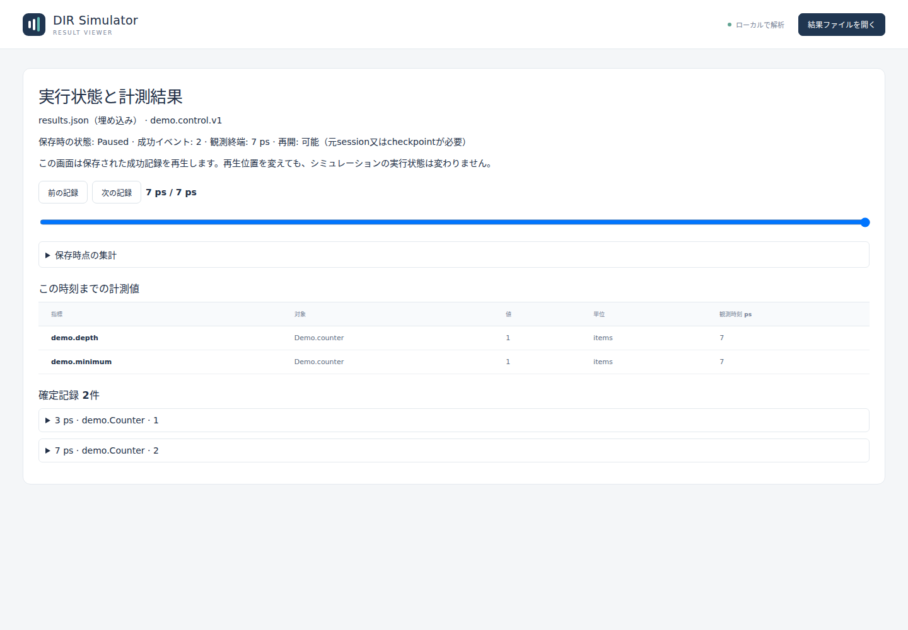
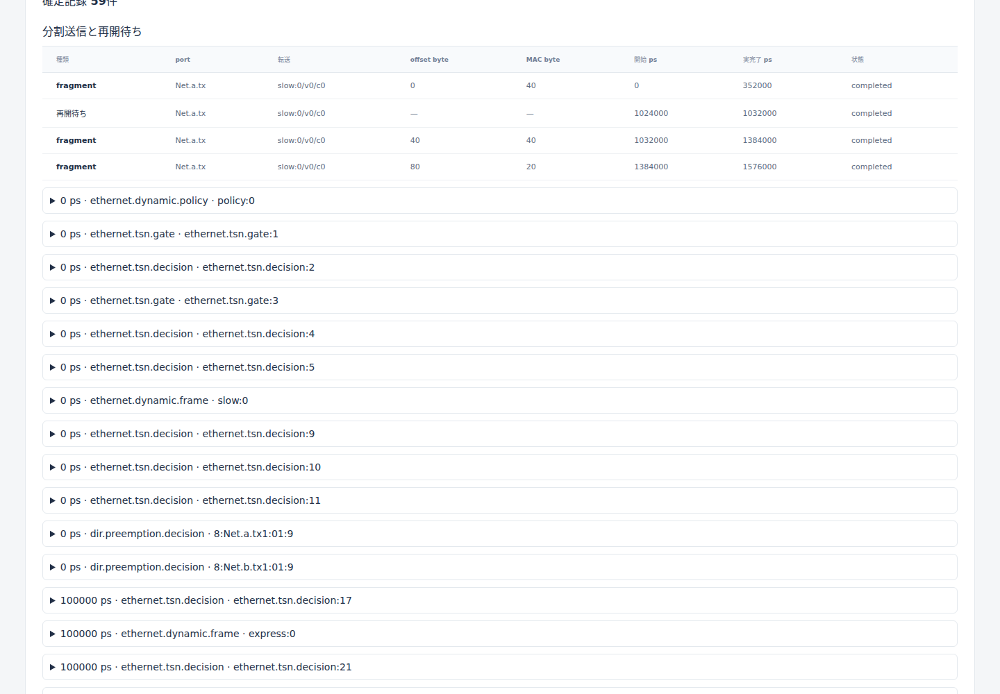
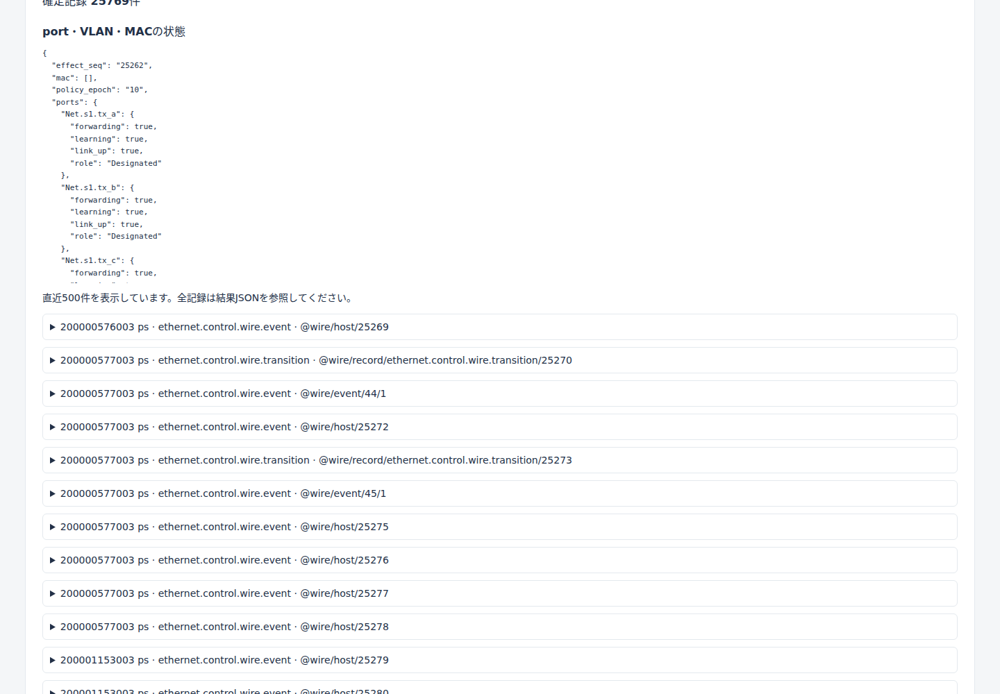

# 後続10分野の現行実装と利用境界

文書バージョン：`1.1.0`
対象GitHubバージョン：`v1.1.6`
文書ID：`guide-reference-extension-adoption`
文書状態：承認済み限定scopeを実装済み。製品受入の最終判定は製品検証記録。

### 更新履歴

| 文書バージョン | 更新日 | 更新内容 |
| --- | --- | --- |
| `1.1.0` | `2026-10-17` | 初版。承認済み10分野の正式採用と現行限定実装の境界を統合。v1.1.6収録版 |

2026-10-17作業記録：10分野の設定・API・利用例・観測境界を現在のソースに合わせて統合した。文書版・履歴は本pushの改訂として確定した。

[正式採用仕様](#source-ref-1)、[詳細設計](#source-ref-2)、[検証仕様](#source-ref-3)が正式DIR要件0256〜0282への入口である。既存P-IDと設計vectorは保持する。`design_ready=true`は限定設計の引継ぎ可を示す。現行ソースの実装、公開済みrelease、製品試験合格、標準適合は別の判定である。

実際の検証範囲・件数・環境・残件は、製品検証の実行範囲を記録する[製品検証記録](#source-ref-4)と[JSON](#source-ref-5)を参照する。この追補や既存の撮影画像は新機能の全条件合格を宣言しない。第三者PDFの出典・checksum記録も規格全体適合を証明しない。

## profileと選択範囲

既存16 builtinに次の4件を追加し、現行Registryは20件となる。INIでは一つの`model-profile`を明示し、`model-config`と`workload`をINIからの相対パスで指定する。任意のprofile配列や暗黙合成は受理しない。既定`can.cc.ideal.v1`、既存同期run、V1計測とschema1/2は従来の選択を保つ。

| profile / 能力 | 対応する動作 | 設定・scopeの正本 | 主な境界 |
| --- | --- | --- | --- |
| `can.ethernet.tsn.v1` | Classical CAN・変換・dynamic Ethernet・TAS/CBS/PSFPを一FESへ接続 | [合成S01〜03](#source-ref-6) | 一つのEthernet所有。PSFPは変換offer時一回。容量待ちとgate/credit待ちを区別 |
| `ethernet.redundancy.abstract.v1` | 複製枝の独立送信と有限履歴による除去 | [冗長S01〜03](#source-ref-7) | 単一talker・一複製点・一除去点・静的2〜16経路。非巡回u64 sequence。IEEE FRER/R-TAGは対象外 |
| `ethernet.preemption.abstract.v1` | fragment境界のexpress割込みと一frameの再開 | [分割S01〜03](#source-ref-8) | 全二重。fragment overhead/gapを明示。MAC Merge/SMD/verify handshake、preemptable CBS、半二重は対象外 |
| `ethernet.control.wire.experimental.v1` | 受動IGMP/MLDと能動RSTP/MVRPのadapter union | [共通wire](#source-ref-9) | wireとTSN/Gateway/冗長/preemptionの合成は拒否。所有が重なるabstract操作も拒否 |
| `cooperative_control` | RunSessionによるPause/Resume/Stop/Export | [制御設計](#source-ref-10) | 汎用registeredとnetwork系7 builtin。専用engineはUnsupportedCapability |
| `metrics_v2` | 整数point/gauge・指定集計・窓 | [計測設計](#source-ref-11) | schema3と明示catalogを持つ登録profile。network builtinはV2能力を宣言しない |
| `checkpoint` | 停止状態を同一binaryの新processへ移す | [保存設計](#source-ref-12) | 全Model/Channelのcodecがある汎用registeredだけ。network checkpointはUnsupportedCapability |

network系7 builtinはdynamic、TSN、既存CAN↔Ethernet変換と上記4件である。協調制御の宣言から永続保存対応を推測しない。モデル作者は自分の登録profileの能力を明示する。

## 設定を変更する場所

| 対象 | model-config / API | workload・既定値・制限 |
| --- | --- | --- |
| 合成 | `schema_name=dir.can_ethernet_tsn.config`、`schema_version=1`、`bridge/ethernet/tsn/limits` | 変換workloadの`schema_version=1/can/ethernet`を使用。完全な入力は[composite例](#source-ref-13)と[workload](#source-ref-14)。bridgeへEthernetを二重定義しない |
| 冗長 | `dir.ethernet_redundancy.config`、版1、`base={profile:ethernet.tsn.v1,config:…}`、`replication/limits` | dynamic workload4、`controls=[]`。streamsのsource_generator/replicate_at/eliminate_at/history_capacity/egress_pathsを明示 |
| 分割 | `dir.ethernet_preemption.config`、版1、同じTSN base、`preemption/limits` | dynamic workload4、`controls=[]`。portごとのclass分割、fragment量・overhead・resume gapは[完全例](#source-ref-15)を参照 |
| wire | exact rootは`schema_name/schema_version/ethernet/port_identities/adapters` | `dir.ethernet_control_wire.workload`版1の`ethernet/packets`。packetは`adapter_id/ingress_port/arrival_ps/encapsulation/bytes_hex`とprotocol別field。未知field/null/未知revisionを拒否 |
| RunOptions | `max_exports=1024`、`checkpoint_enabled=false` | max_exportsは正u32、mailboxは固定64枠。要求はownerがdrive/pollした境界で処理 |
| MetricV2Limits | `max_metric_targets=1024`、`max_observations_per_batch=65536` | いずれも正u32。targetは凍結モデル実体。pointの初期gauge指定を拒否、gaugeは全targetの初期値必須 |
| CheckpointLimits | `max_total_bytes=1073741824`、`max_files=100000`、`max_blob_bytes=268435456`、`max_fes_entries=1000000` | 全て正、blob≤total。APIはRust整数、JSONのu64量は十進文字列、max_files/max_fes_entriesはJSON整数 |

全必須field・型・範囲・省略・0・未知値の扱いは上表からリンクする規範S項目を正とする。サンプル値を省略時の既定値とみなさない。時刻u64 psは正規十進文字列、priority/VIDなど明示JSON整数はboolを受理しない。新network limitsの`max_pending_branches/max_control_events`は明示正u32であり、暗黙defaultを置かない。

IGMP/MLDはRFC9776/9777のReport/Queryを受ける保守的な受動snooperで、host/listener/router生成、querier選出を提供しない。control inputのIP envelope/checksumだけを検証し、通常multicastデータは既存`ip_multicast` metadataを用いる。

RSTPは選択したIEEE 802.1Q-2022 CIST、ForceProtocolVersion=2、全二重point-to-point customer bridgeを対象とする。旧STP受信互換とmigrationの限定機械を含める。shared LAN、MSTI/region、provider bridgeは対象外。[RSTP規範補足](#source-ref-16)の設定と状態表を正とし、wire RSTPを含むrunでは`ethernet.dynamic.convergence_ps="0"`を要求する。

MVRPはcontext 0、customer bridge FullParticipantのApplicant/Registrar/LeaveAll/Periodic/MAPを対象とする。物理連結領域の全bridgeに一instanceずつ、各bridgeの全接続portへの配置を要求し、部分配置と非対応bridge relayを拒否する。local declarationだけでデータ受信を許可しない。管理・timer・VID1..4094の契約は[MVRP規範補足](#source-ref-17)を参照する。

## リポジトリrootからの実行

各出力先は未作成のものを使用する。入力JSON/NEDはINIが参照するので、サンプルを移動する場合は相対パスも保持する。

```sh
cargo run --locked -p dir-simulator -- run --config examples/network-extensions/composite.ini --output /tmp/dir-ext-composite
cargo run --locked -p dir-simulator -- run --config examples/network-extensions/redundancy.ini --output /tmp/dir-ext-redundancy
cargo run --locked -p dir-simulator -- run --config examples/network-extensions/preemption.ini --output /tmp/dir-ext-preemption
cargo run --locked -p dir-simulator -- run --config examples/ethernet-wire/active.ini --output /tmp/dir-ext-active
cargo run --locked -p dir-simulator -- run --config examples/ethernet-wire/passive.ini --output /tmp/dir-ext-passive
cargo run --locked -p dir-simulator -- view --input /tmp/dir-ext-active/results.json --output /tmp/dir-ext-active-viewer.html
```

checkpointは独自codecを登録する同梱exampleを使う。通常CLIの`run`にsave/restore flagsを追加する形式ではない。

```sh
cargo build --locked -p dir-simulator --example control_checkpoint
target/debug/examples/control_checkpoint run examples/control-checkpoint/scenario.ini /tmp/dir-control-baseline
target/debug/examples/control_checkpoint save examples/control-checkpoint/scenario.ini /tmp/dir-control-saved
target/debug/examples/control_checkpoint restore /tmp/dir-control-saved
cargo run --locked -p dir-simulator -- view --input /tmp/dir-control-saved/restored/results.json --output /tmp/dir-control-restored-viewer.html
```

`save CONFIG OUTPUT_ROOT`は`OUTPUT_ROOT/paused`へ結果をexportし、`OUTPUT_ROOT/checkpoint`へbundleを保存してprocessを終了する。`restore OUTPUT_ROOT`は同じbinaryの新processからbundleを検査し、新tokenで再開して`OUTPUT_ROOT/restored`へ結果を保存する。`run CONFIG OUTPUT_ROOT`は比較用の`OUTPUT_ROOT/completed`を作る。途中で再buildするとbinary照合が失敗し得る。ResumeTokenやresults.jsonだけで別processへ復元しない。

<a id="api"></a>

## 現在の公開API

型は[`dir_simulator::registry`](#source-ref-18)と[`dir_simulator::runtime::session`](#source-ref-19)から利用する。新descriptor/codec/capabilityは別登録であり、既存ModuleDescriptor/ChannelDescriptor/ProfileDescriptorに必須fieldを追加しない。Model/Channelの`checkpoint(&CheckpointEncodeContext)`は既定Unsupportedの任意hookで、旧trait実装を維持する。

| API | 入出力・責務 |
| --- | --- |
| `Registry::register_execution_capabilities(profile, ExecutionCapabilities)` | `cooperative_control/metrics_v2/checkpoint`を明示。未登録は全false。checkpointには制御能力必須 |
| `Registry::register_metric_v2(descriptor, targets, initial_gauges)` / `set_metric_v2_limits` | `MetricDescriptorV2{name,unit,version,value_kind,sampling,aggregation}`。integer、pointはidentity/sum/count/min/max/mean、gaugeはtime_mean |
| `Context::observe_point_u64(name,target,value)` / `set_gauge_u64` | samplingとtarget所有を照合し、成功callbackのeffectとして確定。checked u128の和・積分と正確比率を保持 |
| `Registry::register_model_checkpoint_codec(descriptor, restore)` / `register_channel_checkpoint_codec` | implementation key/version・codec name/version・external_state=`none`・max_bytesを凍結。restore factoryは`(config, codec_version, bytes, &CheckpointDecodeContext)` |
| `CheckpointEncodeContext::encode_timer_ref` / `CheckpointDecodeContext::decode_timer_ref` | TimerTokenのlive/retiredとowner/idを照合。通常scheduleでtokenを再発行しない |
| `RunSession::new(prepared, RunOptions)` | `Result<(RunSession,Controller),ControlError>`。preparedはArcへ変換可能。未対応backend/capabilityはUnsupportedCapability |
| `Controller::submit` / `retry` / `ack` / `forget` | 有限要求slot・同ID再試行・ack取得を管理。別threadへControllerを渡せるが自動workerは作らない。直接Exportをsubmitする場合destinationは絶対パス |
| `run_until_yield` / `advance_one` / `poll_control` | ownerが成功境界まで駆動。Paused中もpollなしでは要求完了の保証なし |
| `state` / `snapshot` / `prepared` / `pause_token` / `replay_log` | 現在状態・成功prefix・process内token・境界記録を取得 |
| `resume(token)` / `export(&Path)` / `export_with_root(root,destination)` | 新世代tokenを一回消費。exportの相対先はsessionの固定rootから解決。明示rootは絶対パス |
| `checkpoint(&Path,CheckpointLimits)` / `checkpoint_with_handle` | Pausedかつcheckpoint_enabledで保存。後者は`(RequestHandle,ControlAck)`を返し、同じmailbox要求の再試行・ack取得に使えるhandleを保持する |
| `restore_checkpoint(path,registry,limits)` | `Result<(RunSession,ResumeToken),ControlError>`。同一binary bytes・入力・Registry・codec版・hash・上限を照合し、initializeを再実行せずPausedで復元 |
| `run_with_control(session)` | `Result<(RunSession,RunState,Option<ResumeToken>),ControlError>`を返す便宜入口 |
| `replay_with_control(prepared,options,&[ReplayEntry])` | 記録したcommit ordinal/boundary/要求順を再演。Export/Checkpointの論理destinationは維持し、実I/Oは新しい専用directoryへ分離 |
| `RunSession::replay_artifact_root()` | 再演artifactの`Option<&Path>`。Drop後も保持されるので必要に応じ呼出側で削除。元のartifactを上書きしない。元環境に依存するI/O失敗は再現不一致になり得る |
| `close()` / Drop | 初期化成功Modelと生成成功Channelへcleanupを一回実施し、tokenを無効化。closeは冪等 |

Checkpointの新規要求はowner側の`RunSession::checkpoint`又は`RunSession::checkpoint_with_handle`で行います。`Controller::submit(ControlCommand::Checkpoint)`はowner専用操作として拒否します。`Controller::retry`は既に発行済みの要求handleの再試行に使用します。

`RunState`はReady/Initializing/Running/Paused/Exporting/Stopped/Completed/Failed/Closed。Pauseは再開可能、Stopは終端で再開不可。Pause/Stop自体ではcleanupを呼ばず、自然終端・失敗・close/Dropで一回処理する。Completed/Failed/Stoppedからexportできるが、Ready/RunningのexportはInvalidState。同一境界では失敗とStopの優先規則を適用し、実callback途中のsnapshotを公開しない。

ackの`request_id/control_seq/boundary_seq/boundary_kind/commit_ordinal/virtual_time_ps/state/status`で受付と適用を区別する。`status`はApplied/Pending/Superseded/InvalidState/Busy/EngineFailed/SessionClosed/ResourceExhausted。受付成功は操作成功ではなく、ackのstatusとerrorを確認する。

保存backendは現行ではUnix向けで、directoryのfsyncと置換なしrenameに対応するfilesystemが必要。非Unixや必要な耐久性操作を提供しない環境では`DurabilityUnsupported`として保存を拒否する。今回の実行検証環境はLinuxである。保存は既存destinationを置換せず、stagingから原子的に公開する。receiptのDurableとPublishedDurabilityUnknownを区別する。stateにはFES・next IDs・live/retired timer参照・journal・計測積分器・最後の成功順序`last_committed_key`と入力探索集合`input_directories`も保存する。破損・差分・codec不足・上限超過では復元実行を開始しない。

## 結果とViewerで確認できるもの

通常network拡張runはschema2、制御exportとV2登録profileはschema3を使う。結果の`simulation.model_records`はprofile別schema catalogと実績prefixを持つ。network hostが付ける`data.effect_seq`は正準十進u64文字列で、同時刻の確定順を表す。制御exportは`control`のversion/session_id/export_ordinal/state/commit_ordinal/horizon_ps/pending_events/resume_supported/replay_sha256を追加する。tokenやcodec秘密状態は結果JSONへ公開しない。exportは再開用bundleではない。

Metric V2は`metadata.metrics_v2`、整数観測record、summary/global/windowと既存列を保つCSVへ投影する。未観測の凍結targetもsummaryへ出し、母数0の平均はnull。gaugeは右連続、同時刻変更は成功effect順、H点のpoint観測と半開windowへの算入を区別する。

Viewerは4追加profileのschema2と登録/controlled schema3を受理し、control状態・event/record・metric・実績区間を表示する。Pause/ResumeをViewerからengineへ送る操作画面ではなく、保存済み結果を読む。networkのqueued/started/completed TX、packet boundary RX、policy/state transition、冗長branch/recovery/origin、preemption fragment/gap/frame完了は別の事実として読む。候補portや予定EOFを実受信へ補完しない。partial/停止結果では未完了fragment・転送・requestをそのまま残す。冗長配送の巻戻しは`metadata.network_runtime.redundancy.transfer_circuits`に保存した実際の枝・転送・hop対応を使う。preemptable転送の最終予定EOFは最終fragmentの開始後だけ表示し、fragment/gap参照も再生時刻までに生成されたものへ絞る。受信は`observed_ps`、配送機会は参照元frameの生成時刻から表示し、後の中継・受信完了を先取りしない。Viewerの表示対応と、製品・画面検証の実施範囲は区別する。wire遷移の変数名・型・機械別scopeは`docs/proposals/implementation/wire遷移公開catalog.md`を参照する。大きなID・counter・priority tupleは十進文字列で保持する。

## 実画面の読み方

次の画像は実際の`results.json`からRust CLIで書き出したHTMLをChromiumで表示し、viewportを直接撮影したもの。入力・exporter・HTML・画像のSHA-256と撮影条件は[画像証跡](../assets/reference/extensions/screenshot-evidence.json)に残す。保存終端Hの表示例であり、全条件の合格数や全規格適合を表さない。



Pausedの例では、成功eventが2件、Hが7psで、同時刻のgauge値を表示している。「再開可能」は元sessionかcheckpointを使用する意味で、結果HTMLから再開を要求する操作ではない。



100byteを40・40・20byteへ分割した実績。初回fragmentの完了後、express送信を待ち、1024000〜1032000psの再開待ちを経て続きが送られる。実完了欄が空なら未完了であり、予定時刻で補完しない。



portごとの`learning/forwarding/role/link_up`と共通`policy_epoch`を表示する。JSON領域はスクロールして残りのport・VID・MAC表を確認できる。直近500件の詳細表示から省略された全記録は元の結果JSONに保持する。

<a id="source-contracts"></a>

## 正本・ソース・入力の参照表

このガイドsiteは`docs/guide`を公開範囲とする。site外の正本と対応ソースは、リポジトリrootからのパスを以下に示す。正式traceと詳細仕様の参照リンクはcheckout内の正本文書から確認できる。製品記録の2ファイルは製品検証の実行範囲を記録する。

| 参照 | リポジトリrootからのパス・固定アンカー |
| --- | --- |
| <a id="source-ref-1"></a>1 | `docs/specs/後続拡張採用詳細機能仕様書.md` |
| <a id="source-ref-2"></a>2 | `docs/design/後続拡張採用詳細設計書.md` |
| <a id="source-ref-3"></a>3 | `docs/verification/cases/後続拡張採用検証仕様書.md` |
| <a id="source-ref-4"></a>4 | `docs/verification/results/extension-product-2026-10-17.md` |
| <a id="source-ref-5"></a>5 | `docs/verification/results/extension-product-2026-10-17.json` |
| <a id="source-ref-6"></a>6 | `docs/proposals/implementation/ネットワーク後続拡張実装設計書.md#p-composite-s01` |
| <a id="source-ref-7"></a>7 | `docs/proposals/implementation/ネットワーク後続拡張実装設計書.md#p-replication-s01` |
| <a id="source-ref-8"></a>8 | `docs/proposals/implementation/ネットワーク後続拡張実装設計書.md#p-preemption-s01` |
| <a id="source-ref-9"></a>9 | `docs/proposals/後続拡張契約提案仕様書.md#wire` |
| <a id="source-ref-10"></a>10 | `docs/proposals/implementation/実行制御・指標・checkpoint実装設計書.md#p-control-s01` |
| <a id="source-ref-11"></a>11 | `docs/proposals/implementation/実行制御・指標・checkpoint実装設計書.md#p-metric-s01` |
| <a id="source-ref-12"></a>12 | `docs/proposals/implementation/実行制御・指標・checkpoint実装設計書.md#p-checkpoint-s01` |
| <a id="source-ref-13"></a>13 | `examples/network-extensions/composite-model.json` |
| <a id="source-ref-14"></a>14 | `examples/network-extensions/composite-workload.json` |
| <a id="source-ref-15"></a>15 | `examples/network-extensions/preemption-model.json` |
| <a id="source-ref-16"></a>16 | `docs/proposals/implementation/RSTP規範仕様・詳細設計書.md` |
| <a id="source-ref-17"></a>17 | `docs/proposals/implementation/MVRP規範仕様・詳細設計書.md` |
| <a id="source-ref-18"></a>18 | `crates/dir-simulator/src/registry/extensions.rs` |
| <a id="source-ref-19"></a>19 | `crates/dir-simulator/src/runtime/session.rs` |
