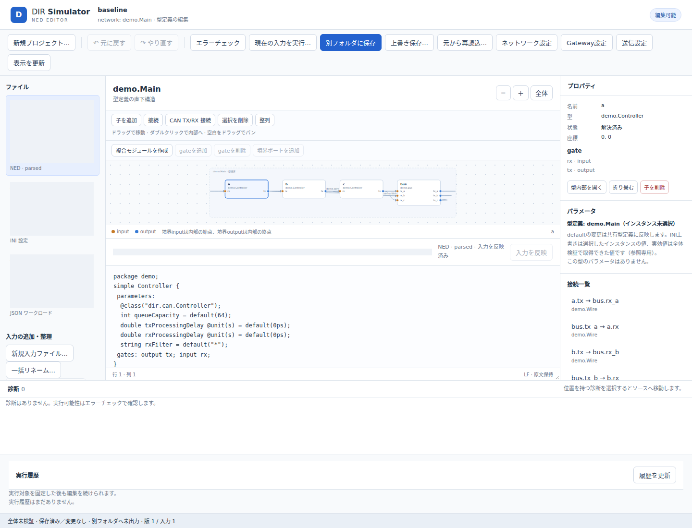
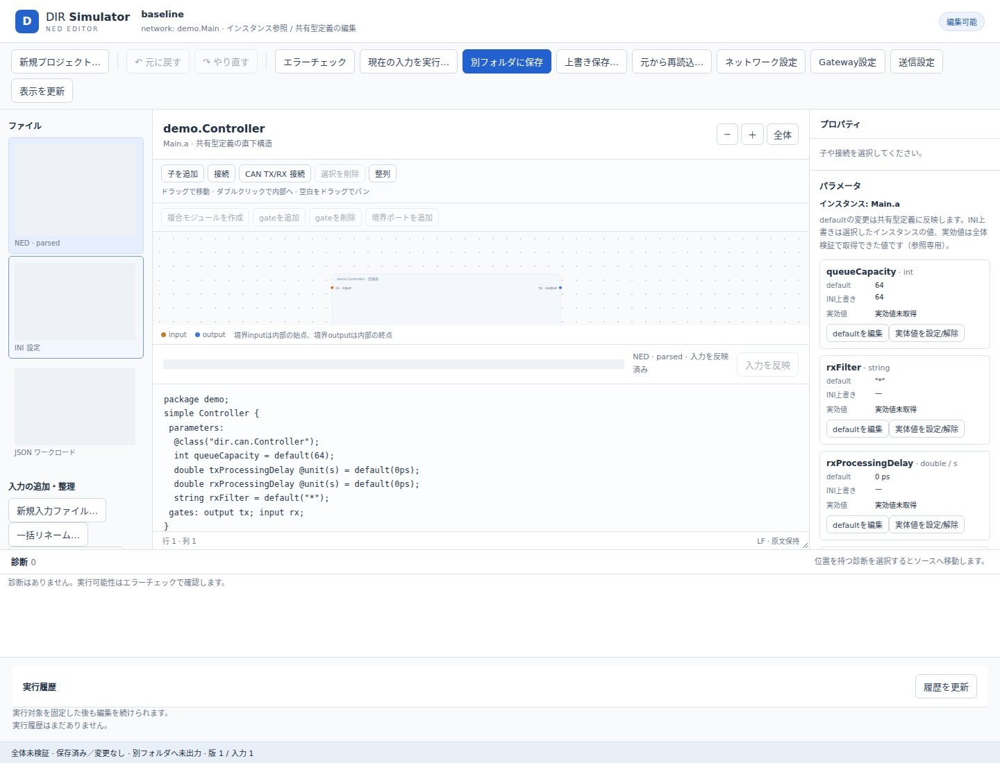
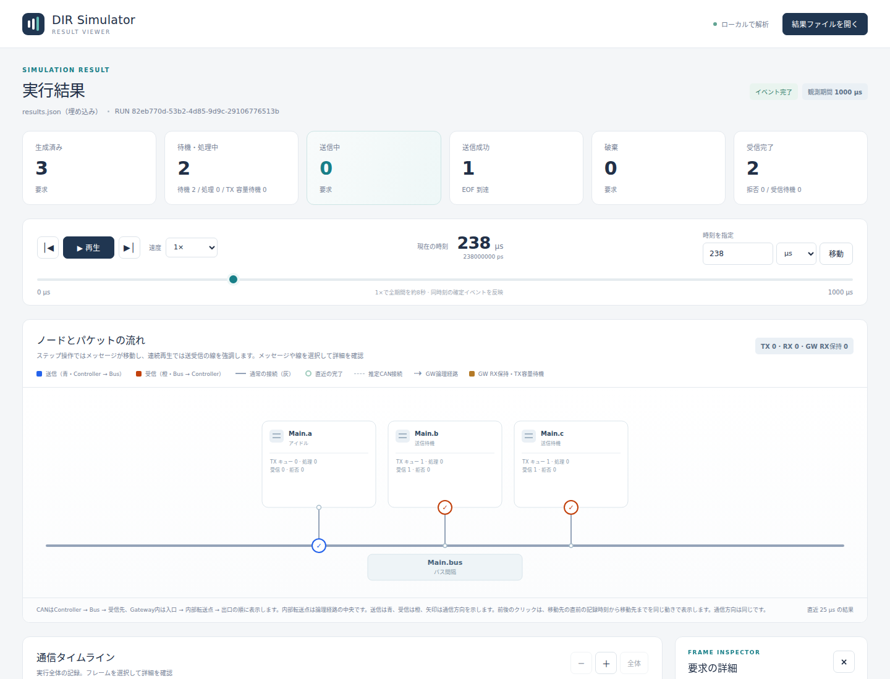
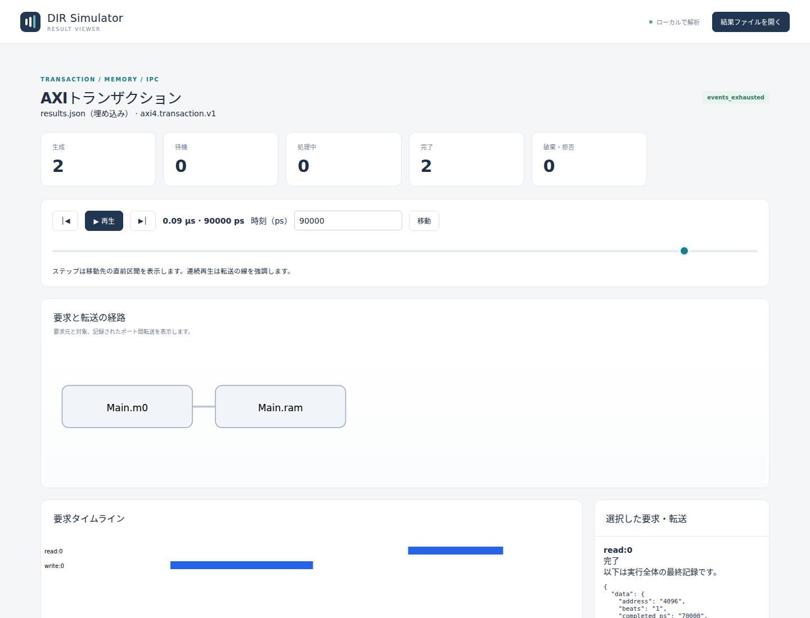

# 画面操作の機能・動作仕様

文書バージョン：`1.1.0`
対象GitHubバージョン：`main @ c67e153cc3bcf1f6ac0303d23023ce8ae4a4f533`
収録リリース：`v1.1.6`（本文・画像の調査基準は上記commitを維持）
 
文書ID：`guide-reference-ui`
 
文書状態：仕様検討用資料。図は公開サンプルを基準ソースで表示した実画面。

### 更新履歴

| 文書バージョン | 更新日 | 更新内容 |
| --- | --- | --- |
| `1.1.0` | `2026-10-17` | 初版。編集、保存、整理、実行、結果閲覧の機能と操作後の動作を整理。v1.1.6へ収録し、本文・画像の調査基準を維持 |

[全体の入口](DIR機能・動作仕様ガイド.md)／[共通基盤](共通基盤の機能・動作仕様.md)。NEDエディタは入力を作る画面、Viewerは保存した結果を読む画面である。Viewerの再生はシミュレータの再実行ではない。

## プロジェクトの作成・読み込み・構造表示

### 概要

**機能仕様：** 新しいCAN／Multibusプロジェクトを作るか既存INIを開き、ファイル・型・配置した実体・構成図を往復して編集する。

**動作仕様：** 起動時に入力一式をメモリへ読み取る。その後の編集はこの内部モデルに作用し、保存するまでは元ファイルを変更しない。外部で変更したファイルは再読込するまで反映されない。

図の読み方：ファイルは原文の単位、型は部品の定義、実体はnetworkに配置した個体。構成図のgate方向と、CANの送信・受信の意味を区別して読む。図では個人環境の絶対path部分だけをマスクしている。撮影条件・hashは[画像証跡](../assets/reference/screenshot-evidence.json)に記録する。

### 詳細

**機能仕様：** 起動と保存・復旧の場所は次の設定で決まる。

| 設定・操作 | 場所／既定 | 固定動作・制約 |
| --- | --- | --- |
| `--config` | CLI、省略可 | 省略時は内部MultibusテンプレートのUntitled。初期入力ファイルは作らない |
| `--export-root` | CLI、省略時は起動ディレクトリ | 保存先の親。UIではその内側の相対保存先を指定 |
| `--state-root` | CLI、省略時は`${XDG_STATE_HOME:-~/.local/state}/dir-simulator/ned-editor` | 復旧記録・run管理用。入力フォルダの内側は避ける |
| 新規プロジェクト | UIの名前・テンプレート | 単一CAN、Multibus、Gateway例、空のMultibus。名前はASCII識別子 |
| 待受け | 利用者設定なし | `127.0.0.1`の空きポート。起動端末に出たセッションURLを開く |

**動作仕様：** 新規作成時は前の編集を破棄するか確認し、履歴を初期化する。入力NEDの構文不正は読み込みを拒否するが、接続不足などの意味エラーは開いてから修正できる。構文を壊した編集中は最後の正常な図を「古い図」として残し、構造編集を止めて原文での修正を可能にする。選択・ズーム・スクロールだけでは未保存変更にならない。

**変更判断：** リモート共有編集、Ethernet等の専用テンプレート、任意ファイルを自由に追加するIDEを必要とする場合は追加設計が必要。現在の標準フォーム・部品群はClassical CAN／Gateway中心であり、シミュレータの全profileが同じGUI編集能力を持つとは限らない。

参照：[エディタ仕様][editor-spec]、[取扱説明書][editor-manual]、[起動server][server]、[template実装][template]、[ブラウザ試験][editor-browser]。

## 原文・構成図・設定フォームの編集

### 概要

**機能仕様：** 原文を直接編集するほか、部品の追加、接続、配置、実行条件、送信、Gateway経路をフォームで設定できる。

**動作仕様：** UI操作をNED／INI／JSONへ反映し、同じ内部原文を検証・保存・実行へ渡す。型defaultの変更はその型を使う全実体に影響し、INI実体値は指定した実体だけに影響する。

図ではMain.aのパラメータ欄と共有型の原文を示す。`queueCapacity`のdefaultとINI上書きはいずれも64で、撮影時の実効値欄は「実効値未取得」である。実効値は全体検証で取得するため、表示中の入力値と検証済み実効値を区別する。設定値がモデルの物理条件なのか、仮想実行期間なのか、画面の配置情報なのかも区別する。

### 詳細

**機能仕様：** 以下はユーザーが直接変えられる項目。

| 機能 | 入力・保存場所 | 適用範囲・制約 |
| --- | --- | --- |
| 原文編集 | NED／INI／JSON内部原文 | 日本語IME確定後に反映。未確定の変換文字列を送信しない |
| 部品追加・削除 | NEDの宣言・submodules | Controller/Bus/Multibus/Gateway/Fanout等。必要な標準定義を取り込む |
| 結線 | NED connections | CANペアはTX/RXの2本を一操作で追加。使用中gateや方向不正を拒否 |
| 複合部品・境界gate | NED module、内部子・辺 | 親と内部の接続を整合させる。接続中gateの削除を拒否 |
| default literal | NED parameter | 同じ型の全利用箇所へ影響 |
| 実体値の設定・解除 | INI完全pathキー | 空欄で上書き解除、NED defaultへ戻る |
| ネットワーク設定 | INI | 仮想実行時間、窓、イベント上限等 |
| 送信設定 | workload JSON | explicit/periodic、CAN ID、最大8byteのデータ等。FD専用フォームではない |
| Gateway設定 | model-config JSON | Controllerのport対応、入口・複数出口、delay、hop、RX容量等 |
| 配置・折り畳み等 | `*.ned.layout.json` | 表示情報。物理的な距離やリンク遅延を変更しない |

**動作仕様：** 単一CANにMultibus専用部品を追加する場合、確認後に既存型の実装とINIのprofileを合わせ、必要な経路JSONを追加する。既存値とgate名は保ち、追加部品の外部結線は利用者が完成させる。元にないファイルが増えた場合は別フォルダ保存を使う。

不明なJSON項目や重複キーをフォームで黙って捨てない。構築途中の未接続は編集可能だが、全体検証に通らなければ保存できない。未送信入力がある間の保存・検証・実行は、その反映を待つ。遅れて返った応答で新しい入力を巻き戻さない。

**固定値：** Undo／Redoは最大200操作、保持する差分は32MiBまで（`model.rs`）。保存後は同じセッションの履歴を利用できるが、再読込で初期化する。これらはUIの設定項目ではない。

**変更判断：** defaultと実体値を一つのフォームへ統合するなら適用範囲を明示する。履歴拡大はメモリ上限、原文同期、削除・新規ファイルの取り消しを一緒に検証する。

参照：[エディタ仕様][editor-spec]、[modelと履歴][editor-model]、[編集コマンド][commands]、[画面実装][editor-view]、[テンプレート][template]。

## 入力の追加・型の独立化・一括リネーム

### 概要

**機能仕様：** 新規NEDや欠けた設定JSONの作成、一つの実体だけに固有な型の複製、参照を含む名前変更を提供する。

**動作仕様：** まず変更計画を作り、旧新の原文と影響箇所を表示する。確認して適用すると一まとまりの編集になる。適用前に元内容が変わった計画はそのまま実行しない。

### 詳細

**機能仕様：** 操作別の範囲は次の通り。

| 操作 | 設定するもの | 固定境界・失敗条件 |
| --- | --- | --- |
| 新規入力 | NED root、`demo/NewType.ned`等の相対名、型名、LF/CRLF、BOM | 絶対path、`..`、root直下packageなし、既存名衝突を拒否。作成直後はメモリ内だけ |
| 欠落JSON | workload／Multibus model-config、INI参照 | 既存JSON交換、二つ目のINI、binary、任意ファイル管理の機能ではない |
| 型独立化 | 対象simple/module実体、新型名、既存または新規NED | root network/channelは対象外。必要な共有祖先も複製 |
| 一括リネーム | owner＋type/child/gate/parameter＋新名 | package変更は対象外。最終衝突を拒否。相互入替やcycleは一つの計画にまとめる |

**動作仕様：** `Main.a`と`Main.b`が同じRack型の場合、`Main.a.unit`だけの型独立化では必要なRackも複製し、b側を元の型に保つ。内部子型を無条件で全て再帰複製する操作ではない。

childの名前変更はその型を使う全配置の子孫pathにも影響するため、INI、Channel節、対応JSON、配置参照を更新する。単なる文字列置換とは異なり、comment、payload、説明文、generator/route ID、`@class`を同じ名前だからという理由で変更しない。標準実装が要求する固定gate/parameter名の変更は共通prepareで拒否され得る。

**固定値：** 計画保持量64MiB、計画の有効期間600秒（`refactor.rs`）。未対応profile/schema、曖昧な参照、layout修復が必要な入力を推測して変更しない。

**変更判断：** 一つの実体だけを変えたい場合は型独立化、全利用箇所で名称を揃えたい場合は一括リネーム。package移動やファイル削除を追加するなら、読み込みroot、参照、保存集合、復旧を含めた設計が必要。

参照：[エディタ仕様の拡張設計][editor-spec]、[refactor][refactor]、[symbol操作][symbols]、[file creation][file-creation]、[拡張ブラウザ試験][extensions-browser]。

## 保存・競合検出・復旧

### 概要

**機能仕様：** 検証済み入力一式を別フォルダへ保存し、登録済みの保存先へ明示上書きできる。途中失敗を検出して保存完了または元への復元を行う。

**動作仕様：** 保存予定の一式を検証し、確認時の原文・対象ファイルと一致することを確認して書く。外部変更を検出したら拒否する。複数ファイルが一回のOS操作で同時に置き換わるわけではないため、途中状態には復旧記録を使う。

### 詳細

**機能仕様：** 別フォルダ保存の出力はINI=`project.ini`、NED=`ned/0001/`以降、workload=`data/workload.json`、model-config=`data/model-config.json`、layout=対応NED隣。INI参照を出力先の構造に合わせて調整する。

**動作仕様：** 元入力を削除しても取得済み内部原文から別フォルダ保存できる。新しいファイルを追加して保存集合が違う場合は、既存保存先の上書きを拒否する。Undoは保存済みディスクのファイルを消す操作にはならない。最初のタブが編集権を持ち、別タブは閲覧専用。編集権の移動を保存途中に行わない。

| 状態 | 画面・利用者の操作 | 製品の動作 |
| --- | --- | --- |
| 通常保存 | 別フォルダまたは登録先を選択 | 全体prepare後、確認対象の変更を検査して書込み |
| 競合 | 再読込・保存先変更等を判断 | 外部更新や新NEDを勝手に上書き・削除しない |
| 復旧待ち | 保存完了または元へ復元を選択 | journalのbefore/afterに合う場合だけ進める |
| `finalizing` | 保存完了を再試行 | 確定情報・backup回収を完了。復旧方向を反転しない |
| `invalid` | 診断と記録を確認 | 所有や内容が合わなければ編集・復旧を停止し原状を保持 |

**固定条件：** symlinkをたどらず、descriptor基準の操作・fsync・所有情報を用いる。自動保存間隔や外部編集の自動取り込みの設定は提供しない。

**変更判断：** 無確認上書き、ファイル集合の増減、自動保存を望む場合は、競合時の優先側と復旧後の完成条件が必要。保存の復旧とシミュレーションの途中再開は別機能。

参照：[エディタ仕様][editor-spec]、[保存実装][save]、[復旧実装][recovery]、[保存対応表の回帰試験][mapping-tests]。

## 未保存入力の実行・停止・結果管理

### 概要

**機能仕様：** 編集中の内容を保存せず実行し、そのときの入力と結果を対応付ける。別の編集を続けながら実行状態を確認できる。

**動作仕様：** 全入力の反映後にsnapshotを固定し、待機→準備→実行→結果照合→終端状態へ進む。実行後に入力を変更すると過去の入力の結果と表示する。現在の原文・Undo履歴を実行時へ自動で戻さない。

### 詳細

**機能仕様：** 画面の実時間上限は1～3600秒、既定600秒。INIの仮想`sim-time-limit`とは別。worker開始からprepare/simulate/exportを測り、待機時間は含めない。

| 項目 | 現行値 | 変更場所・意味 |
| --- | --- | --- |
| 同時実行／待機 | 1 worker／2 run | `run_control.rs`に固定。複数タブで枠が増えるものではない |
| 固定入力 | 1 run 256MiB・10000ファイル | `run_snapshot.rs`に固定 |
| active固定入力合計 | 512MiB | `PIN_LIMIT`に固定。Undo保持容量と別 |
| worker address space | 4GiB | `worker.rs`のOS hard上限。物理RAM消費量の保証ではない |
| 単一出力ファイル | 1GiB | OS hard上限 |
| run領域／全runs | 2GiB／10GiB | 受付確認＋1秒ごとのsoft監視。一時超過を防ぐquotaではない |
| 停止猶予 | SIGTERM後2秒でSIGKILL | 固定。協調的なsnapshot保存・再開機能ではない |

**動作仕様：** 「実行対象の固定」の応答は受付完了で、計算完了ではない。出典画面からrevision、run ID、固定原文、hashを確認する。進捗率や実行中の確定イベント数を推測して表示しない。準備失敗は原文を保持して止まり、シミュレーション結果を作らない。

停止ボタンは停止要求を出す。manifestが未公開なら残骸を結果として開かない。既に公開されている完全な結果は照合後に残せる。再起動時に公開済み結果を回復する一方、未公開のactive/queued runを自動再実行しない。停止後の部分exportや途中Resumeは現在の保証に含まれない。

**変更判断：** 多数の実験を並列実行したい場合はworker数だけでなく入力保持量、ディスク、公平な待ち順、停止と回収を決める。libraryで長時間実行を再開する場合は[実装済みRunSessionとgeneric checkpoint](後続10分野の現行実装と利用境界.md)を明示利用する。エディタのworker停止操作には自動接続しない。

参照：[実行管理][run-control]、[snapshot][run-snapshot]、[worker上限][worker]、[エディタ仕様][editor-spec]、[拡張ブラウザ試験][extensions-browser]。

## エディタからのViewer・ダウンロード・削除

### 概要

**機能仕様：** 照合済みrunからViewerを開き、結果ファイルや出典を取得し、不要な終端runを削除する。

**動作仕様：** manifest、hash、run identity、入力出典の照合後に取得操作を可能にする。Viewerは別originのloopbackサーバーで表示し、編集画面の権限を渡さない。

### 詳細

**機能仕様：** Viewerリンクは発行から1時間有効。期限切れ・明示失効・サービス再起動で無効になる。Viewer生成は4GiB address space、単一ファイル1GiB、600秒上限に固定されている。これらはINIのモデル設定ではない。

**動作仕様：** Viewer準備が失敗しても元の結果は保持する。失効後は再準備して新しいリンクを得る。結果取得は許可されたファイルを一つずつ選び、hashを確認したファイルから配信する。自動ZIP化は行わず、実行時原文は別表示。終端runの削除は固定原文・結果・出典を消すが編集中のプロジェクトを変えない。active、取得中、Viewer参照中は削除を拒否し、容量不足時も自動で結果を削除しない。

**変更判断：** 長期共有URL、ZIP一括取得、自動世代削除、複数ユーザー閲覧は追加仕様になる。現在のURLは閲覧権限を含むため、そのままスクリーンショットや配布資料へ掲載しない。

参照：[Viewer server][viewer-server]、[Viewer worker][viewer-worker]、[取扱説明書][editor-manual]。

## Viewerの時刻移動・要求詳細・モデル別表示

### 概要

**機能仕様：** 保存結果を構成図・タイムライン・要求一覧・詳細で読み、特定の時刻に何が確定していたかを確認する。

**動作仕様：** 選択時刻までの確定記録から状態を復元する。再生や巻き戻しで結果ファイルを書き換えない。未来に予定されたEOFや受信時刻を、既に完了した実績として補わない。

図の読み方：タイムラインと詳細の時刻は実行全体の記録、件数と状態は選択時刻の値。一覧の後の時刻が見えていても、現在時刻で完了した意味にはならない。

### 詳細

**機能仕様：** CAN/GW/FD、Ethernet、transactionで対応する画面・record schemaを切り替える。任意の独自profileを汎用表示できるわけではない。

| 操作／設定 | 場所・既定・上限 | 意味 |
| --- | --- | --- |
| 時刻単位 | UI、µs/ns/ps/ms/s | 内部はBigIntのps。入力数値にも選択単位が適用 |
| 時刻指定／スライダー | UI、観測区間内 | 1ps精度。同じ時刻の内部scheduler順は逐次再生しない |
| 前後イベント | ボタン／左右キー | 異なる記録時刻へ移動。後退でも通信の向きは変わらない |
| 再生速度 | UI | CAN系1×は全観測期間を約8秒で表示。物理速度ではない |
| タイムライン | CAN系上限500区間 | 表示制限。集計母数を切り詰めない |
| 要求一覧 | CAN系75行／ページ | 検索・状態filter・ページ移動で絞る |
| Gateway転送 | CAN/GW画面の最新500行 | 受信時刻順。RX保持・TX待機・分岐を別に読む |
| ファイル切替 | 結果ファイルを開く／drop | 新結果を検証し旧選択をリセット。無効結果は読込エラー |

**動作仕様：** 要求詳細の「この要求の記録時刻」は生成、ready、SOF、実EOF、解放、受信等の確定時刻だけをまとめる。同じ時刻は一つの移動先。選択要求本人の記録が対象で、Gatewayの別コピーはそのコピーを選ぶ。移動すると再生を止め、手入力で同じ時刻に移動した状態と一致する。

transaction画面のメモリbyte、slot所有者、DMA進捗等は「実行終了時の資源」として示す。過去時刻へ移動しても、その最終snapshotを過去のメモリ内容と読み替えない。Ethernet画面はcopy、port、キュー、受信先の記録を読む。[モデル章](Ethernetの機能・動作仕様.md)に同報と期限の意味を記す。

**変更判断：** 大規模表示、任意profile対応、同時刻内の一イベントずつの再生、メモリ内容の時刻ごとの復元は別の拡張になる。過去のメモリを再現するには、画面だけでなく必要な変更履歴を結果側に記録する必要がある。

参照：[Viewer仕様][viewer-spec]、[HTML生成][viewer-code]、[CAN復元モデル][viewer-model]、[transaction復元][transaction-model]、[Viewerブラウザ試験][viewer-browser]。

## CAN・Gatewayの同一区間比較

### 概要

**機能仕様：** 一つのrunにある複数バス・Controllerの負荷と待ちを、同じ期間で比較する。

**動作仕様：** 全期間またはタイムラインの表示区間`[a,b)`を選び、確定記録全体から再計算する。検索や75行ページ、500区間の表示上限で比較の母数を変えない。

### 詳細

**機能仕様：** バスTX、Intermission、TXキュー、GW RX保持を別々に表示する。CAN FD・Ethernet・transactionにこの比較表を拡張しているわけではない。

**動作仕様：** バスTXはSOF～EOF、IntermissionはEOF～releaseと区間の交差長を加算する。未完了は観測終端までとして未完了件数を表示する。TX割合は区間長を分母とし、小数第3位まで切り捨てる。キューの「再演状態最大」は正の時間幅で存在した状態の最大値であり、同時刻の`0→2→1`は1。一瞬の2も数える保存済み`queue_max`とは定義が違う。欠測を要求数から推測せずN/A、ゼロ長の比率は未定義とする。

**設定・固定条件：** UIで区間と並び順を選ぶ。算出式、欠測、同値時の名前順は`model.js`／`app.js`の固定契約。異なるrun間の自動統計比較や原因推定は提供していない。

**変更判断：** 比較表で必要なのが「瞬間最大」「時間を持つ最大」「長時間滞留」のどれかを決める。同じ「最大」の表示へ異なる定義を混在させない。

参照：[Viewer仕様][viewer-spec]、[CAN復元モデル][viewer-model]、[Viewerモデル試験][viewer-tests]。

[editor-spec]: https://github.com/hideki-ozu/DIR-Simulator/blob/c67e153cc3bcf1f6ac0303d23023ce8ae4a4f533/docs/tools/ned-editor/NED-editor仕様書.md
[editor-manual]: https://github.com/hideki-ozu/DIR-Simulator/blob/c67e153cc3bcf1f6ac0303d23023ce8ae4a4f533/docs/tools/ned-editor/NED-editor取扱説明書.md
[server]: https://github.com/hideki-ozu/DIR-Simulator/blob/c67e153cc3bcf1f6ac0303d23023ce8ae4a4f533/crates/dir-simulator/src/tool/ned-editor/server.rs
[template]: https://github.com/hideki-ozu/DIR-Simulator/blob/c67e153cc3bcf1f6ac0303d23023ce8ae4a4f533/crates/dir-simulator/src/tool/ned-editor/template.rs
[editor-browser]: https://github.com/hideki-ozu/DIR-Simulator/blob/c67e153cc3bcf1f6ac0303d23023ce8ae4a4f533/tests/ned_editor_browser.test.cjs
[editor-model]: https://github.com/hideki-ozu/DIR-Simulator/blob/c67e153cc3bcf1f6ac0303d23023ce8ae4a4f533/crates/dir-simulator/src/tool/ned-editor/model.rs
[commands]: https://github.com/hideki-ozu/DIR-Simulator/blob/c67e153cc3bcf1f6ac0303d23023ce8ae4a4f533/crates/dir-simulator/src/tool/ned-editor/commands.rs
[editor-view]: https://github.com/hideki-ozu/DIR-Simulator/blob/c67e153cc3bcf1f6ac0303d23023ce8ae4a4f533/crates/dir-simulator/src/tool/ned-editor/assets/view.js
[refactor]: https://github.com/hideki-ozu/DIR-Simulator/blob/c67e153cc3bcf1f6ac0303d23023ce8ae4a4f533/crates/dir-simulator/src/tool/ned-editor/refactor.rs
[symbols]: https://github.com/hideki-ozu/DIR-Simulator/blob/c67e153cc3bcf1f6ac0303d23023ce8ae4a4f533/crates/dir-simulator/src/tool/ned-editor/refactor_symbols.rs
[file-creation]: https://github.com/hideki-ozu/DIR-Simulator/blob/c67e153cc3bcf1f6ac0303d23023ce8ae4a4f533/crates/dir-simulator/src/tool/ned-editor/file_creation.rs
[extensions-browser]: https://github.com/hideki-ozu/DIR-Simulator/blob/c67e153cc3bcf1f6ac0303d23023ce8ae4a4f533/tests/ned_editor_extensions_browser.test.cjs
[save]: https://github.com/hideki-ozu/DIR-Simulator/blob/c67e153cc3bcf1f6ac0303d23023ce8ae4a4f533/crates/dir-simulator/src/tool/ned-editor/output.rs
[recovery]: https://github.com/hideki-ozu/DIR-Simulator/blob/c67e153cc3bcf1f6ac0303d23023ce8ae4a4f533/crates/dir-simulator/src/tool/ned-editor/output.rs
[mapping-tests]: https://github.com/hideki-ozu/DIR-Simulator/blob/c67e153cc3bcf1f6ac0303d23023ce8ae4a4f533/crates/dir-simulator/src/tool/ned-editor/acceptance_mapping_tests.rs
[run-control]: https://github.com/hideki-ozu/DIR-Simulator/blob/c67e153cc3bcf1f6ac0303d23023ce8ae4a4f533/crates/dir-simulator/src/tool/ned-editor/run_control.rs
[run-snapshot]: https://github.com/hideki-ozu/DIR-Simulator/blob/c67e153cc3bcf1f6ac0303d23023ce8ae4a4f533/crates/dir-simulator/src/tool/ned-editor/run_snapshot.rs
[worker]: https://github.com/hideki-ozu/DIR-Simulator/blob/c67e153cc3bcf1f6ac0303d23023ce8ae4a4f533/crates/dir-simulator/src/tool/ned-editor/run_control/worker.rs
[viewer-server]: https://github.com/hideki-ozu/DIR-Simulator/blob/c67e153cc3bcf1f6ac0303d23023ce8ae4a4f533/crates/dir-simulator/src/tool/ned-editor/run_control/viewer_server.rs
[viewer-worker]: https://github.com/hideki-ozu/DIR-Simulator/blob/c67e153cc3bcf1f6ac0303d23023ce8ae4a4f533/crates/dir-simulator/src/tool/ned-editor/viewer_worker.rs
[viewer-spec]: https://github.com/hideki-ozu/DIR-Simulator/blob/c67e153cc3bcf1f6ac0303d23023ce8ae4a4f533/docs/tools/viewer/viewer仕様書.md
[viewer-code]: https://github.com/hideki-ozu/DIR-Simulator/blob/c67e153cc3bcf1f6ac0303d23023ce8ae4a4f533/crates/dir-simulator/src/tool/viewer.rs
[viewer-model]: https://github.com/hideki-ozu/DIR-Simulator/blob/c67e153cc3bcf1f6ac0303d23023ce8ae4a4f533/crates/dir-simulator/src/tool/viewer/assets/model.js
[transaction-model]: https://github.com/hideki-ozu/DIR-Simulator/blob/c67e153cc3bcf1f6ac0303d23023ce8ae4a4f533/crates/dir-simulator/src/tool/viewer/assets/transaction-model.js
[viewer-browser]: https://github.com/hideki-ozu/DIR-Simulator/blob/c67e153cc3bcf1f6ac0303d23023ce8ae4a4f533/tests/viewer_browser.cjs
[viewer-tests]: https://github.com/hideki-ozu/DIR-Simulator/blob/c67e153cc3bcf1f6ac0303d23023ce8ae4a4f533/tests/viewer_model.test.cjs

2026-10-17現行実装追補：承認済み後続10分野の[API・設定・scope・出力・Viewer境界](後続10分野の現行実装と利用境界.md)を追加した。固定commitに基づく既存画像・実測は取得時の証跡として保持する。新機能はv1.1.6に収録する。製品受入最終判定は同追補の製品検証記録へ分離する。文書版・履歴は本pushの改訂として確定した。
