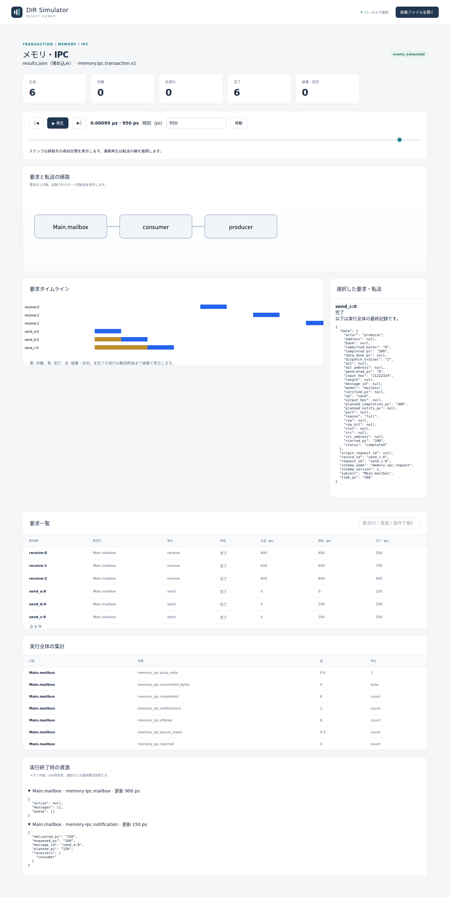
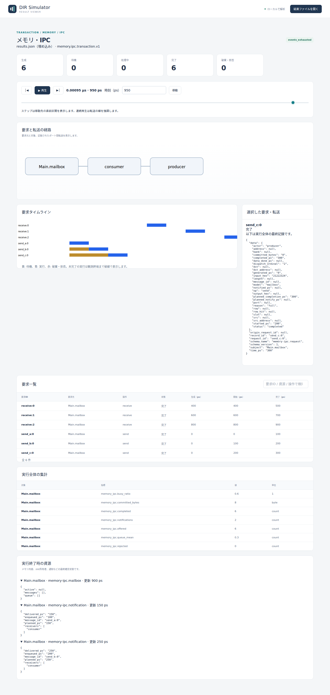
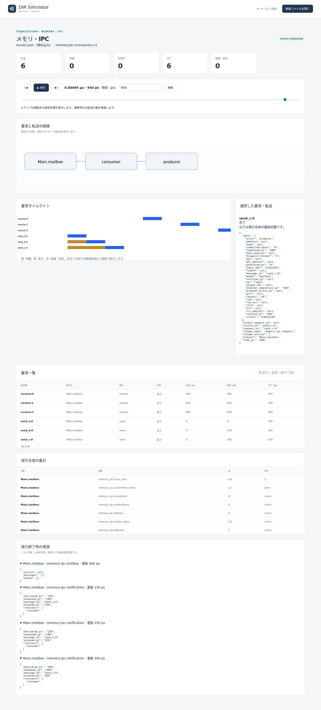

# メールボックスの容量と満杯応答

文書バージョン：`1.1.0`  
対象GitHubバージョン：`v1.1.4`  
文書ID：`guide-mailbox-capacity`  
文書状態：公開用記事。CLI実測・実Viewer画像付き

### 更新履歴

| 文書バージョン | 更新日 | 更新内容 |
| --- | --- | --- |
| `1.1.0` | `2026-10-11` | 初回push。メールボックス容量の1変数比較、8入力ZIP、正式版CLI実測と実Viewer画像を追加 |

## 目的：要求の完了とメッセージの受渡しを区別する

送る側が3件のメッセージをまとめて投入し、受ける側が少し後で取り出す場面を考えます。受信待ちのメッセージを何件まで保持できるかが、メールボックスの`capacity`です。この例では容量だけを1、2、3へ変え、保持できなかった送信がどう返るかを確認します。

DIR SimulatorのメールボックスはIPC（処理間通信）の抽象モデルです。ここでの「メール」は電子メールではなく、短いバイト列をFIFO（先に入ったものから取り出す列）で受け渡す仕組みを指します。

全条件で送信3件と受信3件、計6要求が「完了」します。それでも受け取れるメッセージは容量に応じて1、2、3件です。完了した要求の`reason`が`ok`か、満杯を表す`full`か、空を表す`empty`かまで読むことが、この実習の目的です。

| 確認したい要求 | 観察する結果 |
| --- | --- |
| 一度に3件を渡せるか | 送信要求の`reason=ok/full`を数える |
| 順番と内容が保たれるか | 受信の`message_id`と`output_hex`を送信に照合する |
| 到着通知と受信を分けられるか | 通知の`delivered_ps`と受信の`completed_ps`を比較する |
| 満杯でも処理が継続するか | `completed=6`、`rejected=0`、`partial=false`を確認する |

## 構成と責務：二つの列と一つの処理係

公開版v1.1.4の`memory.ipc.transaction.v1`を使い、NEDに`@class("dir.ipc.MailboxV1")`の`Main.mailbox`を一つ配置します。`producer`と`consumer`は権限を照合するactor名です。CPUやOSのプロセスを起動する設定ではありません。

| 要素 | 設定と責務 |
| --- | --- |
| 要求の生成 | `workload.json`が`send_a:0`、`send_b:0`、`send_c:0`を0 psに生成。受信は400、600、800 psに生成 |
| 要求の待ち列 | `queue_capacity=4`。処理開始を待つsend/receive要求を保持する |
| 単一server | 待ち列の先頭から1件ずつ処理。`service_ps=100`後にsend/receiveを評価する |
| メッセージの列 | 成功したsendの内容を受信まで保持する。今回変える`capacity`はこの列の上限 |
| 権限とサイズ | `senders=["producer"]`、`receivers=["consumer"]`、`payload_bytes=4`。全要求がこれを守る |
| 到着通知 | 成功sendの追加から`notify_ps=50`後、consumer宛ての通知記録を残す。receiveを自動生成しない |
| CLI／Viewer | 結果を保存し、要求の現在状態・最終記録・集計を表示する |

この二つの容量は別物です。`queue_capacity`不足なら受付時に`rejected/queue_full`となります。一方、今回の`capacity`不足はsendを100 psかけて評価した時点で`completed/full`として返ります。満杯が解消するまで自動で待ち続けたり、後で再送したりはしません。

同じ時刻の要求は生成器IDの順に受付されます。このサンプルでは`send_a`、`send_b`、`send_c`の順です。送信は0／100／200 psに処理を開始し、100／200／300 psに応答します。最初の受信要求は400 psまで発生しないため、3件を送る間はメッセージの空きが増えません。この条件が容量比較を単純にしています。

モデルは単独のメールボックスだけで完結し、CAN、SRAM、DMAへの接続には依存しません。実行のための依存ファイルはNED、モデルJSON、負荷JSON、INIです。各`capacityN.ini`が同じNEDと負荷を参照し、対応する`capacityN.json`だけを選びます。

## 再現手順：入力を展開し、結果を保存する

[メールボックス実習入力ZIP](downloads/mailbox-capacity-inputs.zip)を空の作業場所に展開してください。ZIPには8入力だけが入り、実行結果は含まれません。[リポジトリの入力](https://github.com/hideki-ozu/DIR-Simulator/tree/main/examples/guide/mailbox-capacity)も同じです。

CLI導入は[初めてのCAN実行](初めてのCAN実行.md)の導入手順を参照してください。この実習は正式タグ`v1.1.4`、固定commit `b45515644dfc65c205216d564d5bf7ef00280622`からビルドしたCLIで実測しています。後からmainへ追加されたViewer機能には依存しません。

`dir-simulator`をPATHに置き、展開先をカレントディレクトリとして次を実行します。最初に出力の親ディレクトリを作ります。既存の出力へ上書きせず、再実行時は`out`を新しい名前に置き換えてください。

```sh
mkdir out
dir-simulator validate --config examples/guide/mailbox-capacity/capacity1.ini
dir-simulator run --config examples/guide/mailbox-capacity/capacity1.ini --output out/capacity1
dir-simulator view --input out/capacity1/results.json --output out/capacity1-viewer.html

dir-simulator validate --config examples/guide/mailbox-capacity/capacity2.ini
dir-simulator run --config examples/guide/mailbox-capacity/capacity2.ini --output out/capacity2
dir-simulator view --input out/capacity2/results.json --output out/capacity2-viewer.html

dir-simulator validate --config examples/guide/mailbox-capacity/capacity3.ini
dir-simulator run --config examples/guide/mailbox-capacity/capacity3.ini --output out/capacity3
dir-simulator view --input out/capacity3/results.json --output out/capacity3-viewer.html
```

validateが`valid`、runが`exit_code=0`、viewが`complete`を返したら、生成したHTMLをブラウザで開きます。容量以外のモデル設定、負荷、時刻は全て共通です。JSONの差は`mailboxes[0].capacity`だけ、INIの差は対応するJSON名だけです。

## 実測：同じ完了件数でも受渡し件数が違う

正式版CLIをWSL Ubuntu 24.04で実行した結果です。下表のok/full/empty件数は`simulation.model_records`の要求行の`op`と`reason`から数えています。独立した「送信成功件数」metricが存在するという意味ではありません。

| 容量 | sendのok | sendのfull | receiveのok | receiveのempty | 実通知数 | 追加したbyte数 |
| --- | --- | --- | --- | --- | --- | --- |
| 1 | 1 | 2 | 1 | 2 | 1 | 4 |
| 2 | 2 | 1 | 2 | 1 | 2 | 8 |
| 3 | 3 | 0 | 3 | 0 | 3 | 12 |

成功したsendだけがメッセージを追加し、到着通知を予約します。容量1では`send_a:0`だけ、容量2ではaとb、容量3ではa・b・cが成功します。受信はFIFO順に取り出すので、残っていなければ`empty`です。fullを返した送信の復活や自動再試行はありません。

| 受信要求 | 生成／開始（ps） | 完了（ps） | 成功時のmessage_id | 成功時のoutput_hex |
| --- | --- | --- | --- | --- |
| `receive:0` | 400 | 500 | `send_a:0` | `01020304` |
| `receive:1` | 600 | 700 | `send_b:0` | `11121314` |
| `receive:2` | 800 | 900 | `send_c:0` | `21222324` |

容量1の後半2受信、容量2の最後の受信は`empty`で、`message_id`と`output_hex`がnullです。send/receiveの時刻は全条件で同じで、容量を増やして処理係が速くなったわけではありません。各処理は100 psです。1 psはピコ秒、1 µs = 1,000,000 psです。100 psと50 psは実習用の抽象設定値で、実機IPCの性能値ではありません。

全条件で`memory_ipc.offered=6`、`completed=6`、`rejected=0`でした。busy_ratioは0.6、queue_meanは0.3で同じです。`memory_ipc.queue_length/queue_mean`は要求の待ち列の指標で、保存中のメッセージ数を表しません。容量変更の結果は要求の理由と内容、`memory_ipc.committed_bytes`、`memory_ipc.notifications`で確かめます。

通知は成功したa／b／cに対して150／250／350 psに届きます。最初の受信完了500 psより前です。`memory-ipc.notification`の`delivered_ps`は到着通知の実績で、consumerが内容を取り出した時刻ではありません。取り出した事実はreceiveの`completed_ps`、`message_id`、`output_hex`で確認してください。

全条件が`events_exhausted`、`partial=false`で終了し、最後のイベントは900 ps、観測終端は1000 psでした。最終`memory-ipc.mailbox`のmessages、要求queueは空、activeはnullです。[測定記録](https://github.com/hideki-ozu/DIR-Simulator/tree/main/docs/verification/results/mailbox-capacity)には固定source・入力・バイナリのハッシュと結果を保存しています。

## Viewerで読む：完了6件の理由を開く

生成HTMLの「時刻（ps）」へ`950`を入力して「移動」を押します。要求一覧から`send_c:0`を選び、詳細JSONの`status`と`reason`を読みます。下の「実行終了時の資源」は見出しをクリックして展開し、メールボックスと通知行を確認してください。以下は正式v1.1.4の実ViewerをChromiumで表示した画像です。

容量1ではcの`reason=full`、追加byte数4、通知1件です。



容量2でもcは`full`ですが、bまで保存できたため追加byte数8、通知2件です。



容量3ではcも`ok`でmessage_idが付き、追加byte数12、通知3件です。



3画面とも上部は「生成6、完了6、破棄・拒否0」です。この表示だけではfullとokを区別できません。さらに`receive:1`や`receive:2`を選び、理由と出力内容を比較してください。

時刻を戻す場合、上部カウンタと一覧の状態は表示時刻の状態に変わります。一方、選択詳細JSON、集計、資源は実行全体の最終確定記録です。時間移動によって過去時点のmessages列を復元する画面ではありません。通知行が表示されていても、その表示時刻に通知済みとは限りません。

## 制約と次の実験

モデルは単一server、有限FIFO、指定したactor権限と固定時間を使います。OSのスケジューラ、CPU割込優先度・mask、実際のIPC API、再送制御や相手処理の自動起動を再現しません。容量と`queue_capacity`は0～1024、1件のpayload上限は1～65536 byteで、容量×上限byte数は65536以下です。境界の詳しい規則は[メールボックス仕様](https://github.com/hideki-ozu/DIR-Simulator/blob/v1.1.4/docs/specs/models/メモリ・IPC詳細機能仕様書.md#mailbox)を参照してください。

この実習は権限・サイズが正しく、要求待ち列に十分な空きがあり、全処理が終端1000 psより前に完了する条件です。`queue_full`、権限拒否、停止時の未通知は検証していません。発火区間は`[0,T)`で、T上のイベントは実行されません。

次は容量を1に固定し、受信の発生時刻だけを早めてください。送信がメッセージ列を満たす間にconsumerが取り出せれば、同じ容量でも結果が変わるはずです。その際も、到着通知がreceiveを自動で発生させると考えず、workloadの生成時刻を明示して比較してください。

[ガイドの入口へ戻る](index.md) / [設定・用語・FAQ](設定・用語・FAQ.md)
