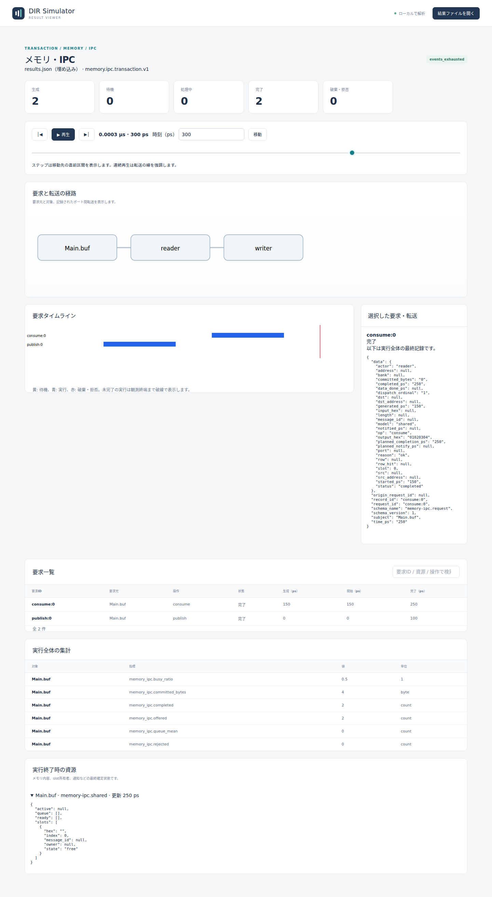
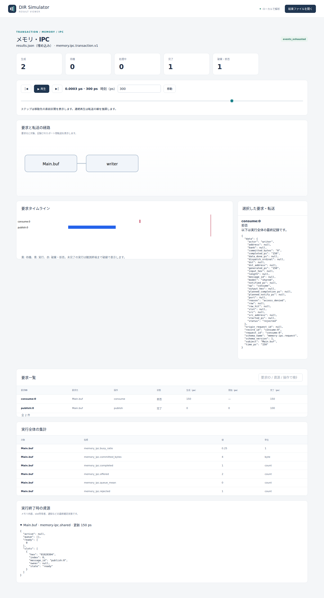
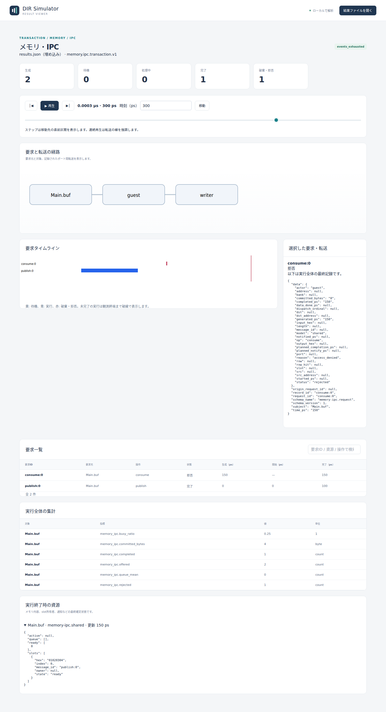

# 共有メモリの公開と取得権限

文書バージョン：`1.1.0`  
対象GitHubバージョン：`v1.1.4`  
実測ソースcommit：`b45515644dfc65c205216d564d5bf7ef00280622`  
文書ID：`guide-shared-roles`  
文書状態：公開用本文

### 更新履歴

| 文書バージョン | 更新日 | 更新内容 |
| --- | --- | --- |
| `1.1.0` | `2026-10-12` | 共有メモリのconsume actorだけを変える実習・実CLI・実Viewerを追加 |

## 目的：公開したデータを、誰が取得できるか確かめる

センサ値を作る側と、値を使う側の役割を分けたい場面を考えます。この実習では共有メモリIPCへ `01020304` を公開し、取得要求のactorだけを変えます。確認する要求は、公開側はいつも同じデータを渡せること、登録された取得側だけがデータを受け取ること、拒否されても公開済みのデータが消えないことです。

actorはモデルへ渡す役割名です。OSのユーザー、ログイン認証、秘密の資格情報ではありません。この実習の権限は設定した役割集合への所属を判定する、transactionモデル内の境界です。

## 構成と責務：共有バッファと二つの役割

| 要素 | 責務・固定設定 |
| --- | --- |
| `Main.buf` | 共有メモリ資源。slot1個、各slot最大4バイト、操作待機容量4 |
| `writer` | producersに登録した公開側。0psにpublishを要求する |
| `reader` | consumersに登録した取得側。150psのconsumeを許可する |
| `guest` | どちらの役割集合にも登録していない比較用の名前 |
| 操作サービス | publish100ps、consume100ps。通常操作は単一serverがFIFOで処理する |

NEDは `dir.ipc.SharedV1` のバッファ一つを置きます。writerやreaderは独立したNEDノードではなく、要求とJSON設定に記載する論理的な役割名です。`memory.ipc.transaction.v1` の調整機構が要求をバッファへ届けるため、NEDの配線は不要です。JSONのmodelが容量・時間・役割集合、workloadが要求、INIが実行条件を担当します。

仕様上、slotは `free → publishing → ready → consuming → free` と進みます。publish完了時にデータを公開し、consume完了時に結果へコピーしてslotを空きへ戻します。操作中のownerは一時的な占有者を表し、許可される役割の集合とは別です。readyの `owner=null` は誰でも取得できるという意味ではありません。

今回の利用フローは、writerのpublishが0psに開始、100psに公開完了、150psにconsumeを要求する順です。すでに公開済みなので、取得側の違いに絞って比較できます。

## 再現手順：consumeのactorだけを変える

[共有メモリ実習入力ZIP](downloads/shared-roles-inputs.zip)を展開します。NED1、共通model1、workload3、INI3の8入力です。リポジトリでは `examples/guide/shared-roles/` に同じものがあります。

公開済み[v1.1.4 Release](https://github.com/hideki-ozu/DIR-Simulator/releases/tag/v1.1.4)のソースでビルドした `dir-simulator` をPATHへ置き、展開先の `examples/guide/shared-roles` で実行します。ビルドの基本は[設定・用語・FAQ](設定・用語・FAQ.md)を参照してください。タグ以後のmainを正式版と混同しません。

```bash
mkdir out
dir-simulator validate --config reader.ini
dir-simulator run --config reader.ini --output out/reader
dir-simulator view --input out/reader/results.json --output out/reader-viewer.html
dir-simulator validate --config writer.ini
dir-simulator run --config writer.ini --output out/writer
dir-simulator view --input out/writer/results.json --output out/writer-viewer.html
dir-simulator validate --config guest.ini
dir-simulator run --config guest.ini --output out/guest
dir-simulator view --input out/guest/results.json --output out/guest-viewer.html
```

既に `out` があれば新しい展開先を使います。INIの違いはworkloadファイル名だけ、workload JSONの違いは `generators[1].request.actor` だけです。公開要求、データ、要求時刻、役割集合、容量・処理時間、終了400psは共通です。

全3条件でvalidateはvalidになります。構成・入力の検証成功は、シミュレーション内の全操作が受け付けられることを意味しません。未登録actorのconsumeは、実行時の受付で通常の拒否応答になります。

## 実測：producer登録だけではconsumeできない

全条件で `publish:0` は0→100psで `completed/ok` になりました。変えた `consume:0` の結果は次のとおりです。

| consume actor | consume status / reason | 開始→終端（ps） | 取得結果 | 終了時slot |
| --- | --- | --- | --- | --- |
| reader | completed / ok | 150→250 | 01020304 | free、内容なし |
| writer | rejected / access_denied | null→150 | null | ready、01020304が残る |
| guest | rejected / access_denied | null→150 | null | ready、01020304が残る |

writerはpublishを許可された役割ですが、consumersには入っていません。そのためguestと同じくconsumeを拒否されます。拒否は150psの受付時で、サービスを開始しません。`started_ps=null`、`planned_completion_ps=null` と拒否理由を合わせて読みます。拒否された行の `completed_ps=150` は要求の終端時刻で、成功した取得の完了時刻ではありません。

reader条件の終了時はready列が空、slot0はfree、hexは空です。writer/guest条件はready列にslot0が一つ残り、slotのhexは `01020304`、message_idは `publish:0` です。どの条件でもactiveはnull、操作待機列は空です。拒否は公開済みデータを消費しません。

| actor | offered | completed | rejected | busy_ratio |
| --- | --- | --- | --- | --- |
| reader | 2 | 2 | 0 | 0.5 |
| writer | 2 | 1 | 1 | 0.25 |
| guest | 2 | 1 | 1 | 0.25 |

上表は `memory_ipc.*` の集計です。全条件とも公開された4バイトを数える資源の `committed_bytes=4` で、取得成功の件数とは別です。実行はすべてexit_code0・events_exhausted・partial=false、終了400ps・残イベント0です。exit_code0だけで「consumeも成功」と判断せず、要求のstatusとreasonを見ます。

## Viewer：300psで取得要求と残ったslotを照合する

生成HTMLをブラウザで開き、時刻300psへ移動して `consume:0` を選びます。操作の基本は[Viewerで結果を読む](Viewerで結果を読む.md)を参照してください。以下は正式版CLIから生成した実画面です。

validateの構成数はnode_count1・channel_count0です。Viewerの経路図に現れるreader・writer・guestは要求に記録されたactorの表示で、NEDへ追加されたノードではありません。図にactor名が載っていても、その操作が許可されたかは詳細のstatusとreasonで確認します。



reader条件は生成2・完了2です。詳細のactor、status、reason、output_hexと、展開した「実行終了時の資源」のfree状態を照合します。





writer/guest条件は生成2・完了1・故障/拒否1です。詳細には `access_denied`、開始時刻null、取得結果nullが並びます。slotはready、ownerはnullです。資源欄は保存された実行終了時の状態なので、時刻を戻した際の過去snapshotとしては扱いません。

## 制約と仕様への入口

この実習はslot1個、公開1回、取得1回の正常公開と権限拒否だけです。複数slot・複数consumer、full/empty、競合、公開/取得途中の打切り、actorの両役割登録は試していません。CPU cache/fence、物理的な共有RAM、OS認証・セキュリティ分離、実機性能を実装・保証するものではありません。論理的なpublish/consumeと所有状態の抽象モデルです。

契約は[正式v1.1.4のメモリ・IPC詳細機能仕様（共有メモリ）](https://github.com/hideki-ozu/DIR-Simulator/blob/v1.1.4/docs/specs/models/メモリ・IPC詳細機能仕様書.md#shared)の `DIR-REQ-0206`〜`DIR-REQ-0209` / `DIR-FUNC-0049` に対応します。

[ガイドの入口へ戻る](index.md)
