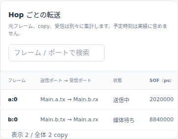
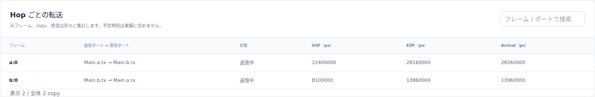
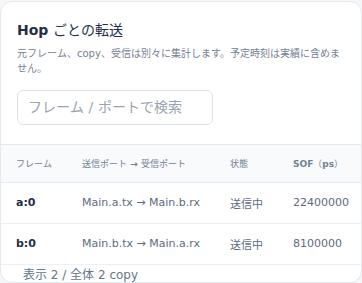

# 半二重Ethernetの再送とseedによる待ち時間の違い

文書バージョン：`1.1.1`
対象GitHubバージョン：`v1.1.6`
実測ソースcommit：`397900451015c9bca6a33d24feac0a88b9b7b8fe`
文書ID：`guide-ethernet-beb-seed`
文書状態：公開用本文

### 更新履歴

| 文書バージョン | 更新日 | 更新内容 |
| --- | --- | --- |
| `1.1.1` | `2026-10-20` | Issue #121：公開済み画像を保持した撮影再検証、単独実習の選択と新規出力先・再試行手順を整合 |
| `1.1.0` | `2026-10-20` | 正式v1.1.6で1変数比較を新規実測し、独立入力・実Viewer・巻戻し検証を追加 |

## 目的：再送の期限と、実際に送れる時刻を分ける

同じ物理対の両端から同時に送ると、半二重Ethernetでは衝突します。この実習ではフレームを増やさず、BEBのseedだけを1と0に変えます。初回の衝突が同じでも、再送slot、再衝突、送信順、配送遅延が変わる様子を読みます。

「衝突したattempt」と「最終的に届くframe」は別です。backoff期限に達しても、相手の信号が残っていれば送信を待ちます。seedは再現条件であり、優先度や品質を調整する設定ではありません。

## 構成と責務：2 Endpointと一つの物理対

`Main.a → Main.b` と逆方向の二つのLinkが、一つの物理対abを表します。両Endpointが0psに空dataのframeを1件ずつ生成します。100BASE-TX half、100Mbps、伝搬100ns、PHY処理0、終了100µsを固定します。

| ファイル・部品 | 責務 |
| --- | --- |
| `models/media/Main.ned`・`Types.ned` | 2 Endpointと対向Link、速度・伝搬の接続 |
| `collision.ini` | 媒体v2 profile、入力参照、観測終了 |
| `collision.model.json` | MAC、queue、PHY、halfとseed |
| `collision.workload.json` | generator a/bの時刻0・各1要求 |
| runtime | carrier、衝突検出、jam、BEB、各attemptと確定受信の記録 |
| Viewer | 保存された記録をcursor時刻で再演 |

配布には同じNED packageの `Mix.ned` も原本通り含めていますが、このINIが選ぶnetworkはMainです。条件別にMainやgenerator IDを改名しません。BEB hashにはseedだけでなくtransfer IDと衝突番号も入るためです。

frameは生成物、transferは出力ポートで送る一件、attemptはその送信試行、receptionは成功受信を表します。同じtransferに複数attemptがあっても別frameが増えた意味ではありません。衝突したattemptの予定arrivalを成功受信として数えません。TAS/CBS/preemptionとは合成しません。

## 再現手順：model rootのseedだけを変える

[独立実習入力ZIP](downloads/ethernet-beb-seed-inputs.zip)を新しいフォルダへ展開します。リポジトリの `examples/guide/ethernet-beb-seed/` と同じ入力です。各条件にINI・model JSON・workload JSON・NED依存を含め、相対参照で完結します。元の公開サンプルや検証fixtureは変更しません。

[正式v1.1.6 Release](https://github.com/hideki-ozu/DIR-Simulator/releases/tag/v1.1.6)のsource commit `397900451015c9bca6a33d24feac0a88b9b7b8fe` を取得し、指定Rust 1.85.0で `cargo build --locked --release -p dir-simulator` を実行します。生成した `dir-simulator` をPATHへ置き、展開先の `examples/guide/ethernet-beb-seed` で実行します。ビルド環境の準備は[設定・用語・FAQ](設定・用語・FAQ.md)を参照してください。

```bash
mkdir out
dir-simulator validate --config seed-1/collision.ini
dir-simulator run --config seed-1/collision.ini --output out/seed-1
dir-simulator view --input out/seed-1/results.json --output out/seed-1-viewer.html
dir-simulator validate --config seed-0/collision.ini
dir-simulator run --config seed-0/collision.ini --output out/seed-0
dir-simulator view --input out/seed-0/results.json --output out/seed-0-viewer.html
```

既にoutがあれば別の新しい展開先を使います。既存の結果を上書きすると、入力と画面の対応を確かめにくくなります。

二つのdirectoryの意味差分は `collision.model.json` のroot `seed` が文字列 `"1"` / `"0"` であることだけです。INI・workload・全NEDはbyte一致です。

同じseedも別出力先へ再実行します。例えば `dir-simulator run --config seed-1/collision.ini --output out/seed-1-repeat` です。今回の検査では両seedとも反復し、simulation全体が一致しました。入力pathやrun IDを含むresults.jsonファイル全体のbyte一致を要求しているのではありません。

## 予測と新規実測：初回は共通、再送が分かれる

以下の予測は512bit slot、96bit IFG、公開BEB vectorsから立てたものです。今回の実測列は新しく得たmodel_recordsと照合した値です。表の時間はすべてpsです。

| 観測項目 | seed1予測 | seed1実測 | seed0予測 | seed0実測 |
| --- | ---: | ---: | ---: | ---: |
| 初回SOF（a/b） | 0 / 0 | 0 / 0 | 0 / 0 | 0 / 0 |
| 初回衝突検出（a/b） | 100000 / 100000 | 100000 / 100000 | 100000 / 100000 | 100000 / 100000 |
| 初回jam開始推定→終了 | 640000→960000 | 640000→960000 | 640000→960000 | 640000→960000 |
| 初回backoff slot（a/b） | 0 / 1 | 0 / 1 | 1 / 1 | 1 / 1 |
| 初回backoff期限（a/b） | 960000 / 6080000 | 960000 / 6080000 | 6080000 / 6080000 | 6080000 / 6080000 |
| 成功attemptのSOF（a/b） | 2020000 / 8840000 | 2020000 / 8840000 | 22400000 / 8100000 | 22400000 / 8100000 |
| 各transferのattempt数 | 2 | 2 | 3 | 3 |
| 各transferの衝突検出数 | 1 | 1 | 2 | 2 |

seed1ではaのslotが0でも、peerのjam信号が伝搬して消える1060000psからIFG960000psを満たし、SOF2020000psになります。bは6080000psに期限へ到達しますが、aの信号が続くため媒体待ちです。aの最後の信号がbへ届く7880000psからIFGを待ち、8840000psに送れます。backoff期限とIFGを機械的に直列加算する計算ではありません。

seed0は両端が6080000psに再送し、6180000psに再衝突します。2回目のslotはa=3、b=0、jam終了7040000psです。bは8100000ps、aは自身のbackoff期限22400000psに送信します。最終成功SOFの表だけでは再衝突を読めないため、`ethernet.attempt` をtransfer IDとnumberで追います。

| 指標・ID | seed1新規実測 | seed0新規実測 |
| --- | ---: | ---: |
| `$all / ethernet.media.attempts` | 4 | 6 |
| `$all / ethernet.media.collisions` | 2 | 4 |
| `$all / ethernet.media.delivered` | 2 | 2 |
| `$all / ethernet.media.retry_exhausted` | 0 | 0 |
| a:0→bのreception.ready（生成0からの遅延も同じps） | 7880000 | 28260000 |
| b:0→aのreception.ready（同上） | 14700000 | 13960000 |

collisionsの2/4は両outputでの検出件数の和です。物理的に共有された衝突場面は各1/2回であり、指標の母数が違います。各条件の成功receptionは2件だけで、衝突attemptに受信を補っていません。送信占有はjamを含み、IFG/backoffを含みません。`ethernet.media.jam_ps` と `ethernet.media.tx_utilization` は保存済みsummaryから補助的に読めます。二つの条件ともevents_exhausted、pending_events=0、partial=falseでした。

## Viewer：6080000psで期限到達と媒体待ちを見る

生成した各HTMLを開き、「時刻（ps）」へ6080000を入れます。seed1はaが送信中・bが媒体待ち、seed0は両端が2回目の送信中です。seed0の2回目の衝突は100000ps後なので、このcursorで衝突済みとは読みません。








状態列・上部件数はcursor時点です。SOF/EOF/Arrival列、選択した転送の詳細、試行JSONは実行全体の記録を含みます。画像のseed0 a行に22400000psが見えても、cursor6080000psで3回目が始まった意味ではありません。全run詳細で最終成功attemptの時刻を確認し、現在の状態は状態列で読みます。

100000psでは両条件ともUI上はjam送信中です。このラベルは衝突検出後の経路を表し、preamble完了後の実jam開始640000psより先に切り替わります。表のjam開始推定は確定jam_end960000psと1衝突あたりjam320000psから求めています。1200000psではseed1 a=媒体待ち/b=再送待ち、seed0は両端再送待ちです。6080000→100000→6080000psと往復し、同じ状態へ戻ることを両画面幅で確認しました。受信完了数は成功arrival以前に増えません。

## 証跡と再検証

2026-10-20に正式v1.1.6のclean sourceからlocked release buildした同一binaryで、両条件のvalidate/run/viewを新規実行しました。実行環境はWSL2 Ubuntu 24.04.4 LTS x86_64、Rust 1.85.0です。以下は今回の実測であり、Issueの解析予測や過去fixtureの出力を転記した値ではありません。

[計測・予測照合](https://github.com/hideki-ozu/DIR-Simulator/blob/main/docs/verification/results/ethernet-beb-seed/measurements.json)、[実Viewer撮影・巻戻しの記録](https://github.com/hideki-ozu/DIR-Simulator/blob/main/docs/verification/results/ethernet-beb-seed/viewer-browser.json)、[成果物SHA-256台帳](https://github.com/hideki-ozu/DIR-Simulator/blob/main/docs/verification/results/ethernet-beb-seed/artifact-ledger.json)にsource commit、binary、入力、results.json、HTML、PNG、ブラウザ版、viewport、cursorを保存しています。`https://github.com/hideki-ozu/DIR-Simulator/blob/main/docs/verification/results/ethernet-beb-seed/repository/` に元JSON・CSV・manifest・CLIログ・生成HTMLがあり、`zip/` は別の新規展開先から再実行した結果です。

manifestの全成果物hashと空diagnostics、JSON/summary.csvの値・target・標本数・観測区間を照合し、ZIPの全member一致と展開後の論理simulation一致を検証しました。run IDや入力の絶対path等のmetadataは論理結果と分けています。実画面は各results.jsonから正式CLIで生成した自己完結HTMLをChromiumで開いて直接撮影し、desktop1440×1000・狭幅390×844で状態を確認しました。外部通信・ページエラーは0です。mobileで横に長い表は横スクロールできます。撮影時の横位置も記録しています。

新しいcheckoutで再検証する場合、リポジトリrootで以下を実行します。`/path/to/dir-simulator` を上記の正式binaryへ置き換え、`/path/to/new-evidence` は未使用pathを指定してください。

```bash
python3 scripts/build_guide_inputs.py --check
python3 scripts/verify_guide_capacity_comparisons.py \
  --binary /path/to/dir-simulator --source-root /path/to/formal-source \
  --only ethernet-beb-seed --output /path/to/new-evidence
python3 scripts/check_guide_capacity_measurements.py /path/to/new-evidence --only ethernet-beb-seed
NODE_PATH=/path/to/browser-tools/node_modules \
  node scripts/verify_capacity_comparisons_viewer.cjs /path/to/new-evidence \
  --only ethernet-beb-seed --output /path/to/new-captures
```

独立検査は出力の独立期待値・保存則・CSVを照合します。

撮影コマンドにはPlaywrightとChromiumが必要です。`/path/to/browser-tools/node_modules` はPlaywrightを導入したnode_modulesへ置き換えます。計測・数値照合・撮影はいずれも `--only ethernet-beb-seed` を指定しており、この実習の証跡だけを読みます。

`/path/to/new-captures` は未使用の撮影出力先です。生成される `capture-summary.json` から `ethernet-beb-seed/viewer-browser.json` を辿れ、実PNGは `ethernet-beb-seed/images/` に保存されます。各reportは自身のdirectoryを基準に、実際に読んだ計測JSON・results.json・manifest・Viewer HTMLと撮影PNGのpath/hash、条件・cursor・viewportを記録します。元の計測成果物と記事収録済みのPNG・台帳は変更しません。

同じ撮影出力先を再指定すると、既存出力を変更せず拒否します。同じ計測証跡をもう一度撮影する場合は、`--output /path/to/new-captures-2` のように別の未使用先を指定します。`--output` を省略した既定値は `/path/to/new-evidence/viewer-captures` です。全4実習を一度に検証する場合は、新しい証跡rootを指定し、上の計測・数値照合・撮影の3コマンドすべてから `--only ethernet-beb-seed` を外します。

公開済みPNGを残した状態での全4実習・AXI単独・Gateway単独の再実行、同じ出力先の拒否、別の出力先での再撮影、元成果物の不変性は[撮影再実行の検証記録](https://github.com/hideki-ozu/DIR-Simulator/blob/main/docs/verification/results/issue-121-capture-workflow/acceptance.json)に保存しています。

## 対象範囲と次に読む資料

この実習は固定100BASE-TX halfの2 MAC対だけです。hub、多MAC共有領域、T1 half、実機誤り率、波形、IEEE 802.3全文適合を検証していません。continuous-idle-96・sha256-bebはこのprofileの契約です。16試行上限dropは未測定で、2 seedから平均性能・公平性・最悪値を推定しません。

carrier/jam/BEBの契約は[Ethernetリファレンス](reference/Ethernetの機能・動作仕様.md)、媒体の詳細は[Ethernet媒体拡張詳細機能仕様書](https://github.com/hideki-ozu/DIR-Simulator/blob/main/docs/specs/models/Ethernet媒体拡張詳細機能仕様書.md)を参照してください。全二重の基本へ戻る場合は[Ethernet配送期限と遅延判定の比較](Ethernet配送期限と遅延判定の比較.md)へ進みます。
