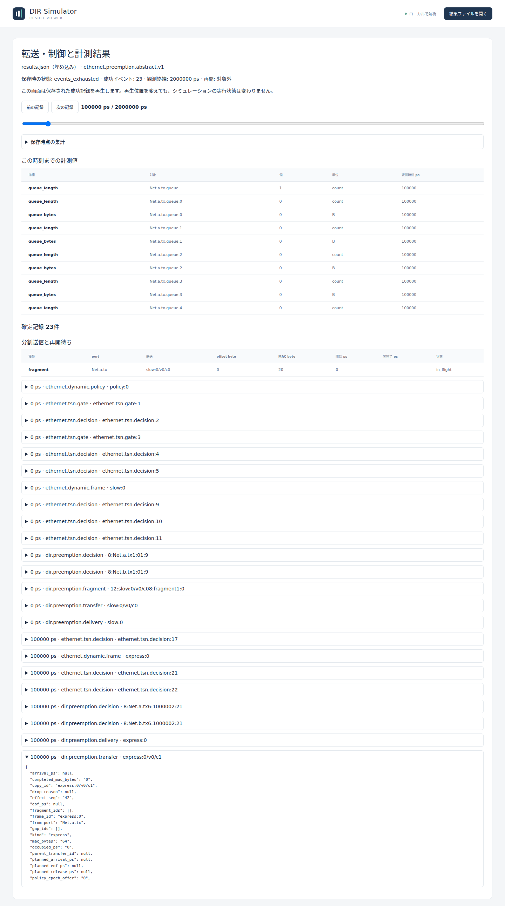
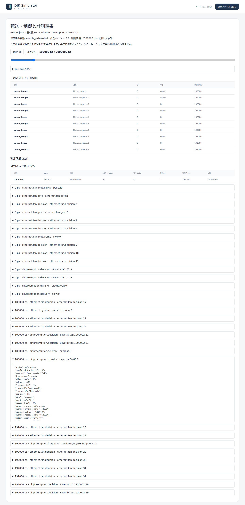
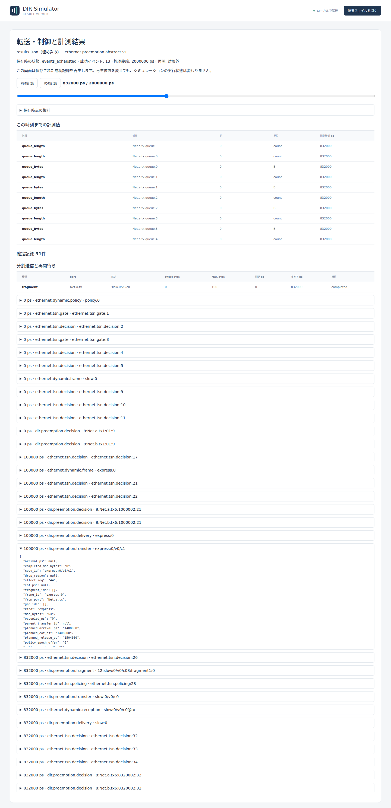
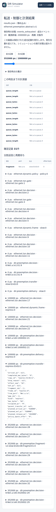

# 抽象preemptionのfragment長とexpress待ち時間

文書バージョン：`1.2.0`
対象GitHubバージョン：`v1.2.0`
文書ID：`guide-preemption-fragments`
文書状態：公開用完成稿

<a id="guide-preemption-fragments"></a>

### 更新履歴

| 文書バージョン | 更新日 | 更新内容 |
| --- | --- | --- |
| `1.2.0` | `2026-10-22` | v1.2.0の対象タグ・文書版を確定。過去の測定基準と公開済み履歴を保持 |
| `1.1.0` | `2026-10-19` | 初版：fragment長20/40/100byteの1変数比較、正式版実測、実Viewerと独立入力ZIPを追加 |

## expressはどの境界で送信を始められるか

[Ethernetの優先キューと送信順](Ethernetの優先キューと送信順.md)では、優先度が高くても送信中のフレームを追い越せませんでした。この実習では、低優先度のslowを分割し、fragmentの境界で高優先度のexpressへ送信権を渡す抽象preemptionを使います。

変えるのは送信元の`fragment_payload_bytes`だけです。20/40/100byteの3条件で、expressの待ち時間とslowの完了時刻・送信占有時間を比較します。以下は正式[v1.1.6](https://github.com/hideki-ozu/DIR-Simulator/releases/tag/v1.1.6)、source `397900451015c9bca6a33d24feac0a88b9b7b8fe`からビルドした同一CLIによる新しい測定です。企画時のmain `28ad65c992af80f4f3db681930daa0756546294f`の調査とは区別します。

## 全体の構成と責務

```text
slow: MAC100byte / P0 / 生成0ps ─────┐
                                  ├→ Net.a.tx → 1Gbps・伝搬0ps → Net.b.rx
express: MAC64byte / P7 / 生成100000ps ┘    fragment境界で切替
```

NEDには逆方向のLinkもありますが、生成する負荷はaからbへの2フレームだけです。両方向は別の出力資源です。

| 入力・要素 | 責務と固定する条件 |
| --- | --- |
| NED | Endpoint a/b、全二重の2方向Link、1Gbps、伝搬・TX/RX処理0ps、queue容量64 |
| INI | NED・profile・model-config・workloadを接続。終了2000000ps |
| workload | slowを0ps、expressを100000psに生成。宛先、MAC長、priority、生成時刻を固定 |
| model-config | profileは`ethernet.preemption.abstract.v1`。P7をexpress、P0をpreemptableとする |
| a.txのpreemption | `fragment_payload_bytes`だけ20/40/100へ変更。各fragmentのoverhead4byte、resume gap8000ps |
| b.txのpreemption | fragment長40byteのまま固定。両portを一括置換しない |
| Viewer | 保存済みのtransfer・fragment・gap・deliveryを時刻に沿って表示 |

TASとCBSは使いません。runtimeはexpressの到着時にslowを任意のbit位置で切断せず、実行中fragmentの完了を待ちます。expressの直列化とIFGが終わった後、slowを再開する場合だけresume gapを置きます。fragmentごとのoverhead、expressのIFG、resume gapは別の時間です。

## 入力ZIPと正式CLIを用意する

[独立8ファイルZIP](downloads/ethernet-preemption-fragments-inputs.zip)には、共通NED・workload、3条件のINIとmodel JSONを含めています。このガイドを含むcheckoutの`examples/guide/ethernet-preemption-fragments/`も同じ入力です。正式v1.1.6のsourceだけには、新設したこの実習フォルダは含まれません。

Gitとrustup/Cargoを準備したWSL Ubuntuのシェルで、正式タグを新しいディレクトリへ取得します。Rustはリポジトリ指定の1.85.0です。commitの一致を確認した場合だけビルドします。

```bash
git -c core.autocrlf=false clone --depth 1 --branch v1.1.6 --single-branch \
  https://github.com/hideki-ozu/DIR-Simulator.git dir-preemption-v116 &&
cd dir-preemption-v116 &&
test "$(git rev-parse HEAD)" = 397900451015c9bca6a33d24feac0a88b9b7b8fe &&
cargo build --locked -p dir-simulator --bin dir-simulator &&
export PATH="$PWD/target/debug:$PATH"
```

同じシェルでZIPを展開した場所へ移動し、`examples/guide/ethernet-preemption-fragments`が見える位置で実行します。出力先には未使用の名前を指定してください。

```bash
mkdir preemption-results
for size in 20 40 100; do
  dir-simulator validate \
    --config examples/guide/ethernet-preemption-fragments/fragment-$size.ini &&
  dir-simulator run \
    --config examples/guide/ethernet-preemption-fragments/fragment-$size.ini \
    --output preemption-results/fragment-$size &&
  dir-simulator view \
    --input preemption-results/fragment-$size/results.json \
    --output preemption-results/fragment-$size-viewer.html || break
done
```

## 実測：短いfragmentは待ちを減らし、overheadを増やす

`dir.preemption.transfer`で、expressの`queued_ps=100000`、slowの`sof_ps=0`を確認します。各条件のIDはexpressが`express:0/v0/c1`、slowが`slow:0/v0/c0`です。

| fragment長 byte | express SOF ps | express待ち ps | express EOF / release ps | slow最終EOF ps | slow送信占有 ps | slowの分割 |
| ---: | ---: | ---: | --- | ---: | ---: | --- |
| 20 | 192000 | 92000 | 768000 / 864000 | 1640000 | 960000 | 20×5 |
| 40 | 352000 | 252000 | 928000 / 1024000 | 1576000 | 896000 | 40 / 40 / 20 |
| 100 | 832000 | 732000 | 1408000 / 1504000 | 832000 | 832000 | 100×1 |

express待ちは`SOF - queued`です。最初のslow fragmentは、それぞれ`(20+4)×8×1000=192000ps`、`(40+4)×8×1000=352000ps`、`(100+4)×8×1000=832000ps`で終わります。expressが100000psに待ち始めても、その境界までは送信できません。

slowのMAC100byteを分割するたびにoverhead4byteが加わります。送信占有時間はfragment区間の和で、20条件は`(100+5×4)×8×1000=960000ps`、40条件は896000ps、100条件は832000psです。この抽象profileのfragment長・overheadの計算を、通常EthernetのpreambleやIFGへ置き換えてはいけません。

expressは3条件とも576000psの直列化と96000psのIFGを使います。20条件のresume gapは`[864000,872000)`、40条件は`[1024000,1032000)`の8000psです。100条件ではslowがexpressより先に終わり、再開しないのでgapは0件でした。

20条件のslowのSOFから最終EOFまでの経過1640000psは、slow占有960000 + express直列化576000 + express IFG96000 + resume gap8000です。**この経過時間をslowの送信占有時間として集計しないでください。**

固定観測区間`[0,2000000)`で、a.txの実送信占有だけを合計するなら、slow占有とexpress直列化の和を分子にします。20/40/100条件はそれぞれ1536000/1472000/1408000ps、比率は76.8/73.6/70.4%です。ここにはIFG・resume gap・空き時間を含めていません。資源が次の送信へ使えない期間を調べる場合は、それらを別項目で加えます。

3条件とも2フレームが2000000ps内に完了しました。manifestはcomplete・partial false、diagnosticsは空、pendingは0です。小さいfragmentでexpress待ちは減りましたが、slowのfragment数とoverhead、最終EOFは増えました。

## 実Viewerで同じ時刻と境界を読む

生成したHTMLを開き、スライダーと「前の記録」「次の記録」で再生位置を100000psに合わせます。スライダーで近くへ移動し、記録送りで表示時刻を確かめると境界を追えます。このprofileの画面には数値入力による時刻移動欄はありません。3条件ともexpressはqueued、slowの最初のfragmentは送信中です。以下は正式CLIが出力したHTMLを実ブラウザで撮影した画面です。



次に各条件のexpress SOFへ進みます。20条件は192000ps、40条件は352000ps、100条件は832000psです。fragmentの実完了とexpressの送信開始が同じ境界になります。







比較には「分割送信と再開待ち」の表と、`dir.preemption.transfer`・`dir.preemption.fragment`・`dir.preemption.gap`の詳細記録を使います。最終結果の`eof_ps`や`planned_end_ps`が読めても、その時刻まで再生を進める前は完了実績ではありません。検証ではスライダーの共通100000psと各SOFの200ps前・SOF時点を確認し、前進・巻戻しで同じ状態へ戻ることを照合しています。

## 再現証拠と範囲

[測定checker](https://github.com/hideki-ozu/DIR-Simulator/blob/main/scripts/verify_guide_preemption_fragments.py)と[実測JSON](https://github.com/hideki-ozu/DIR-Simulator/blob/main/docs/verification/results/preemption-fragments/measurements.json)に、条件差分、commit、binary/input hash、終了値、manifest、fragment/gapの実記録を保存しています。[実Viewer証跡](https://github.com/hideki-ozu/DIR-Simulator/blob/main/docs/verification/results/preemption-fragments/viewer-captures.json)は、HTML・画像のhashと再生時点を対応付けます。リポジトリ入力9操作に加え、配布ZIPの全8ファイルの一致を確認し、別の場所へ展開して同じ3条件のvalidate/run/viewを9操作実行しました。全18操作が終了0で、ZIP側のsimulationも元の結果と一致しました。新しい測定を追試するcheckerには`--binary`と未使用の`--output`を指定します。ZIP比較にはさらに`--zip-reproduction --baseline-output`で、同checkerが出力した元入力側の結果フォルダを指定します。

これはDIRの抽象preemptionの比較です。MAC Merge、SMD、verify handshake、半二重、preemptable CBS、Gateway・冗長との合成、IEEE規格適合や実機性能の証明は対象にしません。モデルの範囲は[後続10分野の現行実装と利用境界](reference/後続10分野の現行実装と利用境界.md)でも確認できます。

Copyright (c) 2026 DIR Simulator contributors. Licensed under MIT OR Apache-2.0. [MIT](https://github.com/hideki-ozu/DIR-Simulator/blob/v1.1.6/LICENSE-MIT)・[Apache-2.0](https://github.com/hideki-ozu/DIR-Simulator/blob/v1.1.6/LICENSE-APACHE)。
