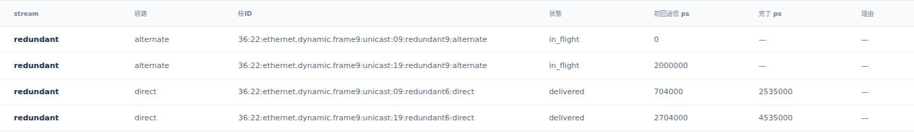
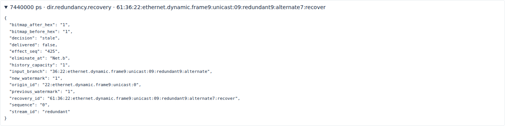
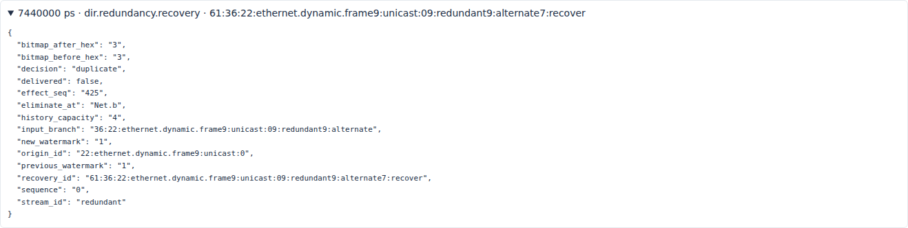
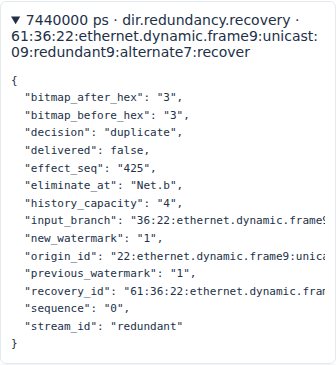

# 抽象冗長配送の履歴容量とduplicate・stale

文書バージョン：`1.1.0`
対象GitHubバージョン：`v1.1.6`
文書ID：`guide-redundancy-history`
文書状態：公開用完成稿

<a id="guide-redundancy-history"></a>

### 更新履歴

| 文書バージョン | 更新日 | 更新内容 |
| --- | --- | --- |
| `1.1.0` | `2026-10-19` | 初版：履歴容量1/4の1変数比較、2 origin・4枝の正式版実測、実Viewerと独立入力ZIPを追加 |

## 届いたコピー数と、一度だけ配送する判断を分ける

同じ通信を二つの経路へ複製すると、受信口には複数のコピーが届きます。recoveryはsequenceの履歴を使い、同じoriginをアプリケーションへ一度だけ配送します。この実習では履歴容量だけを1と4へ変え、遅いコピーが`stale`になる場合と`duplicate`になる場合を比べます。

以下は正式[v1.1.6](https://github.com/hideki-ozu/DIR-Simulator/releases/tag/v1.1.6)、source `397900451015c9bca6a33d24feac0a88b9b7b8fe`からビルドした同一CLIによる新しい測定です。企画調査のmain `28ad65c992af80f4f3db681930daa0756546294f`とは分けています。profileは`ethernet.redundancy.abstract.v1`です。

## 全体の構成と記録の役割

```text
                          direct
                      s1 ───────── s2
                     ／ ＼        ／ ＼
talker a ───────────┘    s3 ─────┘    └──── recovery b
                         alternate

direct    : a.tx → s1.tx_b → s2.tx_a → b.rx
alternate : a.tx → s1.tx_c → s3.tx_c → s2.tx_a → b.rx
```

両経路はa.txとs2.tx_aを共有します。完全に物理独立な二経路ではなく、同じ出力portではコピー同士も待ち合わせます。今回は故障を入れず、alternateのs3に長い転送遅延を置きます。

| 入力・記録 | 責務 |
| --- | --- |
| NED | Endpointと三角Switch網、全二重Link、1Gbps・各Link伝搬1000psを定義 |
| INI | NED・workload・model-configを結ぶ。終了10000000ps |
| workload | 0psと2000000psに同じunicastを生成し、sequence0/1を作る |
| model-config | 明示したdirect/alternate経路、stream、recovery先、履歴容量を指定 |
| `dir.redundancy.origin` | 元通信。sequence、target数、配送完了数を保持 |
| `dir.redundancy.branch` | originから複製した経路ごとの枝。各hopを進み、最終状態へ至る |
| `ethernet.dynamic.transfer/reception` | hopごとの送信copyと物理受信。branch全体や配送完了とは別 |
| `dir.redundancy.recovery` | 終点でのsequence判定。watermark、bitmap、deliveredを記録 |
| Viewer | 保存済み記録を時刻で読み、枝の進行とrecoveryを表示 |

比較前の共通準備として、元の公開サンプルから生成時刻を0/2000000ps、s3の`forward_delay_ps`を5000000psへ変えています。この準備を両条件へ同じように適用し、条件間では`replication.streams[0].history_capacity`だけ1/4へ変更します。その他のSwitch転送遅延2000ps、経路、frame、queue、priority、Link、終了時刻は固定です。

## watermarkとbitmapを先に読む

watermarkは受理済みsequenceの上限です。bitmapのbit0はwatermark自身、bit1は一つ古いsequenceという対応で、受理済みの位置が1になります。

最初のsequence0は`accept_first`、新しいsequence1は`accept_advance`として受理されます。その後でsequence0が到着したとき、watermarkとの差は`1-0=1`です。差が履歴容量以上なら`stale`、履歴内で既に受理bitが立っていれば`duplicate`です。容量1では差1が範囲外、容量4では範囲内になります。どちらも`delivered=false`ですが、根拠が違います。

## 独立入力を正式CLIで実行する

[独立6ファイルZIP](downloads/ethernet-redundancy-history-inputs.zip)には共通NED・workload、2条件のINIとmodel JSONを含めています。このガイドを含むcheckoutの`examples/guide/ethernet-redundancy-history/`も同じ入力です。新設フォルダは正式v1.1.6のsourceだけには含まれないため、ZIPも用意します。

Gitとrustup/Cargoを導入したWSL Ubuntuのシェルで、正式タグを新しいディレクトリへ取得します。Rustはリポジトリ指定の1.85.0です。

```bash
git -c core.autocrlf=false clone --depth 1 --branch v1.1.6 --single-branch \
  https://github.com/hideki-ozu/DIR-Simulator.git dir-redundancy-v116 &&
cd dir-redundancy-v116 &&
test "$(git rev-parse HEAD)" = 397900451015c9bca6a33d24feac0a88b9b7b8fe &&
cargo build --locked -p dir-simulator --bin dir-simulator &&
export PATH="$PWD/target/debug:$PATH"
```

同じシェルでZIPを展開した場所へ移動し、`examples/guide/ethernet-redundancy-history`が見える位置で実行します。未使用の出力先を指定してください。

```bash
mkdir redundancy-results
for capacity in 1 4; do
  dir-simulator validate \
    --config examples/guide/ethernet-redundancy-history/capacity-$capacity.ini &&
  dir-simulator run \
    --config examples/guide/ethernet-redundancy-history/capacity-$capacity.ini \
    --output redundancy-results/capacity-$capacity &&
  dir-simulator view \
    --input redundancy-results/capacity-$capacity/results.json \
    --output redundancy-results/capacity-$capacity-viewer.html || break
done
```

## 実測：遅いsequence0の除去理由だけが変わる

到着順と時刻は両条件で一致しました。directのsequence1が、alternateのsequence0より先にrecoveryへ到着します。bitmapは16進表記です。

| recovery時刻 ps | sequence / 経路 | 容量1のdecision | 容量1のwatermark / bitmap前→後 | 容量4のdecision | 容量4のwatermark / bitmap前→後 | delivered |
| ---: | --- | --- | --- | --- | --- | --- |
| 2535000 | 0 / direct | accept_first | null→0 / 0→1 | accept_first | null→0 / 0→1 | true |
| 4535000 | 1 / direct | accept_advance | 0→1 / 1→1 | accept_advance | 0→1 / 1→3 | true |
| 7440000 | 0 / alternate | stale | 1→1 / 1→1 | duplicate | 1→1 / 3→3 | false |
| 9440000 | 1 / alternate | duplicate | 1→1 / 1→1 | duplicate | 1→1 / 3→3 | false |

容量4ではsequence1を受理した時点でbitmapが`3`、つまり二進数`11`になり、sequence0と1の受理を両方記憶します。容量1のbitmapは最新のsequence1だけを残します。7440000psの遅いsequence0を、容量1で「記憶している重複」と説明してはいけません。

sequence0の実hopを追うと、次の時刻になります。branchには最終transferだけでなくparent transferでつながる途中のcopyがあります。

| 経路 | 出力port | SOF ps | 相手へのarrival ps |
| --- | --- | ---: | ---: |
| alternate | Net.a.tx | 0 | 609000 |
| alternate | Net.s1.tx_c | 611000 | 1220000 |
| alternate | Net.s3.tx_c | 6220000 | 6829000 |
| alternate | Net.s2.tx_a | 6831000 | 7440000 |
| direct | Net.a.tx | 704000 | 1313000 |
| direct | Net.s1.tx_b | 1315000 | 1924000 |
| direct | Net.s2.tx_a | 1926000 | 2535000 |

経路名directでも最初の送信が0psとは限りません。alternate側copyが共有a.txを先に使い、direct側はIFG込みで704000psに開始しています。sequence1は同じ対応の時刻が2000000ps後です。

各条件ともoriginは2件、枝は4件、recoveryは4件、未完了枝は0件でした。各originでbへの`status=received`の物理receptionは2件ですが、originの`completed_count=1`、`target_count=1`です。全体の配送は2件で、容量1ではstale1・duplicate1、容量4ではduplicate2となりました。受信口へ届いた事実と、recoveryが配送を許した事実を分けて数えます。

終了は10000000ps、最終イベントは9535000ps、pending0、manifestはcomplete・partial false、diagnosticsは空でした。比較のために片方だけ終了時刻を延ばす操作はしていません。

## 実Viewerでsequence1の受理から遅いsequence0へ進む

生成したHTMLを開き、スライダーと「前の記録」「次の記録」で4535000psへ移動します。数値入力による時刻移動欄はないため、記録送りと上部の現在時刻を照合してください。directの2枝はdelivered、alternateの2枝はまだin_flightです。次にスライダーで7439000ps付近を確認し、記録送りで7440000psへ進め、遅いsequence0のbranchとrecovery記録を開きます。

以下の画像は、実Viewerの該当表・詳細記録をそのまま切り出して撮影しています。現在時刻と元HTML・結果のhashは[部分画像の証跡](https://github.com/hideki-ozu/DIR-Simulator/blob/main/docs/verification/results/redundancy-history/focused-viewer.json)に保存しています。









7440000psでは、同じcopyの`ethernet.dynamic.reception`はreceivedでも、branchの配送判定はstale/duplicateです。最終結果の状態や予定到着時刻を、到着前の実績と混同しないでください。実ブラウザ検証では、7440000psから4535000psへ戻すとalternateがin_flightへ戻り、再度7440000psへ進むと同じ除去理由になることも確認しています。

## 再現証拠と範囲

[測定checker](https://github.com/hideki-ozu/DIR-Simulator/blob/main/scripts/verify_guide_redundancy_history.py)と[実測JSON](https://github.com/hideki-ozu/DIR-Simulator/blob/main/docs/verification/results/redundancy-history/measurements.json)に、容量以外の入力一致、commit、binary/input hash、manifest、origin/branch/hop/reception/recoveryの対応を保存しています。[実Viewer証跡](https://github.com/hideki-ozu/DIR-Simulator/blob/main/docs/verification/results/redundancy-history/viewer-captures.json)に、HTML・画像のhashと再生時点を保存しています。リポジトリ入力6操作に加え、配布ZIPの全6ファイルの一致を確認し、別の場所へ展開して同じ2条件のvalidate/run/viewを6操作実行しました。全12操作が終了0で、ZIP側のsimulationも元の結果と一致しました。checkerで追試する場合は`--binary`と未使用の`--output`を指定し、ZIP比較には`--zip-reproduction --baseline-output`で同checkerが出力した元入力側の結果フォルダを渡します。

このモデルのsequenceは非巡回u64、履歴は有限です。IEEE FRER/R-TAG完全適合、sequence wrap、分散経路制御、故障時の無損失保証を示す実験ではありません。[後続10分野の現行実装と利用境界](reference/後続10分野の現行実装と利用境界.md)で、抽象モデルの範囲も確認してください。

Copyright (c) 2026 DIR Simulator contributors. Licensed under MIT OR Apache-2.0. [MIT](https://github.com/hideki-ozu/DIR-Simulator/blob/v1.1.6/LICENSE-MIT)・[Apache-2.0](https://github.com/hideki-ozu/DIR-Simulator/blob/v1.1.6/LICENSE-APACHE)。
