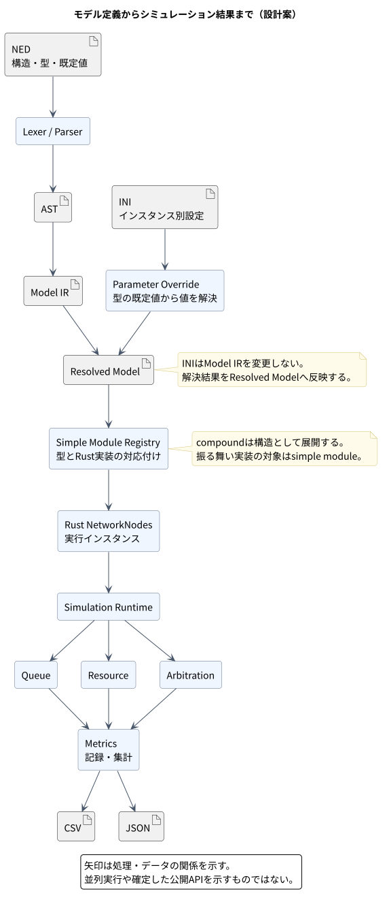
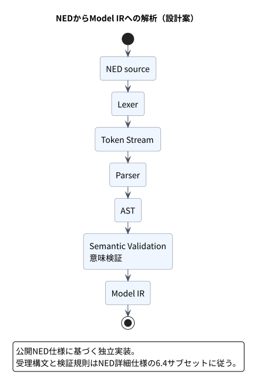
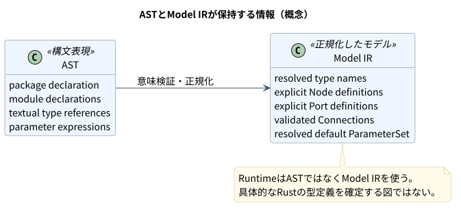
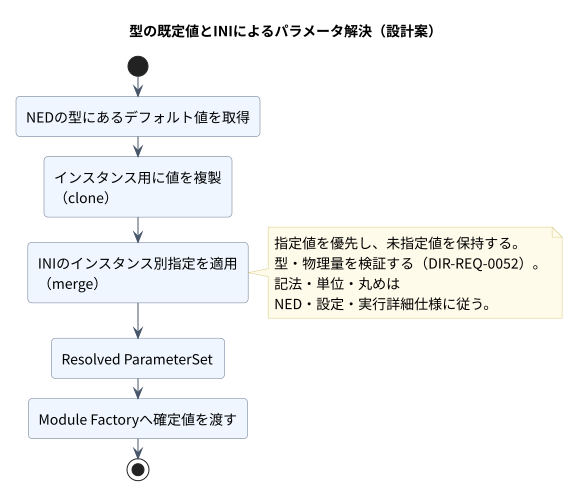
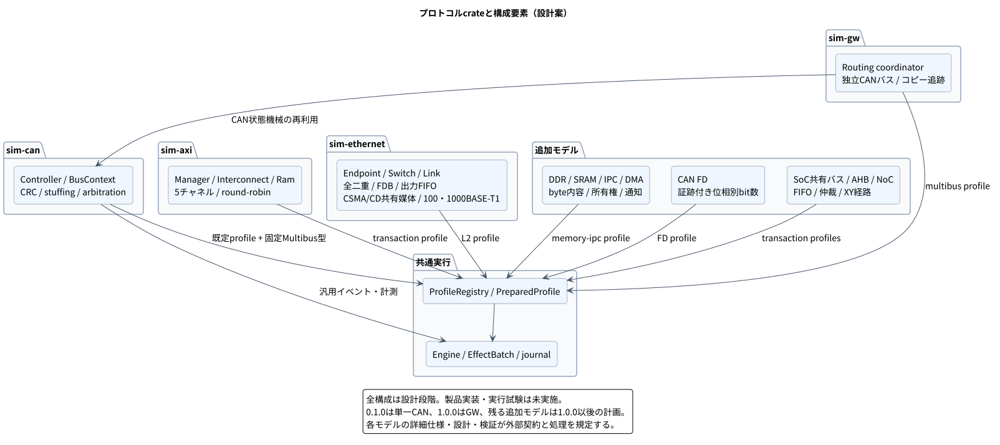
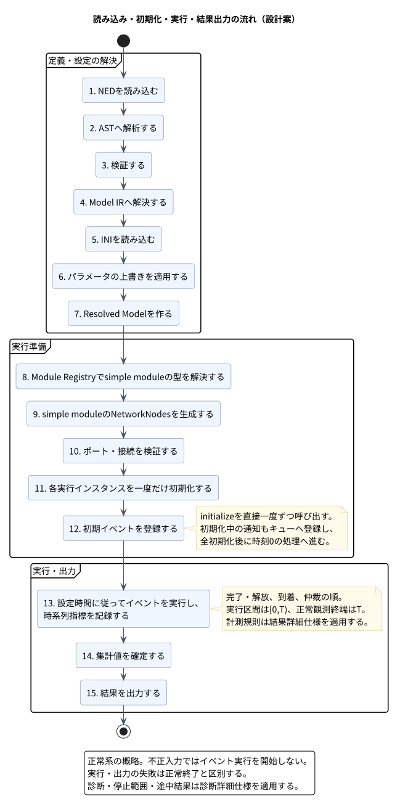

# アーキテクチャ設計書

文書バージョン：`1.1.7`
対象GitHubバージョン：`feat/complete-remaining-capabilities-20261021 @ 082629e1ecb3c966f60a043819c2362ef50e627f`
既存公開部分：`v1.1.6`。2026-10-21の追加部分は実装ブランチ、未公開。

### 更新履歴

| 文書バージョン | 更新日 | 更新内容 |
| --- | --- | --- |
| `1.1.7` | `2026-10-21` | CAN protocol・ISO FD・AXI/AHB/NoC・network計測/保存・専用engine協調実行・版移行の責務を追加 |
| `1.1.6` | `2026-10-17` | 後続10分野の採用構成、Timer通知tokenの公開API、各実行経路と非対応scopeを反映 |
| `1.1.5` | `2026-10-11` | 公開文書整合性監査の修正を反映し、文書PATCHを一つ上げ、対象タグをv1.1.4へ統一 |
| `1.1.4` | `2026-10-08` | 公開Registry・登録モデル共通エンジン・API互換性・再現情報の配置と、追加ネットワーク3 profileの責務分担を反映。追加profileのv1.1.4の公開予定を反映 |
| `1.1.3` | `2026-10-05` | AXI・SoC/AHB/NoC・メモリ/IPCの組込みアダプターと確定snapshotの実装を記録 |
| `1.1.2` | `2026-10-04` | 媒体対とCAN FDの専用input/runtime/output・prepared/snapshotを現行配置へ反映し、公開拡張APIの境界を保持 |
| `1.1.1` | `2026-10-04` | Port policy、copy別wire/class、VLAN別FDB・group交換とprofile別schemaの所有境界を追加し、v1.1.1向け文書版を更新 |
| `1.1.0` | `2026-10-04` | Ethernet payload・snapshot、入力・実行・観測・viewerの所有境界とQoS設計参照を追加 |
| `1.0.2` | `2026-10-04` | NED editor追加に伴うGitHub版v1.0.1を対象に更新。GitHubのPATCH変更のため文書版は維持 |
| `1.0.2` | `2026-10-04` | PR6の診断・仲裁・提供状態とOMNeT由来成果物削除を保持し、mainのNEDエディタ・保存復旧を統合。分岐して公開した履歴を両方保持 |
| `1.0.1` | `2026-10-03` | レビュー修正：目標構成と現行実装を区別し、診断保持APIと再現情報の未対応範囲を追記 |
| `1.0.1` | `2026-10-04` | NEDエディタの7ブロック、共通parse／prepare境界、UIのmodule組立・設定・保存／復旧の実装配置と文書参照を反映 |
| `1.0.0` | `2026-10-03` | 入力・実行・結果・ビューアのソース配置とGWのRX保持・転送責務を反映。文書版を1.0.0、対象タグをv1.0.0に統一 |
| `0.1.1` | `2026-10-03` | 作業内容を集約：CANへの対象限定と要件の詳細化、番号付きIDの4桁化を反映。抽象CANコントローラ・フレーム単位の時間計算・単一バスと次版GW接続の方針を反映。CAN評価モデルの方針確定に伴い、調停の未確定事項の参照を個別TBDへ更新。NEDサブセット、ディレクトリ探索、完全修飾名、境界接続とRust側ポート情報の採用方針を反映。channel型・接続上の適用を採用し、接続構造・経路特性・BUS等の動作の分担を更新。全TBDの決定を詳細仕様へ接続し、時刻・イベント・登録・channel・バッファの採用設計を整合。詳細仕様を正本として責務・所有権・CAN詳細設計の対応を確定し、概念API例を整理。GW・AXI・Ethernetとprofile統合の責務・上流仕様を追加。Ethernet半二重・1000BASE-T1の13要件・3機能・4受け入れ条件と媒体設計を追加。CAN FD・100BASE-T1、SoC・AHB・NoC、メモリ・IPCの構成責務と詳細設計への接続を追加。v0.1公開に合わせ、文書版を0.1.1へ統一し対象タグを確定 |
| `0.1.0` | `2026-09-27` | 文書バージョン、対象GitHubバージョン、更新履歴を追加 |

分岐中にPR6とmainで同じ版番号を別々に公開したため、過去の更新履歴は両方保持している。

文書ID：`architecture`

| 項目 | 内容 |
| --- | --- |
| 状態 | 初期仕様の責務分担を規定済み。共通実行・CAN・GW・AXI・Ethernet・profile統合は詳細設計・検証仕様へ展開済み。CANとGW・複数CAN、Ethernet全二重L2・QoS・VLANに加え、媒体v2・100BASE-T1・CAN FDの内部実装・製品試験を実施。AXI・SoC／AHB／NoC・メモリ／IPCの内部実装と製品照合も[実行記録](verification/results/soc-memory-product-2026-10-05.json)へ保存。現行ソースに公開Registryと登録モデル用共通エンジンを追加し、[拡張runtime検証記録](verification/results/extension-runtime-2026-10-05.json)へ範囲を分けて記録する |
| 正本 | 振る舞いは[分野別詳細仕様](機能仕様書.md#1-正本と分担)、内部アルゴリズムは[実行詳細設計](design/実行詳細設計書.md)と[CAN詳細設計](design/CANモデル詳細設計書.md)を正とする |
| 既存API例の移行 | 旧版の未コンパイルRust型・trait例は本書の責務表と詳細設計への参照へ整理。実装後の正確なRust宣言はソース／生成API文書へ対応付ける |
| 目標設計の拡張 | コアの時刻・予約・journalをプロトコル非依存とし、CANを独立crateでRegistryに登録する。複数bus/GW/AXI/Ethernetの状態はモデル側へ追加する。現行の提供状態は下記のソース配置と公開APIを正とする |
| trace状態 | confirmedは当該設計判断の確定を示す。下流未割当・検証未実行とは別に管理する。全要件の経路の充足は生成トレーサビリティ一覧を参照 |

## 全体構成と依存方向

以下の`sim-core`等は責務を分ける目標設計であり、現在配布しているcrate一覧ではない。現行の実装は[単一crateの配置](#source-layout)と[公開API](#公開apiと互換性)を参照する。Registry・Envelope・Contextは現行ソースの同一crate内で公開し、登録モデル用の共通エンジンへ接続した。組込み13 profileは専用処理のアダプターを維持する。入力の元位置・値の採用元と構築環境を含む再現情報も同一crateへ追加した。設計全体の製品適合と大規模性能は個別に検証する。

| 実装単位 | 所有する責務 | 依存先 |
| --- | --- | --- |
| sim-core | ID、整数時刻、schema識別、エラー等の共通値 | 基本ライブラリ |
| sim-model | descriptor、正規モデル、接続、Registry契約 | sim-core |
| ned-parser / sim-config | AST、参照・階層・接続の解決／INI・量の厳密換算 | sim-core、sim-model |
| sim-runtime | イベントヒープ、Context、効果batch、モデル実行、確定journal | sim-core、sim-model |
| sim-result | 登録計測の集計とJSON/CSV公開 | sim-core、確定journalの読取契約 |
| sim-can | CRC・仲裁・負荷・BusContext・CAN codecs | 共通契約、汎用資源操作 |
| dir-simulator | 公開CLIとdir_simulatorライブラリ、組込み登録集合 | 入力・runtime・result・canの公開操作 |



[図のソース](diagrams/architecture/architecture--simulation-pipeline--component.puml)

### 要件の責務から読む構成と受け渡し

[要件定義書](要件定義書.md)の順序に沿い、構造・条件の準備、実行・資源、モデル固有処理、観測・出力を次の境界で接続する。要件の主親は能力の分解、以下の構成はその実現責務であり、一つの親要件を一つのモジュールへ機械的に対応付けるものではない。

| 要件群 | 担当する構成 | 境界で維持する内容 |
| --- | --- | --- |
| [構造定義](要件定義書.md#dir-req-0005) | [モデル読込](#arch-model-loading)、[モデル・ポート](#arch-node-model) | 型・展開インスタンス・接続の識別と元位置を保持し、構造検証済みのモデルを値解決へ渡す |
| [実験条件の初期化](要件定義書.md#dir-req-0006) | [設定](#arch-configuration)、[正規値](#arch-parameters)、[Registry](#arch-registry)、[ライフサイクル](#arch-lifecycle) | 値の優先順位・型・単位・登録を検証した後に生成・初期化する。prepareの成功とinitializeの成功を区別する |
| [実行と資源](要件定義書.md#dir-req-0007) | [時刻](#arch-time)、[scheduler](#arch-scheduler)、[Context](#arch-model-api)、[資源](#arch-resources) | モデル固有状態の更新とイベント・記録の確定を対応付ける。待ち・転送・伝搬の担当を分け、時間の二重算入を防ぐ |
| [結果取得](要件定義書.md#dir-req-0008) | [計測・結果公開](#arch-results)、[ライフサイクル](#arch-lifecycle) | 確定journalと終了時状態から時系列・集計・再現情報を生成する。出力失敗はモデル上の破棄や未完了と区別する |
| [CAN評価](要件定義書.md#dir-req-0001) | [CANモデル](#arch-domain-models)と共通基盤 | コントローラ候補選出、バス仲裁、転送時間・占有、受信の責務を連携させ、モデル状態と観測結果を同じ要求へ対応付ける |
| [拡張契約](要件定義書.md#dir-req-0122)・[追加モデル選択](要件定義書.md#dir-req-0157) | [Registry](#arch-registry)、[拡張モデル共通](#arch-model-extension)と各profileのcontext | 共通の時刻・journal・診断契約を使い、モデル固有の検証・仲裁・状態・codecを登録する。profileの選択と異なるprofileの同一実行内混成は区別する |

入力失敗の診断、同時刻の再現性、計測値の意味付けは各境界に横断して適用する。親要件の受け入れでは、子の局所規則だけでなく入力から結果への連携を確認する。本文の説明によって未割当の下流経路が埋まるわけではなく、実際の割当は各項目の`trace`と生成一覧で確認する。

### 現行モデルと将来モデルの設計参照

0.1.0の対象はClassical CANである。以下の追加モデルは版付きprofileの設計契約として管理する。v1.1.4までに初期抽象profileを提供しており、要件の階層への配置、製品の実装範囲と試験の合否を分ける。既存の内部設計への入口を示し、新しいcrateやAPIをここで追加定義しない。

| 提供段階・分野 | 構成上の責務 | 詳細設計 |
| --- | --- | --- |
| 共通基盤 | 時刻・予約・確定journal・終了と失敗 | [実行詳細設計](design/実行詳細設計書.md) |
| 0.1.0 Classical CAN | [CANモデル](#arch-domain-models) | [CAN詳細設計](design/CANモデル詳細設計書.md) |
| 将来モデルの共通契約 | [profile選択とモデル別記録](#arch-model-extension) | [複数モデル統合詳細設計](design/複数モデル統合詳細設計書.md) |
| 1.0.0 GW・複数CAN | [GWの独立バスと転送](#arch-gateway) | [GW詳細設計](design/GWモデル詳細設計書.md) |
| CAN FD・100BASE-T1（v1.1.2で提供） | [独立通信profile](#arch-original-network) | [CAN FD・100BASE-T1詳細設計](design/CANFD・100BASE-T1詳細設計書.md) |
| Ethernet L2・QoS・VLAN・媒体（v1.1.0〜v1.1.2で提供） | [L2転送](#arch-ethernet)、[媒体状態](#arch-ethernet-media) | [Ethernet詳細設計](design/Ethernetモデル詳細設計書.md)、[媒体拡張詳細設計](design/Ethernet媒体拡張詳細設計書.md) |
| SoC・AXI・AHB・NoC（v1.1.3で提供） | [共有バス・NoC](#arch-soc-models)、[AXI](#arch-axi) | [SoC・AHB・NoC詳細設計](design/SoC・AHB・NoC詳細設計書.md)、[AXI詳細設計](design/AXIモデル詳細設計書.md) |
| メモリ・IPC（v1.1.3で提供） | [メモリサービス・所有権・通知](#arch-memory-ipc) | [メモリ・IPC詳細設計](design/メモリ・IPC詳細設計書.md) |

## 現行ソースの配置と共有データ

<a id="source-layout"></a>

現行の20組込みprofileと登録拡張モデルは単一crate内で次の責務へ分割する。次の配置図は主要ファイルを示し、モデル別のテスト・補助ファイルは各ディレクトリに置く。`src/lib.rs`は公開入口と再export、`src/lib/`は複数の処理層が利用するデータ契約を持つ。各処理層から共有データへ依存し、共有データから入力・Engine・出力・ツールへは依存しない。

```text
crates/dir-simulator/src/
├── lib.rs                         公開API・互換用再export
├── main.rs                        CLI
├── run.rs                         出力予約→実行→結果公開、RunReport
├── registry/                      公開descriptor・factory・Context、登録profileの準備
├── lib/
│   ├── types.rs                   入力データ型の公開入口
│   ├── types/
│   │   ├── common.rs              実行条件、入力snapshot、Schedule、Diagnostic
│   │   ├── prepared.rs            PreparedSimulationの構成
│   │   ├── can.rs                 Frame、Bus、Controller、Generator、PreparedCan
│   │   ├── gateway.rs             Route、Gateway、PreparedGateway
│   │   └── axi.rs、soc.rs、memory_ipc.rs、ethernet/、canfd.rs、network.rs
│   │                                  追加profileの入力型
│   ├── snapshot.rs                確定結果型の公開入口・Snapshot
│   └── snapshot/
│       ├── common.rs              終了状態、計数、Point、診断
│       ├── can.rs                 要求・受信・バス状態
│       ├── gateway.rs             転送記録と要求ID別の転送系譜
│       └── axi.rs、soc.rs、memory_ipc.rs、ethernet/、canfd.rs
│                                      追加profileの確定結果
├── input.rs                       prepare・共通入力処理
├── input/
│   ├── tests.rs
│   ├── ned.rs                     NED共通処理
│   ├── json_diagnostics.rs        JSON位置付き診断
│   ├── provenance.rs              宣言・採用値・論理rootの再現情報
│   ├── ned/tests.rs
│   ├── can.rs                     CAN入力アダプター
│   ├── can/tests.rs
│   ├── gateway.rs                 CAN間Gateway構成検証
│   └── axi.rs、soc.rs、memory_ipc.rs、canfd.rs、ethernet/、network/、can_ethernet.rs
│                                      追加profileの入力・構成検証
├── runtime.rs                     simulateの公開入口
├── runtime/
│   ├── engine.rs                  実行状態の所有、配送、実行ループ、終了
│   ├── scheduler.rs               予約順序、事前検査、予約公開、dirty
│   ├── registered.rs              登録モデルの共通実行エンジン
│   ├── spool.rs                   観測点の一時JSONL退避
│   ├── can_archive.rs             完了要求・受信台帳の退避
│   ├── axi.rs、soc.rs、memory_ipc.rs、canfd.rs、ethernet/
│   │                                  組込み専用エンジン
│   ├── network.rs、can_ethernet.rs 新3 profileのstaged coordinator
│   ├── can.rs                     CAN初期化・生成・仲裁・送受信
│   ├── can/protocol.rs            CRC・stuff・frame・フィルタ・時間計算
│   ├── can/tests.rs
│   ├── gateway.rs                 経路照合・転送・fanout
│   └── tests.rs                   モデル間の確定状態・失敗境界
├── output.rs                      結果処理の統括
├── output/
│   ├── reservation.rs             出力先検証と排他予約
│   ├── aggregate.rs               型付きレコードの集計
│   ├── model_records.rs           CAN／Gateway結果のschema変換
│   ├── metadata.rs                再現情報
│   ├── metadata/reproduction.rs   確定モデル・採用元・構築環境
│   ├── preparation.rs             準備失敗の結果集合
│   ├── registered.rs              登録モデルのschema2結果
│   ├── axi.rs、soc.rs、memory_ipc.rs、canfd.rs、ethernet/、network.rs
│   │                                  追加profileの結果・指標
│   ├── stream.rs、disk_sort.rs、contribution_sort.rs
│   │                                  CAN/Gatewayの逐次集計・外部ソート
│   ├── json.rs                    JSON／JSONL
│   ├── csv.rs                     CSV
│   ├── publish.rs                 保存・hash・manifest最終公開
│   └── tests.rs
├── tool.rs                        補助ツールの公開入口
└── tool/
    ├── viewer.rs                  ビューア生成
    ├── viewer/
    │   ├── tests.rs
    │   └── assets/                index.html、style.cssとCAN・Ethernet・transaction用JS
    └── ned-editor/                ローカルNEDエディタ
        ├── mod.rs、server.rs      CLI入口・loopback HTTP
        ├── input.rs、analysis.rs  snapshot取得・共通parse/prepare
        ├── model.rs、commands.rs  原文と履歴・構造操作
        ├── composition.rs         module・境界ポート・gateの組立
        ├── template.rs、builtin.rs 内部テンプレート・全標準部品
        ├── settings.rs            INI・Gateway・送信設定フォーム
        ├── output.rs              一式保存・競合確認・復旧
        ├── controller.rs、view.rs  操作統括・画面投影
        ├── templates/             バイナリに埋め込むNED・INI・JSON
        └── assets/                index.html、style.css、input.js、view.js
```

Rustの外部結合試験は`crates/dir-simulator/tests/`、ビューアとNEDエディタのJavaScript／ブラウザ試験はルートの`tests/`へ置く。NEDエディタは`tool/ned-editor/`に実装する。独自文法を設けず、共通入力の`inspect_config`・`parse_ned`・`prepare_with_source`を内部snapshotへ適用する。原文・構造・配置・履歴を内部モデルに保持し、共有型変更と実体別設定を区別する。保存前の正式検証、版付き確認、単一writer、保存競合・復旧はエディタ側で統括する。[NED-editor仕様書](tools/ned-editor/NED-editor仕様書.md)と[取扱説明書](tools/ned-editor/NED-editor取扱説明書.md)に責務・操作・検証条件を記載する。

| 構成 | 共通部分 | モデル固有部分 |
| --- | --- | --- |
| `PreparedSimulation` | `common: PreparedCommon`にprofile選択、network、module_paths、時間・イベント上限、計測窓、channel数、入力パスと取得内容 | `can: PreparedCan`にBus／Controller／Generator・所属表・ビットレート。`gateway: PreparedGateway`にCAN間Gateway／RouteとController所有表。`ethernet: Option<PreparedEthernet>`にdevice・方向・generator・class・媒体設定。`canfd: Option<PreparedCanFd>`に専用Bus・二速度・Controller・証跡付きframe cache。`axi`・`soc`・`memory_ipc`に対応profileの検証済み入力、`registered`にRegistryと登録実行構成・合成ネットワークを保持 |
| `Snapshot` | `common: CommonSnapshot`に終了状態、時刻、成功・未処理イベント数、観測点、診断 | `can: CanSnapshot`に要求・受信・バス状態。`gateway: GatewaySnapshot`にForwardRecordと`request_lineage`。`ethernet: Option<EthernetSnapshot>`に元frame・hop transfer・reception・媒体attempt。`canfd: Option<CanFdSnapshot>`に専用要求・受信・Bus状態。`axi`・`soc`・`memory_ipc`にtransaction別結果、`registered`に登録モデルの確定レコード・配送、`network: Option<serde_json::Value>`に合成ネットワークの確定状態を保持 |

`request_lineage`は要求IDをキーとし、元要求ID・親要求ID・GWホップ数をGateway側で所有する。通常の生成要求にも初期の系譜を登録し、転送コピーはその系譜を引き継ぐ。CANの`Request`へGatewayフィールドを混在させず、要求の並べ替えに依存しない対応を保つ。runtime内のヒープ、cursor、WireFrame、キュー、active状態はEngineが所有し、共有データへ移さない。`Snapshot`は確定結果であり、実行再開用の完全なcheckpointではない。

### 公開APIと互換性

`dir_simulator::{prepare, run, RunReport, Diagnostic, PreparedSimulation}`、`types`、`snapshot`、`can::{serialize, accepts, end_time, WireFrame}`、`viewer::write`の公開パスを維持する。`run_with_diagnostics`と`RunFailure`に加え、`prepare_with_registry`、`run_config`、`run_config_with_registry`を公開する。登録型と`Model`／`Channel`／`Context`は`dir_simulator::registry`に置く。`types`／`snapshot`は`#[path]`で共有データの入口へ対応付け、`can`／`viewer`は実装先から再exportする。

従来の`prepare(&Path)`は組込みprofileを準備する一引数の操作として維持し、`prepare_with_registry(&Path, Registry)`は静的登録済み拡張profileを受け取る。`run_config`と`run_config_with_registry`は準備から結果公開まで担当し、準備失敗も取得済み入力から5ファイルへ保存する。`run`は従来どおり`Diagnostic`をエラーとして返し、結果公開前に実行診断があれば最後の診断メッセージへ残す。診断を構造化して扱う呼出し側は[run_with_diagnostics](../crates/dir-simulator/src/run.rs)を使用する。失敗時の`RunFailure`は終了コードを決める最後の`diagnostic`、それより前の`prior_diagnostics`、公開失敗直前のシミュレーション終了状態`original_termination`を保持する。CLIの`run`は`run_config`を使用する。正確なRust宣言は[公開入口](../crates/dir-simulator/src/lib.rs)と実装先を正とする。

共有データのフィールド配置はRust APIの変更となる。呼出し側は例えば`prepared.controllers`を`prepared.can.controllers`、`prepared.time_limit_ps`を`prepared.common.time_limit_ps`、`snapshot.requests`を`snapshot.can.requests`、`snapshot.termination`を`snapshot.common.termination`へ変更する。要求の転送系譜は`request.origin_request_id`等から`snapshot.gateway.request_lineage[&request.request_id]`へ変更する。公開名の再exportだけで旧フィールド参照を互換にできるものではない。

CAN/Gatewayの`run`内部では`CanSnapshot.archive`が所有する一時台帳へ完了済み要求・受信・転送を退避し、停止時の未完了も凍結する。外部の`runtime::simulate`は従来どおりメモリ上の配列を返す。`CanSnapshot`を構造体リテラルで作る呼出し側は`archive: None`を指定する。出力処理はarchiveの有無に応じて同じschemaへ射影する。`RunReport.event_processing_wall_seconds`は保存結果と分離したイベントループ実時間である。

JSON／CSVのschema、項目、表記、ソート順、CLIの契約は維持し、内部の型構成をそのままserializeしない。組込みprofileは専用エンジンを公開Registryのアダプターとして維持し、追加登録モデルは共通実行エンジンを使用する。従来の構成変更は[検証記録](verification/results/source-layout-2026-10-03.json)、今回の登録実行は[拡張runtime検証記録](verification/results/extension-runtime-2026-10-05.json)で範囲を分けて管理する。

## 時刻と正確算術

<a id="arch-time"></a>

```trace
{
  "id": "architecture#arch-time",
  "stage": "architecture",
  "requirements": [
    "DIR-REQ-0007",
    "DIR-REQ-0024",
    "DIR-REQ-0031",
    "DIR-REQ-0036",
    "DIR-REQ-0037",
    "DIR-REQ-0045",
    "DIR-REQ-0046",
    "DIR-REQ-0052",
    "DIR-REQ-0055"
  ],
  "upstream": [
    "spec-runtime#time",
    "spec-runtime#termination",
    "spec-resources#delay",
    "spec-runtime#event-order"
  ],
  "state": "confirmed",
  "pending": []
}
```

設定の時間・単位（DIR-REQ-0024・0052）を整数psへ正確換算し、量と帯域からの転送時間（0036）と時刻反映（0037）へ同じchecked算術を適用する。入力値の所有は[入力・設定詳細設計](design/入力・設定詳細設計書.md)、実行時の加算・丸めは[実行詳細設計](design/実行詳細設計書.md#scheduler)が担当する。

| 責務 | 採用する構成・判断 |
| --- | --- |
| 表現 | SimTimeとDurationはu64 ps。入力十進数は有理数として正確換算し、算出期間だけceilする。 |
| 所有 | Engineが現在時刻を持ち、モデルはContextから参照する。時刻進行は最小有効イベントに従う。 |
| 計算境界 | ビット数からEOF・releaseへの変換はCANが行い、汎用側は検査済み予約時刻を扱う。 |
| 正本 | [詳細機能仕様](specs/実行詳細機能仕様書.md#time)、[詳細設計](design/実行詳細設計書.md#scheduler) |

## イベントと型付き配送

<a id="arch-events"></a>

```trace
{
  "id": "architecture#arch-events",
  "stage": "architecture",
  "requirements": [
    "DIR-REQ-0007",
    "DIR-REQ-0031",
    "DIR-REQ-0032",
    "DIR-REQ-0033",
    "DIR-REQ-0045",
    "DIR-REQ-0046"
  ],
  "upstream": [
    "spec-runtime#event-order",
    "spec-runtime#delivery",
    "spec-interfaces#extension-contract"
  ],
  "state": "confirmed",
  "pending": []
}
```

| 責務 | 採用する構成・判断 |
| --- | --- |
| Envelope | イベントID、送信元・宛先、要求ID、時刻とschema名・版・bytes、受信port。TimerTokenはEngineの予約が所有し、Timerのcallback中にContext.current_timer_tokenから取得する。Envelopeの項目追加やpayloadへの識別子埋込みは不要。 |
| 拡張 | payloadの復号はRegistryに登録したcodecへ委譲。コアがCAN ID・CRCを解釈することは範囲注釈上の対象外。 |
| 完了と到着 | phase0は完了／解放、phase1は生成／到着／Timer、phase2はdirty資源の仲裁。 |
| 正本 | [詳細機能仕様](specs/実行詳細機能仕様書.md#delivery)、[詳細設計](design/実行詳細設計書.md#dispatch) |

## スケジューラと停止

<a id="arch-scheduler"></a>

```trace
{
  "id": "architecture#arch-scheduler",
  "stage": "architecture",
  "requirements": [
    "DIR-REQ-0007",
    "DIR-REQ-0024",
    "DIR-REQ-0031",
    "DIR-REQ-0042",
    "DIR-REQ-0045",
    "DIR-REQ-0046",
    "DIR-REQ-0055",
    "DIR-REQ-0095",
    "DIR-REQ-0096",
    "DIR-REQ-0119",
    "DIR-REQ-0120"
  ],
  "upstream": [
    "spec-runtime#event-order",
    "spec-runtime#termination",
    "spec-runtime#time",
    "spec-runtime#examples"
  ],
  "state": "confirmed",
  "pending": []
}
```

実行条件（DIR-REQ-0024）のTと観測区間を確定し、時系列（0042）が正常終了時のTまたは失敗時の確定境界Hまでの状態を記録できるよう、凍結snapshotへ終了理由・H・最後の成功時刻を渡す。[実行詳細設計](design/実行詳細設計書.md#scheduler)と[結果処理詳細設計](design/結果処理詳細設計書.md)の間で同じ境界を共有する。

| 責務 | 採用する構成・判断 |
| --- | --- |
| 順序 | (time,delta,phase,sequence)の昇順。dirty集合をphase1固定点で封じ、資源パス順にphase2を予約する。 |
| 予約 | 成功batchで順序付き予約、取消しはtoken表で管理。無効ヒープ要素は時刻・件数から除く。 |
| 停止 | [0,T)で処理し、正常終端はT。上限と失敗はコミットprefixを凍結。論理generator将来予定を終了理由へ算入。 |
| 正本 | [詳細機能仕様](specs/実行詳細機能仕様書.md#event-order)、[詳細設計](design/実行詳細設計書.md#scheduler) |

## モデル・ポート・channelの所有

<a id="arch-node-model"></a>

```trace
{
  "id": "architecture#arch-node-model",
  "stage": "architecture",
  "requirements": [
    "DIR-REQ-0019",
    "DIR-REQ-0020",
    "DIR-REQ-0021",
    "DIR-REQ-0023",
    "DIR-REQ-0030",
    "DIR-REQ-0033",
    "DIR-REQ-0051",
    "DIR-REQ-0073",
    "DIR-REQ-0074",
    "DIR-REQ-0075",
    "DIR-REQ-0076"
  ],
  "upstream": [
    "spec-ned#implementation",
    "spec-ned#connections",
    "spec-interfaces#extension-contract",
    "spec-diagnostics#lifecycle"
  ],
  "state": "confirmed",
  "pending": []
}
```

| 責務 | 採用する構成・判断 |
| --- | --- |
| 構造と実行 | compound/networkは静的構造として展開し、simpleだけをfactoryで実体化する。正規インスタンスパスから安定IDを与える。 |
| ポート | 名前・方向・protocol・message・schema版をdescriptorで照合。compound境界の内外接続を解決してsimple間経路を作る。 |
| channel | NED型と辺ごとのインスタンスを分離。初期FixedDelayはpropagation-delay能力を提供し、適用時刻はモデルの責務。 |
| 正本 | [詳細機能仕様](specs/NED詳細機能仕様書.md#implementation)、[詳細設計](design/実行詳細設計書.md#registry) |

## 正規値とパラメータ

<a id="arch-parameters"></a>

```trace
{
  "id": "architecture#arch-parameters",
  "stage": "architecture",
  "requirements": [
    "DIR-REQ-0006",
    "DIR-REQ-0018",
    "DIR-REQ-0024",
    "DIR-REQ-0025",
    "DIR-REQ-0026",
    "DIR-REQ-0027",
    "DIR-REQ-0052",
    "DIR-REQ-0053",
    "DIR-REQ-0079",
    "DIR-REQ-0080",
    "DIR-REQ-0081",
    "DIR-REQ-0119"
  ],
  "upstream": [
    "spec-configuration#values",
    "spec-configuration#ini",
    "spec-ned#syntax",
    "spec-configuration#diagnostics",
    "spec-diagnostics#diagnostic-schema"
  ],
  "state": "confirmed",
  "pending": []
}
```

値域と正確換算（DIR-REQ-0119）は、入力の数値表記、物理量、u64等の格納範囲を段階ごとに検査する。[入力・設定詳細設計](design/入力・設定詳細設計書.md#values)へ元位置・採用元を含めて割り当て、暗黙の単位丸めやオーバーフローによる値の変化を防ぐ。

| 責務 | 採用する構成・判断 |
| --- | --- |
| 値 | dimensionless整数・binary64・bool・stringと、時間ps／bitrateの正確整数を区別。生リテラルと位置は診断用に保持。 |
| 優先 | 型のdefault又はリテラルへインスタンスINIを適用し、descriptorの型・物理量・値域・必須性を検査。 |
| 実装境界 | 一般のパーサ／値解決の内部データ構造は[入力・設定詳細設計](design/入力・設定詳細設計書.md)へ展開。受理・拒否の外部判断は設定仕様で確定。 |
| 正本 | [詳細機能仕様](specs/設定詳細機能仕様書.md#values) |

## 登録と実装選択

<a id="arch-registry"></a>

```trace
{
  "id": "architecture#arch-registry",
  "stage": "architecture",
  "requirements": [
    "DIR-REQ-0006",
    "DIR-REQ-0028",
    "DIR-REQ-0029",
    "DIR-REQ-0030",
    "DIR-REQ-0053",
    "DIR-REQ-0078",
    "DIR-REQ-0122",
    "DIR-REQ-0015",
    "DIR-REQ-0017",
    "DIR-REQ-0058",
    "DIR-REQ-0117",
    "DIR-REQ-0118"
  ],
  "upstream": [
    "spec-ned#implementation",
    "spec-interfaces#operation",
    "spec-interfaces#extension-contract",
    "spec-diagnostics#lifecycle",
    "spec-diagnostics#diagnostic-schema"
  ],
  "state": "confirmed",
  "pending": []
}
```

| 責務 | 採用する構成・判断 |
| --- | --- |
| 二段解決 | NED型の完全修飾名から@class実装キーへ、次にmodule/channel factoryへ解決する。 |
| 凍結 | prepareで登録集合を固定し、全入力照合後にモデルを構築。異なるprofile/schema/policyの追加は別の登録として扱う。 |
| 既定方式 | 初期CAN、FixedDelay、drop-newest、固定優先度とCAN仲裁、周期／明示負荷、JSON/CSVを登録する。 |
| 正本 | [詳細機能仕様](specs/インタフェース詳細機能仕様書.md#extension-contract)、[詳細設計](design/実行詳細設計書.md#registry) |

## Contextとコミット境界

<a id="arch-model-api"></a>

```trace
{
  "id": "architecture#arch-model-api",
  "stage": "architecture",
  "requirements": [
    "DIR-REQ-0007",
    "DIR-REQ-0030",
    "DIR-REQ-0031",
    "DIR-REQ-0032",
    "DIR-REQ-0033",
    "DIR-REQ-0045",
    "DIR-REQ-0046",
    "DIR-REQ-0055",
    "DIR-REQ-0056",
    "DIR-REQ-0122",
    "DIR-REQ-0034",
    "DIR-REQ-0037",
    "DIR-REQ-0118",
    "DIR-REQ-0120"
  ],
  "upstream": [
    "spec-interfaces#extension-contract",
    "spec-runtime#delivery",
    "spec-runtime#event-order",
    "spec-diagnostics#lifecycle",
    "spec-diagnostics#termination"
  ],
  "state": "confirmed",
  "pending": []
}
```

| 責務 | 採用する構成・判断 |
| --- | --- |
| 操作 | schedule/send/cancel/request_arbitration/observeを一callbackのEffectBatchへ蓄積する。 |
| 公開 | 全コマンドを検査後FES・dirty・token・journalへ一括公開。CANも同じコミット境界に参加する。 |
| 失敗 | 未公開batchを破棄し実行停止。結果はjournalから取得する。注：任意モデル内部の全状態複製・ロールバックは対象外。 |
| 正本 | [詳細機能仕様](specs/インタフェース詳細機能仕様書.md#extension-contract)、[詳細設計](design/実行詳細設計書.md#dispatch) |

## キュー・遅延・占有

<a id="arch-resources"></a>

```trace
{
  "id": "architecture#arch-resources",
  "stage": "architecture",
  "requirements": [
    "DIR-REQ-0007",
    "DIR-REQ-0034",
    "DIR-REQ-0035",
    "DIR-REQ-0036",
    "DIR-REQ-0037",
    "DIR-REQ-0038",
    "DIR-REQ-0039",
    "DIR-REQ-0040",
    "DIR-REQ-0041",
    "DIR-REQ-0042",
    "DIR-REQ-0043",
    "DIR-REQ-0083",
    "DIR-REQ-0084",
    "DIR-REQ-0085",
    "DIR-REQ-0086",
    "DIR-REQ-0087",
    "DIR-REQ-0088",
    "DIR-REQ-0089",
    "DIR-REQ-0090",
    "DIR-REQ-0091"
  ],
  "upstream": [
    "spec-resources#queue",
    "spec-resources#resource",
    "spec-resources#delay",
    "spec-results#measurement-points",
    "spec-results#aggregation",
    "spec-can-models#arbitration",
    "spec-runtime#event-order"
  ],
  "state": "confirmed",
  "pending": []
}
```

[実行詳細設計の資源](design/実行詳細設計書.md#resources)が容量、候補、選出、占有と時間成分を所有し、成功更新時に観測を確定journalへ渡す。[結果処理詳細設計](design/結果処理詳細設計書.md)はその観測から標本・積分・集計を計算する。資源状態の更新と計測値の確定を別の責務として双方検証する。

| 責務 | 採用する構成・判断 |
| --- | --- |
| 汎用操作 | 有界offer/peek/takeとowner・解放時刻を提供。選出policyと溢れpolicyは登録境界で分離。 |
| CAN所有 | 一BusContextがcontroller別待機キューとbus占有を持ち、SOFの勝者取出しと占有を一遷移で確定。 |
| 計測 | 内部コンテナから直接終了結果を組み立てず、確定した観測差分をjournalへ反映する。 |
| 正本 | [詳細機能仕様](specs/資源詳細機能仕様書.md)、[詳細設計](design/CANモデル詳細設計書.md#state-machine) |

## NEDの読込みと構造検証

<a id="arch-model-loading"></a>

```trace
{
  "id": "architecture#arch-model-loading",
  "stage": "architecture",
  "requirements": [
    "DIR-REQ-0005",
    "DIR-REQ-0015",
    "DIR-REQ-0016",
    "DIR-REQ-0017",
    "DIR-REQ-0018",
    "DIR-REQ-0019",
    "DIR-REQ-0020",
    "DIR-REQ-0021",
    "DIR-REQ-0022",
    "DIR-REQ-0023",
    "DIR-REQ-0053",
    "DIR-REQ-0073",
    "DIR-REQ-0074",
    "DIR-REQ-0075",
    "DIR-REQ-0076",
    "DIR-REQ-0077",
    "DIR-REQ-0078",
    "DIR-REQ-0082"
  ],
  "upstream": [
    "spec-ned#syntax",
    "spec-ned#implementation",
    "spec-ned#connections",
    "spec-ned#examples",
    "spec-configuration#diagnostics",
    "spec-diagnostics#diagnostic-schema"
  ],
  "state": "confirmed",
  "pending": []
}
```

| 責務 | 採用する構成・判断 |
| --- | --- |
| 処理順 | 再帰探索→package整合→字句／構文→型表→全宣言検査→選択network展開→接続検証。詳細な順序はNED・診断仕様を正とする。 |
| AST/IR | ASTは元位置と表記、IRは解決済み完全名・ノード・端点・接続・defaultを保持する。INIの変更はResolvedModelへ置く。 |
| 継続 | [入力・設定詳細設計](design/入力・設定詳細設計書.md)でAST・IR・展開・元位置・接続の内部処理を規定し、[入力・設定検証](verification/cases/入力・設定検証仕様書.md)で正常・境界・異常を確認する。製品試験の実施範囲と残条件は[受け入れ実施記録](verification/results/acceptance-2026-10-08.md)を参照する。 |
| 正本 | [詳細機能仕様](specs/NED詳細機能仕様書.md) |

## INIと実験条件

<a id="arch-configuration"></a>

```trace
{
  "id": "architecture#arch-configuration",
  "stage": "architecture",
  "requirements": [
    "DIR-REQ-0006",
    "DIR-REQ-0024",
    "DIR-REQ-0025",
    "DIR-REQ-0026",
    "DIR-REQ-0027",
    "DIR-REQ-0052",
    "DIR-REQ-0053",
    "DIR-REQ-0055",
    "DIR-REQ-0057",
    "DIR-REQ-0079",
    "DIR-REQ-0080",
    "DIR-REQ-0081",
    "DIR-REQ-0119",
    "DIR-REQ-0121"
  ],
  "upstream": [
    "spec-configuration#ini",
    "spec-configuration#values",
    "spec-configuration#diagnostics",
    "spec-interfaces#operation",
    "spec-diagnostics#diagnostic-schema"
  ],
  "state": "confirmed",
  "pending": []
}
```

読取り不能（DIR-REQ-0121）と型・単位・値域違反（0119）は、入力snapshotを確定する前にファイル／キーの元位置と共通診断を対応付ける。[入力・設定詳細設計](design/入力・設定詳細設計書.md)が取得・解決を、ライフサイクルが実行callback開始前の停止を担当する。

| 責務 | 採用する構成・判断 |
| --- | --- |
| 役割 | Generalの実行値・インスタンス値、Channel節の辺別値を区別し、正確換算後にResolvedModelへ渡す。 |
| 再現入力 | NED/INI/workloadの取得bytesと確定値をsnapshotへ保存し、結果メタデータのhashと対応付ける。 |
| 入力不正 | 未知・重複・欠落・単位違反を準備段階で診断し、対象モデルをinitializeする前に終了する。 |
| 正本 | [詳細機能仕様](specs/設定詳細機能仕様書.md) |

## 計測と結果公開

<a id="arch-results"></a>

```trace
{
  "id": "architecture#arch-results",
  "stage": "architecture",
  "requirements": [
    "DIR-REQ-0008",
    "DIR-REQ-0042",
    "DIR-REQ-0043",
    "DIR-REQ-0044",
    "DIR-REQ-0054",
    "DIR-REQ-0056",
    "DIR-REQ-0083",
    "DIR-REQ-0084",
    "DIR-REQ-0085",
    "DIR-REQ-0086",
    "DIR-REQ-0087",
    "DIR-REQ-0088",
    "DIR-REQ-0089",
    "DIR-REQ-0090",
    "DIR-REQ-0091",
    "DIR-REQ-0092",
    "DIR-REQ-0093",
    "DIR-REQ-0094",
    "DIR-REQ-0095",
    "DIR-REQ-0096",
    "DIR-REQ-0117",
    "DIR-REQ-0120"
  ],
  "upstream": [
    "spec-results#measurement-points",
    "spec-results#aggregation",
    "spec-results#result-schema",
    "spec-results#atomic-output",
    "spec-diagnostics#termination",
    "spec-interfaces#operation",
    "spec-results#experiment-metadata"
  ],
  "state": "confirmed",
  "pending": []
}
```

実験条件の識別（DIR-REQ-0117）は取得済み入力bytesのhash、確定値、profile・登録版・モデル前提をmetadataへ対応付ける。終了時の未完了（0120）は予定値で補完せず、同じ確定snapshotと[部分公開契約](specs/結果詳細機能仕様書.md#atomic-output)を[結果処理詳細設計](design/結果処理詳細設計書.md)へ割り当てる。

| 責務 | 採用する構成・判断 |
| --- | --- |
| 入力 | コミット済みjournalとmetadata・診断集合を受け取る。event_seqとeffect_seqを保持し、出力seqは保存順として別採番。 |
| 集計 | 37登録指標の観測点・母数・対象・窓・丸めを結果仕様どおり適用。モデル別台帳はprofile/schema版で解釈。 |
| 公開 | 5ファイルを一時dirへ書きhash検査し、manifestを最後に公開。完全schemaと生成例は結果仕様を参照。 |
| 継続 | [結果処理詳細設計](design/結果処理詳細設計書.md)と[結果処理検証](verification/cases/結果処理検証仕様書.md)で集計・schema・メタデータ・公開失敗を具体化。製品I/O試験の実施範囲と残条件は[受け入れ実施記録](verification/results/acceptance-2026-10-08.md)を参照する。 |
| 正本 | [詳細機能仕様](specs/結果詳細機能仕様書.md) |

## CANモデルと将来モデル

<a id="arch-domain-models"></a>

```trace
{
  "id": "architecture#arch-domain-models",
  "stage": "architecture",
  "requirements": [
    "DIR-REQ-0001",
    "DIR-REQ-0006",
    "DIR-REQ-0007",
    "DIR-REQ-0019",
    "DIR-REQ-0024",
    "DIR-REQ-0033",
    "DIR-REQ-0034",
    "DIR-REQ-0035",
    "DIR-REQ-0036",
    "DIR-REQ-0037",
    "DIR-REQ-0038",
    "DIR-REQ-0039",
    "DIR-REQ-0040",
    "DIR-REQ-0041",
    "DIR-REQ-0045",
    "DIR-REQ-0046",
    "DIR-REQ-0051",
    "DIR-REQ-0058",
    "DIR-REQ-0097",
    "DIR-REQ-0098",
    "DIR-REQ-0099",
    "DIR-REQ-0100",
    "DIR-REQ-0101",
    "DIR-REQ-0102",
    "DIR-REQ-0103",
    "DIR-REQ-0104",
    "DIR-REQ-0105",
    "DIR-REQ-0106",
    "DIR-REQ-0107",
    "DIR-REQ-0108",
    "DIR-REQ-0109",
    "DIR-REQ-0110",
    "DIR-REQ-0111",
    "DIR-REQ-0112",
    "DIR-REQ-0113",
    "DIR-REQ-0114",
    "DIR-REQ-0115",
    "DIR-REQ-0116",
    "DIR-REQ-0120",
    "DIR-REQ-0122"
  ],
  "upstream": [
    "spec-can-models#profile",
    "spec-can-models#frame-input",
    "spec-can-models#arbitration",
    "spec-can-models#wire-time",
    "spec-can-models#ack-errors",
    "spec-can-models#workload",
    "spec-can-models#controller",
    "spec-can-models#examples",
    "spec-interfaces#extension-contract",
    "spec-resources#resource",
    "spec-resources#delay",
    "spec-ned#implementation",
    "spec-ned#connections",
    "spec-interfaces#operation",
    "spec-resources#queue",
    "spec-runtime#event-order",
    "spec-runtime#delivery",
    "spec-runtime#examples",
    "spec-results#measurement-points",
    "spec-results#aggregation",
    "spec-results#experiment-metadata",
    "spec-results#result-schema"
  ],
  "state": "confirmed",
  "pending": []
}
```

負荷の準備・実行（DIR-REQ-0006・0007・0024）は、設定snapshotを検証済みgenerator定義へ渡し、全入力を検査した後にT未満の発火だけを生成する責務である。[CAN詳細設計](design/CANモデル詳細設計書.md#workload-validation)で、同じNEDに異なる実験条件を与えた際の初期化・発火・記録を対応付ける。共通能力の組合せと拡張契約（0019・0051・0122）は[Registry設計](design/実行詳細設計書.md#registry)が担当する。

| 責務 | 採用する構成・判断 |
| --- | --- |
| プロファイル | can.cc.ideal.v1は11/29bitデータ、理想ACK、単一共有bus、content依存CRC/stuff/EOF/release計算を提供。 |
| 所有状態 | BusContext、controller別queue、RequestState、ReceiverState、dispatcher。状態遷移とpayload codecはCAN詳細設計を正とする。 |
| 検証 | bit列・CRC・stuff位置の固定vectors、三ControllerのNED/INI/workloadと期待値をCAN検証仕様へ接続。 |
| 追加モデル | GW／独立複数bus、AXI／Ethernetは同じ登録境界へ追加。本書後半の各モデル構成と詳細設計に責務を規定 |
| 正本 | [詳細機能仕様](specs/models/CANモデル詳細機能仕様書.md)、[詳細設計](design/CANモデル詳細設計書.md) |

## 準備・実行・終了・診断

<a id="arch-lifecycle"></a>

```trace
{
  "id": "architecture#arch-lifecycle",
  "stage": "architecture",
  "requirements": [
    "DIR-REQ-0005",
    "DIR-REQ-0006",
    "DIR-REQ-0007",
    "DIR-REQ-0008",
    "DIR-REQ-0024",
    "DIR-REQ-0030",
    "DIR-REQ-0031",
    "DIR-REQ-0032",
    "DIR-REQ-0033",
    "DIR-REQ-0044",
    "DIR-REQ-0045",
    "DIR-REQ-0046",
    "DIR-REQ-0053",
    "DIR-REQ-0055",
    "DIR-REQ-0056",
    "DIR-REQ-0118",
    "DIR-REQ-0119",
    "DIR-REQ-0120",
    "DIR-REQ-0121"
  ],
  "upstream": [
    "spec-interfaces#operation",
    "spec-diagnostics#lifecycle",
    "spec-diagnostics#termination",
    "spec-runtime#termination",
    "spec-runtime#event-order",
    "spec-runtime#delivery",
    "spec-diagnostics#failure-examples",
    "spec-diagnostics#diagnostic-schema"
  ],
  "state": "confirmed",
  "pending": []
}
```

正常例・失敗例を公開操作へ接続し、入力取得・値域違反（DIR-REQ-0119・0121）、初期化、実行、finish、出力（0044・0056）の各境界でRunReportとCLI終了コードを確定する。停止時の未完了（0120）は成功journalから保存する。[ライフサイクル詳細設計](design/実行詳細設計書.md#lifecycle)と[利用フロー・品質検証](verification/cases/利用フロー・品質検証仕様書.md)で各工程の連携と失敗注入を規定する。

| 責務 | 採用する構成・判断 |
| --- | --- |
| 準備 | validateは入力と登録・構成検証まで。runは出力先確認、準備、factory、initialize、実行、snapshot、finish、出力を担当。 |
| 失敗 | 一次診断と二次診断、準備／実行／出力の優先を共通契約へ集約。RunReportをCLIとライブラリの共通結果とする。 |
| 検証 | 共通実行検証仕様のbatch失敗・finish失敗・I/O失敗のケースへ対応。 |
| 正本 | [詳細機能仕様](specs/診断詳細機能仕様書.md)、[詳細設計](design/実行詳細設計書.md#dispatch) |

## 構造・ライフサイクルの図

| 図 | ソース |
| --- | --- |
|  | [PlantUML](diagrams/architecture/architecture--ned-parsing--activity.puml) |
|  | [PlantUML](diagrams/architecture/architecture--ast-model-ir--class.puml) |
|  | [PlantUML](diagrams/architecture/architecture--parameter-resolution--activity.puml) |
|  | [PlantUML](diagrams/architecture/architecture--protocol-models--component.puml) |
|  | [PlantUML](diagrams/architecture/architecture--runtime-lifecycle--activity.puml) |

## 実装と確認の順序

| 段階 | 成果と確認先 |
| --- | --- |
| 共通値・Registry・入力 | 型／量／schemaの検査を実装し、NED/INIの完全例をprepareで受理する |
| スケジューラ・journal | 共通実行検証仕様で時刻・同時刻・取消し・失敗prefixを確認する |
| CAN serializer・BusContext | CAN検証仕様の独立vectorsと状態遷移ケースを照合する |
| 結果・CLI統合 | 5ファイルschema、読み戻し、診断・exit codeを確認する |
| 性能・拡張適合 | [品質方針](品質・配布方針.md)とDIR-AC-0027を検証し、結果を実測記録として追加する |

## GWの構成

<a id="arch-gateway"></a>

```trace
{
  "id": "architecture#arch-gateway",
  "stage": "architecture",
  "requirements": [
    "DIR-REQ-0123",
    "DIR-REQ-0124",
    "DIR-REQ-0125",
    "DIR-REQ-0126",
    "DIR-REQ-0127",
    "DIR-REQ-0128",
    "DIR-REQ-0129",
    "DIR-REQ-0130",
    "DIR-REQ-0131",
    "DIR-REQ-0132"
  ],
  "upstream": [
    "spec-gw-models#configuration",
    "spec-gw-models#forwarding",
    "spec-gw-models#payload-results"
  ],
  "state": "confirmed",
  "pending": []
}
```

| 責務 | 内容 |
| --- | --- |
| 所有・依存 | sim-gwはNED compoundに紐付くrouting coordinatorを全simple構築後に生成する。dir.can.MultibusController/Busの固定descriptorは既存CANコードを再利用し、BusContextはバスごとに独立する。coordinatorは静的経路・区間所有者・非循環を準備検査し、受信通知時にingressの有限RX枠を受理し、copyとegress CAN要求を原子batchで連携する。正容量TX満杯はRX保持とwaiting_txで待ち、全枝の受理又は終端後にRXを解放する。RX満杯破棄は元CAN成功・受信とは別に記録する。WireFrameはnative準備計算から不変共有する。共通核は汎用Envelope/時刻/効果とModelRecordを扱い、GW固有fieldを解釈しない。詳細設計はdesign-gw#validation、#routing-state、#payload-exportへ割り当てる。 |
| 正本 | [仕様](specs/models/GWモデル詳細機能仕様書.md)、[詳細設計](design/GWモデル詳細設計書.md)、[検証](verification/cases/GWモデル検証仕様書.md) |
| 互換性 | 既定CANの構成・codec・結果schema1を保持し、追加profileとschema2で分離 |

## AXIの構成

<a id="arch-axi"></a>

```trace
{
  "id": "architecture#arch-axi",
  "stage": "architecture",
  "requirements": [
    "DIR-REQ-0133",
    "DIR-REQ-0134",
    "DIR-REQ-0135",
    "DIR-REQ-0136",
    "DIR-REQ-0137",
    "DIR-REQ-0138",
    "DIR-REQ-0139",
    "DIR-REQ-0140",
    "DIR-REQ-0141",
    "DIR-REQ-0142",
    "DIR-REQ-0143",
    "DIR-REQ-0144"
  ],
  "upstream": [
    "spec-axi-models#profile",
    "spec-axi-models#transactions",
    "spec-axi-models#channels",
    "spec-axi-models#memory",
    "spec-axi-models#records"
  ],
  "state": "confirmed",
  "pending": []
}
```

| 責務 | 内容 |
| --- | --- |
| 所有・依存 | sim-axiはManager/Interconnect/Ramのadapterとinterconnect単位AxiContextを所有する。AxiContextが待機列、round-robin cursor、五チャネル段階、RAM byte列を管理し、汎用schedulerへ時刻・型付きpayload・計測効果だけを渡す。採用範囲・外部型はAXIモデル詳細機能仕様書、内部状態と所有権はAXIモデル詳細設計書、6ケースはAXIモデル検証仕様書を正本とする。 |
| 正本 | [仕様](specs/models/AXIモデル詳細機能仕様書.md)、[詳細設計](design/AXIモデル詳細設計書.md)、[検証](verification/cases/AXIモデル検証仕様書.md) |
| 互換性 | 既定CANの構成・codec・結果schema1を保持し、追加profileとschema2で分離 |

## Ethernetの構成

<a id="arch-ethernet"></a>

```trace
{
  "id": "architecture#arch-ethernet",
  "stage": "architecture",
  "requirements": [
    "DIR-REQ-0145",
    "DIR-REQ-0146",
    "DIR-REQ-0147",
    "DIR-REQ-0148",
    "DIR-REQ-0149",
    "DIR-REQ-0150",
    "DIR-REQ-0151",
    "DIR-REQ-0152",
    "DIR-REQ-0153",
    "DIR-REQ-0154",
    "DIR-REQ-0155",
    "DIR-REQ-0156"
  ],
  "upstream": [
    "spec-ethernet-models#profile",
    "spec-ethernet-models#wire",
    "spec-ethernet-models#switch",
    "spec-ethernet-models#outputs"
  ],
  "state": "confirmed",
  "pending": []
}
```

| 責務 | 内容 |
| --- | --- |
| 所有・依存 | EthernetProfileが型・codec・負荷・結果schemaを登録し、EthernetFabricContextが各出力FIFO/方向資源・静的FDB・hop関連を所有する。runtimeのphase0完了/phase1入力/phase2送信開始、確定journal、汎用exporterを利用する。CRCとMAC表はモデル内へ閉じ、CAN既定profileと独立に構築する。 |
| 正本 | [仕様](specs/models/Ethernetモデル詳細機能仕様書.md)、[詳細設計](design/Ethernetモデル詳細設計書.md)、[検証](verification/cases/Ethernetモデル検証仕様書.md) |
| 互換性 | 既定CANの構成・codec・結果schema1を保持し、追加profileとschema2で分離 |

## 拡張モデル共通の構成

<a id="arch-model-extension"></a>

```trace
{
  "id": "architecture#arch-model-extension",
  "stage": "architecture",
  "requirements": [
    "DIR-REQ-0157",
    "DIR-REQ-0158",
    "DIR-REQ-0159",
    "DIR-REQ-0160"
  ],
  "upstream": [
    "spec-model-extension#selection",
    "spec-model-extension#inputs",
    "spec-model-extension#results"
  ],
  "state": "confirmed",
  "pending": []
}
```

| 責務 | 内容 |
| --- | --- |
| 所有・依存 | ProfileRegistryが入力・構成validator・負荷・codec・metric・結果schemaを選択し、PreparedProfileへ固定する。各モデルcontextは資源状態を所有し、Engineへ汎用イベントとjournal差分を提示する。既定CANはschema1、追加モデルはschema2を使用し、各recordの意味は登録されたモデルschemaに属する。 |
| 正本 | [仕様](specs/拡張モデル共通詳細機能仕様書.md)、[詳細設計](design/複数モデル統合詳細設計書.md)、[検証](verification/cases/拡張モデル統合検証仕様書.md) |
| 互換性 | 既定CANの構成・codec・結果schema1を保持し、追加profileとschema2で分離 |

## Ethernet媒体拡張の構成

<a id="arch-ethernet-media"></a>

```trace
{
  "id": "architecture#arch-ethernet-media",
  "stage": "architecture",
  "requirements": [
    "DIR-REQ-0145",
    "DIR-REQ-0161",
    "DIR-REQ-0162",
    "DIR-REQ-0163",
    "DIR-REQ-0164",
    "DIR-REQ-0165",
    "DIR-REQ-0166",
    "DIR-REQ-0167",
    "DIR-REQ-0168",
    "DIR-REQ-0169",
    "DIR-REQ-0170",
    "DIR-REQ-0171",
    "DIR-REQ-0172",
    "DIR-REQ-0173"
  ],
  "upstream": [
    "spec-ethernet-media#half-config",
    "spec-ethernet-media#csma",
    "spec-ethernet-media#t1",
    "spec-ethernet-media#records"
  ],
  "state": "confirmed",
  "pending": []
}
```

| 責務 | 内容 |
| --- | --- |
| 所有・処理 | sim-ethernetのv2 FabricContextは物理対ごとのMediaPairと出力MACを所有する。固定EndpointV2/SwitchV2/LinkV2 descriptorが新codecを選び、halfは伝搬carrier・衝突・jam・再送を同一媒体で原子的に連携、full/T1は方向別MACと固定PHY遅延を計算する。serializer/FDB/tree/有限FIFOは既存責務を再利用し、成功frameだけSwitch処理へ配送する。試行token世代とjournalで衝突した到達を無効化し、共通核は型付きイベントとschema2 recordを運搬する。design-ethernet-media#half-state/#t1-state/#journalへ詳細を割り当てる。 |
| 正本 | [媒体仕様](specs/models/Ethernet媒体拡張詳細機能仕様書.md)、[媒体設計](design/Ethernet媒体拡張詳細設計書.md)、[媒体検証](verification/cases/Ethernet媒体拡張検証仕様書.md) |
| 拡張境界 | PHY種別・duplex・deference/backoffは版付きモデル契約。既定CAN・Ethernet v1の登録と意味を保持 |

## CAN FD・100BASE-T1の責務分担

<a id="arch-original-network"></a>

```trace
{
  "id": "architecture#arch-original-network",
  "stage": "architecture",
  "requirements": [
    "DIR-REQ-0174",
    "DIR-REQ-0175",
    "DIR-REQ-0176",
    "DIR-REQ-0177",
    "DIR-REQ-0178",
    "DIR-REQ-0179",
    "DIR-REQ-0180",
    "DIR-REQ-0181",
    "DIR-REQ-0182",
    "DIR-REQ-0183",
    "DIR-REQ-0184",
    "DIR-REQ-0185"
  ],
  "upstream": [
    "spec-original-network#canfd",
    "spec-original-network#t1"
  ],
  "state": "confirmed",
  "pending": []
}
```

| 責務 | 採用する構成・判断 |
| --- | --- |
| 所有と実行 | FD用登録型と100BASE-T1用profileを別版で追加し、共通runtime/journalへ型付き通知を接続する。既存CC v1・Ethernet v1/v2を維持する。FD位相長は証跡付き外部入力であり規格適合bitstreamを生成したとはみなさない。 |
| 正本 | [詳細仕様](specs/models/CANFD・100BASE-T1詳細機能仕様書.md)、[詳細設計](design/CANFD・100BASE-T1詳細設計書.md)、[検証](verification/cases/CANFD・100BASE-T1検証仕様書.md) |

## SoC・AHB・NoCの責務分担

<a id="arch-soc-models"></a>

```trace
{
  "id": "architecture#arch-soc-models",
  "stage": "architecture",
  "requirements": [
    "DIR-REQ-0186",
    "DIR-REQ-0187",
    "DIR-REQ-0188",
    "DIR-REQ-0189",
    "DIR-REQ-0190",
    "DIR-REQ-0191",
    "DIR-REQ-0192",
    "DIR-REQ-0193",
    "DIR-REQ-0194",
    "DIR-REQ-0195",
    "DIR-REQ-0196",
    "DIR-REQ-0197"
  ],
  "upstream": [
    "spec-soc-models#soc",
    "spec-soc-models#ahb",
    "spec-soc-models#noc"
  ],
  "state": "confirmed",
  "pending": []
}
```

| 責務 | 採用する構成・判断 |
| --- | --- |
| 所有と実行 | SoC共有バス・AHB相当・NoCを独立profile/contextへ実装し、共通DESのphase、effect batch、journalと結果集計へ接続する。 |
| 正本 | [詳細仕様](specs/models/SoC・AHB・NoC詳細機能仕様書.md)、[詳細設計](design/SoC・AHB・NoC詳細設計書.md)、[検証](verification/cases/SoC・AHB・NoC検証仕様書.md) |

## メモリ・IPCの責務分担

<a id="arch-memory-ipc"></a>

```trace
{
  "id": "architecture#arch-memory-ipc",
  "stage": "architecture",
  "requirements": [
    "DIR-REQ-0198",
    "DIR-REQ-0199",
    "DIR-REQ-0200",
    "DIR-REQ-0201",
    "DIR-REQ-0202",
    "DIR-REQ-0203",
    "DIR-REQ-0204",
    "DIR-REQ-0205",
    "DIR-REQ-0206",
    "DIR-REQ-0207",
    "DIR-REQ-0208",
    "DIR-REQ-0209",
    "DIR-REQ-0210",
    "DIR-REQ-0211",
    "DIR-REQ-0212",
    "DIR-REQ-0213",
    "DIR-REQ-0214",
    "DIR-REQ-0215",
    "DIR-REQ-0216",
    "DIR-REQ-0217"
  ],
  "upstream": [
    "spec-memory-ipc#ddr",
    "spec-memory-ipc#sram",
    "spec-memory-ipc#shared",
    "spec-memory-ipc#dma",
    "spec-memory-ipc#mailbox"
  ],
  "state": "confirmed",
  "pending": []
}
```

| 責務 | 採用する構成・判断 |
| --- | --- |
| 所有と実行 | memory.ipc.transaction.v1は一つのcoordinatorからDDR/SRAMの資源handleとIPC/DMA状態機械を管理し、共通u64 ps・phase・journalに接続する。DMAは同profile内のDDR/SRAMサービスを共有し、共有メモリslotとmailboxは独立した有限領域を持つ。 |
| 正本 | [詳細仕様](specs/models/メモリ・IPC詳細機能仕様書.md)、[詳細設計](design/メモリ・IPC詳細設計書.md)、[検証](verification/cases/メモリ・IPC検証仕様書.md) |

<a id="arch-ethernet-qos"></a>

## Ethernet負荷・QoSの実行と観測

```trace
{
  "id": "architecture#arch-ethernet-qos",
  "stage": "architecture",
  "requirements": [
    "DIR-REQ-0218",
    "DIR-REQ-0219",
    "DIR-REQ-0220",
    "DIR-REQ-0221",
    "DIR-REQ-0222",
    "DIR-REQ-0223"
  ],
  "upstream": [
    "spec-ethernet-qos#workload",
    "spec-ethernet-qos#queues",
    "spec-ethernet-qos#observations"
  ],
  "state": "confirmed",
  "pending": []
}
```

[追加仕様](specs/models/Ethernet負荷・QoS詳細機能仕様書.md)のprofileで、準備済みEthernet payloadを既存のCAN/GWと独立に所有する。入力は共通NED構文と厳密JSON検証、実行は方向別送信器・classキュー・lazy generator、結果は確定Frame/Transfer/Receptionと共通Pointを担当する。共通の時刻順・半開停止・canonical CSV/JSON・原子的公開を再利用する。

[詳細設計](design/Ethernet負荷・QoS詳細設計書.md)は生成cursor、容量・送信選択、フローprojectionへ責務を分ける。viewerは専用pure replayモデルで実績時刻を復元し、parent transferから経路を追跡する。profile別schemaとmetric登録により、既存CANとEthernet基本v1の意味・出力を維持する。

<a id="arch-ethernet-vlan"></a>

## Ethernet VLAN・静的マルチキャストの追加構成

```trace
{
  "id": "architecture#arch-ethernet-vlan",
  "stage": "architecture",
  "requirements": [
    "DIR-REQ-0224",
    "DIR-REQ-0225",
    "DIR-REQ-0226",
    "DIR-REQ-0227",
    "DIR-REQ-0228",
    "DIR-REQ-0229"
  ],
  "upstream": [
    "spec-ethernet-vlan#ports-codec",
    "spec-ethernet-vlan#forwarding",
    "spec-ethernet-vlan#observations"
  ],
  "state": "confirmed",
  "pending": []
}
```

[詳細仕様](specs/models/EthernetVLAN・マルチキャスト詳細機能仕様書.md)の独立profileは、既存Ethernet Engine・方向別classキュー・tree・共通journalを拡張する設計。Port policyが到達wireからVID/classを分類し、Switchの(VID,MAC)表が候補を決定する。各copyのtag変換済みwireを容量判定前に所有させ、FCS・MAC長・送信時間・量を同じwireへ結び付ける。元frameのwire/priorityはsourceの不変値として保持する。

[詳細設計](design/EthernetVLAN・マルチキャスト詳細設計書.md)はprepare/codec、原子的VLAN/group交換、結果/viewerへ責務を分ける。frame/3・transfer/3・reception/2を新profileだけへ登録し、sourceとhopの分類、filterとcopy dropの母数を分けて保存する。[検証手順](verification/cases/EthernetVLAN・マルチキャスト検証仕様書.md)は独立wire算術、経路・停止境界、既存CAN/L2/QoS回帰を規定する。本VLAN profileの開発実装・製品試験を追加し、実施範囲は検証記録で管理する。媒体v2・動的制御・Gateway変換は別契約である。

## AXI・SoC・メモリの現行ソース境界

`input/{axi,soc,memory_ipc}.rs`は共通NED解析の後にprofile別の型・接続・構成・負荷を検証する。`runtime/{axi,soc,memory_ipc}.rs`は独立した資源状態、疎な予約、版付き内部event codecと成功prefixを所有する。`lib/types/`と`lib/snapshot/`の同名領域で不変入力と確定状態を分け、`output/`の同名アダプターが共通CSV／JSONとmanifest-last公開へ変換する。

既存CAN/GW/Ethernet/CAN FDの選択とschemaは維持する。追加組込みprofileは公開`prepare`／`run`とCLIを利用し、公開Registryでは専用エンジンのアダプターとして登録する。外部登録profileは`prepare_with_registry`と登録モデル用共通エンジンを利用する。ビューアの要求タイムラインと最終資源snapshotも、記録された実績と予定を分けて扱う。

## CAN↔Ethernet変換・動的制御・TSNの詳細設計境界

2026-10-07の詳細設計は以下の3 profileで規定する。いずれも現行ソースへ実装済みで、v1.1.4で公開済みである。既存13 profileはnativeアダプターを維持し、追加3 profileは登録Engineの同じFESへprivate staged coordinatorとして接続する。製品試験の範囲は[検証記録](verification/results/network-extension-product-2026-10-07.json)に保存する。

<a id="arch-can-ethernet"></a>

### CAN↔Ethernet変換の責務

```trace
{
  "id": "architecture#arch-can-ethernet",
  "stage": "architecture",
  "requirements": [
    "DIR-REQ-0230",
    "DIR-REQ-0231",
    "DIR-REQ-0232",
    "DIR-REQ-0233",
    "DIR-REQ-0234",
    "DIR-REQ-0235",
    "DIR-REQ-0236",
    "DIR-REQ-0237",
    "DIR-REQ-0238",
    "DIR-REQ-0239"
  ],
  "upstream": [
    "spec-can-ethernet#codec",
    "spec-can-ethernet#runtime"
  ],
  "state": "confirmed",
  "pending": []
}
```

複合Gateway coordinatorがCANのBusContext、Ethernetの方向別port、変換規則と受信保持を所有し、単一FESで実受信完了・処理・子TX offerを接続する。CANとEthernetの専用シミュレーションを別々に実行して時系列を後結合する方式は採用しない。変換は固定版のDIR独自payload codecと明示規則で行い、MAC FCSとCAN CRC/stuffingは変換後のwireから再生成する。root/parent/branchと媒体別転送IDを保存し、物理受信・変換候補・子要求・最終受信の母数を分離する。初版Ethernetは静的VLANを土台とし、TSN/動的制御と同時利用する追加複合profileは別途契約する。

[詳細仕様](specs/models/CAN・Ethernet変換詳細機能仕様書.md)、[詳細設計](design/CAN・Ethernet変換詳細設計書.md)、[検証ケース](verification/cases/CAN・Ethernet変換検証仕様書.md)で構造・型・順序・数値条件を管理する。

<a id="arch-ethernet-dynamic"></a>

### Ethernet動的制御の責務

```trace
{
  "id": "architecture#arch-ethernet-dynamic",
  "stage": "architecture",
  "requirements": [
    "DIR-REQ-0240",
    "DIR-REQ-0241",
    "DIR-REQ-0242",
    "DIR-REQ-0243",
    "DIR-REQ-0244",
    "DIR-REQ-0245",
    "DIR-REQ-0246",
    "DIR-REQ-0247"
  ],
  "upstream": [
    "spec-ethernet-dynamic#membership",
    "spec-ethernet-dynamic#topology"
  ],
  "state": "confirmed",
  "pending": []
}
```

Ethernet coordinatorがVID別学習FDB、group/source membership、VID登録、link状態と計算treeを所有する。物理グラフの閉路を受理し、中央計算の抽象STPでroot・roleと収束境界を一意に決める。stateの参照口を snapshot_policy、eligible_egress、policy_epochへ集約する。転送IDはvisit/hopを含めて再訪を識別し、期限timerとwakeは世代で無効化する。受信時の候補集合は固定し、queued copyの最新port/VLAN適格性だけをSOF前に再確認する。既にon-wireのcopyは非中断契約に従い、wire制御packetや規格全文適合は初版対象外とする。

[詳細仕様](specs/models/Ethernet動的制御詳細機能仕様書.md)、[詳細設計](design/Ethernet動的制御詳細設計書.md)、[検証ケース](verification/cases/Ethernet動的制御検証仕様書.md)で構造・型・順序・数値条件を管理する。

<a id="arch-ethernet-tsn"></a>

### Ethernet TSNの責務

```trace
{
  "id": "architecture#arch-ethernet-tsn",
  "stage": "architecture",
  "requirements": [
    "DIR-REQ-0248",
    "DIR-REQ-0249",
    "DIR-REQ-0250",
    "DIR-REQ-0251",
    "DIR-REQ-0252",
    "DIR-REQ-0253",
    "DIR-REQ-0254",
    "DIR-REQ-0255"
  ],
  "upstream": [
    "spec-ethernet-tsn#scheduling",
    "spec-ethernet-tsn#policing"
  ],
  "state": "confirmed",
  "pending": []
}
```

TSN coordinatorは動的Ethernetのstate参照口を利用し、理想共有clock上でPSFP→egress適格性→TAS fit→CBS資格→class優先度の順に判定する。TASはcopyのpreamble・MAC・IFG全占有がgate窓内に収まる保守的条件を採用し、非中断送信とする。CBSは符号付きchecked整数credit、PSFPは到着単位のstream filter/gateと二bucket meterを所有する。更新は指定時刻の原子的policy/GCL世代変更として行い、待ち理由に応じた最初の必要時刻だけを予約する。初版はTAS/CBS/PSFPと理想clockを対象にし、wire PTP、FRER、frame preemptionは別の後続契約とする。

[詳細仕様](specs/models/EthernetTSN詳細機能仕様書.md)、[詳細設計](design/EthernetTSN詳細設計書.md)、[検証ケース](verification/cases/EthernetTSN検証仕様書.md)で構造・型・順序・数値条件を管理する。

共通Engineの(time,delta,phase,sequence)順序と公開Contextのsignatureは変更しない。send_request_atの配送はphase1であり、phase0完了・制御は内部schedule_at timerとprofile coordinatorの時刻ごとのbatchで処理する。batch内順序はwire完了→link/STP→登録/membership→aging→GCLとし、同時刻phase1の到着前に制御を適用する。モデル内部stateの汎用rollbackを前提にせず、新規coordinatorが差分計画、checked計算・容量/ID/予約/journalのpreflight、Context Effects検証後の確定境界を実装する。現行公開Contextには完成EffectBatchと任意model stateを一括確定するhookはないため、下記のprivate staged-coordinator adapterの追加を提供条件とする。実装前に共通Engineとの接続と旧profile回帰を検証する。

<a id="extension-adoption"></a>

## 承認済み後続拡張の採用構成（2026-10-17、v1.1.6収録）

既存16 builtinから20へ追加。能力・codecはRegistry別表、実行制御はsession、network/wireは専用partition、出力とViewerは確定recordを所有する。[採用詳細設計](design/後続拡張採用詳細設計書.md)と[現行利用境界](guide/reference/後続10分野の現行実装と利用境界.md)に接続する。

<a id="extension-core"></a>

### 互換性・原子性・観測の責務

```trace
{"id": "architecture#extension-core", "stage": "architecture", "requirements": ["DIR-REQ-0256", "DIR-REQ-0257", "DIR-REQ-0258"], "upstream": ["spec-extension-adoption#core"], "state": "confirmed", "pending": []}
```

`crates/dir-simulator/src/registry/mod.rs`を実行責務の入口とし、Registry/input/output/snapshot/Viewerを対応する限定契約へ接続する。既存profile・公開API・schemaの非選択時互換、FES所有権、失敗prefix、予定と実績の区別を保持する。 [詳細設計](design/後続拡張採用詳細設計書.md#core)。

<a id="extension-composite"></a>

### CAN・Gateway・TSN合成の責務

```trace
{"id": "architecture#extension-composite", "stage": "architecture", "requirements": ["DIR-REQ-0259", "DIR-REQ-0260", "DIR-REQ-0261"], "upstream": ["spec-extension-adoption#composite"], "state": "confirmed", "pending": []}
```

`crates/dir-simulator/src/runtime/can_ethernet.rs`を実行責務の入口とし、Registry/input/output/snapshot/Viewerを対応する限定契約へ接続する。単一Ethernet所有、一回のPSFP評価、容量待ちとgate/credit待ち、terminal母数を区別する。 [詳細設計](design/後続拡張採用詳細設計書.md#composite)。

<a id="extension-replication"></a>

### 抽象冗長配送の責務

```trace
{"id": "architecture#extension-replication", "stage": "architecture", "requirements": ["DIR-REQ-0262", "DIR-REQ-0263", "DIR-REQ-0264"], "upstream": ["spec-extension-adoption#replication"], "state": "confirmed", "pending": []}
```

`crates/dir-simulator/src/runtime/network/replication.rs`を実行責務の入口とし、Registry/input/output/snapshot/Viewerを対応する限定契約へ接続する。単一talker・一複製点・一除去点・静的2～16経路。非巡回u64 sequenceと有限履歴を使い、枝ごとに媒体を消費する。IEEE FRER wire、R-TAG、分散経路制御は対象外。 [詳細設計](design/後続拡張採用詳細設計書.md#replication)。

<a id="extension-preemption"></a>

### 抽象preemptionの責務

```trace
{"id": "architecture#extension-preemption", "stage": "architecture", "requirements": ["DIR-REQ-0265", "DIR-REQ-0266", "DIR-REQ-0267"], "upstream": ["spec-extension-adoption#preemption"], "state": "confirmed", "pending": []}
```

`crates/dir-simulator/src/runtime/network/preemption.rs`を実行責務の入口とし、Registry/input/output/snapshot/Viewerを対応する限定契約へ接続する。全二重、fragment境界のみでexpressを選び、単一suspended frameを再開する。SMD/MAC Merge/verify handshakeとpreemptable CBS、半二重、Gateway/冗長との合成は対象外。 [詳細設計](design/後続拡張採用詳細設計書.md#preemption)。

<a id="extension-igmp"></a>

### 受動IGMPv3の責務

```trace
{"id": "architecture#extension-igmp", "stage": "architecture", "requirements": ["DIR-REQ-0268"], "upstream": ["spec-extension-adoption#igmp"], "state": "confirmed", "pending": []}
```

`crates/dir-simulator/src/runtime/wire/membership.rs`を実行責務の入口とし、Registry/input/output/snapshot/Viewerを対応する限定契約へ接続する。IPv4 Report/Queryとchecksumから保守的membership/router-port leaseを学習する受動snooper。host/routerの能動生成・querier選出は対象外。 [詳細設計](design/後続拡張採用詳細設計書.md#igmp)。

<a id="extension-mld"></a>

### 受動MLDv2の責務

```trace
{"id": "architecture#extension-mld", "stage": "architecture", "requirements": ["DIR-REQ-0269"], "upstream": ["spec-extension-adoption#mld"], "state": "confirmed", "pending": []}
```

`crates/dir-simulator/src/runtime/wire/membership.rs`を実行責務の入口とし、Registry/input/output/snapshot/Viewerを対応する限定契約へ接続する。IPv6 envelope、Router Alert、pseudo-header checksumを検査する受動snooper。listener/router生成は対象外。通常データpayloadはopaqueでip_multicast metadataを使用する。 [詳細設計](design/後続拡張採用詳細設計書.md#mld)。

<a id="extension-rstp"></a>

### 限定CIST能動RSTPの責務

```trace
{"id": "architecture#extension-rstp", "stage": "architecture", "requirements": ["DIR-REQ-0270", "DIR-REQ-0271"], "upstream": ["spec-extension-adoption#rstp"], "state": "confirmed", "pending": []}
```

`crates/dir-simulator/src/runtime/wire/rstp.rs`を実行責務の入口とし、Registry/input/output/snapshot/Viewerを対応する限定契約へ接続する。IEEE 802.1Q-2022から選択したCIST、ForceProtocolVersion=2、全二重point-to-point customer bridge。旧STP受信互換とmigrationを含む限定機械。shared LAN、MSTI/region、provider bridgeは対象外。 [詳細設計](design/後続拡張採用詳細設計書.md#rstp)。

<a id="extension-mvrp"></a>

### MVRP FullParticipantの責務

```trace
{"id": "architecture#extension-mvrp", "stage": "architecture", "requirements": ["DIR-REQ-0272", "DIR-REQ-0273"], "upstream": ["spec-extension-adoption#mvrp"], "state": "confirmed", "pending": []}
```

`crates/dir-simulator/src/runtime/wire/mvrp.rs`を実行責務の入口とし、Registry/input/output/snapshot/Viewerを対応する限定契約へ接続する。context 0のcustomer bridge FullParticipant、Applicant/Registrar/MAPとVID1..4094。物理連結領域の全bridge・全接続portへの配置を要求し、非対応relay、provider、MMRP/MSRP/GVRPを対象外とする。 [詳細設計](design/後続拡張採用詳細設計書.md#mvrp)。

<a id="extension-control"></a>

### 協調RunSessionの責務

```trace
{"id": "architecture#extension-control", "stage": "architecture", "requirements": ["DIR-REQ-0274", "DIR-REQ-0275", "DIR-REQ-0276"], "upstream": ["spec-extension-adoption#control"], "state": "confirmed", "pending": []}
```

`crates/dir-simulator/src/runtime/session.rs`を実行責務の入口とし、Registry/input/output/snapshot/Viewerを対応する限定契約へ接続する。成功commit境界でPause/Resume/Stop/Export。単一ownerがdrive/pollし、有限mailboxと再試行を管理する。実時間の応答上限は保証しない。 [詳細設計](design/後続拡張採用詳細設計書.md#control)。

<a id="extension-metric"></a>

### 整数Metric V2の責務

```trace
{"id": "architecture#extension-metric", "stage": "architecture", "requirements": ["DIR-REQ-0277", "DIR-REQ-0278", "DIR-REQ-0279"], "upstream": ["spec-extension-adoption#metric"], "state": "confirmed", "pending": []}
```

`crates/dir-simulator/src/runtime/metric_v2.rs`を実行責務の入口とし、Registry/input/output/snapshot/Viewerを対応する限定契約へ接続する。明示catalogのpoint/gaugeと対象所有権、checked u128集計、Hと半開窓、母数0のnull、schema3を扱う。既存V1計測とschema1/2は保持する。 [詳細設計](design/後続拡張採用詳細設計書.md#metric)。

<a id="extension-checkpoint"></a>

### 同一build汎用checkpointの責務

```trace
{"id": "architecture#extension-checkpoint", "stage": "architecture", "requirements": ["DIR-REQ-0280", "DIR-REQ-0281", "DIR-REQ-0282"], "upstream": ["spec-extension-adoption#checkpoint"], "state": "confirmed", "pending": []}
```

`crates/dir-simulator/src/runtime/session/checkpoint.rs`を実行責務の入口とし、Registry/input/output/snapshot/Viewerを対応する限定契約へ接続する。全Model/Channelの明示codecと同一binary bytes・Registry・入力・codec版を要求する汎用registered engineとowned network partitionを扱う。専用engineと外部通信状態はcodec未提供。通常restoreは厳密同一版で、異版移行は下記の明示APIへ分離。 [詳細設計](design/後続拡張採用詳細設計書.md#checkpoint)。

<a id="canfd-iso"></a>

### 内容からのISO CAN FD wire生成

```trace
{"id":"architecture#canfd-iso","stage":"architecture","requirements":["DIR-REQ-0174","DIR-REQ-0175","DIR-REQ-0176","DIR-REQ-0177","DIR-REQ-0178","DIR-REQ-0179","DIR-REQ-0180","DIR-REQ-0181"],"upstream":["spec-canfd-iso#codec"],"state":"confirmed","pending":[]}
```

新しい[can.fd.iso.v1](specs/models/CANFD-ISO詳細機能仕様書.md#codec)はpureなFD encoder/decoderを`runtime/canfd/codec.rs`で所有する。inputはframe内容から不変wire cacheを作り、専用FD engineは生成した位相長を実行時間へ使う。outputとViewerはversion 2 frameのCRC/stuff情報と実績を扱う。[詳細設計](design/CANFD-ISO詳細設計書.md#codec)。従来のprecomputed profileとcontroller認証の境界を保つ。

<a id="network-metric-v2"></a>

### network所有観測のMetric V2接続

```trace
{"id":"architecture#network-metric-v2","stage":"architecture","requirements":["DIR-REQ-0277","DIR-REQ-0278","DIR-REQ-0279"],"upstream":["spec-network-metric-v2#catalog"],"state":"confirmed","pending":[]}
```

`runtime/network_metrics.rs`が[選択時のcatalog](specs/models/ネットワークMetricV2詳細機能仕様書.md#catalog)とnetwork所有deltaの観測を構築する。registered engineの既存transactional MetricStateV2が一度だけpreflight/commitし、exportはcloneを使う。V1と既定schema2を保持する。[詳細設計](design/ネットワークMetricV2詳細設計書.md#catalog)。

<a id="axi-concurrent"></a>

### AXI並列チャネルと共有byte owner

```trace
{"id":"architecture#axi-concurrent","stage":"architecture","requirements":["DIR-REQ-0283","DIR-REQ-0284","DIR-REQ-0285"],"upstream":["spec-axi-concurrent#channels"],"state":"confirmed","pending":[]}
```

新しい`fabric.Concurrent` ownerが[五チャネルの独立資源](specs/models/AXI並列チャネル詳細機能仕様書.md#channels)、ID別順序とrouted path、有限W buffer、実beat commitを所有する。`runtime/transaction_fabric/memory.rs`がbyte・exclusive monitorを所有し、AXIとdirect DMAを同じ可視性境界へ接続する。既存memory/IPCやCPUとの混成は別の実装項目である。[設計](design/AXI並列チャネル詳細設計書.md#channels)。

<a id="ahb-pipeline"></a>

### AHB address/data pipeline

```trace
{"id":"architecture#ahb-pipeline","stage":"architecture","requirements":["DIR-REQ-0286"],"upstream":["spec-ahb-pipeline#pipeline"],"state":"confirmed","pending":[]}
```

新しい`ahb.Pipeline` ownerが[full AHB 2の選択契約](specs/models/AHBパイプライン詳細機能仕様書.md#pipeline)を一HCLKずつ進める。address ownerとdata ownerを区別し、HREADY hold、burst/lock、二cycle応答、HSPLITとdummy IDLEをlive stateへ保持する。共有MemoryService実装を使って実byteを更新するが、AXI/AHBを一つのruntimeへ接続したことは意味しない。[設計](design/AHBパイプライン詳細設計書.md#pipeline)。

<a id="can-protocol"></a>

### CAN protocolのbit・閉込め・アプリ受信

```trace
{"id":"architecture#can-protocol","stage":"architecture","requirements":["DIR-REQ-0287","DIR-REQ-0288","DIR-REQ-0289","DIR-REQ-0290"],"upstream":["spec-can-protocol#protocol"],"state":"confirmed","pending":[]}
```

`dir.can.ProtocolV1` ownerが[CAN 2.0 Part Bの選択契約](specs/models/ClassicalCANプロトコル仕様書.md#protocol)に従い、実bit・各controllerの観測・error/overload・counter・復帰・再送を進める。request/attempt、RNG cursorとtimer、有限アプリRX/serviceを所有する。通常の理想CAN engineと別profileである。[設計](design/ClassicalCANプロトコル設計書.md#protocol)。

<a id="legacy-control"></a>

### 専用engineの協調境界

```trace
{"id":"architecture#legacy-control","stage":"architecture","requirements":["DIR-REQ-0274","DIR-REQ-0275","DIR-REQ-0276"],"upstream":["spec-legacy-control#control"],"state":"confirmed","pending":[]}
```

runtime/session/backend.rsが専用継続stateを所有する。実callback単位のstepと明示observe、schema4でtyped結果を保存し、通常同期出力を保持する。 [詳細設計](design/専用モデル協調実行詳細設計書.md#control)。

<a id="network-checkpoint"></a>

### owned network保存

```trace
{"id":"architecture#network-checkpoint","stage":"architecture","requirements":["DIR-REQ-0280","DIR-REQ-0281","DIR-REQ-0282"],"upstream":["spec-network-checkpoint#state"],"state":"confirmed","pending":[]}
```

generic coreとNetworkState/Arena、metric/journal、timerの双方向予約を保存・照合する。Arena recordの実schema・時刻・descriptorを公開前に検証する。 [詳細設計](design/ネットワークcheckpoint詳細設計書.md#state)。

<a id="noc-flit"></a>

### 実flitのNoC

```trace
{"id":"architecture#noc-flit","stage":"architecture","requirements":["DIR-REQ-0291","DIR-REQ-0292","DIR-REQ-0293"],"upstream":["spec-noc-flit#network"],"state":"confirmed","pending":[]}
```

有限VC FIFO、link pipeline、credit、tree escapeとfault epochを一つのregistered ownerへ集約する。CPUからも同じflit serviceを使い、別simulate結果を結合しない。 [詳細設計](design/NoCフリット詳細設計書.md#network)。

<a id="checkpoint-migration"></a>

### 明示した版移行

```trace
{"id":"architecture#checkpoint-migration","stage":"architecture","requirements":["DIR-REQ-0294"],"upstream":["spec-checkpoint-migration#migration"],"state":"confirmed","pending":[]}
```

trusted exact旧新identityを持つadapterでsource/target private arenaを検証し、同じbounded publisherへ新規bundleを渡す。通常restoreと分離し、source byte hashとlineageを維持する。 [詳細設計](design/checkpoint版移行詳細設計書.md#migration)。

<a id="soc-execution"></a>

### CPUと共有byteの実合成

```trace
{"id":"architecture#soc-execution","stage":"architecture","requirements":["DIR-REQ-0295","DIR-REQ-0296","DIR-REQ-0297","DIR-REQ-0298"],"upstream":["spec-soc-execution#execution"],"state":"confirmed","pending":[]}
```

SoC ownerがCPUの停止/retire、有限cache/directory、DMAとleaseを持つ。既存の実AXI/AHB/NoC serviceへ要求し、唯一のMemoryServiceをcallback中だけ貸し出す。 [詳細設計](design/SoC実行詳細設計書.md#execution)。

<a id="ddr4"></a>

### DDR4非同期target

```trace
{"id":"architecture#ddr4","stage":"architecture","requirements":["DIR-REQ-0299"],"upstream":["spec-ddr4#commands"],"state":"confirmed","pending":[]}
```

DDR4 device/controllerはcommand・clock・予約を持ちRAMを持たない。半cycle ReadByte/WriteByteを唯一のMemoryServiceへ適用し、RequestCompleteまでR/B/HREADYやcache fillを完了しない。初期化待ちは実deadlineへjumpする。 [詳細設計](design/DDR4コマンド詳細設計書.md#commands)。

<a id="axi5"></a>

### AXI5 atomicとQoS

```trace
{"id":"architecture#axi5","stage":"architecture","requirements":["DIR-REQ-0300","DIR-REQ-0301"],"upstream":["spec-axi5#atomic"],"state":"confirmed","pending":[]}
```

AWATOPをdecodeしてcoherence exclusion下でbyte atomicを実行する。AW/W順序と共有W資源のburst owner、R/B保持、QoS/ageと容量を一つの状態で検証する。 [詳細設計](design/AXI5実行詳細設計書.md#atomic)。

<a id="qcc-cnc"></a>

### CUC/CNC集中設定と受入れ判定

```trace
{"id":"architecture#qcc-cnc","stage":"architecture","requirements":["DIR-REQ-0302"],"upstream":["spec-qcc-cnc#configuration"],"state":"confirmed","pending":[]}
```

版を明示したローカル管理APIで要求・資源・固定経路から実TASを生成し、参加応答、原子的適用、撤去、再計算rollback、source契約と実queue予約を単一network ownerで実行する。 [詳細設計](design/TSN集中設定詳細設計書.md#configuration)。

<a id="numerical-phy"></a>

### Ethernet数値PHY実サンプル実行

```trace
{"id":"architecture#numerical-phy","stage":"architecture","requirements":["DIR-REQ-0303"],"upstream":["spec-numerical-phy#samples"],"state":"confirmed","pending":[]}
```

プロジェクト版の実MAC byteを電圧sample、因果FIR、ADCと測定受信器へ通し、実復号/FCS、carrier、共有衝突、未知drift、喪失/再訓練とcheckpointを共通FESで処理する。IEEE固有PCS/startup/PLCAは選択した別契約の仕様・検証範囲に従う。 [詳細設計](design/Ethernet数値PHY詳細設計書.md#samples)。

<a id="active-multicast"></a>

### 能動IGMP/MLD

```trace
{"id":"architecture#active-multicast","stage":"architecture","requirements":["DIR-REQ-0304","DIR-REQ-0305"],"upstream":["spec-active-multicast#protocol"],"state":"confirmed","pending":[]}
```

packet生成とgroup-state actorを既存network ownerのFIFO・媒体・FESへ結合し、複数listener集約と実受信のtimerを同じDeltaで公開する。[詳細設計](design/Ethernet能動マルチキャスト詳細設計書.md#protocol)。

<a id="bridge-components"></a>

### 共有LAN・MSTI・provider component

```trace
{"id":"architecture#bridge-components","stage":"architecture","requirements":["DIR-REQ-0306","DIR-REQ-0307","DIR-REQ-0308"],"upstream":["spec-bridge-components#bridging"],"state":"confirmed","pending":[]}
```

既存network ownerが一つの共有媒体占有、実BPDU受信、VLAN別tree投影とcomponent別FDBを所有する。内部C/S handoffを物理送信へ数えず、実egressのqueue/bytes/FCSへ結合する。[詳細設計](design/Ethernetブリッジ構成詳細設計書.md#bridging)。

<a id="local-tsn-clock"></a>

### 独立node時計とTSN gate

```trace
{"id":"architecture#local-tsn-clock","stage":"architecture","requirements":["DIR-REQ-0309","DIR-REQ-0310"],"upstream":["spec-local-tsn-clock#clock"],"state":"confirmed","pending":[]}
```

network ownerの時計snapshotを送信TASと受信PSFPへ投影し、物理時間とmeterをglobal時刻へ保持する。[詳細設計](design/TSNローカル時計詳細設計書.md#clock)。

<a id="distributed-frer"></a>

### 分散FRER経路の責務

```trace
{"id":"architecture#distributed-frer","stage":"architecture","requirements":["DIR-REQ-0311"],"upstream":["spec-distributed-frer#paths"],"state":"confirmed","pending":[]}
```

既存NetworkState/FESの通常物理queueにprefix、複製branch、suffixを結合し、typed flowで除去点の受理と実宛先配送を分離する。[詳細設計](design/分散FRER経路詳細設計書.md#paths)。

<a id="frer-vector"></a>

### FRER規範回復の責務

```trace
{"id":"architecture#frer-vector","stage":"architecture","requirements":["DIR-REQ-0312"],"upstream":["spec-frer-vector#vector"],"state":"confirmed","pending":[]}
```

通常NetworkStateの実wire受信と共通Controlにvector履歴/timerを結合し、endpoint受理またはtyped suffix roundごとに実配送を追跡する。省略algorithmのlegacy once-only動作を保持する。[詳細設計](design/FRER規範回復詳細設計書.md#vector)。

<a id="mac-merge"></a>

### 実MAC Mergeの責務

```trace
{"id":"architecture#mac-merge","stage":"architecture","requirements":["DIR-REQ-0313"],"upstream":["spec-mac-merge#merge"],"state":"confirmed","pending":[]}
```

同じNetworkState/FES/serializerでeMAC/pMAC、実fragment、verificationとRX組立を所有し、実segmentをCBS/TASと時刻観測へ渡す。[詳細設計](design/MACMerge詳細設計書.md#merge)。

<a id="gptp-packets"></a>

### gPTP実packetとapplication時計の責務

```trace
{"id":"architecture#gptp-packets","stage":"architecture","requirements":["DIR-REQ-0314"],"upstream":["spec-gptp-packets#packets"],"state":"confirmed","pending":[]}
```

通常queue/serializerで実PTP packetを送受信し、raw oscillatorのcaptureと受信済みprotocol証拠からNodeClockを一意に補正する。gateは同じ時計を参照する。[詳細設計](design/gPTP実パケット詳細設計書.md#packets)。

<a id="ieee-phy"></a>

### 選択IEEE PHYの責務

```trace
{"id":"architecture#ieee-phy","stage":"architecture","requirements":["DIR-REQ-0315","DIR-REQ-0316","DIR-REQ-0317"],"upstream":["spec-ieee-phy#modes"],"state":"confirmed","pending":[]}
```

既存の数値channelと同一Network FESにnamed PCS/訓練・MAC retry・PLCA/repeaterを接続し、actual physical attemptとreceiver別decoded deliveryを分離する。[詳細設計](design/IEEE選択PHY詳細設計書.md#modes)。

<a id="gateway-frer-composition"></a>

### CAN由来の複合冗長配送の責務

```trace
{"id":"architecture#gateway-frer-composition","stage":"architecture","requirements":["DIR-REQ-0318"],"upstream":["spec-gateway-frer-composition#pipeline"],"state":"confirmed","pending":[]}
```

実CAN受信とGateway変換を一つのprefix・FRER・shaper・MAC Merge・suffix配送へ結合し、元lineageと実際の最終受信を保持する。[詳細設計](design/Gateway冗長TSN複合詳細設計書.md#pipeline)。

<a id="typed-network-composition"></a>

### 型付きadapterによる共有owner構成の責務

```trace
{"id":"architecture#typed-network-composition","stage":"architecture","requirements":["DIR-REQ-0319","DIR-REQ-0320"],"upstream":["spec-typed-network-composition#adapters"],"state":"confirmed","pending":[]}
```

実装済みの互換componentをforwarding・shaping・MAC・physical・clockのtyped adapterで結合し、port/domainごとの一意な責務を検証する。[詳細設計](design/型付きネットワーク構成詳細設計書.md#adapters)。
